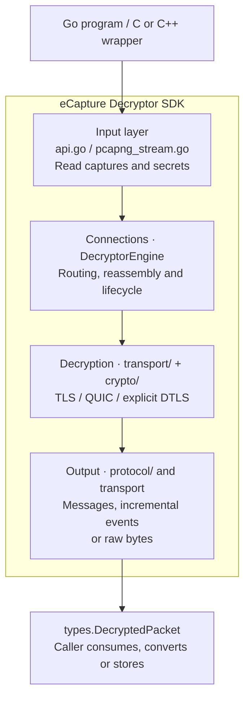
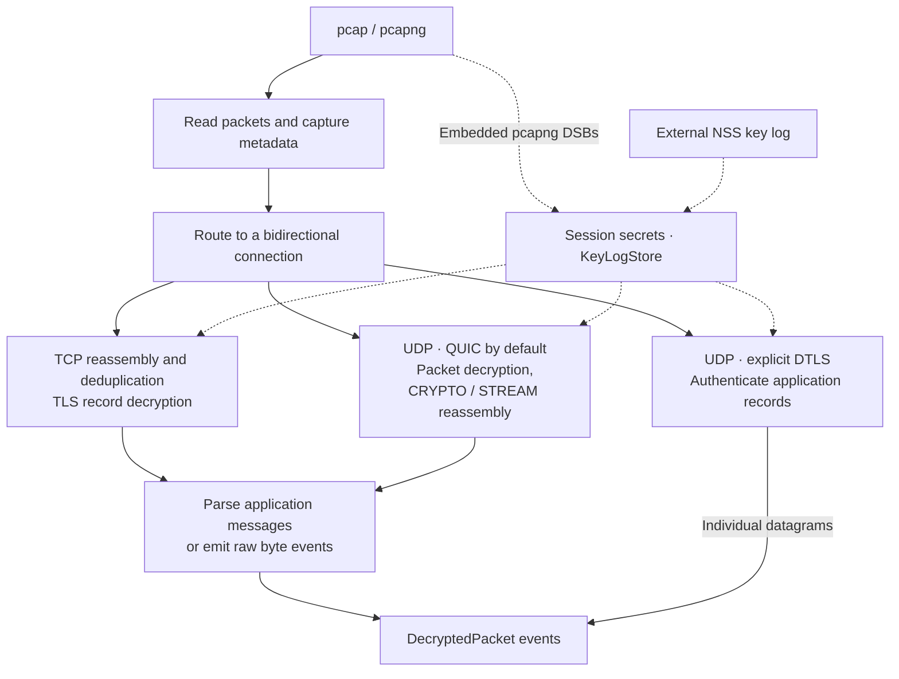

# eCapture Decryptor

Use **eCapture Decryptor v1.4.4** to turn a packet capture and its TLS session secrets into application messages in your own program. For example, a test runner can use the SDK to check that a recorded HTTP response carries the expected status. The Go package and module are named `ecapture_decryptor`. [Run the Go quick start](/decryptor/en/quick-start/) · [v1.4.4 release](https://github.com/gojue/ecapture_decryptor/releases/tag/v1.4.4)

## Choose an integration {#integrations}

| What your program has | Where to start | What your program receives |
| --- | --- | --- |
| A completed pcapng with embedded TLS secrets, or a pcap and a matching NSS key log | [Go file API](/decryptor/en/quick-start/) | A channel of decoded events that your program drains |
| A producer writing pcapng blocks to a pipe or connection | [Go streaming API](/decryptor/en/streaming/) | A callback for each decoded event, including events unlocked by a later secrets block |
| A C or C++ executable that processes capture files | [Native library](/decryptor/en/native/) | A JSON file containing event metadata |

In Go, the result type is `*types.DecryptedPacket`. A single HTTP response can span many network packets. By default, the SDK emits the reconstructed message. With incremental HTTP events enabled, it can emit headers, body chunks and the end of the message separately. Choose the representation that your consumer expects. [API and event fields](/decryptor/en/api/) · [Protocols and output modes](/decryptor/en/protocols/)

## Layered architecture {#architecture}

The SDK reads, tracks connections, decrypts and parses inside the caller's process. This diagram follows the main processing path through the source responsibilities in v1.4.4. All layers run in the same process.

`crypto/` supplies `KeyLogStore`, handshake and record decryption, and cipher suites; `types/` defines shared options, interfaces and events. `capi/` wraps the Go file API in a C ABI. JSON/HAR export belongs to the relevant wrapper, example or caller. [Input and connection management](https://github.com/gojue/ecapture_decryptor/blob/v1.4.4/api.go) · [Decryptor factory](https://github.com/gojue/ecapture_decryptor/blob/v1.4.4/factory.go) · [Shared interfaces](https://github.com/gojue/ecapture_decryptor/blob/v1.4.4/types/interfaces.go)

## From capture data to events {#data-flow}

Captures carry network data and capture metadata; key logs supply session secrets. These paths meet at decryption. Classic pcap uses external keys, while pcapng can also carry keys in DSBs. The external log below applies to Go reader/file entry points accepting that argument; the pcapng callback API reads keys only from DSBs in its input.

Many network packets can form one application message, and one message can produce several incremental events. Output event counts therefore differ from capture packet counts. Events also carry process and handshake metadata when the capture provides it. [Event data model](/decryptor/en/api/#data-model) · [Output modes](/decryptor/en/protocols/#options) · [Late-key flow](/decryptor/en/streaming/#lifecycle)

## Where eCapture and eCaptureQ fit {#ecosystem}

eCapture v2.12.0 embeds this SDK version. Its packet-based text mode sends packets and secrets to the SDK on the capture host. You can also save a pcapng with eCapture and read that file later in a separate Go or C program. Reading a saved test capture requires neither a running collector nor eBPF privileges. [Collector capture modes](/en/3-capture-modes/) · [Pinned SDK dependency](https://github.com/gojue/ecapture/blob/v2.12.0/go.mod)

eCaptureQ subscribes to the collector's `ecapture.v2` WebSocket and can export a native pcapng file. Pass that file to the SDK. A WebSocket message still has its Protobuf envelope, which the SDK's pcapng reader cannot consume directly. [eCaptureQ native file export](/q/en/interface/#native)

## Distribution and licensing {#distribution}

The project publishes Go source and prebuilt C libraries under separate terms. Its license includes an exception for integration in eCapture and works derived from eCapture. For a standalone application, consult the source or binary terms for the form you use. The binary license covers non-commercial linking and specifies attribution and commercial licensing requirements. [Source license and eCapture exception](https://github.com/gojue/ecapture_decryptor/blob/v1.4.4/LICENSE) · [Binary license](https://github.com/gojue/ecapture_decryptor/blob/v1.4.4/LICENSE-BINARY)
