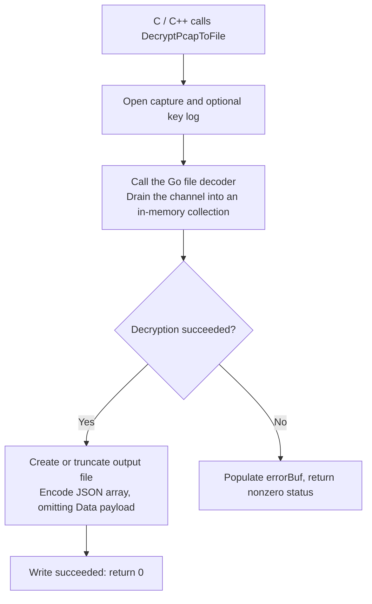

# C and C++ integration

Link the prebuilt library when your program needs to read a saved capture and write the decoded event metadata to JSON. The release contains a generated C header, a static archive and a shared library. Building the example against that archive requires a C toolchain. The Go toolchain is unnecessary.

## Select a binary package {#package}

Choose the v1.4.4 archive for the system **running your application**, and download its matching `.tar.gz.sha256` file. The architecture of the machine that recorded the traffic can differ.

| Target | Package name |
| --- | --- |
| Linux x86-64 | `ecapture_decryptor-v1.4.4-linux-amd64.tar.gz` |
| Linux arm64 | `ecapture_decryptor-v1.4.4-linux-arm64.tar.gz` |
| macOS Apple silicon | `ecapture_decryptor-v1.4.4-darwin-arm64.tar.gz` |

For example, on Apple silicon, run these commands in the download directory. On Linux substitute your archive name and use `sha256sum -c` to verify it. [Official packages and checksums](https://github.com/gojue/ecapture_decryptor/releases/tag/v1.4.4)

```sh
decryptor_sdk=ecapture_decryptor-v1.4.4-darwin-arm64
shasum -a 256 -c "$decryptor_sdk.tar.gz.sha256" &&
  tar -xzf "$decryptor_sdk.tar.gz"
```

## Decode a fixture {#example}

Save this as `decode.c` alongside the extracted directory. Pass a capture file and a **new** output filename, since the SDK creates or truncates the JSON file. The test capture contains its own TLS secrets, so the second argument to `DecryptPcapToFile` is `NULL`. For a separate NSS key log, pass its path there instead.

```c
#include <stdio.h>
#include "libecapture_decryptor.h"

int main(int argc, char **argv) {
    if (argc != 3) {
        fprintf(stderr, "usage: %s capture.pcapng result.json\n", argv[0]);
        return 1;
    }
    char error[512] = {0};
    char format[] = "json";
    int status = DecryptPcapToFile(argv[1], NULL, argv[2], format, error, sizeof error);
    if (status != 0) {
        fprintf(stderr, "decode failed (%d): %s\n", status, error);
    }
    return status;
}
```

Choose the link command for your platform. Set `decryptor_sdk` to your extracted directory and pass the static archive by path so the linker selects it even when the shared library is in the same directory. C++ callers can include the same header. [Upstream build settings](https://github.com/gojue/ecapture_decryptor/blob/v1.4.4/examples/c_demo/Makefile)

```sh
# macOS
cc -I"$decryptor_sdk/include" decode.c "$decryptor_sdk/lib/libecapture_decryptor.a" \
  -lpthread -framework CoreFoundation -framework Security -o decode

# Linux
cc -I"$decryptor_sdk/include" decode.c "$decryptor_sdk/lib/libecapture_decryptor.a" \
  -lpthread -lresolv -o decode
```

Save the upstream HTTP/1.0 loopback fixture in the working directory, then run the example. The resulting JSON array contains a request and a response. Inspect their `protocol`, `direction` and `dataLength` fields. The C wrapper uses Go's standard JSON encoding of the packet struct, which omits the `Data` payload. To inspect the HTTP bytes themselves, read `packet.Data` in the [Go quick start](/decryptor/en/quick-start/). [Download the test capture](https://raw.githubusercontent.com/gojue/ecapture_decryptor/v1.4.4/test/testdata/http10_ecapture_dsb.pcapng)

```sh
./decode http10_ecapture_dsb.pcapng result.json
```

## Input, output and errors {#contracts}

On success, `DecryptPcapToFile` collects the full result before creating the output file. The diagram shows the decryption success and failure branches. File creation or JSON encoding failures also return a nonzero status and populate the error buffer.



This JSON array is written after decryption completes. To process payload bytes event by event, use the [Go event API](../api/#events); for continuous input, use the [Go streaming callback](../streaming/#consumer).

| Entry point | Behavior in v1.4.4 |
| --- | --- |
| `DecryptPcapToFile` | Accepts a capture path, an optional key log and the literal format `"json"`. Holds events in memory, then writes one JSON array. A return value of zero means the call completed. Read the caller-owned error buffer on failure. |
| `DecryptPcapStreamToFile` | Reads capture bytes from standard input through EOF and then writes one JSON array. A positive `maxPackets` limits the number of decoded events retained for output. Zero retains all events. For DSB-only input, feed pcapng. |
| `GetVersion` / `FreeString` | The version string is allocated by the library. Release it with `FreeString` after use. |

In this release, the device-name entry point `DecryptLiveTrafficToFile` returns a session handle but its worker reports that live device capture requires a pcap integration. Feed an existing producer to standard input for a bounded recording, or use the [Go streaming callback](/decryptor/en/streaming/) to process each event as it arrives. [C wrapper implementation](https://github.com/gojue/ecapture_decryptor/blob/v1.4.4/capi/main.go) · [Packet JSON fields](https://github.com/gojue/ecapture_decryptor/blob/v1.4.4/types/packet.go)
