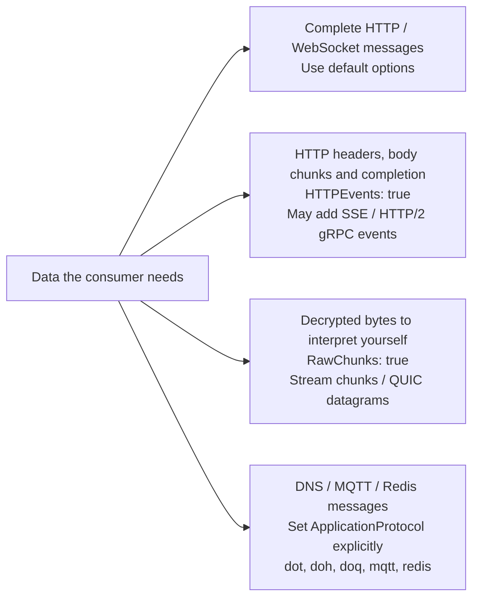

# Protocol support and options

The default Go decoder reconstructs application messages from TLS over TCP and QUIC over UDP. To select another representation, pass `types.DecryptOptions` to `WithOptions` on a file configuration or to `DecryptPcapngStreamWithOptions`. See the [Go entry points](../api/#entry-points).

## Protocol and output matrix {#matrix}

| Captured traffic | Go option | What one event contains |
| --- | --- | --- |
| HTTP/1.0, HTTP/1.1 or HTTP/2 over TLS, HTTP/3 over QUIC | Default | A reconstructed HTTP request or response. For multiplexed HTTP, use `stream_id` to correlate directions. |
| WebSocket over HTTP/1.1 Upgrade | Default | A WebSocket message reassembled across fragments, or a ping, pong or close. Negotiated `permessage-deflate` is supported. Decoding requires the Upgrade exchange. |
| HTTP headers, streaming bodies, SSE | `HTTPEvents: true` | Independent `headers`, `body_chunk`, `trailers` and terminal events. SSE responses may also emit `sse` records. |
| gRPC over HTTP/2 | `HTTPEvents: true` | An additional `grpc_message` for each complete framed message. `Data` contains message bytes, including an empty message when valid. Inspect `grpc_status` on response trailers or end. Protobuf decoding requires the application's schema. |
| DNS over TLS, HTTPS or QUIC | `ApplicationProtocol: "dot"`, `"doh"` or `"doq"` | `Protocol="dns"`. A successful `message` contains a complete DNS wire message in `Data`. `Metadata["transport"]` identifies the DNS transport. Non-2xx DoH responses produce `http_error` with a status. DoQ resets produce `reset`. |
| MQTT 3.1.1 over TLS/TCP | `ApplicationProtocol: "mqtt"` | One complete control packet, including its header. For PUBLISH, `payload_offset` and `payload_length` locate the application bytes. Requires a captured CONNECT. |
| Redis over TLS/TCP | `ApplicationProtocol: "redis"` | One complete fixed-length RESP2/RESP3 value. `kind` distinguishes request, response, push and attribute. Use `request_id` on paired commands and replies. |
| TLS/TCP or QUIC/UDP application bytes | `RawChunks: true` | Authenticated TLS bytes or QUIC STREAM chunks with direction and offset. QUIC DATAGRAM frames produce individual `datagram` events, including empty datagrams. |
| DTLS 1.2 over UDP | `UDPProtocol: "dtls"` | One `datagram` per authenticated application record. `epoch` and `sequence` identify the record. Datagrams may arrive out of order. |

TCP and QUIC integration tests exercise these modes with recorded traffic. The fixture notes identify the protocol versions and peer implementations for each trace. [TCP fixtures](https://github.com/gojue/ecapture_decryptor/blob/v1.4.4/test/fixtures/http_tcp_capture/README.md) · [QUIC fixtures](https://github.com/gojue/ecapture_decryptor/blob/v1.4.4/test/fixtures/http3_capture/README.md) · [DTLS tests](https://github.com/gojue/ecapture_decryptor/blob/v1.4.4/transport/dtls_decryptor_test.go)

## Choose compatible options {#options}

Choose the data granularity your consumer needs before selecting an output mode. These are the four choices for TLS/QUIC. DTLS datagram output and the layering rules for `TLSUpgrade` are described below.

- Select one output mode per call. `RawChunks` and `HTTPEvents` are mutually exclusive. An explicit `ApplicationProtocol` conflicts with either and with a nonzero `MaxDecodedBodyBytes`. It selects the parser for that call, independent of port.
- With `HTTPEvents`, `MaxDecodedBodyBytes: 8 << 20` enables single-layer gzip expansion up to 8 MiB per message. A zero limit preserves content-coded body bytes. When gzip expansion is active, offsets count decoded bytes. Other encodings pass through.
- `TLSUpgrade` selects a TCP negotiation before the target TLS session. Supported values are `smtp`, `imap`, `pop3`, `ldap`, `postgres`, `mysql`, `connect` and `https-connect`. For example, combine `TLSUpgrade: "smtp"` with `RawChunks: true` to receive negotiation and upgraded application bytes. The negotiation event has `Protocol="starttls"` and `kind="negotiation_chunk"`. Use `tls_depth` to distinguish layers. `https-connect` supports one nested TLS session and requires keys for each encrypted layer.
- UDP defaults to QUIC. Selecting `UDPProtocol: "dtls"` applies to all UDP connections in the call. It can coexist with `RawChunks`, which leaves DTLS datagram semantics intact and changes TCP output. DTLS conflicts with explicit application protocols, TLS upgrades, HTTP events and a nonzero gzip limit. `TLSUpgrade` also conflicts with DoQ.

`types.DecryptOptions.Validate()` checks these combinations before input is consumed. [Option validation](https://github.com/gojue/ecapture_decryptor/blob/v1.4.4/types/options.go) · [TLS negotiation tests](https://github.com/gojue/ecapture_decryptor/blob/v1.4.4/transport/tls_upgrade_test.go)

## Reassembly and capture limits {#limits}

**HTTP events.** Group events by `ConnectionID()`, `stream_id` and `Direction`. HTTP/1 assigns each request a number starting at 1 and reuses it for the matching response. HTTP/2 and HTTP/3 use the wire stream ID. Concatenate only `body_chunk` to reconstruct a body. SSE and gRPC events expose records from those same bytes. `end` finishes the message direction, `reset` indicates cancellation and `partial` marks incomplete data. WebSocket Upgrade requires default complete-message mode. [HTTP event and WebSocket integration tests](https://github.com/gojue/ecapture_decryptor/blob/v1.4.4/raw_stream_test.go)

**Raw streams.** Use the offset for each connection and direction, also grouping by `stream_id` for QUIC or `tls_depth` for an upgraded TLS connection. TLS `stream_end` marks the end of capture input. On QUIC, a normal end requires contiguous bytes up to FIN. On `stream_reset` the offset is the final size and earlier bytes can be missing. Datagrams have message boundaries and carry no stream offset. [Raw stream tests](https://github.com/gojue/ecapture_decryptor/blob/v1.4.4/raw_stream_test.go)

**Handshakes and protocol versions.** Capture the handshake and supply matching session secrets. TCP supports TLS 1.2 and 1.3. QUIC v1/v2 requires a bidirectional capture including the client Initial. HTTP/3 with dynamic QPACK also depends on the encoder instructions used by the captured headers. DTLS requires the client and server hellos, a matching `CLIENT_RANDOM` master secret and one of two ECDHE-RSA AES-GCM suites (128 or 256 bits). [QUIC integration tests](https://github.com/gojue/ecapture_decryptor/blob/v1.4.4/quic_integration_test.go) · [Version and suite coverage](https://github.com/gojue/ecapture_decryptor/blob/v1.4.4/docs/API.md)

**Application boundaries.** The DNS decoders support ordinary queries. DoH accepts DNS requests and responses over HTTP/1.x, HTTP/2 or HTTP/3. DoQ requires 1-RTT, one query and response per client-initiated bidirectional stream, and a DNS ID of zero. MQTT coverage is limited to 3.1.1 over TLS/TCP. Redis accepts bulk-string array commands and fixed-length values. Inline commands and streamed RESP values are outside this parser. [DNS tests](https://github.com/gojue/ecapture_decryptor/blob/v1.4.4/protocol/protocol_dns_test.go) · [MQTT tests](https://github.com/gojue/ecapture_decryptor/blob/v1.4.4/protocol/protocol_mqtt_test.go) · [Redis tests](https://github.com/gojue/ecapture_decryptor/blob/v1.4.4/protocol/protocol_redis_test.go)
