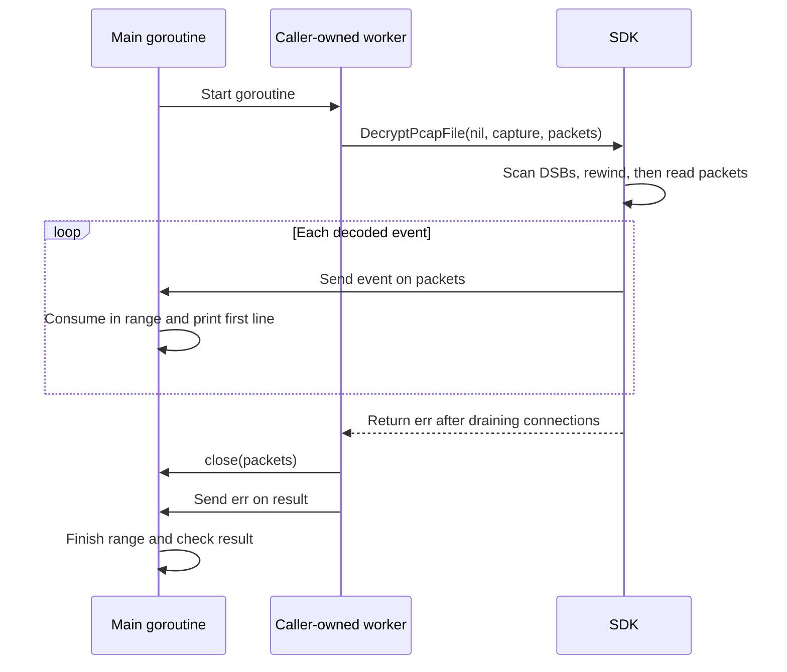

# Go quick start

Read one HTTP/1.0 request and its response from a TLS 1.3 capture. The v1.4.4 test fixture contains traffic between two loopback test processes and embeds their session secrets in pcapng Decryption Secrets Blocks (DSBs). You can run the example offline once the Go modules are installed. [Test fixture and expected messages](https://github.com/gojue/ecapture_decryptor/blob/v1.4.4/http_tcp_integration_test.go)

## Set up an independent Go module {#setup}

Use Go 1.26.0 or newer and a shell on Linux or macOS. The Go file decoder runs in user space with `CGO_ENABLED=0`. This example needs neither a running collector nor libpcap headers. The SDK pins a gopacket fork. Go applies `replace` directives from the main module, so add the same replacement to the application before fetching v1.4.4. [SDK module definition](https://github.com/gojue/ecapture_decryptor/blob/v1.4.4/go.mod)

```sh
mkdir decrypt-demo
cd decrypt-demo
go mod init example.org/decrypt-demo
go mod edit -replace=github.com/google/gopacket@v1.1.19=github.com/cfc4n/gopacket@v1.1.20
go get github.com/gojue/ecapture_decryptor@v1.4.4

sdk_dir=$(go list -m -f '{{.Dir}}' github.com/gojue/ecapture_decryptor)
cp "$sdk_dir/test/testdata/http10_ecapture_dsb.pcapng" sample.pcapng
```

The final command copies the 11 KB test capture from the downloaded module. The capture already contains the matching keys. [Loopback fixture description](https://github.com/gojue/ecapture_decryptor/blob/v1.4.4/test/fixtures/http_tcp_capture/README.md)

## Decode the capture {#decode}

Save the following program as `main.go` in `decrypt-demo`. Passing `nil` as the first argument to `DecryptPcapFile` selects the keys embedded in the file. The program drains the output channel while the SDK reads the capture. The goroutine that calls the SDK closes the channel once the call returns, including on error.

```go
package main

import (
	"bytes"
	"fmt"
	"log"
	"os"

	sdk "github.com/gojue/ecapture_decryptor"
	"github.com/gojue/ecapture_decryptor/types"
)

func run() error {
	capture, err := os.Open("sample.pcapng")
	if err != nil {
		return err
	}
	defer capture.Close()

	packets := make(chan *types.DecryptedPacket)
	result := make(chan error, 1)
	go func() {
		err := sdk.DecryptPcapFile(nil, capture, packets)
		close(packets)
		result <- err
	}()

	for packet := range packets {
		firstLine, _, _ := bytes.Cut(packet.Data, []byte("\r\n"))
		fmt.Printf("%s %s | %s\n", packet.Protocol, packet.Direction, firstLine)
	}
	return <-result
}

func main() {
	if err := run(); err != nil {
		log.Fatal(err)
	}
}
```

The two goroutines cooperate in this order. Consume the channel while decryption runs: waiting until the SDK returns would block the first send on this unbuffered channel.



The two-pass read applies to the seekable pcapng file in this example. Non-seekable input is read in arrival order. The caller closes the output channel after either success or failure. [File entry points and lifecycle](../api/#entry-points)

## Verify the exchange {#verify}

```sh
go run .
```

Look for these two lines among the SDK diagnostics.

```text
http/1.0 request | GET /legacy HTTP/1.0
http/1.0 response | HTTP/1.0 200 OK
```

Here `http/1.0` describes the decoded application message. The fixture negotiated TLS 1.3. `packet.Data` contains the complete message, including the test response body `legacy-response`. The program prints only its first line. [Fixture assertions](https://github.com/gojue/ecapture_decryptor/blob/v1.4.4/http_tcp_integration_test.go)

For a capture you are authorized to analyze with a separate NSS key log, pass its open file as the first argument. Any embedded DSBs are also loaded. For a producer that sends pcapng blocks over time, use the [streaming guide](/decryptor/en/streaming/).
