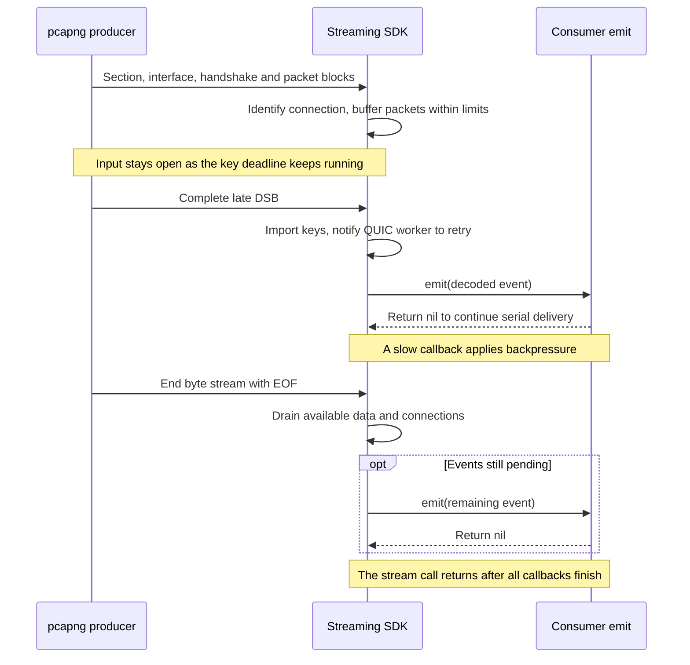

# Streaming integration

Use `DecryptPcapngStream` when your application supplies a continuing stream of pcapng bytes and needs decoded messages before the producer finishes. The same API accepts the authorized loopback capture in the [Go quick start](/decryptor/en/quick-start/) as a finite replay. [Streaming implementation](https://github.com/gojue/ecapture_decryptor/blob/v1.4.4/pcapng_stream.go)

## Choose the input and key source {#input}

| Source supplied by your application | Entry point | How the SDK reads keys |
| --- | --- | --- |
| Growing pcapng in a pipe or connection | `DecryptPcapngStream(ctx, input, emit)` or `DecryptPcapngStreamWithOptions(ctx, input, emit, options)` | Reads TLS secrets from DSBs as blocks arrive. The callback API takes no separate key-log argument. |
| pcap or pcapng reader plus a separate, finite NSS key log | `DecryptLiveTraffic(keylog, input, packets)` | Reads the supplied key log to EOF before processing capture bytes. In pcapng it also imports DSBs. The caller supplies the input and drains the output channel. |
| Completed capture | `DecryptPcapFile(keylog, input, packets)` | Takes an optional key log. For seekable pcapng files it pre-scans DSBs, rewinds, then processes packets. |

The callback API expects pcapng bytes starting with a Section Header Block. A producer may split a block across writes. If the producer sends eCapture Protobuf v2 messages, unwrap the native `PCAPNG` events and concatenate their `pcapng.data` bytes in order within one connection. A `TEXT` event already contains collector output. [Go entry points](https://github.com/gojue/ecapture_decryptor/blob/v1.4.4/api.go) · [Collector wire format](https://github.com/gojue/ecapture/blob/v2.12.0/protobuf/PROTOCOLS.md)

## Connect a consumer {#consumer}

`Forward` sends each complete application message to the caller's output channel. Supply an `io.ReadCloser` whose `Close` interrupts a blocked `Read`, such as an `io.PipeReader` or a network connection. A regular file returns EOF at its current end, so use a pipe or connection if more capture blocks will arrive later.

```go
package replay

import (
	"context"
	"io"

	sdk "github.com/gojue/ecapture_decryptor"
	"github.com/gojue/ecapture_decryptor/types"
)

func Forward(ctx context.Context, input io.ReadCloser, out chan<- *types.DecryptedPacket) error {
	return sdk.DecryptPcapngStreamWithOptions(ctx, input, func(p *types.DecryptedPacket) error {
		select {
		case out <- p:
			return nil
		case <-ctx.Done():
			return ctx.Err()
		}
	}, types.DecryptOptions{})
}
```

Run the downstream consumer concurrently with `Forward`. The SDK calls `emit` serially and waits for outstanding callbacks before returning. A full output channel applies backpressure. The `select` lets cancellation interrupt a blocked send. If the downstream consumer stops early, it should cancel `ctx`. The caller owns `out` and can close it after `Forward` returns and all senders have finished.

On normal completion, have the producer close its pipe writer or finish its network stream to deliver EOF. Release the input on the caller's side after the call. The SDK closes `input` itself on cancellation or callback failure to interrupt a pending read. A blocking operation inside `emit` must also support cancellation. `OnDiagnostic` callbacks may run concurrently and should return promptly. [Callback and cancellation contract](https://github.com/gojue/ecapture_decryptor/blob/v1.4.4/docs/API.md)

## Late keys and resource limits {#lifecycle}

A DSB can arrive after the packets it unlocks, even after the final network packet. Keep the input open long enough to deliver that block. With an open stream, buffered QUIC packets can be retried when matching keys arrive. Normal EOF drains available packets and worker output.

This example follows a QUIC connection missing application traffic secrets, with keys arriving before its deadline. The key notification triggers retries without another network packet or EOF.



If the context is canceled or `emit` fails, the SDK closes the input to interrupt reading, then waits for workers and callbacks to exit. An already blocked callback must respond to cancellation itself. A connection key timeout differs from cancellation of the whole stream call; see [return values](#completion). [Key notifications](https://github.com/gojue/ecapture_decryptor/blob/v1.4.4/crypto/keylog.go) · [QUIC retries](https://github.com/gojue/ecapture_decryptor/blob/v1.4.4/transport/quic_decryptor.go)

In v1.4.4, streaming calls retain keys while workers still reference them. After the last reference is released, earlier workers still discovering their connection identity can temporarily protect those keys. A later connection that reuses a retired identity needs its keys supplied again. Unassociated keys have a retention window measured from first import, using `IdleTimeout`. File calls retain loaded keys for the duration of the call.

| Go option | Default | What to account for |
| --- | --- | --- |
| `KeyWaitTimeout` | 30 seconds | Bounds waits for necessary key material. For QUIC identity discovery the deadline starts at worker creation. Further packets, Retry and repeated DSBs do not extend it. |
| `IdleTimeout` | 5 minutes | Reclaims idle connections and sets the retention window for unassociated stream keys. Uses elapsed time. |
| `MaxConnections` | 1,024 | Counts active workers and those still draining. A slot becomes available after cleanup. |

Pass these limits in `types.DecryptOptions` to `DecryptPcapngStreamWithOptions`. `DecryptPcapngStream` uses the defaults. [Lifecycle changes in v1.4.4](https://github.com/gojue/ecapture_decryptor/blob/v1.4.4/CHANGELOG.md) · [Resource options](https://github.com/gojue/ecapture_decryptor/blob/v1.4.4/types/options.go)

## Interpret the return value {#completion}

A connection diagnostic can arrive while other connections continue. **Once the call returns, this input session has ended.** A `nil` result means normal EOF and successful draining. Inspect each applicable error independently with `errors.Is`. Joined errors can carry several of these markers.

| Marker in the root package | Meaning |
| --- | --- |
| `ErrConnectionFailures` | One or more connections failed. The SDK reports a summary when the call ends. Previously delivered events remain available to the consumer. |
| `ErrPipelineFailure` | The input or key import failed. A key-log capacity error also matches `crypto.ErrKeyLogResourceLimit` in the SDK's `crypto` package. |
| `ErrStreamCanceled` | The caller canceled the context or its deadline elapsed. The result also retains `context.Canceled` or `context.DeadlineExceeded`. |
| `ErrEmitFailed` | The callback returned an error. The SDK stops reading, drains producers and preserves the callback error for `errors.Is` or `errors.As`. |

Check `ErrStreamCanceled` to identify caller cancellation. A connection timeout can also contain `context.DeadlineExceeded`. Argument and option validation can return an error before streaming begins. See the [Go API reference](/decryptor/en/api/) for option types and [protocols](/decryptor/en/protocols/) for the events delivered by each mode.
