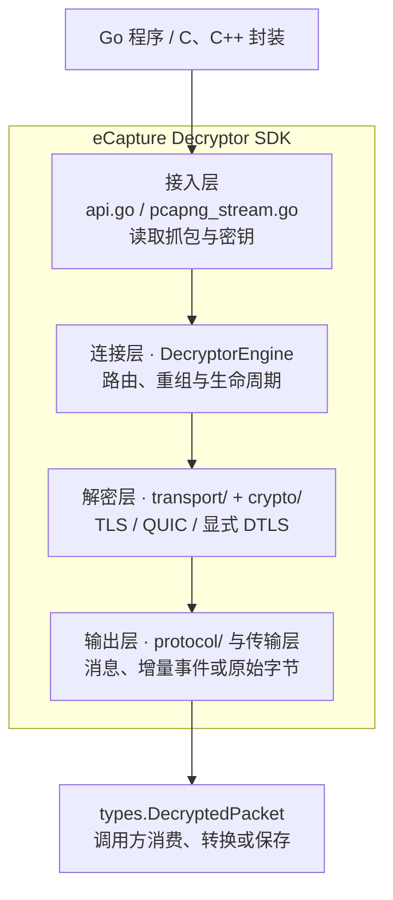
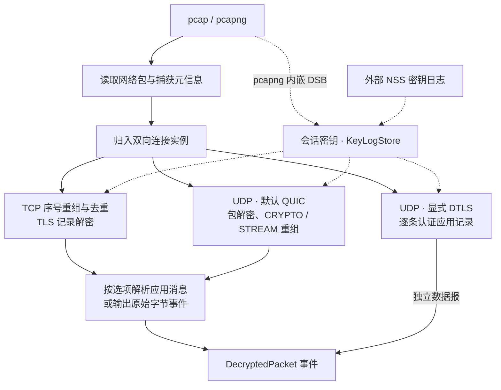

# eCapture Decryptor

**eCapture Decryptor v1.4.4** 可以在你的程序中读取抓包和对应的 TLS 会话密钥，还原应用层消息。例如，集成测试可以用它检查一次已录制的 HTTP 请求是否收到了预期的响应。Go 根包和模块名均使用 `ecapture_decryptor`。[运行第一个 Go 示例](/decryptor/zh/quick-start/) · [v1.4.4 发布记录](https://github.com/gojue/ecapture_decryptor/releases/tag/v1.4.4)

## 选择集成方式 {#integrations}

| 你的程序已有的输入 | 从哪里开始 | 程序得到的结果 |
| --- | --- | --- |
| 内嵌 TLS 密钥的完整 pcapng，或 pcap 与配套的 NSS 密钥日志 | [Go 文件接口](/decryptor/zh/quick-start/) | 从通道中逐条读取解码事件 |
| 持续向管道或连接写入 pcapng 数据块的生产端 | [Go 流式接口](/decryptor/zh/streaming/) | 通过回调接收事件，密钥块晚到时也能交付之前等待解密的消息 |
| 需要处理抓包文件的 C 或 C++ 程序 | [原生库集成](/decryptor/zh/native/) | 包含事件元数据的 JSON 文件 |

Go 接口返回 `*types.DecryptedPacket`。一条 HTTP 响应可能横跨多个网络包，SDK 默认交付重组后的消息。启用增量 HTTP 事件后，调用方可以分别收到消息头、正文片段和结束事件。请按下游处理逻辑选择输出形式。[API 与事件字段](/decryptor/zh/api/) · [协议与输出模式](/decryptor/zh/protocols/)

## 分层架构 {#architecture}

SDK 在调用方进程内完成读取、连接管理、解密和解析。下图沿主处理链展示 v1.4.4 的源码职责，各层都在同一进程中运行。

`crypto/` 提供 `KeyLogStore`、握手与记录解密、密码套件支持；`types/` 定义各层共享的选项、接口和事件。`capi/` 将 Go 文件接口包装为 C ABI；JSON/HAR 等导出由相应封装、示例或调用方完成。[接入与连接管理](https://github.com/gojue/ecapture_decryptor/blob/v1.4.4/api.go) · [解密器工厂](https://github.com/gojue/ecapture_decryptor/blob/v1.4.4/factory.go) · [公共接口](https://github.com/gojue/ecapture_decryptor/blob/v1.4.4/types/interfaces.go)

## 数据如何变成事件 {#data-flow}

抓包携带网络数据与捕获元信息，密钥日志提供会话密钥。两路数据在解密阶段汇合：经典 pcap 使用外部密钥，pcapng 还可通过 DSB 提供密钥。图中的外部日志适用于接受该参数的 Go reader/file 入口；pcapng 回调入口仅从流中读取 DSB。

多个网络包可能合成一条应用消息，同一条消息也可能拆成多个增量事件，因此不要把输出事件数当成抓包数量。进程信息和握手元数据会随事件提供，前提是捕获中存在相应信息。[事件数据模型](/decryptor/zh/api/#data-model) · [输出模式](/decryptor/zh/protocols/#options) · [迟到密钥流程](/decryptor/zh/streaming/#lifecycle)

## 与 eCapture、eCaptureQ 配合使用 {#ecosystem}

eCapture v2.12.0 内置了这一版本的 SDK。使用基于网络包的文本模式时，采集器在采集主机上把包和密钥交给 SDK。你也可以先用 eCapture 保存 pcapng，再交给单独的 Go 或 C 程序离线读取。分析已有测试抓包无需启动采集器，也无需 eBPF 权限。[采集模式](/zh/3-capture-modes/) · [采集器使用的 SDK 版本](https://github.com/gojue/ecapture/blob/v2.12.0/go.mod)

eCaptureQ 通过 `ecapture.v2` WebSocket 订阅采集器。若通过 Q 导出了原生 pcapng 文件，可以直接将文件交给 SDK。单条 WebSocket 消息仍带有 Protobuf 封装，不能直接作为 pcapng 输入。[eCaptureQ 原生文件导出](/q/zh/interface/#native)

## 分发与许可 {#distribution}

项目为 Go 源码和预编译 C 库分别规定了使用条件，并为 eCapture 及其衍生作品提供集成例外。独立应用应按使用形式查看相应条款。二进制许可列出了非商业链接、署名和商业授权要求。[源码许可与 eCapture 集成例外](https://github.com/gojue/ecapture_decryptor/blob/v1.4.4/LICENSE) · [二进制许可](https://github.com/gojue/ecapture_decryptor/blob/v1.4.4/LICENSE-BINARY)
