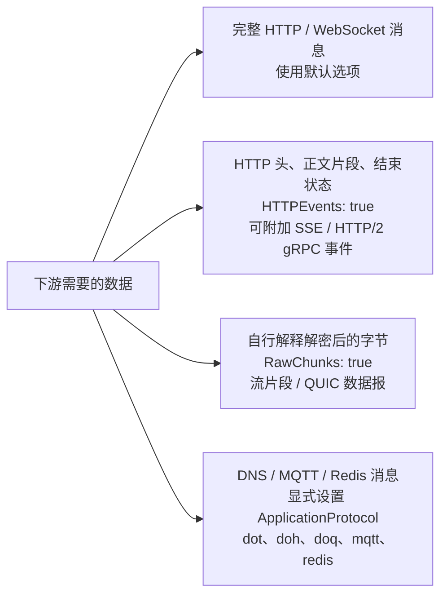

# 协议支持与选项

Go 解密器默认重组 TLS/TCP 和 QUIC/UDP 上的应用消息。需要改变输出形式时，将 `types.DecryptOptions` 传给文件配置的 `WithOptions` 方法，或传给 `DecryptPcapngStreamWithOptions`。[Go 入口说明](../api/#entry-points)

## 协议与输出对照表 {#matrix}

| 捕获到的流量 | Go 选项 | 单条事件的内容 |
| --- | --- | --- |
| TLS 上的 HTTP/1.0、HTTP/1.1、HTTP/2，或 QUIC 上的 HTTP/3 | 默认 | 一条重组后的 HTTP 请求或响应。多路复用时可用 `stream_id` 关联两个方向。 |
| 经 HTTP/1.1 Upgrade 的 WebSocket | 默认 | 一条跨分片重组的消息，或 ping、pong、close 控制帧。支持协商后的 `permessage-deflate`，需要捕获 Upgrade 握手。 |
| HTTP 头、流式正文、SSE | `HTTPEvents: true` | 分别交付 `headers`、`body_chunk`、`trailers` 和终止事件。SSE 响应还可能产生 `sse` 记录。 |
| HTTP/2 上的 gRPC | `HTTPEvents: true` | 每条成帧的消息会额外生成 `grpc_message`。`Data` 中是消息字节，合法消息也可以为空。可从响应 trailers 或 end 读取 `grpc_status`，解读 Protobuf 字段需要应用的 schema。 |
| DNS over TLS、HTTPS 或 QUIC | `ApplicationProtocol: "dot"`、`"doh"` 或 `"doq"` | `Protocol="dns"`，成功的 `message` 在 `Data` 中携带完整 DNS 线格式报文。`Metadata["transport"]` 表示 DNS 传输方式。DoH 的非 2xx 响应产生带状态码的 `http_error`，DoQ 流复位产生 `reset`。 |
| TLS/TCP 上的 MQTT 3.1.1 | `ApplicationProtocol: "mqtt"` | 一份含包头的完整控制包。对于 PUBLISH，用 `payload_offset` 和 `payload_length` 在包内定位业务载荷。需要捕获 CONNECT。 |
| TLS/TCP 上的 Redis | `ApplicationProtocol: "redis"` | 一个完整的定长 RESP2/RESP3 值。按 `kind` 区分请求、响应、推送和 attribute。已配对的命令和回复带 `request_id`。 |
| TLS/TCP 或 QUIC/UDP 的应用字节 | `RawChunks: true` | 通过认证的 TLS 字节或 QUIC STREAM 片段，附方向与偏移。每个 QUIC DATAGRAM 单独产生一个 `datagram` 事件，空数据报也会保留。 |
| UDP 上的 DTLS 1.2 | `UDPProtocol: "dtls"` | 每条认证成功的应用记录产生一个 `datagram`，通过 `epoch` 与 `sequence` 标识记录。数据报可以乱序交付。 |

TCP 与 QUIC 集成测试使用捕获文件检验这些输出。夹具说明列出了每份捕获对应的协议版本和对端实现。[TCP 夹具](https://github.com/gojue/ecapture_decryptor/blob/v1.4.4/test/fixtures/http_tcp_capture/README.md) · [QUIC 夹具](https://github.com/gojue/ecapture_decryptor/blob/v1.4.4/test/fixtures/http3_capture/README.md) · [DTLS 测试](https://github.com/gojue/ecapture_decryptor/blob/v1.4.4/transport/dtls_decryptor_test.go)

## 组合选项 {#options}

先决定下游需要什么粒度的数据，再选择输出模式。下图列出 TLS/QUIC 的四种选择；DTLS 的独立数据报输出和 `TLSUpgrade` 的分层规则见下方说明。

- 每次调用选择一种输出模式。`RawChunks` 与 `HTTPEvents` 互斥。显式指定 `ApplicationProtocol` 时，不能同时启用两者中的任何一个，也不能设置非零的 `MaxDecodedBodyBytes`。所选解析器对该次调用生效，与端口无关。
- 启用 `HTTPEvents` 后，`MaxDecodedBodyBytes: 8 << 20` 会展开单层 gzip，每条消息的解压上限为 8 MiB。设为零时保留内容编码后的正文字节。启用 gzip 展开时偏移量按解压后的字节数计算，其他编码按原样交付。
- `TLSUpgrade` 指定目标 TLS 会话之前的 TCP 协商，允许 `smtp`、`imap`、`pop3`、`ldap`、`postgres`、`mysql`、`connect`、`https-connect`。例如，用 `TLSUpgrade: "smtp"` 搭配 `RawChunks: true` 可读取协商字节以及升级后的应用字节。协商事件带 `Protocol="starttls"` 与 `kind="negotiation_chunk"`，用 `tls_depth` 区分不同层。`https-connect` 支持一层内嵌 TLS，各加密层都需要各自的密钥。
- UDP 默认走 QUIC。`UDPProtocol: "dtls"` 对本次调用的全部 UDP 连接生效，可配合 `RawChunks` 使用，这时 DTLS 仍输出独立数据报，TCP 则改为输出原始片段。DTLS 与显式应用协议、TLS 升级、HTTP 增量事件和非零 gzip 上限互斥。`TLSUpgrade` 与 DoQ 也互斥。

`types.DecryptOptions.Validate()` 会在读取输入前检查这些组合。[选项校验](https://github.com/gojue/ecapture_decryptor/blob/v1.4.4/types/options.go) · [TLS 协商测试](https://github.com/gojue/ecapture_decryptor/blob/v1.4.4/transport/tls_upgrade_test.go)

## 重组语义与捕获条件 {#limits}

**HTTP 事件。** 用 `ConnectionID()`、`stream_id` 和 `Direction` 关联同一消息方向的事件。HTTP/1 从 1 起为请求编号，配对响应沿用相同编号。HTTP/2 与 HTTP/3 使用线上 stream ID。重建正文时只拼接 `body_chunk`。SSE 与 gRPC 事件交付从同一份字节中提取的记录。`end` 表示该方向正常结束，`reset` 表示取消，`partial` 表示数据不完整。WebSocket Upgrade 需要使用默认的完整消息模式。[HTTP 事件与 WebSocket 集成测试](https://github.com/gojue/ecapture_decryptor/blob/v1.4.4/raw_stream_test.go)

**原始流。** 按连接和方向累计偏移，QUIC 还需区分 `stream_id`，升级过的 TLS 连接还需区分 `tls_depth`。TLS 的 `stream_end` 表示捕获输入结束。QUIC 正常结束要求已连续收到截至 FIN 的全部字节。`stream_reset` 的偏移量表示最终大小，此前的字节仍可能有缺失。数据报保留消息边界，没有流偏移量。[原始流测试](https://github.com/gojue/ecapture_decryptor/blob/v1.4.4/raw_stream_test.go)

**握手与协议版本。** 捕获应覆盖握手，并提供与该会话匹配的密钥。TCP 支持 TLS 1.2 和 1.3。QUIC v1/v2 需要包含客户端 Initial 的双向捕获。若 HTTP/3 使用动态 QPACK，还需要相应头部依赖的编码器指令。DTLS 需要捕获客户端与服务端 Hello，提供匹配的 `CLIENT_RANDOM` 主密钥，套件限 ECDHE-RSA 的 AES-128-GCM 或 AES-256-GCM。[QUIC 集成测试](https://github.com/gojue/ecapture_decryptor/blob/v1.4.4/quic_integration_test.go) · [版本与套件范围](https://github.com/gojue/ecapture_decryptor/blob/v1.4.4/docs/API.md)

**应用协议范围。** DNS 解析器支持普通查询。DoH 可通过 HTTP/1.x、HTTP/2 或 HTTP/3 传送 DNS 请求与响应。DoQ 限 1-RTT，每条由客户端发起的双向流承载一次查询和响应，DNS ID 必须为零。MQTT 支持范围为 TLS/TCP 上的 3.1.1。Redis 支持以 bulk string 数组编码的命令和定长值，不支持 inline 命令与流式 RESP 值。[DNS 测试](https://github.com/gojue/ecapture_decryptor/blob/v1.4.4/protocol/protocol_dns_test.go) · [MQTT 测试](https://github.com/gojue/ecapture_decryptor/blob/v1.4.4/protocol/protocol_mqtt_test.go) · [Redis 测试](https://github.com/gojue/ecapture_decryptor/blob/v1.4.4/protocol/protocol_redis_test.go)
