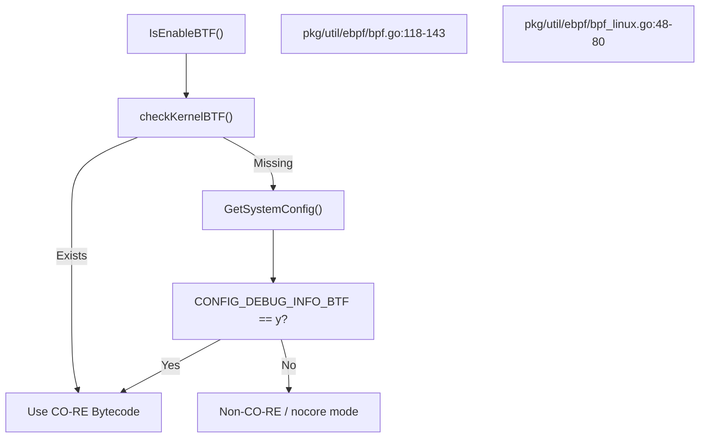
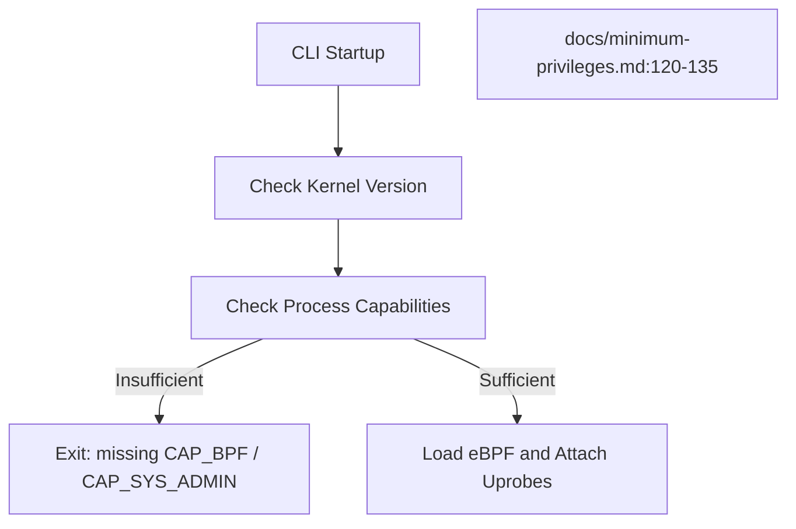

# Requirements and Installation

<details>
<summary>Relevant source files</summary>

The following files were used as context for generating this wiki page:

- [.github/ISSUE_TEMPLATE/bug_report.md](https://github.com/gojue/ecapture/blob/8c9caada/.github/ISSUE_TEMPLATE/bug_report.md)
- [SECURITY.md](https://github.com/gojue/ecapture/blob/8c9caada/SECURITY.md)
- [docs/README.md](https://github.com/gojue/ecapture/blob/8c9caada/docs/README.md)
- [docs/compilation.md](https://github.com/gojue/ecapture/blob/8c9caada/docs/compilation.md)
- [docs/defense-detection.md](https://github.com/gojue/ecapture/blob/8c9caada/docs/defense-detection.md)
- [docs/example-outputs.md](https://github.com/gojue/ecapture/blob/8c9caada/docs/example-outputs.md)
- [docs/minimum-privileges.md](https://github.com/gojue/ecapture/blob/8c9caada/docs/minimum-privileges.md)
- [docs/release-verification.md](https://github.com/gojue/ecapture/blob/8c9caada/docs/release-verification.md)
- [pkg/util/ebpf/bpf.go](https://github.com/gojue/ecapture/blob/8c9caada/pkg/util/ebpf/bpf.go)
- [pkg/util/ebpf/bpf_linux.go](https://github.com/gojue/ecapture/blob/8c9caada/pkg/util/ebpf/bpf_linux.go)
- [pkg/util/ebpf/bpf_test.go](https://github.com/gojue/ecapture/blob/8c9caada/pkg/util/ebpf/bpf_test.go)

</details>


## Purpose and Scope
This page defines the host environment requirements, kernel configurations, privilege requirements (root or Linux capabilities), and installation procedures required to run eCapture. It details the runtime dependencies for the three core TLS capture modules (`tls` for OpenSSL/BoringSSL, `gotls` for Go native TLS, and `gnutls` for GnuTLS) and explains the interface prerequisites specific to `pcapng` capture modes.

Sources: [docs/compilation.md:26-37](https://github.com/gojue/ecapture/blob/8c9caada/docs/compilation.md#L26-L37), [docs/minimum-privileges.md:5-34](https://github.com/gojue/ecapture/blob/8c9caada/docs/minimum-privileges.md#L5-L34)

---

## Supported Platforms and Architectures
eCapture relies on eBPF uprobes, tracepoints, and Traffic Control (TC) hooks, which impose strict kernel version and architecture constraints.

| Architecture | Minimum Linux Kernel | Android Support | Notes |
|---|---|---|---|
| `x86_64` | Kernel 4.18+ | Supported | Full CO-RE and non-CO-RE support |
| `aarch64` (`arm64`) | Kernel 5.5+ | Supported | Requires Android 12+ typically |
| `LoongArch64` (`loong64`) | Kernel 6.6+ | Not Supported | Requires LLVM 18+ and specific sysroots |

Sources: [docs/compilation.md:28-30](https://github.com/gojue/ecapture/blob/8c9caada/docs/compilation.md#L28-L30), [docs/minimum-privileges.md:124-126](https://github.com/gojue/ecapture/blob/8c9caada/docs/minimum-privileges.md#L124-L126)

---

## Kernel and BTF Requirements
eCapture operates in two bytecode modes: CO-RE (Compile Once – Run Everywhere) using BPF Type Format (BTF) and non-CO-RE (fallback compilation using local kernel headers).

### BTF Detection Logic
At startup, eCapture checks whether kernel BTF is enabled by inspecting `/sys/kernel/btf/vmlinux` or scanning fallback directories for kernel ELF images via `checkKernelBTF()` [pkg/util/ebpf/bpf.go:89-98](https://github.com/gojue/ecapture/blob/8c9caada/pkg/util/ebpf/bpf.go#L89-L98). If BTF is absent, it falls back to inspecting kernel configuration files (`/proc/config.gz`, `/boot/config-*`) for `CONFIG_DEBUG_INFO_BTF` [pkg/util/ebpf/bpf_linux.go:28-31](https://github.com/gojue/ecapture/blob/8c9caada/pkg/util/ebpf/bpf_linux.go#L28-L31).


Sources: [pkg/util/ebpf/bpf.go:89-143](https://github.com/gojue/ecapture/blob/8c9caada/pkg/util/ebpf/bpf.go#L89-L143), [pkg/util/ebpf/bpf_linux.go:48-80](https://github.com/gojue/ecapture/blob/8c9caada/pkg/util/ebpf/bpf_linux.go#L48-L80)

### Mandatory Kernel Configurations
Regardless of BTF, the target kernel must have the following options enabled, verified by `IsEnableBPF()` [pkg/util/ebpf/bpf.go:146-170](https://github.com/gojue/ecapture/blob/8c9caada/pkg/util/ebpf/bpf.go#L146-L170):
* `CONFIG_BPF`
* `CONFIG_UPROBES`
* `CONFIG_ARCH_SUPPORTS_UPROBES`

Sources: [pkg/util/ebpf/bpf.go:30-44](https://github.com/gojue/ecapture/blob/8c9caada/pkg/util/ebpf/bpf.go#L30-L44), [pkg/util/ebpf/bpf.go:146-170](https://github.com/gojue/ecapture/blob/8c9caada/pkg/util/ebpf/bpf.go#L146-L170)

---

## Privileges, Root, and Capabilities
Loading eBPF programs, attaching uprobes to shared libraries, and binding TC classifiers require elevated privileges.

### Linux Capabilities Breakdown
Starting with Linux 5.8, eBPF privileges were unbundled from `CAP_SYS_ADMIN`. The required capabilities vary by kernel version and operating mode:

| eCapture Mode | Kernel >= 5.8 Required Capabilities | Kernel < 5.8 Required Capabilities |
|---|---|---|
| `text` | `CAP_BPF` + `CAP_PERFMON` + `CAP_SYS_PTRACE` | `CAP_SYS_ADMIN` |
| `keylog` | `CAP_BPF` + `CAP_PERFMON` + `CAP_SYS_PTRACE` | `CAP_SYS_ADMIN` |
| `pcapng` | `CAP_BPF` + `CAP_PERFMON` + `CAP_NET_ADMIN` + `CAP_SYS_PTRACE` | `CAP_SYS_ADMIN` + `CAP_NET_ADMIN` |

Sources: [docs/minimum-privileges.md:5-34](https://github.com/gojue/ecapture/blob/8c9caada/docs/minimum-privileges.md#L5-L34)

### Capability Assignment via `setcap`
To run eCapture without full `root` or `sudo` privileges, assign extended attributes to the binary:

```bash
# For kernel >= 5.8 in pcapng mode
sudo setcap 'cap_bpf,cap_perfmon,cap_net_admin,cap_sys_ptrace=eip' /usr/local/bin/ecapture

# Verify capabilities
getcap /usr/local/bin/ecapture
```

Sources: [docs/minimum-privileges.md:45-73](https://github.com/gojue/ecapture/blob/8c9caada/docs/minimum-privileges.md#L45-L73)


Sources: [docs/minimum-privileges.md:120-135](https://github.com/gojue/ecapture/blob/8c9caada/docs/minimum-privileges.md#L120-L135)

---

## pcapng Interface Prerequisites
When operating in `pcapng` mode (`-m pcap` or `-m pcapng`), eCapture intercepts network packets via Traffic Control (TC) ebpf hooks on a specified network interface (`-i <interface>`) and injects decrypted payload secrets into a `Decryption Secrets Block (DSB)`.

* **Prerequisites**:
  * `CAP_NET_ADMIN` capability (or running as root).
  * A valid, active network interface name (e.g., `eth0`, `ens160`, `wlan0`).
  * When running inside Docker, `--net=host` is mandatory to access and attach TC filters to host network interfaces.

Sources: [docs/minimum-privileges.md:13-34](https://github.com/gojue/ecapture/blob/8c9caada/docs/minimum-privileges.md#L13-L34), [docs/minimum-privileges.md:113-118](https://github.com/gojue/ecapture/blob/8c9caada/docs/minimum-privileges.md#L113-L118)

---

## Module-Specific Prerequisites
The three core TLS capture modules target different underlying runtimes and shared library implementations:

1. **`tls` (OpenSSL and BoringSSL)**:
   * Targets dynamic libraries: `libssl.so` (OpenSSL 1.0.x, 1.1.x, 3.0+) or BoringSSL (Android / Chrome / custom binaries).
   * Requires symbol resolution for functions such as `SSL_do_handshake`, `SSL_read`, and `SSL_write`.
2. **`gotls` (Go Native TLS)**:
   * Targets compiled Go binaries using `crypto/tls`.
   * Requires DWARF symbol tables or function table offsets to locate internal Go TLS structures (e.g., `crypto/tls.(*Conn).read` / `write`).
3. **`gnutls` (GnuTLS)**:
   * Targets applications linked against `libgnutls.so`.
   * Requires compatible version bindings for GnuTLS handshake and record-layer state functions.

Sources: [docs/compilation.md:132-154](https://github.com/gojue/ecapture/blob/8c9caada/docs/compilation.md#L132-L154)

---

## Installation and Compilation from Source
eCapture is built using Go and Clang/LLVM.

### Build Toolchain Prerequisites
* **Golang**: 1.26.0 or newer
* **Clang / LLVM**: 9.0 or newer (LLVM 18 required for LoongArch64)
* **CMake**: 3.18.4 or newer
* **Libelf**: `libelf-dev`

### Compilation Commands
```bash
git clone --recurse-submodules https://github.com/gojue/ecapture.git
cd ecapture
make
bin/ecapture
```

Sources: [docs/compilation.md:33-67](https://github.com/gojue/ecapture/blob/8c9caada/docs/compilation.md#L33-L67)