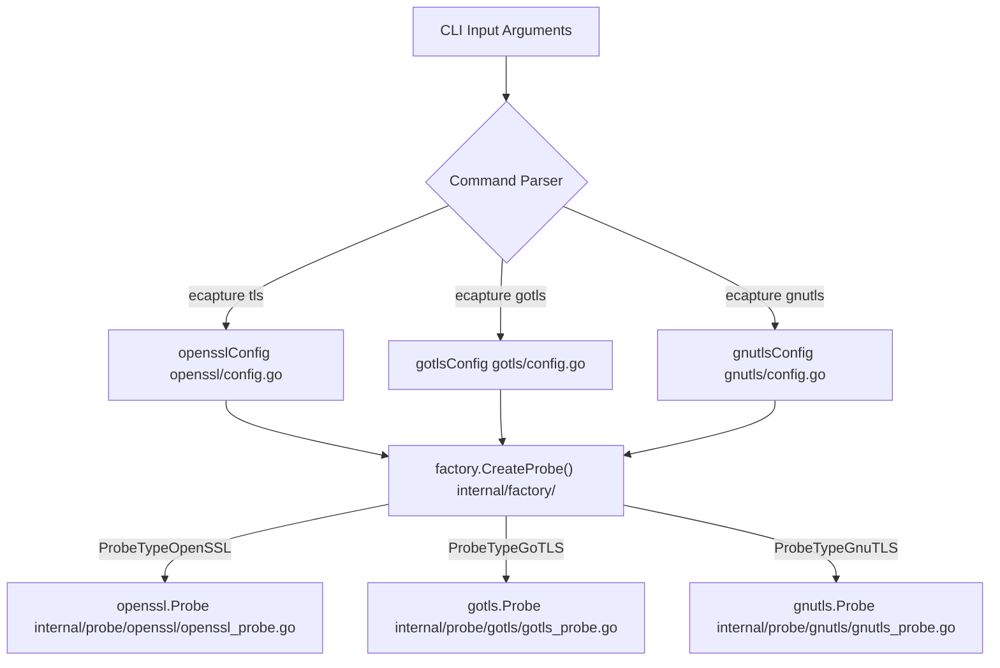
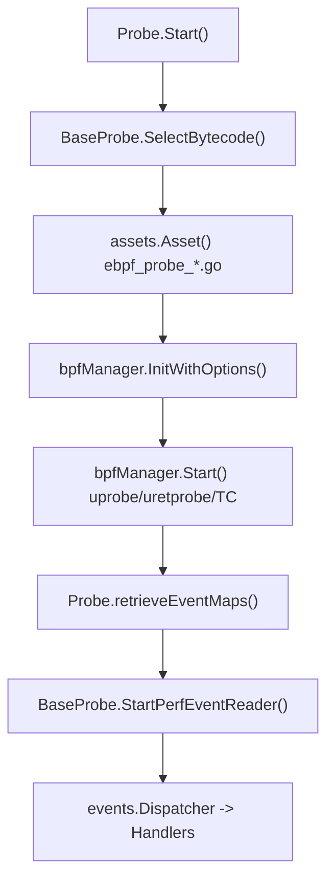

# Choosing a TLS Probe

Relevant source files

The following files were used as context for generating this wiki page:

- [AGENTS.md](https://github.com/gojue/ecapture/blob/8c9caada/AGENTS.md)
- [cli/cmd/gnutls.go](https://github.com/gojue/ecapture/blob/8c9caada/cli/cmd/gnutls.go)
- [cli/cmd/gotls.go](https://github.com/gojue/ecapture/blob/8c9caada/cli/cmd/gotls.go)
- [cli/cmd/nss.go](https://github.com/gojue/ecapture/blob/8c9caada/cli/cmd/nss.go)
- [cli/cmd/root.go](https://github.com/gojue/ecapture/blob/8c9caada/cli/cmd/root.go)
- [cli/cmd/tls.go](https://github.com/gojue/ecapture/blob/8c9caada/cli/cmd/tls.go)
- [docs/agent/architecture.md](https://github.com/gojue/ecapture/blob/8c9caada/docs/agent/architecture.md)
- [docs/agent/build-test.md](https://github.com/gojue/ecapture/blob/8c9caada/docs/agent/build-test.md)
- [docs/agent/probe-development.md](https://github.com/gojue/ecapture/blob/8c9caada/docs/agent/probe-development.md)
- [internal/probe/gnutls/gnutls_probe.go](https://github.com/gojue/ecapture/blob/8c9caada/internal/probe/gnutls/gnutls_probe.go)
- [internal/probe/gotls/gotls_probe.go](https://github.com/gojue/ecapture/blob/8c9caada/internal/probe/gotls/gotls_probe.go)
- [internal/probe/openssl/openssl_probe.go](https://github.com/gojue/ecapture/blob/8c9caada/internal/probe/openssl/openssl_probe.go)

## Purpose and Scope

This page provides a technical comparison and decision framework for selecting the appropriate eCapture TLS probe (`tls`, `gotls`, or `gnutls`). Choosing the correct probe depends on the target application's underlying cryptographic library or language runtime, the operating system platform (Linux vs. Android), and the desired output representation (`text`, `keylog`, or `pcap`/`pcapng`).

Sources: [cli/cmd/tls.go:29-48](https://github.com/gojue/ecapture/blob/8c9caada/cli/cmd/tls.go#L29-L48), [cli/cmd/gotls.go:28-43](https://github.com/gojue/ecapture/blob/8c9caada/cli/cmd/gotls.go#L28-L43), [cli/cmd/gnutls.go:33-49](https://github.com/gojue/ecapture/blob/8c9caada/cli/cmd/gnutls.go#L33-L49)

---

## Core TLS Probes Decision Matrix

The following decision table maps application runtimes and binary characteristics to the correct eCapture CLI subcommand, internal probe factory type, and bytecode targets.

| Target Application Stack | Target Library / Binary | Supported Versions | Supported Platforms | CLI Command | Factory Probe Type | Primary eBPF Source |
| :--- | :--- | :--- | :--- | :--- | :--- | :--- |
| **OpenSSL / BoringSSL** | `libssl.so`, static binaries, Android Conscrypt (`libssl.so`) | OpenSSL 1.0.x, 1.1.x, 3.x+; BoringSSL | Linux (`x86_64`, `aarch64`, `loongarch64`), Android (`x86_64`, `aarch64`) | `ecapture tls` | `factory.ProbeTypeOpenSSL` | `kern/openssl*_kern.c`, `kern/boringssl*_kern.c` |
| **Go Native TLS** | Go compiled ELF binaries (`crypto/tls`) | Go 1.17 – Go 1.26+ (v1/v2 ABI discovery) | Linux (`x86_64`, `aarch64`, `loongarch64`), Android (`x86_64`, `aarch64`) | `ecapture gotls` | `factory.ProbeTypeGoTLS` | `kern/gotls_kern.c` |
| **GnuTLS** | `libgnutls.so` | GnuTLS 3.6.x, 3.7.x, 3.8.x | Linux (`x86_64`, `aarch64`, `loongarch64`), Android Termux (`aarch64`) | `ecapture gnutls` | `factory.ProbeTypeGnuTLS` | `kern/gnutls_*_kern.c` |

Sources: [cli/cmd/tls.go:29-61](https://github.com/gojue/ecapture/blob/8c9caada/cli/cmd/tls.go#L29-L61), [cli/cmd/gotls.go:28-55](https://github.com/gojue/ecapture/blob/8c9caada/cli/cmd/gotls.go#L28-L55), [cli/cmd/gnutls.go:33-60](https://github.com/gojue/ecapture/blob/8c9caada/cli/cmd/gnutls.go#L33-L60), [docs/agent/architecture.md:37-49](https://github.com/gojue/ecapture/blob/8c9caada/docs/agent/architecture.md#L37-L49)

---

## Probe Selection Architecture

The diagram below bridges natural language selection criteria to concrete code entities across the CLI parser, factory registry, and probe initialization packages.

Sources: [cli/cmd/tls.go:26-48](https://github.com/gojue/ecapture/blob/8c9caada/cli/cmd/tls.go#L26-L48), [cli/cmd/gotls.go:26-43](https://github.com/gojue/ecapture/blob/8c9caada/cli/cmd/gotls.go#L26-L43), [cli/cmd/gnutls.go:29-49](https://github.com/gojue/ecapture/blob/8c9caada/cli/cmd/gnutls.go#L29-L49), [internal/probe/openssl/openssl_probe.go:44-69](https://github.com/gojue/ecapture/blob/8c9caada/internal/probe/openssl/openssl_probe.go#L44-L69), [internal/probe/gotls/gotls_probe.go:52-78](https://github.com/gojue/ecapture/blob/8c9caada/internal/probe/gotls/gotls_probe.go#L52-L78), [internal/probe/gnutls/gnutls_probe.go:39-55](https://github.com/gojue/ecapture/blob/8c9caada/internal/probe/gnutls/gnutls_probe.go#L39-L55)

---

## Initialization and Data Flow

Once a probe command is invoked, eCapture validates the configuration, selects matching bytecode assets via `BaseProbe`, and binds eBPF maps to event decoders.

Sources: [internal/probe/openssl/openssl_probe.go:102-163](https://github.com/gojue/ecapture/blob/8c9caada/internal/probe/openssl/openssl_probe.go#L102-L163), [internal/probe/gotls/gotls_probe.go:107-157](https://github.com/gojue/ecapture/blob/8c9caada/internal/probe/gotls/gotls_probe.go#L107-L157), [internal/probe/gnutls/gnutls_probe.go:80-117](https://github.com/gojue/ecapture/blob/8c9caada/internal/probe/gnutls/gnutls_probe.go#L80-L117), [docs/agent/architecture.md:7-26](https://github.com/gojue/ecapture/blob/8c9caada/docs/agent/architecture.md#L7-L26)

---

## Detailed Probe Profiles

### 1. OpenSSL and BoringSSL Probe (`tls`)
* **Use Case**: Applications dynamically or statically linked against OpenSSL (such as Nginx, cURL, Python, Node.js, PHP) or Google BoringSSL (Android system apps, Chrome).
* **Key Flags**: `--libssl` to specify custom library paths [cli/cmd/tls.go:51](https://github.com/gojue/ecapture/blob/8c9caada/cli/cmd/tls.go#L51); `--ssl_version` to target specific ABI offsets [cli/cmd/tls.go:57](https://github.com/gojue/ecapture/blob/8c9caada/cli/cmd/tls.go#L57); `-m text|keylog|pcap` for output modes [cli/cmd/tls.go:53](https://github.com/gojue/ecapture/blob/8c9caada/cli/cmd/tls.go#L53).
* **Implementation Details**: Attaches uprobes to SSL write/read entry/exit functions (e.g., `SSL_write`, `SSL_read`) or BoringSSL internal master secret logging functions.

Sources: [cli/cmd/tls.go:29-61](https://github.com/gojue/ecapture/blob/8c9caada/cli/cmd/tls.go#L29-L61), [internal/probe/openssl/openssl_probe.go:44-69](https://github.com/gojue/ecapture/blob/8c9caada/internal/probe/openssl/openssl_probe.go#L44-L69)

### 2. Go Native TLS Probe (`gotls`)
* **Use Case**: Compiled Go binaries using Go's standard library `crypto/tls` package. Does not depend on OpenSSL.
* **Key Flags**: `--elfpath` (`-e`) to point to the target Go binary for symbol and register ABI discovery [cli/cmd/gotls.go:46](https://github.com/gojue/ecapture/blob/8c9caada/cli/cmd/gotls.go#L46); `--perf-reorder` for high-throughput ordering [cli/cmd/gotls.go:47](https://github.com/gojue/ecapture/blob/8c9caada/cli/cmd/gotls.go#L47).
* **Implementation Details**: Resolves Go internal function symbols such as `crypto/tls.(*Conn).Read`, `crypto/tls.(*Conn).writeRecordLocked`, and `crypto/tls.(*Config).writeKeyLog` [internal/probe/gotls/gotls_probe.go:47-50](https://github.com/gojue/ecapture/blob/8c9caada/internal/probe/gotls/gotls_probe.go#L47-L50).

Sources: [cli/cmd/gotls.go:28-55](https://github.com/gojue/ecapture/blob/8c9caada/cli/cmd/gotls.go#L28-L55), [internal/probe/gotls/gotls_probe.go:46-68](https://github.com/gojue/ecapture/blob/8c9caada/internal/probe/gotls/gotls_probe.go#L46-L68)

### 3. GnuTLS Probe (`gnutls`)
* **Use Case**: Applications compiled against the GnuTLS library (common in enterprise Linux distributions and Termux on Android).
* **Key Flags**: `--gnutls` to specify `libgnutls.so` path [cli/cmd/gnutls.go:52](https://github.com/gojue/ecapture/blob/8c9caada/cli/cmd/gnutls.go#L52); `--ssl_version` for GnuTLS version mapping [cli/cmd/gnutls.go:57](https://github.com/gojue/ecapture/blob/8c9caada/cli/cmd/gnutls.go#L57).
* **Implementation Details**: Attaches uprobes to `gnutls_record_send` and `gnutls_record_recv` functions within `libgnutls.so` [internal/probe/gnutls/gnutls_probe.go:211-212](https://github.com/gojue/ecapture/blob/8c9caada/internal/probe/gnutls/gnutls_probe.go#L211-L212).

Sources: [cli/cmd/gnutls.go:33-60](https://github.com/gojue/ecapture/blob/8c9caada/cli/cmd/gnutls.go#L33-L60), [internal/probe/gnutls/gnutls_probe.go:39-55](https://github.com/gojue/ecapture/blob/8c9caada/internal/probe/gnutls/gnutls_probe.go#L39-L55)