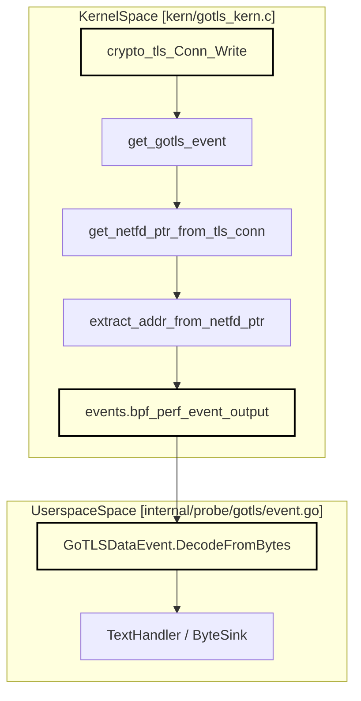
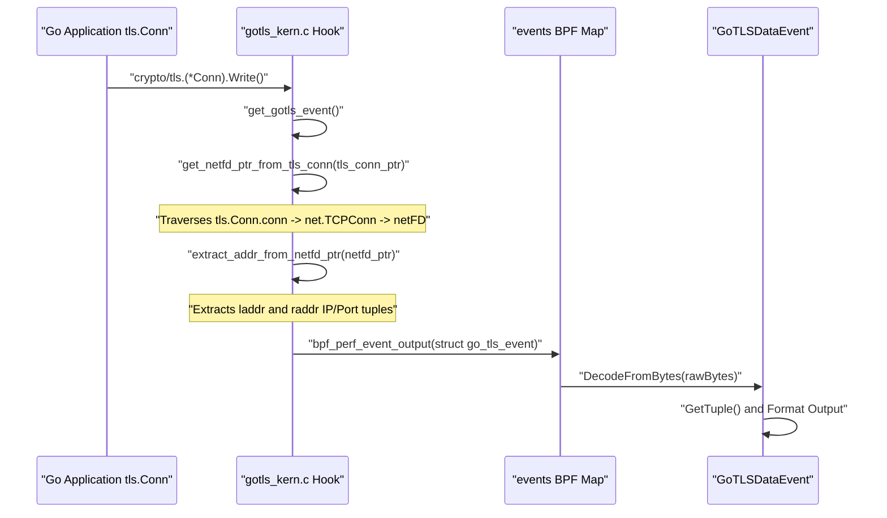

# First GoTLS Capture

<details>
<summary>Relevant source files</summary>

The following files were used as context for generating this wiki page:

- [internal/probe/gotls/event.go](https://github.com/gojue/ecapture/blob/8c9caada/internal/probe/gotls/event.go)
- [internal/probe/gotls/event_test.go](https://github.com/gojue/ecapture/blob/8c9caada/internal/probe/gotls/event_test.go)
- [kern/go_argument.h](https://github.com/gojue/ecapture/blob/8c9caada/kern/go_argument.h)
- [kern/gotls_kern.c](https://github.com/gojue/ecapture/blob/8c9caada/kern/gotls_kern.c)
- [kern/include/openssl_masterkey_common.h](https://github.com/gojue/ecapture/blob/8c9caada/kern/include/openssl_masterkey_common.h)
- [kern/include/tls_constants.h](https://github.com/gojue/ecapture/blob/8c9caada/kern/include/tls_constants.h)
- [test/e2e/README.md](https://github.com/gojue/ecapture/blob/8c9caada/test/e2e/README.md)
- [test/e2e/fixtures/pcapng_check/main.go](https://github.com/gojue/ecapture/blob/8c9caada/test/e2e/fixtures/pcapng_check/main.go)
- [test/e2e/lib/testlib.sh](https://github.com/gojue/ecapture/blob/8c9caada/test/e2e/lib/testlib.sh)
- [test/e2e/linux/common.sh](https://github.com/gojue/ecapture/blob/8c9caada/test/e2e/linux/common.sh)
- [test/e2e/linux/gnutls_test.sh](https://github.com/gojue/ecapture/blob/8c9caada/test/e2e/linux/gnutls_test.sh)
- [test/e2e/linux/gotls_test.sh](https://github.com/gojue/ecapture/blob/8c9caada/test/e2e/linux/gotls_test.sh)
- [test/e2e/linux/tls_test.sh](https://github.com/gojue/ecapture/blob/8c9caada/test/e2e/linux/tls_test.sh)

</details>


## Purpose and Scope

This page provides a verified end-to-end guide for capturing TLS traffic from Go native binaries using eCapture's `gotls` module in text mode. Unlike OpenSSL or GnuTLS—which rely on dynamic shared libraries (`libssl.so` or `libgnutls.so`)—Go applications statically link their own TLS stack (`crypto/tls`) and use custom calling conventions and internal data structures. 

This guide covers target binary selection, required CLI flags (`--elfpath`, `-m text`, `--eventaddr`, `--logaddr`), the expected event payload structure, and transitions to keylog and pcapng workflows [test/e2e/linux/gotls_test.sh:53-129](https://github.com/gojue/ecapture/blob/8c9caada/test/e2e/linux/gotls_test.sh#L53-L129).

Sources: [test/e2e/linux/gotls_test.sh:53-129](https://github.com/gojue/ecapture/blob/8c9caada/test/e2e/linux/gotls_test.sh#L53-L129)

---

## Target Binary Preparation and Prerequisites

Before invoking the `gotls` probe, ensure your target Go application meets the following criteria:
1. **ELF Binary Path**: eCapture requires access to the Go binary's ELF file via `--elfpath` or target Process ID (`--pid`) to resolve symbol tables and function offsets for `crypto/tls.(*Conn).Read` and `crypto/tls.(*Conn).Write`.
2. **Symbol Tables**: Stripped binaries lacking Go symbol tables (`go.itab` or function names) may require symbol restoration or pointing to an unstripped compilation artifact.
3. **Kernel & Privileges**: Requires Linux kernel 4.18+ (x86_64) or 5.5+ (ARM64) with BTF support, running with root privileges (`sudo`) [test/e2e/linux/common.sh:30-47](https://github.com/gojue/ecapture/blob/8c9caada/test/e2e/linux/common.sh#L30-L47).

Sources: [test/e2e/linux/common.sh:30-47](https://github.com/gojue/ecapture/blob/8c9caada/test/e2e/linux/common.sh#L30-L47), [test/e2e/linux/gotls_test.sh:53-70](https://github.com/gojue/ecapture/blob/8c9caada/test/e2e/linux/gotls_test.sh#L53-L70)

---

## Verified End-to-End GoTLS Text-Mode Command

To capture plaintext events from a Go HTTPS client or server in text mode, execute the following verified command [test/e2e/linux/gotls_test.sh:57-70](https://github.com/gojue/ecapture/blob/8c9caada/test/e2e/linux/gotls_test.sh#L57-L70):

```bash
sudo ./bin/ecapture gotls \
    --elfpath /path/to/go_https_client \
    --model text \
    --eventaddr ./gotls_events.log \
    --logaddr ./gotls_operational.log
```

### Flag Reference
- `gotls`: Selects the Go native TLS capture module.
- `--elfpath`: Specifies the path to the compiled Go executable containing `crypto/tls` symbols [test/e2e/linux/gotls_test.sh:57](https://github.com/gojue/ecapture/blob/8c9caada/test/e2e/linux/gotls_test.sh#L57).
- `-m text` (or `--model text`): Selects text representation, streaming decoded plaintext records to the designated output [test/e2e/linux/gotls_test.sh:57](https://github.com/gojue/ecapture/blob/8c9caada/test/e2e/linux/gotls_test.sh#L57).
- `--eventaddr`: Routes captured plaintext data events to a file, stdout, or network sink [test/e2e/linux/gotls_test.sh:57](https://github.com/gojue/ecapture/blob/8c9caada/test/e2e/linux/gotls_test.sh#L57).
- `--logaddr`: Directs operational lifecycle logs (initialization, attachment status, errors) separately from event payloads, ensuring output isolation [test/e2e/linux/gotls_test.sh:57](https://github.com/gojue/ecapture/blob/8c9caada/test/e2e/linux/gotls_test.sh#L57).

Sources: [test/e2e/linux/gotls_test.sh:57-70](https://github.com/gojue/ecapture/blob/8c9caada/test/e2e/linux/gotls_test.sh#L57-L70)

---

## Expected Event Structure and Output

When a Go application performs a TLS read or write, the eBPF kernel probes capture the raw buffer, resolve the underlying file descriptor (`fd`), source/destination IP addresses, and ports from `net.netFD` structures, and push a `go_tls_event` struct to userspace [kern/gotls_kern.c:33-50](https://github.com/gojue/ecapture/blob/8c9caada/kern/gotls_kern.c#L33-L50), [kern/gotls_kern.c:110-187](https://github.com/gojue/ecapture/blob/8c9caada/kern/gotls_kern.c#L110-L187).

### Example Output Record
```json
{
  "timestamp": 1711900000000000000,
  "pid": 1234,
  "tid": 1235,
  "dataLen": 79,
  "eventType": 0,
  "fd": 7,
  "srcIP": "127.0.0.1",
  "srcPort": 54321,
  "dstIP": "127.0.0.1",
  "dstPort": 8443,
  "ipVersion": 4,
  "comm": "go_https_client",
  "data": "GET /e2e HTTP/1.1\r\nHost: 127.0.0.1:8443\r\nUser-Agent: Go-http-client/1.1\r\n\r\n",
  "tuple": "127.0.0.1:54321-127.0.0.1:8443"
}
```

Sources: [kern/gotls_kern.c:33-50](https://github.com/gojue/ecapture/blob/8c9caada/kern/gotls_kern.c#L33-L50), [internal/probe/gotls/event.go:54-74](https://github.com/gojue/ecapture/blob/8c9caada/internal/probe/gotls/event.go#L54-L74)

---

## Architecture and Data Flow

The following diagram illustrates how GoTLS interception bridges kernel-space eBPF probes with userspace decoding components:

Title: "GoTLS Kernel-to-Userspace Data Flow"

Sources: [kern/gotls_kern.c:33-187](https://github.com/gojue/ecapture/blob/8c9caada/kern/gotls_kern.c#L33-L187), [internal/probe/gotls/event.go:77-153](https://github.com/gojue/ecapture/blob/8c9caada/internal/probe/gotls/event.go#L77-L153)

---

## Execution Control Flow

The sequence below details how the kernel probe inspects Go's internal `tls.Conn` object layout to extract connection tuples and plaintext payloads:

Title: "GoTLS Connection and Address Extraction Sequence"

Sources: [kern/gotls_kern.c:110-187](https://github.com/gojue/ecapture/blob/8c9caada/kern/gotls_kern.c#L110-L187), [internal/probe/gotls/event.go:77-153](https://github.com/gojue/ecapture/blob/8c9caada/internal/probe/gotls/event.go#L77-L153)

---

## Transition to Keylog and pcapng Workflows

Once you have verified text-mode capture, you can switch representation models using the `-m` flag without altering target setup:

1. **Keylog Mode (`-m keylog`)**: Extracts TLS master secrets or traffic secrets and writes them in NSS Key Log format. This allows a separate packet capture (`tcpdump` or `tshark`) to decrypt traffic offline [test/e2e/linux/gotls_test.sh:72-108](https://github.com/gojue/ecapture/blob/8c9caada/test/e2e/linux/gotls_test.sh#L72-L108).
2. **pcapng Mode (`-m pcapng`)**: Automatically combines packet capture on a specified interface (`--ifname lo`) with captured TLS secrets, embedding them into a `pcapng` file with a TLS Decryption Secrets Block (DSB) [test/e2e/linux/gotls_test.sh:110-129](https://github.com/gojue/ecapture/blob/8c9caada/test/e2e/linux/gotls_test.sh#L110-L129).

Sources: [test/e2e/linux/gotls_test.sh:72-129](https://github.com/gojue/ecapture/blob/8c9caada/test/e2e/linux/gotls_test.sh#L72-L129), [test/e2e/README.md:30-38](https://github.com/gojue/ecapture/blob/8c9caada/test/e2e/README.md#L30-L38)