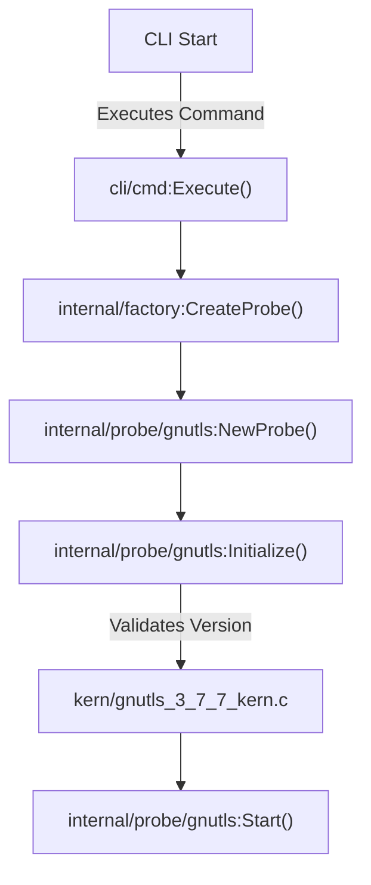
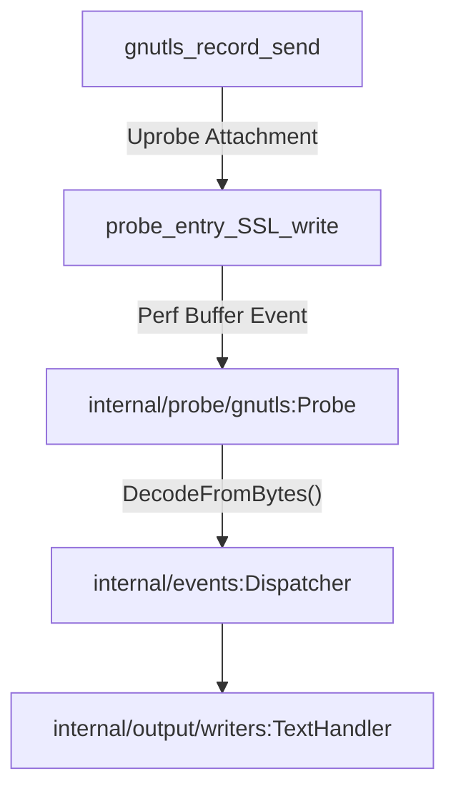
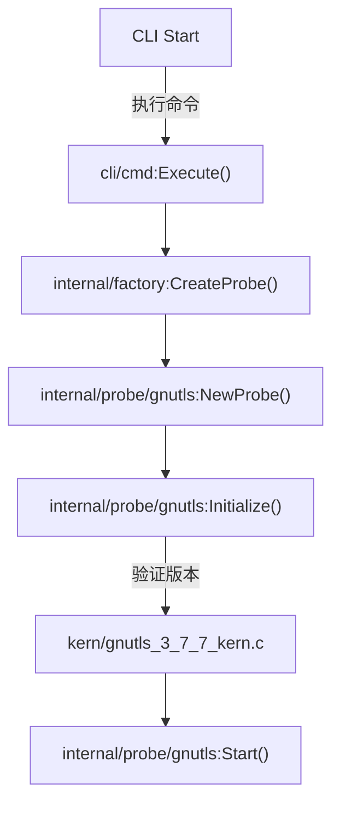
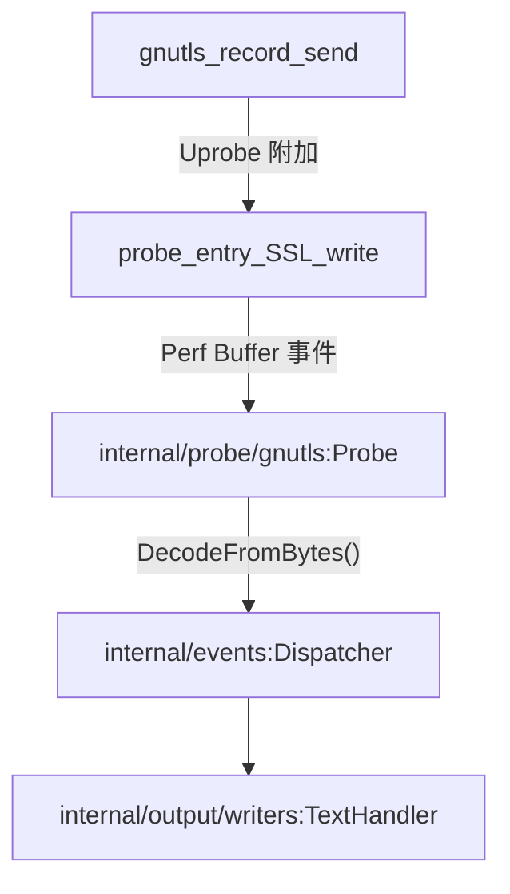

# First GnuTLS Capture

<details>
<summary>Relevant source files</summary>

The following files were used as context for generating this wiki page:

- [AGENTS.md](https://github.com/gojue/ecapture/blob/8c9caada/AGENTS.md)
- [docs/agent/architecture.md](https://github.com/gojue/ecapture/blob/8c9caada/docs/agent/architecture.md)
- [docs/agent/build-test.md](https://github.com/gojue/ecapture/blob/8c9caada/docs/agent/build-test.md)
- [docs/agent/probe-development.md](https://github.com/gojue/ecapture/blob/8c9caada/docs/agent/probe-development.md)
- [internal/probe/gnutls/gnutls_probe.go](https://github.com/gojue/ecapture/blob/8c9caada/internal/probe/gnutls/gnutls_probe.go)
- [internal/probe/gnutls/gnutls_probe_test.go](https://github.com/gojue/ecapture/blob/8c9caada/internal/probe/gnutls/gnutls_probe_test.go)
- [kern/gnutls_3_6_12_kern.c](https://github.com/gojue/ecapture/blob/8c9caada/kern/gnutls_3_6_12_kern.c)
- [kern/gnutls_3_7_0_kern.c](https://github.com/gojue/ecapture/blob/8c9caada/kern/gnutls_3_7_0_kern.c)
- [kern/gnutls_3_7_3_kern.c](https://github.com/gojue/ecapture/blob/8c9caada/kern/gnutls_3_7_3_kern.c)
- [kern/gnutls_3_7_7_kern.c](https://github.com/gojue/ecapture/blob/8c9caada/kern/gnutls_3_7_7_kern.c)
- [kern/gnutls_3_8_4_kern.c](https://github.com/gojue/ecapture/blob/8c9caada/kern/gnutls_3_8_4_kern.c)
- [kern/gnutls_3_8_7_kern.c](https://github.com/gojue/ecapture/blob/8c9caada/kern/gnutls_3_8_7_kern.c)
- [utils/gnutls_offset.c](https://github.com/gojue/ecapture/blob/8c9caada/utils/gnutls_offset.c)

</details>


## Purpose and Scope

This page provides a verified end-to-end tutorial for capturing TLS plaintext events from applications dynamically linked against GnuTLS using `ecapture`'s `gnutls` module. It covers target library discovery, version compatibility verification, text-mode command execution, expected plaintext output, and cross-references to keylog and pcapng workflows.

Sources: [docs/agent/architecture.md](https://github.com/gojue/ecapture/blob/8c9caada/docs/agent/architecture.md), [internal/probe/gnutls/gnutls_probe.go](https://github.com/gojue/ecapture/blob/8c9caada/internal/probe/gnutls/gnutls_probe.go)

---

## Prerequisites and Target Discovery

Before running a GnuTLS capture, you must locate the target shared library (e.g., `libgnutls.so`) on your Linux system and verify its version. GnuTLS relies on hardcoded structure offset maps compiled into eBPF bytecode objects corresponding to specific minor and patch releases (such as `3.6.12`, `3.7.3`, `3.7.7`, `3.8.4`, and `3.8.7`).

1. **Locate the Library**: Use `ldconfig` or package managers to find the absolute path of `libgnutls.so`:
   ```sh
   ldconfig -p | grep gnutls
   ```
   Typical paths include `/usr/lib/x86_64-linux-gnu/libgnutls.so.30` or `/usr/lib64/libgnutls.so`.

2. **Verify Version Compatibility**: Inspect your GnuTLS version using `pkg-config` or library queries:
   ```sh
   pkg-config --modversion gnutls
   ```
   Ensure the version matches one of the supported bytecode definitions in `kern/`.

Sources: [docs/agent/build-test.md](https://github.com/gojue/ecapture/blob/8c9caada/docs/agent/build-test.md), [internal/probe/gnutls/gnutls_probe.go](https://github.com/gojue/ecapture/blob/8c9caada/internal/probe/gnutls/gnutls_probe.go)

---

## Verified End-to-End Text Mode Command

The text mode (`-m text`) attaches uprobes to GnuTLS record-layer functions (`gnutls_record_send` and `gnutls_record_recv`), intercepts buffers, and outputs decoded plaintext events directly to standard output.

### Command Execution

Run `ecapture` with root privileges, specifying the target GnuTLS library path, the detected version, and text capture mode:

```sh
sudo ./bin/ecapture gnutls --libgnutls /usr/lib/x86_64-linux-gnu/libgnutls.so.30 --gversion 3.7.7 -m text
```

### Expected Event Output

When a target application (such as `gnutls-cli` or a custom client) performs a TLS handshake and exchanges data, `ecapture` prints structured event records to stdout:

```text
2/4 [I] time="202X-XX-XXTTT:HH:MM:SSZ" level=info msg="GnuTLS probe started successfully"
2/4 [I] event type: 3, PID: 12345, TID: 12345, UID: 0, Comm: gnutls-cli
2/4 [I] Plaintext Read/Write (Length: 51):
GET / HTTP/1.1
Host: example.com
User-Agent: GnuTLS
```

Sources: [internal/probe/gnutls/gnutls_probe.go](https://github.com/gojue/ecapture/blob/8c9caada/internal/probe/gnutls/gnutls_probe.go)

---

## Transition to Keylog and pcapng Workflows

Once you have verified plaintext capture, you can switch output representations depending on your analysis requirements:

* **Keylog Mode (`-m keylog`)**: Extracts TLS session keys and master secrets in NSS Key Log format, allowing independent packet capture tools like `wireshark` or `tcpdump` to decrypt recorded traffic.
* **pcapng Mode (`-m pcap` or `-m pcapng`)**: Captures network packets via Traffic Control (TC) hooks while embedding a TLS Decryption Secrets Block directly into the resulting `pcapng` file for out-of-the-box decryption in Wireshark.

Sources: [docs/agent/architecture.md](https://github.com/gojue/ecapture/blob/8c9caada/docs/agent/architecture.md), [internal/probe/gnutls/gnutls_probe.go](https://github.com/gojue/ecapture/blob/8c9caada/internal/probe/gnutls/gnutls_probe.go)

---

## Implementation & Data Flow Architecture

The following diagrams bridge the natural language operational space to the concrete code entities within the `internal/probe/gnutls` package and C kernel assets.

### Initialization Flow


Sources: [internal/probe/gnutls/gnutls_probe.go](https://github.com/gojue/ecapture/blob/8c9caada/internal/probe/gnutls/gnutls_probe.go), [docs/agent/architecture.md](https://github.com/gojue/ecapture/blob/8c9caada/docs/agent/architecture.md)

### Data Path and Event Decoding


Sources: [internal/probe/gnutls/gnutls_probe.go](https://github.com/gojue/ecapture/blob/8c9caada/internal/probe/gnutls/gnutls_probe.go), [docs/agent/architecture.md](https://github.com/gojue/ecapture/blob/8c9caada/docs/agent/architecture.md)

---

# 首次 GnuTLS 抓包

## 目的与范围

本页提供一个经过验证的端到端教程，用于使用 `ecapture` 的 `gnutls` 模块从动态链接到 GnuTLS 的应用程序中捕获 TLS 明文事件。内容涵盖目标库发现、版本兼容性验证、文本模式命令执行、预期的明文输出，以及到 keylog 和 pcapng 工作流的交叉引用。

Sources: [docs/agent/architecture.md](https://github.com/gojue/ecapture/blob/8c9caada/docs/agent/architecture.md), [internal/probe/gnutls/gnutls_probe.go](https://github.com/gojue/ecapture/blob/8c9caada/internal/probe/gnutls/gnutls_probe.go)

---

## 前置条件与目标发现

在运行 GnuTLS 抓包之前，必须在 Linux 系统上定位目标共享库（例如 `libgnutls.so`）并验证其版本。GnuTLS 依赖于编译到 eBPF 字节码对象中的硬编码结构体偏移量映射，这些映射对应于特定的次要版本和补丁版本（如 `3.6.12`、`3.7.3`、`3.7.7`、`3.8.4` 和 `3.8.7`）。

1. **定位库文件**：使用 `ldconfig` 或包管理器查找 `libgnutls.so` 的绝对路径：
   ```sh
   ldconfig -p | grep gnutls
   ```
   典型路径包括 `/usr/lib/x86_64-linux-gnu/libgnutls.so.30` 或 `/usr/lib64/libgnutls.so`。

2. **验证版本兼容性**：使用 `pkg-config` 或库查询检查 GnuTLS 版本：
   ```sh
   pkg-config --modversion gnutls
   ```
   确保该版本与 `kern/` 中支持的某个字节码定义相匹配。

Sources: [docs/agent/build-test.md](https://github.com/gojue/ecapture/blob/8c9caada/docs/agent/build-test.md), [internal/probe/gnutls/gnutls_probe.go](https://github.com/gojue/ecapture/blob/8c9caada/internal/probe/gnutls/gnutls_probe.go)

---

## 验证过的端到端文本模式命令

文本模式 (`-m text`) 将 uprobe 附加到 GnuTLS 记录层函数（`gnutls_record_send` 和 `gnutls_record_recv`），拦截缓冲区，并将解码后的明文事件直接输出到标准输出。

### 命令执行

以 root 权限运行 `ecapture`，指定目标 GnuTLS 库路径、检测到的版本以及文本捕获模式：

```sh
sudo ./bin/ecapture gnutls --libgnutls /usr/lib/x86_64-linux-gnu/libgnutls.so.30 --gversion 3.7.7 -m text
```

### 预期事件输出

当目标应用程序（例如 `gnutls-cli` 或自定义客户端）执行 TLS 握手并交换数据时，`ecapture` 会将结构化事件记录打印到 stdout：

```text
2/4 [I] time="202X-XX-XXTTT:HH:MM:SSZ" level=info msg="GnuTLS probe started successfully"
2/4 [I] event type: 3, PID: 12345, TID: 12345, UID: 0, Comm: gnutls-cli
2/4 [I] Plaintext Read/Write (Length: 51):
GET / HTTP/1.1
Host: example.com
User-Agent: GnuTLS
```

Sources: [internal/probe/gnutls/gnutls_probe.go](https://github.com/gojue/ecapture/blob/8c9caada/internal/probe/gnutls/gnutls_probe.go)

---

## 转向 Keylog 与 pcapng 工作流

验证明文捕获后，您可以根据分析需求切换输出表示形式：

* **Keylog 模式 (`-m keylog`)**：以 NSS Key Log 格式提取 TLS 会话密钥和主密钥，允许独立的数据包捕获工具（如 `wireshark` 或 `tcpdump`）解密录制流量。
* **pcapng 模式 (`-m pcap` 或 `-m pcapng`)**：通过流量控制 (TC) 挂钩捕获网络数据包，同时将 TLS 解密密钥块直接嵌入到生成的 `pcapng` 文件中，以便在 Wireshark 中开箱即用地解密。

Sources: [docs/agent/architecture.md](https://github.com/gojue/ecapture/blob/8c9caada/docs/agent/architecture.md), [internal/probe/gnutls/gnutls_probe.go](https://github.com/gojue/ecapture/blob/8c9caada/internal/probe/gnutls/gnutls_probe.go)

---

## 实现与数据流架构

以下图表将自然语言操作空间与 `internal/probe/gnutls` 包及 C 内核资产中的具体代码实体联系起来。

### 初始化流程


Sources: [internal/probe/gnutls/gnutls_probe.go](https://github.com/gojue/ecapture/blob/8c9caada/internal/probe/gnutls/gnutls_probe.go), [docs/agent/architecture.md](https://github.com/gojue/ecapture/blob/8c9caada/docs/agent/architecture.md)

### 数据路径与事件解码


Sources: [internal/probe/gnutls/gnutls_probe.go](https://github.com/gojue/ecapture/blob/8c9caada/internal/probe/gnutls/gnutls_probe.go), [docs/agent/architecture.md](https://github.com/gojue/ecapture/blob/8c9caada/docs/agent/architecture.md)