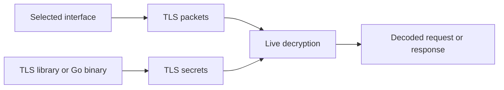

# Getting Started

Start with an HTTPS request you can repeat from your own application. To reconstruct it, eCapture v2.12.0 needs the TLS implementation that made the connection and the interface that carried its packets.

1. [Check the host and install eCapture](1.1-requirements-and-installation.md). You can inspect command help before loading a probe.
2. [Identify the TLS implementation](1.2-choosing-a-tls-probe.md). Choose [OpenSSL/BoringSSL](1.3-first-openssl-and-boringssl-capture.md), [Go crypto/tls](1.4-first-gotls-capture.md), or [GnuTLS](1.5-first-gnutls-capture.md) and start the corresponding probe before making the request.
3. Read the request and response in the terminal. Add `--output stdout --output session.jsonl` to keep a structured copy alongside the terminal output.

## What changed since v2.8.0

In v2.9.0 the three TLS modules gained a packet-based text source. Since v2.11.0, `--model text` uses that source by default. It combines packets from one interface with the target's TLS secrets and decodes application messages. `--text-source hook` selects the older function read/write events. In v2.12.0 the output flags and receiver protocol changed. See [output destinations and migration](../3-capture-modes/3.5-event-destinations-and-rotation.md) before moving existing scripts.

For later analysis, [pcapng mode](../3-capture-modes/3.4-pcapng-mode.md) records packets and embedded TLS secrets in one file. [Keylog mode](../3-capture-modes/3.3-keylog-mode.md) supplies secrets for a packet trace recorded separately. [Release history](https://github.com/gojue/ecapture/blob/v2.12.0/CHANGELOG.md)
