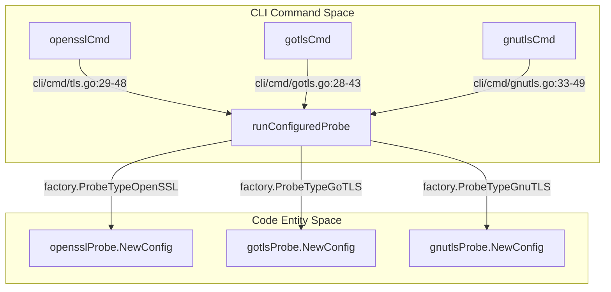
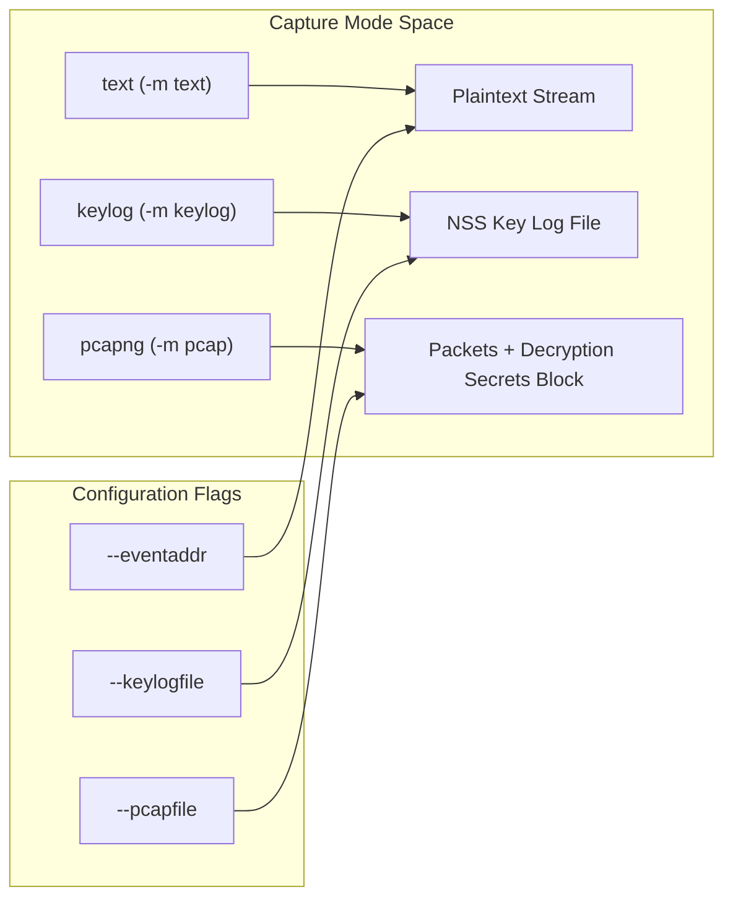

# Getting Started

Relevant source files

The following files were used as context for generating this wiki page:

- [CHANGELOG.md](https://github.com/gojue/ecapture/blob/8c9caada/CHANGELOG.md)
- [README-zh_Hans.md](https://github.com/gojue/ecapture/blob/8c9caada/README-zh_Hans.md)
- [README.md](https://github.com/gojue/ecapture/blob/8c9caada/README.md)
- [cli/cmd/gnutls.go](https://github.com/gojue/ecapture/blob/8c9caada/cli/cmd/gnutls.go)
- [cli/cmd/gotls.go](https://github.com/gojue/ecapture/blob/8c9caada/cli/cmd/gotls.go)
- [cli/cmd/nss.go](https://github.com/gojue/ecapture/blob/8c9caada/cli/cmd/nss.go)
- [cli/cmd/root.go](https://github.com/gojue/ecapture/blob/8c9caada/cli/cmd/root.go)
- [cli/cmd/tls.go](https://github.com/gojue/ecapture/blob/8c9caada/cli/cmd/tls.go)
- [main.go](https://github.com/gojue/ecapture/blob/8c9caada/main.go)

## Purpose and Scope
eCapture (旁观者) is an eBPF-based tool designed to capture SSL/TLS plaintext communication, perform command-line auditing, and monitor database queries without requiring a Man-in-the-Middle (MITM) proxy or custom CA certificate installation [README.md:5-8](https://github.com/gojue/ecapture/blob/8c9caada/README.md#L5-L8), [README.md:59-67](https://github.com/gojue/ecapture/blob/8c9caada/README.md#L59-L67). This entry point guides users through system prerequisites, selecting the appropriate TLS capture module (`tls`, `gotls`, or `gnutls`), and executing your first plaintext, keylog, or pcapng capture workflow.

Sources: [README.md:5-8](https://github.com/gojue/ecapture/blob/8c9caada/README.md#L5-L8), [README.md:59-67](https://github.com/gojue/ecapture/blob/8c9caada/README.md#L59-L67)

---

### Title: Core TLS Command Routing to Probe Factory

Sources: [cli/cmd/tls.go:29-48](https://github.com/gojue/ecapture/blob/8c9caada/cli/cmd/tls.go#L29-L48), [cli/cmd/gotls.go:28-43](https://github.com/gojue/ecapture/blob/8c9caada/cli/cmd/gotls.go#L28-L43), [cli/cmd/gnutls.go:33-49](https://github.com/gojue/ecapture/blob/8c9caada/cli/cmd/gnutls.go#L33-L49)

---

## 1.1 Requirements and Installation
eCapture supports Linux on x86_64 (kernel 4.18+), aarch64 (kernel 5.5+), and LoongArch64 (kernel 6.6+), as well as Android on x86_64 and aarch64 [README.md:34-38](https://github.com/gojue/ecapture/blob/8c9caada/README.md#L34-L38). Execution requires root privileges or specific Linux capabilities to load eBPF programs and attach uprobes/TC classifiers [README.md:34-38](https://github.com/gojue/ecapture/blob/8c9caada/README.md#L34-L38). For complete details on kernel BTF requirements, capability configuration, and environment setup, see [Requirements and Installation](1.1-requirements-and-installation.md).

Sources: [README.md:34-38](https://github.com/gojue/ecapture/blob/8c9caada/README.md#L34-L38), [README.md:70-98](https://github.com/gojue/ecapture/blob/8c9caada/README.md#L70-L98)

---

## 1.2 Choosing a TLS Probe
Depending on your target application stack, eCapture provides three core TLS capture modules:
- **`tls`**: Targets OpenSSL, LibreSSL, and BoringSSL shared libraries or statically linked binaries [README.md:131](https://github.com/gojue/ecapture/blob/8c9caada/README.md#L131), [cli/cmd/tls.go:29-32](https://github.com/gojue/ecapture/blob/8c9caada/cli/cmd/tls.go#L29-L32).
- **`gotls`**: Targets Go binaries built with Go's native `crypto/tls` package [README.md:127](https://github.com/gojue/ecapture/blob/8c9caada/README.md#L127), [cli/cmd/gotls.go:28-32](https://github.com/gojue/ecapture/blob/8c9caada/cli/cmd/gotls.go#L28-L32).
- **`gnutls`**: Targets applications linked against the GnuTLS cryptographic library [README.md:126](https://github.com/gojue/ecapture/blob/8c9caada/README.md#L126), [cli/cmd/gnutls.go:33-36](https://github.com/gojue/ecapture/blob/8c9caada/cli/cmd/gnutls.go#L33-L36).

For a comprehensive decision matrix comparing targets, library paths, and output capabilities, see [Choosing a TLS Probe](1.2-choosing-a-tls-probe.md).

Sources: [README.md:126-131](https://github.com/gojue/ecapture/blob/8c9caada/README.md#L126-L131), [cli/cmd/tls.go:29-32](https://github.com/gojue/ecapture/blob/8c9caada/cli/cmd/tls.go#L29-L32), [cli/cmd/gotls.go:28-32](https://github.com/gojue/ecapture/blob/8c9caada/cli/cmd/gotls.go#L28-L32), [cli/cmd/gnutls.go:33-36](https://github.com/gojue/ecapture/blob/8c9caada/cli/cmd/gnutls.go#L33-L36)

---

### Title: Output Pipeline Mode Selection

Sources: [cli/cmd/tls.go:53-55](https://github.com/gojue/ecapture/blob/8c9caada/cli/cmd/tls.go#L53-L55), [cli/cmd/gotls.go:49-51](https://github.com/gojue/ecapture/blob/8c9caada/cli/cmd/gotls.go#L49-L51), [cli/cmd/gnutls.go:53-55](https://github.com/gojue/ecapture/blob/8c9caada/cli/cmd/gnutls.go#L53-L55)

---

## 1.3 First OpenSSL and BoringSSL Capture
The `tls` command automatically discovers system OpenSSL libraries or accepts explicit paths via `--libssl` [README.md:136-139](https://github.com/gojue/ecapture/blob/8c9caada/README.md#L136-L139), [cli/cmd/tls.go:51](https://github.com/gojue/ecapture/blob/8c9caada/cli/cmd/tls.go#L51). Running in text mode prints decrypted HTTPS requests and responses directly to the console [README.md:106-116](https://github.com/gojue/ecapture/blob/8c9caada/README.md#L106-L116). For verified end-to-end command examples, traffic generators, and transitions to keylog and pcapng workflows, see [First OpenSSL and BoringSSL Capture](1.3-first-openssl-and-boringssl-capture.md).

Sources: [README.md:100-116](https://github.com/gojue/ecapture/blob/8c9caada/README.md#L100-L116), [cli/cmd/tls.go:29-51](https://github.com/gojue/ecapture/blob/8c9caada/cli/cmd/tls.go#L29-L51)

---

## 1.4 First GoTLS Capture
The `gotls` command targets Go binaries by specifying the compiled binary path via `--elfpath` [cli/cmd/gotls.go:46](https://github.com/gojue/ecapture/blob/8c9caada/cli/cmd/gotls.go#L46). It hooks Go's internal TLS connection functions to extract plaintext traffic [README.md:127](https://github.com/gojue/ecapture/blob/8c9caada/README.md#L127). For verified text-mode commands, required flags, expected events, and advanced output bindings, see [First GoTLS Capture](1.4-first-gotls-capture.md).

Sources: [README.md:127](https://github.com/gojue/ecapture/blob/8c9caada/README.md#L127), [cli/cmd/gotls.go:28-46](https://github.com/gojue/ecapture/blob/8c9caada/cli/cmd/gotls.go#L28-L46)

---

## 1.5 First GnuTLS Capture
The `gnutls` command captures plaintext from applications linked with GnuTLS [README.md:126](https://github.com/gojue/ecapture/blob/8c9caada/README.md#L126), [cli/cmd/gnutls.go:33-36](https://github.com/gojue/ecapture/blob/8c9caada/cli/cmd/gnutls.go#L33-L36). It supports explicit library paths (`--gnutls`) and version specifiers (`--ssl_version`) across Linux and Termux/Android environments [cli/cmd/gnutls.go:52-57](https://github.com/gojue/ecapture/blob/8c9caada/cli/cmd/gnutls.go#L52-L57). For complete instructions, version checks, and output examples, see [First GnuTLS Capture](1.5-first-gnutls-capture.md).

Sources: [README.md:126](https://github.com/gojue/ecapture/blob/8c9caada/README.md#L126), [cli/cmd/gnutls.go:33-57](https://github.com/gojue/ecapture/blob/8c9caada/cli/cmd/gnutls.go#L33-L57)