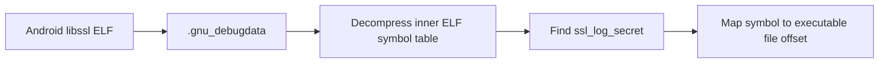

# TLS Capture (OpenSSL and BoringSSL)

`tls` (alias `openssl`) targets the OpenSSL or BoringSSL library used by your application. For a first HTTPS request and an example of the resulting terminal record, see [first OpenSSL and BoringSSL capture](../1-getting-started/1.3-first-openssl-and-boringssl-capture.md).

## Select the library and version

On Linux, the collector searches common library locations such as distribution directories containing `libssl.so.3` or `libssl.so.1.1`. If the service ships its own library, pass that path with `--libssl`. On Android it also searches Conscrypt APEX and system library directories. An Android application bundling its own TLS implementation can use a different library from the system copy. [Linux library discovery](https://github.com/gojue/ecapture/blob/v2.12.0/internal/probe/openssl/config_linux.go) · [Android library discovery](https://github.com/gojue/ecapture/blob/v2.12.0/internal/probe/openssl/config_ecandroid.go)

The probe chooses a bytecode layout for the detected library version. The v2.12.0 table includes patch-specific mappings for the OpenSSL 1.0.2, 1.1.0, 1.1.1, 3.x and 4.0 families, as well as BoringSSL variants. Check the exact patch or Android build when diagnosing a layout mismatch. `--ssl_version` can supply a known version string such as `openssl 3.0.12`. [Version mapping](https://github.com/gojue/ecapture/blob/v2.12.0/internal/probe/openssl/libs.go) · [Version override](https://github.com/gojue/ecapture/blob/v2.12.0/cli/cmd/tls.go)

## Three ways to observe the same workload

```bash
sudo ecapture tls --model text --text-source pcapng
sudo ecapture tls --model keylog --keylogfile openssl.keys
sudo ecapture tls --model pcapng --pcapfile openssl.pcapng
```

Run one command per capture. The first reconstructs messages from packets and TLS secrets. For example, a complete HTTP response can span several packets. The second saves NSS key log lines for a separate trace. The third embeds secrets alongside the packets in a Wireshark-readable file. Packet-based modes choose an interface automatically. Use `-i lo` for a server on loopback. [Output formats](https://github.com/gojue/ecapture/blob/v2.12.0/docs/event-forward-api.md)

## OpenSSL and BoringSSL capture paths

With `--text-source hook`, the existing `SSL_read` and `SSL_write` paths emit application chunks. With the default packet source, the probe observes TLS secrets and the SDK reconstructs messages. OpenSSL discards premature secret records when the client random is still uninitialized, including sessions reused after `SSL_clear`. Connection metadata used to enrich events stays internal to the probe. [OpenSSL fixes and migration](https://github.com/gojue/ecapture/blob/v2.12.0/CHANGELOG.md)

For Android BoringSSL builds with mini-debug symbols, the probe can resolve `bssl::ssl_log_secret` from the compressed symbol table. The address has to map into an executable segment of the actual library. [BoringSSL symbol resolution](https://github.com/gojue/ecapture/blob/v2.12.0/internal/probe/openssl/boringssl_symbol.go)



If startup succeeds but no transaction appears, first verify the library, interface and that the connection began after attachment. [Compare the packets and decoded HTTP in Wireshark](../3-capture-modes/3.6-wireshark-decryption-workflows.md) to distinguish a traffic-selection issue from a decryption issue.
