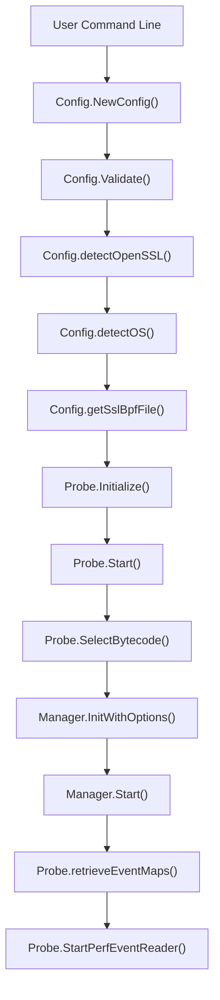

# TLS Capture (OpenSSL and BoringSSL)

<details>
<summary>Relevant source files</summary>

The following files were used as context for generating this wiki page:

- [internal/probe/gotls/gotls_probe.go](https://github.com/gojue/ecapture/blob/8c9caada/internal/probe/gotls/gotls_probe.go)
- [internal/probe/openssl/boringssl_symbol.go](https://github.com/gojue/ecapture/blob/8c9caada/internal/probe/openssl/boringssl_symbol.go)
- [internal/probe/openssl/boringssl_symbol_test.go](https://github.com/gojue/ecapture/blob/8c9caada/internal/probe/openssl/boringssl_symbol_test.go)
- [internal/probe/openssl/config.go](https://github.com/gojue/ecapture/blob/8c9caada/internal/probe/openssl/config.go)
- [internal/probe/openssl/config_ecandroid.go](https://github.com/gojue/ecapture/blob/8c9caada/internal/probe/openssl/config_ecandroid.go)
- [internal/probe/openssl/config_ecandroid_test.go](https://github.com/gojue/ecapture/blob/8c9caada/internal/probe/openssl/config_ecandroid_test.go)
- [internal/probe/openssl/config_test.go](https://github.com/gojue/ecapture/blob/8c9caada/internal/probe/openssl/config_test.go)
- [internal/probe/openssl/event_boringssl_keylog.go](https://github.com/gojue/ecapture/blob/8c9caada/internal/probe/openssl/event_boringssl_keylog.go)
- [internal/probe/openssl/event_boringssl_keylog_test.go](https://github.com/gojue/ecapture/blob/8c9caada/internal/probe/openssl/event_boringssl_keylog_test.go)
- [internal/probe/openssl/openssl_probe.go](https://github.com/gojue/ecapture/blob/8c9caada/internal/probe/openssl/openssl_probe.go)

</details>


## Purpose and Scope

This page provides full technical documentation for the OpenSSL and BoringSSL TLS capture module (`tls`) in `ecapture`. It covers target library auto-discovery, manual specification via `--libssl`, version mapping strategies, Android BoringSSL support with `.gnu_debugdata` XZ-compressed symbol resolution, capture setup, and execution workflows across text, keylog, and pcapng modes.

Sources: [internal/probe/openssl/openssl_probe.go:44-59](https://github.com/gojue/ecapture/blob/8c9caada/internal/probe/openssl/openssl_probe.go#L44-L59), [internal/probe/openssl/config.go:42-66](https://github.com/gojue/ecapture/blob/8c9caada/internal/probe/openssl/config.go#L42-L66)

---

## Target Library Discovery and `--libssl`

The OpenSSL probe initializes by locating the target shared library (`libssl.so`) hosting the SSL/TLS functions (`SSL_read`, `SSL_write`, `SSL_do_handshake`, or BoringSSL keylog hooks). 

If the user does not supply an explicit path via `--libssl`, `ecapture` performs automated platform-specific discovery:
- **Linux:** Scans standard system library paths and inspects loaded process maps or shared objects.
- **Android:** Searches APEX and system paths such as `/apex/com.android.conscrypt/lib64/libssl.so`, `/apex/com.android.conscrypt/lib/libssl.so`, `/system/lib64/libssl.so`, and `/system/lib/libssl.so`.

Sources: [internal/probe/openssl/config.go:82-85](https://github.com/gojue/ecapture/blob/8c9caada/internal/probe/openssl/config.go#L82-L85), [internal/probe/openssl/config_ecandroid.go:36-61](https://github.com/gojue/ecapture/blob/8c9caada/internal/probe/openssl/config_ecandroid.go#L36-L61)

---

## Version Mappings and Bytecode Selection

Once `libssl.so` is located, `ecapture` determines its version and selects the matching compiled eBPF bytecode asset. The probe natively supports OpenSSL versions `1.1.1`, `3.0`, and `3.1`, alongside various BoringSSL releases.

```
+--------------------+       +-----------------------+       +------------------------+
| OpensslPath Found  |------>| Detect Version/OS     |------>| SelectBytecode("...")  |
| (Config.OpensslPath)|      | (Config.detectOS())   |       | (Config.GetBPFFileName)|
+--------------------+       +-----------------------+       +------------------------+
```

Sources: [internal/probe/openssl/config.go:35-40](https://github.com/gojue/ecapture/blob/8c9caada/internal/probe/openssl/config.go#L35-L40), [internal/probe/openssl/config.go:87-94](https://github.com/gojue/ecapture/blob/8c9caada/internal/probe/openssl/config.go#L87-L94), [internal/probe/openssl/openssl_probe.go:117-121](https://github.com/gojue/ecapture/blob/8c9caada/internal/probe/openssl/openssl_probe.go#L117-L121)

Sources: [internal/probe/openssl/config.go:35-40](https://github.com/gojue/ecapture/blob/8c9caada/internal/probe/openssl/config.go#L35-L40), [internal/probe/openssl/openssl_probe.go:117-121](https://github.com/gojue/ecapture/blob/8c9caada/internal/probe/openssl/openssl_probe.go#L117-L121)

---

## Android BoringSSL Support and Symbol Resolution

On Android platforms running BoringSSL, standard export symbols for master secret logging may be stripped or optimized out. `ecapture` handles this by parsing the `.gnu_debugdata` section containing an XZ-compressed mini debug symbol table.

The function `findBoringSSLKeylogAddress` opens the ELF binary, extracts `.gnu_debugdata`, decompresses the XZ stream using `github.com/ulikunitz/xz`, parses the inner ELF symbols, and locates the internal `_ZN4bssl14ssl_log_secretEPK6ssl_stPKcNS_4SpanIKhEE` (`bssl::ssl_log_secret`) function address.

```
+-----------------------+     +----------------------+     +-------------------------+
| ELF File Opening      |---->| Read .gnu_debugdata  |---->| XZ Decompression Stream |
| (elf.Open)            |     | (lib.Section)        |     | (xz.NewReader)          |
+-----------------------+     +----------------------+     +-------------------------+
                                                                        |
                                                                        v
+-----------------------+     +----------------------+     +-------------------------+
| Compute File Offset   |<----| Match Symbol         |<----| Parse Inner ELF Symbols |
| (executableFileOffset)|     | (boringSSLKeylogSym) |     | (elf.NewFile)           |
+-----------------------+     +----------------------+     +-------------------------+
```

Sources: [internal/probe/openssl/boringssl_symbol.go:34-84](https://github.com/gojue/ecapture/blob/8c9caada/internal/probe/openssl/boringssl_symbol.go#L34-L84), [internal/probe/openssl/event_boringssl_keylog.go:34-70](https://github.com/gojue/ecapture/blob/8c9caada/internal/probe/openssl/event_boringssl_keylog.go#L34-L70)

Sources: [internal/probe/openssl/boringssl_symbol.go:34-84](https://github.com/gojue/ecapture/blob/8c9caada/internal/probe/openssl/boringssl_symbol.go#L34-L84), [internal/probe/openssl/event_boringssl_keylog.go:34-70](https://github.com/gojue/ecapture/blob/8c9caada/internal/probe/openssl/event_boringssl_keylog.go#L34-L70)

---

## Capture Setup and Verified Examples

The OpenSSL probe supports three distinct capture modes selected via `-m` / `--capturemode`:
1. **Text Mode (`-m text`)**: Decodes and streams plaintext data passed through `SSL_read` and `SSL_write`.
2. **Keylog Mode (`-m keylog`)**: Dumps NSS-compatible key log lines (client random and secrets) for external packet decryption.
3. **Pcapng Mode (`-m pcapng` / `-m pcap`)**: Captures network packets via traffic control (TC) or socket filters and embeds a TLS Decryption Secrets Block.

### Verified Text Mode Command
```bash
sudo ecapture tls -m text
```

### Verified Keylog Mode Command
```bash
sudo ecapture tls -m keylog --keylogfile /tmp/tls.keys
```

### Verified Pcapng Mode Command
```bash
sudo ecapture tls -m pcapng -i eth0 --pcapfile /tmp/capture.pcapng
```

Sources: [internal/probe/openssl/config.go:138-178](https://github.com/gojue/ecapture/blob/8c9caada/internal/probe/openssl/config.go#L138-L178), [internal/probe/openssl/openssl_probe.go:101-163](https://github.com/gojue/ecapture/blob/8c9caada/internal/probe/openssl/openssl_probe.go#L101-L163)

Sources: [internal/probe/openssl/config.go:138-178](https://github.com/gojue/ecapture/blob/8c9caada/internal/probe/openssl/config.go#L138-L178), [internal/probe/openssl/openssl_probe.go:101-163](https://github.com/gojue/ecapture/blob/8c9caada/internal/probe/openssl/openssl_probe.go#L101-L163)

---

## Architecture and Data Flow

### Diagram 1: Probe Initialization and Configuration Flow
This diagram maps system-level initialization steps to code components in `internal/probe/openssl`.



Sources: [internal/probe/openssl/config.go:68-129](https://github.com/gojue/ecapture/blob/8c9caada/internal/probe/openssl/config.go#L68-L129), [internal/probe/openssl/openssl_probe.go:61-163](https://github.com/gojue/ecapture/blob/8c9caada/internal/probe/openssl/openssl_probe.go#L61-L163)

### Diagram 2: Android BoringSSL Symbol Resolution Data Flow
This diagram illustrates the pipeline used to resolve hidden BoringSSL symbols on Android.

```mermaid
graph LR
    ELF["elf.Open(path)"] --> Sec[".gnu_debugdata Section"]
    Sec --> Comp["Compressed Data Bytes"]
    Comp --> XZ["xz.NewReader()"]
    XZ --> Decomp["Decompressed ELF Buffer"]
    Decomp --> InnerELF["elf.NewFile()"]
    InnerELF --> Syms["miniDebug.Symbols()"]
    Syms --> Match["Find _ZN4bssl14ssl_log_secret..."]
    Match --> Calc["executableFileOffset()"]
    Calc --> Addr["BoringSSLKeylogAddr"]

    %% symbol["internal/probe/openssl/boringssl_symbol.go"]
```



Sources: [internal/probe/openssl/boringssl_symbol.go:34-96](https://github.com/gojue/ecapture/blob/8c9caada/internal/probe/openssl/boringssl_symbol.go#L34-L96)