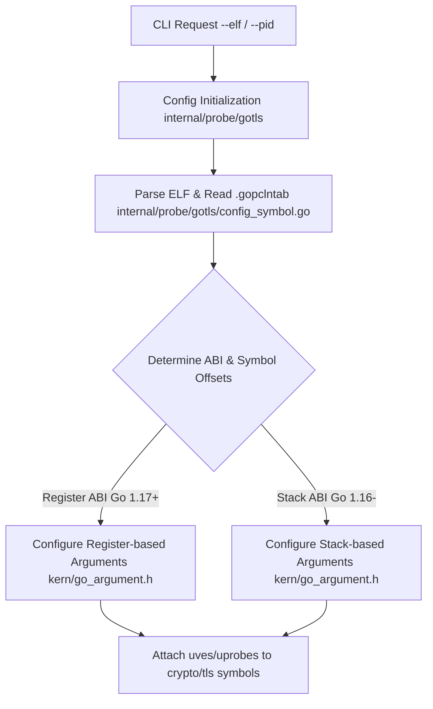
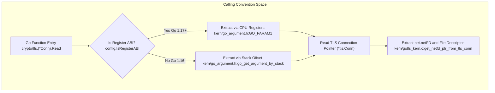

# GoTLS Capture

<details>
<summary>Relevant source files</summary>

The following files were used as context for generating this wiki page:

- [internal/probe/gotls/config_symbol.go](https://github.com/gojue/ecapture/blob/8c9caada/internal/probe/gotls/config_symbol.go)
- [internal/probe/gotls/config_symbol_test.go](https://github.com/gojue/ecapture/blob/8c9caada/internal/probe/gotls/config_symbol_test.go)
- [internal/probe/gotls/event.go](https://github.com/gojue/ecapture/blob/8c9caada/internal/probe/gotls/event.go)
- [internal/probe/gotls/event_test.go](https://github.com/gojue/ecapture/blob/8c9caada/internal/probe/gotls/event_test.go)
- [internal/probe/gotls/gotls_probe.go](https://github.com/gojue/ecapture/blob/8c9caada/internal/probe/gotls/gotls_probe.go)
- [internal/probe/openssl/openssl_probe.go](https://github.com/gojue/ecapture/blob/8c9caada/internal/probe/openssl/openssl_probe.go)
- [kern/go_argument.h](https://github.com/gojue/ecapture/blob/8c9caada/kern/go_argument.h)
- [kern/gotls_kern.c](https://github.com/gojue/ecapture/blob/8c9caada/kern/gotls_kern.c)
- [kern/include/openssl_masterkey_common.h](https://github.com/gojue/ecapture/blob/8c9caada/kern/include/openssl_masterkey_common.h)
- [kern/include/tls_constants.h](https://github.com/gojue/ecapture/blob/8c9caada/kern/include/tls_constants.h)

</details>


This page explains the technical implementation, configuration considerations, symbol and calling-convention mechanics, and verified operational workflows for the `gotls` capture module in eCapture. The `gotls` module traces native TLS connections in Go binaries via eBPF uprobes and uretprobes without requiring external cryptographic libraries like OpenSSL.

Sources: [internal/probe/gotls/gotls_probe.go:1-69](https://github.com/gojue/ecapture/blob/8c9caada/internal/probe/gotls/gotls_probe.go#L1-L69), [kern/gotls_kern.c:1-50](https://github.com/gojue/ecapture/blob/8c9caada/kern/gotls_kern.c#L1-L50)

---

## 1. Purpose and Scope

The `gotls` module targets Go applications compiled with the standard library `crypto/tls` package. Because Go binaries statically link their TLS implementation and runtime support, traditional dynamic library interception (such as hooking `libssl`) is ineffective. Instead, eCapture attaches eBPF probes directly to Go runtime functions responsible for reading, writing, and logging keys within the target ELF binary.

Supported capabilities include:
- **Text Mode (`-m text`)**: Decodes application-layer plaintext data read from and written to Go TLS connections along with network tuples (IP, port, file descriptor, process metadata).
- **Keylog Mode (`-m keylog`)**: Extracts NSS-compatible key log secrets (`CLIENT_RANDOM`, etc.) when `crypto/tls.(*Config).writeKeyLog` is invoked.
- **pcapng Mode (`-m pcap` / `-m pcapng`)**: Captures packet blocks from a network interface while embedding a TLS Decryption Secrets Block containing the extracted keys for direct Wireshark inspection.

Sources: [internal/probe/gotls/gotls_probe.go:46-50](https://github.com/gojue/ecapture/blob/8c9caada/internal/probe/gotls/gotls_probe.go#L46-L50), [internal/probe/gotls/event.go:33-74](https://github.com/gojue/ecapture/blob/8c9caada/internal/probe/gotls/event.go#L33-L74)

---

## 2. Go Binary Selection and Prerequisites

To successfully attach probes to a Go binary, eCapture requires the target process or ELF file path to contain Go debug and symbol metadata (specifically, `.gopclntab` or section data). Stripped binaries lacking symbol tables require external symbol maps or symbols preserved via linker flags (`-ldflags="-w=false"`).

### Version and Architecture Support
- **Supported Go Versions**: Go 1.16 through recent releases (including Go 1.17+ register-based ABI and Go 1.18+ text-relative function offset tables).
- **Architectures**: AMD64 (`__TARGET_ARCH_x86`), ARM64 (`__TARGET_ARCH_arm64`), and LoongArch (`__TARGET_ARCH_loongarch`).
- **Target Specification**: Specified via the CLI using `--pid` for running processes or `--elf` for static analysis and binary attachment setup.


*Figure 2.1: Go binary selection and symbol resolution flow.*

Sources: [internal/probe/gotls/config_symbol.go:92-140](https://github.com/gojue/ecapture/blob/8c9caada/internal/probe/gotls/config_symbol.go#L92-L140), [kern/go_argument.h:1-128](https://github.com/gojue/ecapture/blob/8c9caada/kern/go_argument.h#L1-L128)

---

## 3. Symbol Resolution and Calling Conventions

Go uses specialized calling conventions that evolved significantly between Go 1.16 and Go 1.17+. Understanding these conventions is critical for eBPF argument extraction.

### Hooked Functions
The `gotls` module attaches probes to three core `crypto/tls` internal methods:
1. **Read**: `crypto/tls.(*Conn).Read` — intercepts incoming decrypted application data.
2. **Write**: `crypto/tls.(*Conn).writeRecordLocked` — intercepts outgoing application data before encryption.
3. **Keylog**: `crypto/tls.(*Config).writeKeyLog` — intercepts TLS master secrets and random values.

Sources: [internal/probe/gotls/gotls_probe.go:46-50](https://github.com/gojue/ecapture/blob/8c9caada/internal/probe/gotls/gotls_probe.go#L46-L50)

### ABI Considerations (Register vs. Stack)
- **Stack-based ABI (Go 1.16 and older)**: Function parameters are passed via the stack relative to the stack pointer register (`SP`). Argument retrieval reads from `PT_REGS_SP(ctx) + (index * 8)`.
- **Register-based ABI (Go 1.17 and newer)**: Function parameters are passed via CPU registers (`AX`, `BX`, `CX`, `DI`, `SI`, `R8`, `R9`, `R10` on AMD64). The macro `GO_PARAM1` through `GO_PARAM8` extracts values directly from register definitions or via CO-RE helpers.


*Figure 3.1: Calling convention resolution bridging natural language configuration to eBPF code structures.*

Sources: [kern/go_argument.h:22-128](https://github.com/gojue/ecapture/blob/8c9caada/kern/go_argument.h#L22-L128), [kern/gotls_kern.c:110-146](https://github.com/gojue/ecapture/blob/8c9caada/kern/gotls_kern.c#L110-L146)

---

## 4. Implementation and Data Flow

When an application invokes `crypto/tls.(*Conn).Read` or `writeRecordLocked`, the attached uprobe executes in kernel context, extracts connection metadata (`netFD`, source/destination IPs, ports, file descriptors), and copies the payload into a per-CPU eBPF array map (`gte_context_gen`).

### eBPF Data Structure (`struct go_tls_event`)
Events are structured uniformly in kernel space and transmitted to userspace via BPF perf event arrays (`events` and `mastersecret_go_events`):

| Offset | Field Name | Type | Description |
| :--- | :--- | :--- | :--- |
| 0 | `ts_ns` | `u64` | Monotonic timestamp (`bpf_ktime_get_ns`) |
| 8 | `pid` / `tid` | `u32` / `u32` | Process and Thread IDs |
| 16 | `data_len` | `s32` | Payload length |
| 20 | `event_type` | `u8` | `0` = Write, `1` = Read |
| 24 | `fd` | `u32` | Underlying network file descriptor |
| 28 | `src_ip` / `dst_ip` | `u8[16]` | Source and destination IP addresses (IPv4/IPv6) |
| 44 / 64 | `src_port` / `dst_port` | `u16` / `u16` | Source and destination ports |
| 68 | `comm` | `char[16]` | Process command name |
| 84 | `data` | `char[...]` | Payload buffer |

Sources: [kern/gotls_kern.c:33-50](https://github.com/gojue/ecapture/blob/8c9caada/kern/gotls_kern.c#L33-L50), [internal/probe/gotls/event.go:33-74](https://github.com/gojue/ecapture/blob/8c9caada/internal/probe/gotls/event.go#L33-L74)

---

## 5. Verified Capture Workflows

### Text Mode Workflow
To capture plaintext HTTP/TLS traffic from a compiled Go binary (`./my-go-server`):
```bash
sudo ./ecapture gotls -m text --pid 1234
```
**Expected Output Event**:
```json
{
  "timestamp": 1710000000000000,
  "pid": 1234,
  "tid": 1235,
  "dataLen": 75,
  "eventType": 0,
  "fd": 7,
  "srcIP": "127.0.0.1",
  "srcPort": 54321,
  "dstIP": "127.0.0.1",
  "dstPort": 443,
  "ipVersion": 4,
  "comm": "my-go-server",
  "tuple": "127.0.0.1:54321->127.0.0.1:443",
  "data": "GET / HTTP/1.1\r\nHost: localhost\r\n\r\n"
}
```

Sources: [internal/probe/gotls/event.go:54-74](https://github.com/gojue/ecapture/blob/8c9caada/internal/probe/gotls/event.go#L54-L74)

### Keylog Mode Workflow
To extract NSS-format TLS master secrets:
```bash
sudo ./ecapture gotls -m keylog --pid 1234 --keylogfile ./gotls_keys.log
```
**Expected Output**:
```text
CLIENT_RANDOM 5d41402abc... 098f6bcd4621d373cade4e832627b4f6...
```

### pcapng Mode Workflow
To capture packet blocks alongside embedded decryption secrets:
```bash
sudo ./ecapture gotls -m pcapng -i lo --pid 1234 --pcapfile ./gotls_capture.pcapng
```

Sources: [internal/probe/gotls/gotls_probe.go:62-67](https://github.com/gojue/ecapture/blob/8c9caada/internal/probe/gotls/gotls_probe.go#L62-L67)

---

## 6. Expected Results and Interpretation

When evaluating captures from `gotls`:
1. **Text Mode**: Validates that plaintext bytes match application requests/responses. Ensure the binary is not stripped or build IDs match.
2. **Keylog Mode**: Produces standard NSS key log lines. These can be combined with standard `tcpdump` captures in Wireshark via **Preferences > Protocols > TLS > (Pre)-Master-Secret log filename**.
3. **pcapng Mode**: Generates a self-contained artifact (`.pcapng`) containing both link-layer packets and the TLS Decryption Secrets Block (DSB), allowing immediate inspection in Wireshark without manual key file configuration.

Sources: [internal/probe/gotls/gotls_probe.go:46-68](https://github.com/gojue/ecapture/blob/8c9caada/internal/probe/gotls/gotls_probe.go#L46-L68)