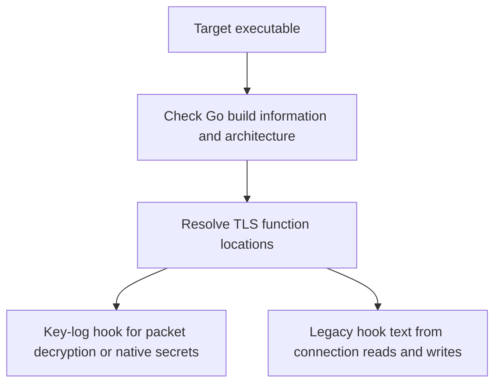

# GoTLS Capture

`gotls` (alias `tlsgo`) targets Go's standard `crypto/tls` library in an executable. Point `--elfpath` (`-e`) at the Go client or server you actually run. The ELF architecture must match the collector (`amd64`, `arm64`, or `loong64` on Linux). Use the Android build for a matching Android Go executable on amd64 or arm64. [GoTLS command](https://github.com/gojue/ecapture/blob/v2.12.0/cli/cmd/gotls.go) · [ELF validation](https://github.com/gojue/ecapture/blob/v2.12.0/internal/probe/gotls/config.go)

## Choose the capture path

```bash
sudo ecapture gotls --elfpath ./go-client --model text --text-source pcapng
sudo ecapture gotls --elfpath ./go-client --model keylog --keylogfile go.keys
sudo ecapture gotls --elfpath ./go-client --model pcapng --pcapfile go.pcapng
```

Run the matching executable and make a fresh connection after starting the chosen command. The default text source combines packets with secrets observed at `crypto/tls.(*Config).writeKeyLog`. HTTP events carry the connection and, when available, stream ID needed to follow concurrent requests. Native keylog mode writes NSS secrets. Native pcapng mode records a trace with embedded secrets. In either packet-based path, specify `-i` when the traffic uses loopback or a different route from the default. [GoTLS mode implementation](https://github.com/gojue/ecapture/blob/v2.12.0/internal/probe/gotls/gotls_probe.go)

For a Go HTTP/3 application, include its **UDP** traffic. A filter such as `'tcp port 443'` excludes QUIC. The maintained HTTP/3 fixtures exercise QUIC v1/v2 using Go TLS. Generate traffic for a known endpoint and check the decoded request path and response. See [text decoder and protocol selectors](../3-capture-modes/3.2-text-mode.md).

## How the ELF is resolved

The collector reads Go build information and matches function positions in the target ELF. Depending on the build, it can use ELF symbols or Go's function tables, including in PIE binaries. Removing DWARF alone does not determine whether a binary can be traced. The necessary Go metadata and target functions must still be identifiable. Go's pre-1.17 stack convention and newer register ABI use different argument layouts. [ELF and ABI handling](https://github.com/gojue/ecapture/blob/v2.12.0/internal/probe/gotls/config.go) · [Symbol and instruction lookup](https://github.com/gojue/ecapture/blob/v2.12.0/internal/probe/gotls/config_symbol.go)



Explicit `--text-source hook` uses `crypto/tls.(*Conn).Read` and `crypto/tls.(*Conn).writeRecordLocked` to observe chunks. If your previous integration parsed a PID, direction and bytes from each call, compare the new decoded `TEXT` records against the original request. HTTP/2 streams interleave and socket reads do not define message boundaries. [First GoTLS capture](../1-getting-started/1.4-first-gotls-capture.md) includes a verification sequence.
