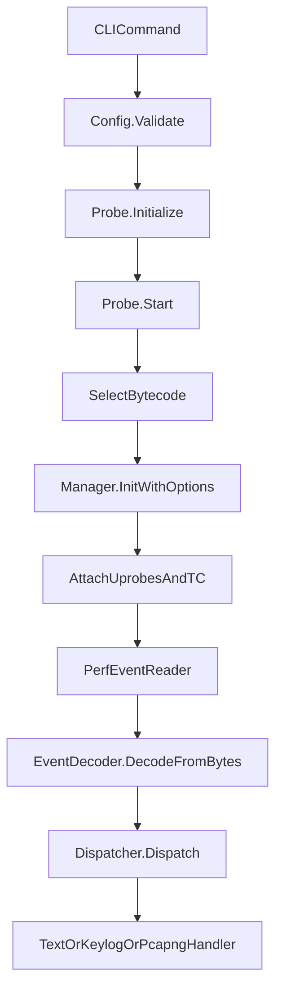
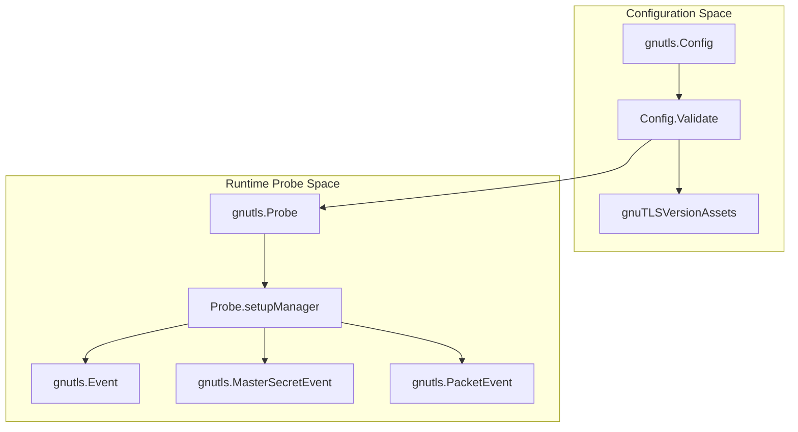

# GnuTLS Capture

<details>
<summary>Relevant source files</summary>

The following files were used as context for generating this wiki page:

- [AGENTS.md](https://github.com/gojue/ecapture/blob/8c9caada/AGENTS.md)
- [docs/agent/architecture.md](https://github.com/gojue/ecapture/blob/8c9caada/docs/agent/architecture.md)
- [docs/agent/build-test.md](https://github.com/gojue/ecapture/blob/8c9caada/docs/agent/build-test.md)
- [docs/agent/probe-development.md](https://github.com/gojue/ecapture/blob/8c9caada/docs/agent/probe-development.md)
- [internal/probe/base/handlers/keylog_handler.go](https://github.com/gojue/ecapture/blob/8c9caada/internal/probe/base/handlers/keylog_handler.go)
- [internal/probe/base/handlers/keylog_handler_test.go](https://github.com/gojue/ecapture/blob/8c9caada/internal/probe/base/handlers/keylog_handler_test.go)
- [internal/probe/gnutls/config.go](https://github.com/gojue/ecapture/blob/8c9caada/internal/probe/gnutls/config.go)
- [internal/probe/gnutls/config_test.go](https://github.com/gojue/ecapture/blob/8c9caada/internal/probe/gnutls/config_test.go)
- [internal/probe/gnutls/event.go](https://github.com/gojue/ecapture/blob/8c9caada/internal/probe/gnutls/event.go)
- [internal/probe/gnutls/event_masterkey.go](https://github.com/gojue/ecapture/blob/8c9caada/internal/probe/gnutls/event_masterkey.go)
- [internal/probe/gnutls/event_packet.go](https://github.com/gojue/ecapture/blob/8c9caada/internal/probe/gnutls/event_packet.go)
- [internal/probe/gnutls/gnutls_probe.go](https://github.com/gojue/ecapture/blob/8c9caada/internal/probe/gnutls/gnutls_probe.go)
- [kern/gnutls.h](https://github.com/gojue/ecapture/blob/8c9caada/kern/gnutls.h)
- [kern/gnutls_masterkey.h](https://github.com/gojue/ecapture/blob/8c9caada/kern/gnutls_masterkey.h)

</details>


## Overview and Scope

The GnuTLS capture module (`gnutls`) provides non-invasive plaintext, keylog, and packet capture capabilities for applications dynamically or statically linked against the GNU Transport Layer Security (GnuTLS) library (`libgnutls.so`) [internal/probe/gnutls/config.go:63-75](https://github.com/gojue/ecapture/blob/8c9caada/internal/probe/gnutls/config.go#L63-L75). Unlike OpenSSL or GoTLS, GnuTLS relies heavily on internal structure layout variations across minor and patch releases. Consequently, eCapture employs version-specific eBPF bytecode objects matched to the target library version detected during initialization [internal/probe/gnutls/config.go:33-61](https://github.com/gojue/ecapture/blob/8c9caada/internal/probe/gnutls/config.go#L33-L61).

Sources: [internal/probe/gnutls/config.go:33-75](https://github.com/gojue/ecapture/blob/8c9caada/internal/probe/gnutls/config.go#L33-L75)

---

## Target Library and Version Support

The target library is typically located at standard system paths such as `/usr/lib/x86_64-linux-gnu/libgnutls.so.30` [internal/probe/gnutls/config.go:63-75](https://github.com/gojue/ecapture/blob/8c9caada/internal/probe/gnutls/config.go#L63-L75). During startup, `Config.Validate()` inspects the target binary to determine the exact GnuTLS version string (ranging from `3.6.12` to `3.8.9`) [internal/probe/gnutls/config.go:101-143](https://github.com/gojue/ecapture/blob/8c9caada/internal/probe/gnutls/config.go#L101-L143). 

The mapping from detected version to compiled eBPF object is managed by `gnuTLSVersionAssets` [internal/probe/gnutls/config.go:33-61](https://github.com/gojue/ecapture/blob/8c9caada/internal/probe/gnutls/config.go#L33-L61). For example, versions `3.8.4` through `3.8.6` resolve to `gnutls_3_8_4_kern.o`, while `3.8.7` through `3.8.9` resolve to `gnutls_3_8_7_kern.o` [internal/probe/gnutls/config.go:55-61](https://github.com/gojue/ecapture/blob/8c9caada/internal/probe/gnutls/config.go#L55-L61).

### Version Support Table

| GnuTLS Version Range | Associated eBPF Bytecode Object | Key Attachment Symbols |
| --- | --- | --- |
| `3.6.12` - `3.6.16` | `gnutls_3_6_12_kern.o` / `gnutls_3_6_13_kern.o` [internal/probe/gnutls/config.go:34-38](https://github.com/gojue/ecapture/blob/8c9caada/internal/probe/gnutls/config.go#L34-L38) | `gnutls_record_send`, `gnutls_record_recv`, session key extractors |
| `3.7.0` - `3.7.11` | `gnutls_3_7_0_kern.o` / `gnutls_3_7_7_kern.o` [internal/probe/gnutls/config.go:39-50](https://github.com/gojue/ecapture/blob/8c9caada/internal/probe/gnutls/config.go#L39-L50) | `gnutls_record_send`, `gnutls_record_recv`, session key extractors |
| `3.8.0` - `3.8.3` | `gnutls_3_7_7_kern.o` [internal/probe/gnutls/config.go:51-54](https://github.com/gojue/ecapture/blob/8c9caada/internal/probe/gnutls/config.go#L51-L54) | `gnutls_record_send`, `gnutls_record_recv`, session key extractors |
| `3.8.4` - `3.8.6` | `gnutls_3_8_4_kern.o` [internal/probe/gnutls/config.go:55-57](https://github.com/gojue/ecapture/blob/8c9caada/internal/probe/gnutls/config.go#L55-L57) | `gnutls_record_send`, `gnutls_record_recv`, session key extractors |
| `3.8.7` - `3.8.9` | `gnutls_3_8_7_kern.o` [internal/probe/gnutls/config.go:58-61](https://github.com/gojue/ecapture/blob/8c9caada/internal/probe/gnutls/config.go#L58-L61) | `gnutls_record_send`, `gnutls_record_recv`, session key extractors |

Sources: [internal/probe/gnutls/config.go:33-143](https://github.com/gojue/ecapture/blob/8c9caada/internal/probe/gnutls/config.go#L33-L143)

---

## Platform Limits and Prerequisites

- **Operating Systems**: Linux only (`x86_64`, `aarch64`, `loongarch64`).
- **Android Restriction**: The GnuTLS module is excluded from Android builds (`ANDROID=1`) in `variables.mk` due to the absence of GnuTLS packaging in standard Android runtimes.
- **Kernel Requirements**: Minimum kernel versions align with general eBPF requirements (x86_64 >= 4.18, aarch64 >= 5.5, loongarch64 >= 6.6).
- **Privileges**: Running capture operations requires `root` privileges or `CAP_SYS_ADMIN` / `CAP_BPF` capabilities.

Sources: [AGENTS.md:51-62](https://github.com/gojue/ecapture/blob/8c9caada/AGENTS.md#L51-L62), [docs/agent/architecture.md:50-52](https://github.com/gojue/ecapture/blob/8c9caada/docs/agent/architecture.md#L50-L52)

---

## Verified Capture Modes and Examples

The GnuTLS probe supports three primary operating modes selected via `-m` / `--mode`: `text`, `keylog`, and `pcapng` [internal/probe/gnutls/config.go:83-91](https://github.com/gojue/ecapture/blob/8c9caada/internal/probe/gnutls/config.go#L83-L91).

### Text Mode Capture

Text mode intercepts `gnutls_record_send` and `gnutls_record_recv` to decode plaintext application data payloads [internal/probe/gnutls/gnutls_probe.go:204-212](https://github.com/gojue/ecapture/blob/8c9caada/internal/probe/gnutls/gnutls_probe.go#L204-L212).

```sh
sudo ./bin/ecapture gnutls -m text --gnutlspath /usr/lib/x86_64-linux-gnu/libgnutls.so.30
```

**Expected Output:**
```text
[mono_ns=123456789000] PID:1234 TID:1234 Comm:curl WRITE (51 bytes):
GET / HTTP/1.1
Host: example.com
```

### Keylog Mode Capture

Keylog mode extracts TLS master secrets and direct traffic secrets (including TLS 1.3 traffic secrets) and outputs them in NSS Key Log Format [internal/probe/gnutls/event_masterkey.go:46-60](https://github.com/gojue/ecapture/blob/8c9caada/internal/probe/gnutls/event_masterkey.go#L46-L60).

```sh
sudo ./bin/ecapture gnutls -m keylog -l gnutls_keys.log --gnutlspath /usr/lib/x86_64-linux-gnu/libgnutls.so.30
```

**Expected Output (`gnutls_keys.log`):**
```text
CLIENT_HANDSHAKE_TRAFFIC_SECRET 0123456789abcdef... 9abcdef012345678...
SERVER_HANDSHAKE_TRAFFIC_SECRET 0123456789abcdef... 9abcdef012345678...
CLIENT_TRAFFIC_SECRET_0 0123456789abcdef... 9abcdef012345678...
SERVER_TRAFFIC_SECRET_0 0123456789abcdef... 9abcdef012345678...
```

### pcapng Mode Capture

pcapng mode combines Traffic Control (TC) packet interception on a specified network interface with embedded TLS Decryption Secrets Blocks [internal/probe/gnutls/gnutls_probe.go:179-186](https://github.com/gojue/ecapture/blob/8c9caada/internal/probe/gnutls/gnutls_probe.go#L179-L186).

```sh
sudo ./bin/ecapture gnutls -m pcapng -i lo -w gnutls_capture.pcapng --gnutlspath /usr/lib/x86_64-linux-gnu/libgnutls.so.30
```

Sources: [internal/probe/gnutls/config.go:153-195](https://github.com/gojue/ecapture/blob/8c9caada/internal/probe/gnutls/config.go#L153-L195), [internal/probe/gnutls/gnutls_probe.go:175-212](https://github.com/gojue/ecapture/blob/8c9caada/internal/probe/gnutls/gnutls_probe.go#L175-L212), [internal/probe/gnutls/event_masterkey.go:46-60](https://github.com/gojue/ecapture/blob/8c9caada/internal/probe/gnutls/event_masterkey.go#L46-L60)

---

## Implementation Architecture and Data Flow

The following diagrams illustrate the internal execution path and code entity mapping for GnuTLS capture initialization and event decoding.

### Architecture Data Flow


Sources: [internal/probe/gnutls/config.go:121-151](https://github.com/gojue/ecapture/blob/8c9caada/internal/probe/gnutls/config.go#L121-L151), [internal/probe/gnutls/gnutls_probe.go:57-117](https://github.com/gojue/ecapture/blob/8c9caada/internal/probe/gnutls/gnutls_probe.go#L57-L117)

### Code Entity Mapping


Sources: [internal/probe/gnutls/config.go:33-100](https://github.com/gojue/ecapture/blob/8c9caada/internal/probe/gnutls/config.go#L33-L100), [internal/probe/gnutls/gnutls_probe.go:39-55](https://github.com/gojue/ecapture/blob/8c9caada/internal/probe/gnutls/gnutls_probe.go#L39-L55), [internal/probe/gnutls/event.go:41-49](https://github.com/gojue/ecapture/blob/8c9caada/internal/probe/gnutls/event.go#L41-L49), [internal/probe/gnutls/event_masterkey.go:49-60](https://github.com/gojue/ecapture/blob/8c9caada/internal/probe/gnutls/event_masterkey.go#L49-L60), [internal/probe/gnutls/event_packet.go:30-37](https://github.com/gojue/ecapture/blob/8c9caada/internal/probe/gnutls/event_packet.go#L30-L37)