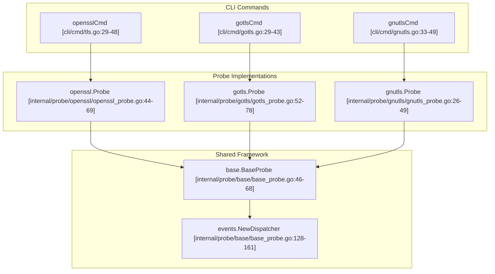

# Core TLS Modules

Relevant source files

The following files were used as context for generating this wiki page:

- [cli/cmd/gnutls.go](https://github.com/gojue/ecapture/blob/8c9caada/cli/cmd/gnutls.go)
- [cli/cmd/gotls.go](https://github.com/gojue/ecapture/blob/8c9caada/cli/cmd/gotls.go)
- [cli/cmd/nss.go](https://github.com/gojue/ecapture/blob/8c9caada/cli/cmd/nss.go)
- [cli/cmd/root.go](https://github.com/gojue/ecapture/blob/8c9caada/cli/cmd/root.go)
- [cli/cmd/tls.go](https://github.com/gojue/ecapture/blob/8c9caada/cli/cmd/tls.go)
- [internal/config/base_config.go](https://github.com/gojue/ecapture/blob/8c9caada/internal/config/base_config.go)
- [internal/domain/configuration.go](https://github.com/gojue/ecapture/blob/8c9caada/internal/domain/configuration.go)
- [internal/probe/base/base_probe.go](https://github.com/gojue/ecapture/blob/8c9caada/internal/probe/base/base_probe.go)
- [internal/probe/gotls/gotls_probe.go](https://github.com/gojue/ecapture/blob/8c9caada/internal/probe/gotls/gotls_probe.go)
- [internal/probe/openssl/openssl_probe.go](https://github.com/gojue/ecapture/blob/8c9caada/internal/probe/openssl/openssl_probe.go)

This page provides a high-level user-facing overview of the core TLS interception capabilities in `eCapture`: **tls** (OpenSSL/BoringSSL), **gotls** (Go native TLS), and **gnutls** (GnuTLS). These three core modules enable the extraction of TLS plaintext, cryptographic key logs, and pcapng packet captures without requiring a custom CA certificate or modifying target applications [cli/cmd/tls.go:29-32](https://github.com/gojue/ecapture/blob/8c9caada/cli/cmd/tls.go#L29-L32), [cli/cmd/gotls.go:29-32](https://github.com/gojue/ecapture/blob/8c9caada/cli/cmd/gotls.go#L29-L32), [cli/cmd/gnutls.go:33-36](https://github.com/gojue/ecapture/blob/8c9caada/cli/cmd/gnutls.go#L33-L36).

## Shared Workflow and Architecture

Despite targeting different cryptographic libraries and runtime environments, all core TLS modules share a unified lifecycle managed by the eBPF probe framework. Configuration parsing, eBPF bytecode loading, map polling, event decoding, and output routing are coordinated through shared components such as `base.BaseProbe` and `events.NewDispatcher` [internal/probe/base/base_probe.go:46-68](https://github.com/gojue/ecapture/blob/8c9caada/internal/probe/base/base_probe.go#L46-L68), [internal/probe/base/base_probe.go:128-161](https://github.com/gojue/ecapture/blob/8c9caada/internal/probe/base/base_probe.go#L128-L161).

*Sources: [cli/cmd/tls.go:29-48](https://github.com/gojue/ecapture/blob/8c9caada/cli/cmd/tls.go#L29-L48), [cli/cmd/gotls.go:29-43](https://github.com/gojue/ecapture/blob/8c9caada/cli/cmd/gotls.go#L29-L43), [cli/cmd/gnutls.go:33-49](https://github.com/gojue/ecapture/blob/8c9caada/cli/cmd/gnutls.go#L33-L49), [internal/probe/openssl/openssl_probe.go:44-69](https://github.com/gojue/ecapture/blob/8c9caada/internal/probe/openssl/openssl_probe.go#L44-L69), [internal/probe/gotls/gotls_probe.go:52-78](https://github.com/gojue/ecapture/blob/8c9caada/internal/probe/gotls/gotls_probe.go#L52-L78), [internal/probe/base/base_probe.go:46-68](https://github.com/gojue/ecapture/blob/8c9caada/internal/probe/base/base_probe.go#L46-L68) *

## Module Comparison

While the output modes (`text`, `keylog`, `pcapng`) remain consistent across modules, their targeting mechanisms and runtime prerequisites differ significantly:

| Module | Command | Target Discovery | Supported Runtimes / Libraries | Platform Support |
| :--- | :--- | :--- | :--- | :--- |
| **tls** | `ecapture tls` | `--libssl` or automatic search [cli/cmd/tls.go:51](https://github.com/gojue/ecapture/blob/8c9caada/cli/cmd/tls.go#L51) | OpenSSL 1.0.x / 1.1.x / 3.x, BoringSSL [cli/cmd/tls.go:32](https://github.com/gojue/ecapture/blob/8c9caada/cli/cmd/tls.go#L32) | Linux (amd64/arm64/loong64), Android (BoringSSL) [cli/cmd/root.go:46](https://github.com/gojue/ecapture/blob/8c9caada/cli/cmd/root.go#L46) |
| **gotls** | `ecapture gotls` | `--elfpath` (ELF binary) [cli/cmd/gotls.go:46](https://github.com/gojue/ecapture/blob/8c9caada/cli/cmd/gotls.go#L46) | Go standard library (`crypto/tls`) compiled binaries | Linux, Android |
| **gnutls** | `ecapture gnutls` | `--gnutls` or automatic search [cli/cmd/gnutls.go:52](https://github.com/gojue/ecapture/blob/8c9caada/cli/cmd/gnutls.go#L52) | GnuTLS library (`libgnutls.so`) [cli/cmd/gnutls.go:52](https://github.com/gojue/ecapture/blob/8c9caada/cli/cmd/gnutls.go#L52) | Linux, Android (Termux) [cli/cmd/gnutls.go:32-46](https://github.com/gojue/ecapture/blob/8c9caada/cli/cmd/gnutls.go#L32-L46) |

Sources: [cli/cmd/tls.go:32-51](https://github.com/gojue/ecapture/blob/8c9caada/cli/cmd/tls.go#L32-L51), [cli/cmd/gotls.go:46](https://github.com/gojue/ecapture/blob/8c9caada/cli/cmd/gotls.go#L46), [cli/cmd/gnutls.go:32-52](https://github.com/gojue/ecapture/blob/8c9caada/cli/cmd/gnutls.go#L32-L52), [cli/cmd/root.go:46](https://github.com/gojue/ecapture/blob/8c9caada/cli/cmd/root.go#L46)

---

## 2.1. TLS Capture (OpenSSL and BoringSSL)

The `tls` module attaches uprobes to OpenSSL and BoringSSL functions (such as `SSL_read`, `SSL_write`, and master key extraction functions) to capture encrypted payloads and session secrets. It supports automatic library path discovery or manual specification via `--libssl` [cli/cmd/tls.go:33-51](https://github.com/gojue/ecapture/blob/8c9caada/cli/cmd/tls.go#L33-L51).

For detailed configuration flags, version mappings, Android BoringSSL setups, and verified text, keylog, and pcapng examples, see [TLS Capture (OpenSSL and BoringSSL)](2.1-tls-capture-openssl-and-boringssl.md).

Sources: [cli/cmd/tls.go:29-61](https://github.com/gojue/ecapture/blob/8c9caada/cli/cmd/tls.go#L29-L61), [internal/probe/openssl/openssl_probe.go:44-69](https://github.com/gojue/ecapture/blob/8c9caada/internal/probe/openssl/openssl_probe.go#L44-L69)

---

## 2.2. GoTLS Capture

The `gotls` module targets Go binaries built with standard `crypto/tls`. Because Go compiles TLS routines statically into ELF binaries rather than relying on shared system libraries, the module requires the path to the target executable via `--elfpath` [cli/cmd/gotls.go:46](https://github.com/gojue/ecapture/blob/8c9caada/cli/cmd/gotls.go#L46) and resolves function offsets or symbols (`crypto/tls.(*Conn).Read`, `crypto/tls.(*Conn).writeRecordLocked`) [internal/probe/gotls/gotls_probe.go:47-49](https://github.com/gojue/ecapture/blob/8c9caada/internal/probe/gotls/gotls_probe.go#L47-L49).

For detailed instruction on Go version compatibility, symbol considerations, Register ABI handling, and runnable workflows across all output modes, see [GoTLS Capture](2.2-gotls-capture.md).

Sources: [cli/cmd/gotls.go:28-55](https://github.com/gojue/ecapture/blob/8c9caada/cli/cmd/gotls.go#L28-L55), [internal/probe/gotls/gotls_probe.go:46-78](https://github.com/gojue/ecapture/blob/8c9caada/internal/probe/gotls/gotls_probe.go#L46-L78)

---

## 2.3. GnuTLS Capture

The `gnutls` module instruments GnuTLS (`libgnutls.so`) function calls to intercept plaintext and handshake secrets [cli/cmd/gnutls.go:33-52](https://github.com/gojue/ecapture/blob/8c9caada/cli/cmd/gnutls.go#L33-L52). It accommodates applications and package managers such as Termux on Android [cli/cmd/gnutls.go:32-46](https://github.com/gojue/ecapture/blob/8c9caada/cli/cmd/gnutls.go#L32-L46).

For library path discovery, version-specific patch mappings, platform limitations, and verified command examples, see [GnuTLS Capture](2.3-gnutls-capture.md).

Sources: [cli/cmd/gnutls.go:31-60](https://github.com/gojue/ecapture/blob/8c9caada/cli/cmd/gnutls.go#L31-L60)