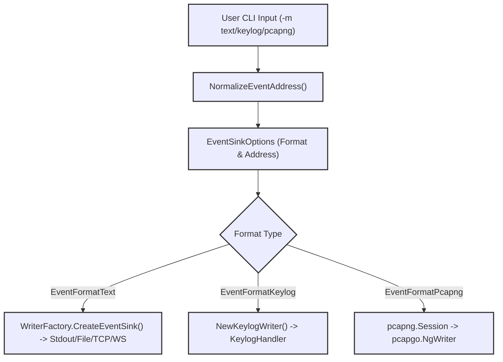
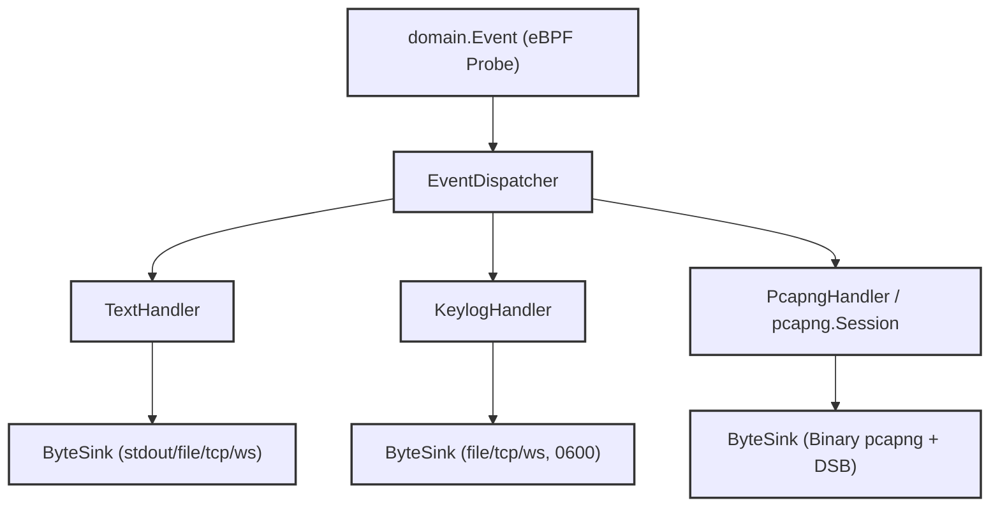

# Choosing Text, Keylog, or pcapng

Relevant source files

The following files were used as context for generating this wiki page:

- [cli/cmd/output_flags.go](https://github.com/gojue/ecapture/blob/8c9caada/cli/cmd/output_flags.go)
- [cli/cmd/output_pipeline_test.go](https://github.com/gojue/ecapture/blob/8c9caada/cli/cmd/output_pipeline_test.go)
- [docs/agent/output-pipeline-refactor-taskbook.md](https://github.com/gojue/ecapture/blob/8c9caada/docs/agent/output-pipeline-refactor-taskbook.md)
- [docs/agent/output-pipeline.md](https://github.com/gojue/ecapture/blob/8c9caada/docs/agent/output-pipeline.md)
- [internal/output/writers/factory.go](https://github.com/gojue/ecapture/blob/8c9caada/internal/output/writers/factory.go)
- [internal/output/writers/pipeline_test.go](https://github.com/gojue/ecapture/blob/8c9caada/internal/output/writers/pipeline_test.go)
- [test/e2e/fixtures/ecaptureq_assert/main.go](https://github.com/gojue/ecapture/blob/8c9caada/test/e2e/fixtures/ecaptureq_assert/main.go)

This page provides a technical decision framework for selecting among the three output capture modes (`text`, `keylog`, and `pcapng`) provided by eCapture's core TLS modules (`tls`, `gotls`, and `gnutls`). It details the internal representation mechanics, destination requirements, artifact structures, and operational caveats associated with each mode.

---

## 1. Capture Mode Decision Matrix

When configuring a core TLS capture session via `-m` or `--format`, you must choose a representation format that matches your downstream analysis workflow. The following table contrasts the three modes across critical architectural dimensions:

| Dimension | Text Mode (`text`) | Keylog Mode (`keylog`) | pcapng Mode (`pcapng`) |
| :--- | :--- | :--- | :--- |
| **Primary Use Case** | Immediate plaintext inspection, terminal debugging, or simple log aggregation. | Decrypting a separate packet capture (e.g., captured via `tcpdump`) inside Wireshark. | All-in-one packet capture containing network blocks and embedded decryption material. |
| **Artifact Content** | UTF-8 formatted plaintext payloads (HTTP, TLS application data transcripts). | NSS Key Log format lines (`CLIENT_RANDOM ...`). | Raw packet blocks combined with a Decryption Secrets Block (DSB). |
| **Destination Rules** | Defaults to `stdout` if empty; supports files, TCP streams, and binary WebSockets. | Requires an explicit destination (`stdout`, file, TCP, WebSocket); truncates files with `0600` permissions. | Requires an explicit destination; generates unframed binary byte streams; rejects byte rotation. |
| **Sensitivity & Security** | Normal sensitivity; logs application text payload directly. | Sensitive; exposes master session secrets capable of decrypting captured traffic. | Sensitive; contains both intercepted raw packets and session decryption keys. |
| **Implementation Entity** | `internal/output/writers.EventFormatText` via `TextHandler` [docs/agent/output-pipeline.md:14](https://github.com/gojue/ecapture/blob/8c9caada/docs/agent/output-pipeline.md#L14), [internal/output/writers/factory.go:29](https://github.com/gojue/ecapture/blob/8c9caada/internal/output/writers/factory.go#L29) | `internal/output/writers.EventFormatKeylog` via `KeylogHandler` [docs/agent/output-pipeline.md:15](https://github.com/gojue/ecapture/blob/8c9caada/docs/agent/output-pipeline.md#L15), [internal/output/writers/factory.go:30](https://github.com/gojue/ecapture/blob/8c9caada/internal/output/writers/factory.go#L30) | `internal/output/writers.EventFormatPcapng` via `pcapng.Session` [docs/agent/output-pipeline.md:16](https://github.com/gojue/ecapture/blob/8c9caada/docs/agent/output-pipeline.md#L16), [internal/output/writers/factory.go:31](https://github.com/gojue/ecapture/blob/8c9caada/internal/output/writers/factory.go#L31) |

Sources: [docs/agent/output-pipeline.md:1-124](https://github.com/gojue/ecapture/blob/8c9caada/docs/agent/output-pipeline.md#L1-L124), [internal/output/writers/factory.go:26-144](https://github.com/gojue/ecapture/blob/8c9caada/internal/output/writers/factory.go#L26-L144), [docs/agent/output-pipeline-refactor-taskbook.md:67-94](https://github.com/gojue/ecapture/blob/8c9caada/docs/agent/output-pipeline-refactor-taskbook.md#L67-L94)

---

## 2. Mode Selection to Code Mapping

This diagram bridges user-facing mode flags to the internal configuration structures and sink construction logic within eCapture.

Sources: [internal/output/writers/factory.go:48-144](https://github.com/gojue/ecapture/blob/8c9caada/internal/output/writers/factory.go#L48-L144), [docs/agent/output-pipeline-refactor-taskbook.md:67-115](https://github.com/gojue/ecapture/blob/8c9caada/docs/agent/output-pipeline-refactor-taskbook.md#L67-L115)

---

## 3. Detailed Mode Analysis

### 3.1 Text Mode (`text`)
Text mode intercepts decrypted application buffers directly from the eBPF uprobe/kprobe hook points and formats them into UTF-8 human-readable strings.
* **Data Flow:** Events are processed by `TextHandler`, which formats payloads using `String()` or `StringHex()` representations without operational-log pollution [docs/agent/output-pipeline.md:14](https://github.com/gojue/ecapture/blob/8c9caada/docs/agent/output-pipeline.md#L14), [cli/cmd/output_pipeline_test.go:36](https://github.com/gojue/ecapture/blob/8c9caada/cli/cmd/output_pipeline_test.go#L36).
* **Destinations:** By default, text mode targets `stdout`. However, it fully supports redirection to files, TCP listeners, or binary WebSocket streams (`--eventaddr`) [docs/agent/output-pipeline.md:68](https://github.com/gojue/ecapture/blob/8c9caada/docs/agent/output-pipeline.md#L68).
* **Caveats:** Text mode does not capture raw TCP/IP packet headers or underlying framing metadata; it records application-layer payloads and connection tuples as reported by the TLS library hooks.

Sources: [docs/agent/output-pipeline.md:14](https://github.com/gojue/ecapture/blob/8c9caada/docs/agent/output-pipeline.md#L14), [cli/cmd/output_pipeline_test.go:33-46](https://github.com/gojue/ecapture/blob/8c9caada/cli/cmd/output_pipeline_test.go#L33-L46)

### 3.2 Keylog Mode (`keylog`)
Keylog mode extracts TLS master secrets (e.g., `CLIENT_RANDOM` or TLS 1.3 `EXPORTER_SECRET` / handshake keys) as they are negotiated by OpenSSL, GoTLS, or GnuTLS.
* **Data Flow:** The underlying `KeylogHandler` processes cryptographic key material events and writes them via `KeylogWriter`, which wraps an arbitrary `ByteSink` to ensure strict newline formatting (`\n`) without mutating caller buffers [docs/agent/output-pipeline.md:15](https://github.com/gojue/ecapture/blob/8c9caada/docs/agent/output-pipeline.md#L15), [internal/output/writers/pipeline_test.go:77-104](https://github.com/gojue/ecapture/blob/8c9caada/internal/output/writers/pipeline_test.go#L77-L104).
* **Destinations:** Keylog mode requires an explicit destination (or uses the legacy `--keylogfile` alias). Files are created with restrictive `0600` permissions and truncated at startup [docs/agent/output-pipeline.md:81](https://github.com/gojue/ecapture/blob/8c9caada/docs/agent/output-pipeline.md#L81), [docs/agent/output-pipeline-refactor-taskbook.md:109](https://github.com/gojue/ecapture/blob/8c9caada/docs/agent/output-pipeline-refactor-taskbook.md#L109).
* **Caveats:** Keylog mode **does not contain packet data**. To inspect traffic, you must run a parallel packet capture (such as `tcpdump` or Wireshark) and configure Wireshark to load the generated key log file [docs/agent/output-pipeline.md:71](https://github.com/gojue/ecapture/blob/8c9caada/docs/agent/output-pipeline.md#L71).

Sources: [docs/agent/output-pipeline.md:71](https://github.com/gojue/ecapture/blob/8c9caada/docs/agent/output-pipeline.md#L71), [docs/agent/output-pipeline-refactor-taskbook.md:75-81](https://github.com/gojue/ecapture/blob/8c9caada/docs/agent/output-pipeline-refactor-taskbook.md#L75-L81), [internal/output/writers/pipeline_test.go:77-104](https://github.com/gojue/ecapture/blob/8c9caada/internal/output/writers/pipeline_test.go#L77-L104)

### 3.3 pcapng Mode (`pcapng`)
pcapng mode constructs a standards-compliant PCAP Next Generation capture artifact combining intercepted packet blocks with an embedded Decryption Secrets Block (DSB).
* **Data Flow:** `PcapngSession` manages a single dedicated goroutine running a `pcapgo.NgWriter`. Packet payloads and decryption secrets are queued, ordered synchronously, flushed upon request, and fully drained during shutdown [docs/agent/output-pipeline.md:16](https://github.com/gojue/ecapture/blob/8c9caada/docs/agent/output-pipeline.md#L16), [docs/agent/output-pipeline-refactor-taskbook.md:82-90](https://github.com/gojue/ecapture/blob/8c9caada/docs/agent/output-pipeline-refactor-taskbook.md#L82-L90).
* **Destinations:** Requires an explicit file path or network destination. Byte-stream rotation (`--rotate`) is strictly prohibited for pcapng streams because it corrupts container framing structures [docs/agent/output-pipeline.md:81](https://github.com/gojue/ecapture/blob/8c9caada/docs/agent/output-pipeline.md#L81), [internal/output/writers/pipeline_test.go:148](https://github.com/gojue/ecapture/blob/8c9caada/internal/output/writers/pipeline_test.go#L148).
* **Caveats:** Operational logging (`--logaddr`) and pcapng event streaming (`--eventaddr`) cannot both target `stdout` simultaneously, as intermixing textual log messages corrupts the binary pcapng stream [docs/agent/output-pipeline.md:84](https://github.com/gojue/ecapture/blob/8c9caada/docs/agent/output-pipeline.md#L84), [internal/output/writers/factory.go:70-75](https://github.com/gojue/ecapture/blob/8c9caada/internal/output/writers/factory.go#L70-L75).

Sources: [docs/agent/output-pipeline.md:16](https://github.com/gojue/ecapture/blob/8c9caada/docs/agent/output-pipeline.md#L16), [docs/agent/output-pipeline-refactor-taskbook.md:82-94](https://github.com/gojue/ecapture/blob/8c9caada/docs/agent/output-pipeline-refactor-taskbook.md#L82-L94), [internal/output/writers/factory.go:70-75](https://github.com/gojue/ecapture/blob/8c9caada/internal/output/writers/factory.go#L70-L75)

---

## 4. Output Pipeline Routing Architecture

The following diagram illustrates how captured domain events flow through the `EventDispatcher` to distinct representation handlers and out to independent `ByteSink` transports.

Sources: [docs/agent/output-pipeline.md:14-18](https://github.com/gojue/ecapture/blob/8c9caada/docs/agent/output-pipeline.md#L14-L18), [docs/agent/output-pipeline-refactor-taskbook.md:67-94](https://github.com/gojue/ecapture/blob/8c9caada/docs/agent/output-pipeline-refactor-taskbook.md#L67-L94)

---

## 5. Summary of Caveats & Validation Rules

* **Conflict Detection:** Explicitly supplying both `--eventaddr` and a legacy mode flag (`--keylogfile` or `--pcapfile`) with conflicting paths triggers a validation failure [internal/output/writers/factory.go:48-66](https://github.com/gojue/ecapture/blob/8c9caada/internal/output/writers/factory.go#L48-L66), [cli/cmd/output_pipeline_test.go:150-180](https://github.com/gojue/ecapture/blob/8c9caada/cli/cmd/output_pipeline_test.go#L150-L180).
* **Channel Isolation:** Captured payloads and cryptographic secrets are strictly segregated from operational logs (`--logaddr` and eCaptureQ `PROCESS_LOG`). Secrets never leak into standard operational run logs [docs/agent/output-pipeline.md:27-29](https://github.com/gojue/ecapture/blob/8c9caada/docs/agent/output-pipeline.md#L27-L29), [cli/cmd/output_pipeline_test.go:71-148](https://github.com/gojue/ecapture/blob/8c9caada/cli/cmd/output_pipeline_test.go#L71-L148).
* **File Permissions:** Sensitive artifact files (`keylog` and `pcapng`) enforce strict UNIX file permissions (`0600`) upon creation [internal/output/writers/factory.go:135-137](https://github.com/gojue/ecapture/blob/8c9caada/internal/output/writers/factory.go#L135-L137).

Sources: [docs/agent/output-pipeline.md:27-29](https://github.com/gojue/ecapture/blob/8c9caada/docs/agent/output-pipeline.md#L27-L29), [internal/output/writers/factory.go:48-137](https://github.com/gojue/ecapture/blob/8c9caada/internal/output/writers/factory.go#L48-L137), [cli/cmd/output_pipeline_test.go:71-180](https://github.com/gojue/ecapture/blob/8c9caada/cli/cmd/output_pipeline_test.go#L71-L180)