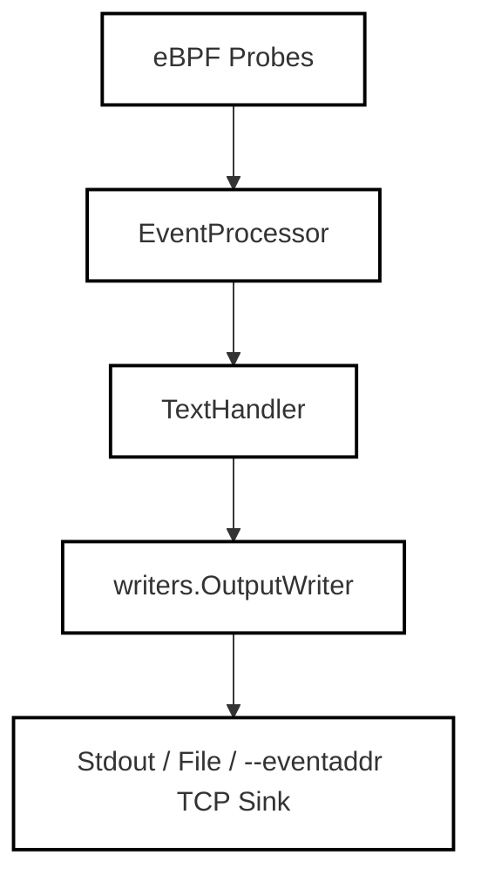

# Text Mode

<details>
<summary>Relevant source files</summary>

The following files were used as context for generating this wiki page:

- [internal/probe/base/handlers/text_handler.go](https://github.com/gojue/ecapture/blob/8c9caada/internal/probe/base/handlers/text_handler.go)
- [internal/probe/base/handlers/text_handler_test.go](https://github.com/gojue/ecapture/blob/8c9caada/internal/probe/base/handlers/text_handler_test.go)
- [pkg/event_processor/base_event.go](https://github.com/gojue/ecapture/blob/8c9caada/pkg/event_processor/base_event.go)
- [pkg/event_processor/http_request.go](https://github.com/gojue/ecapture/blob/8c9caada/pkg/event_processor/http_request.go)
- [pkg/event_processor/http_response.go](https://github.com/gojue/ecapture/blob/8c9caada/pkg/event_processor/http_response.go)
- [pkg/event_processor/iparser.go](https://github.com/gojue/ecapture/blob/8c9caada/pkg/event_processor/iparser.go)
- [pkg/event_processor/iworker.go](https://github.com/gojue/ecapture/blob/8c9caada/pkg/event_processor/iworker.go)
- [pkg/event_processor/processor.go](https://github.com/gojue/ecapture/blob/8c9caada/pkg/event_processor/processor.go)
- [pkg/event_processor/processor_test.go](https://github.com/gojue/ecapture/blob/8c9caada/pkg/event_processor/processor_test.go)

</details>


## Purpose and Scope
This page details **Text Mode** (`-m text`), the default operating mode for eCapture's core TLS capture modules (`tls`, `gotls`, and `gnutls`). Text mode intercepts encrypted TLS socket read/write operations via eBPF probes, decrypts or captures payloads in memory, and prints human-readable plaintext events directly to standard output or a designated event address. It is designed for immediate interactive inspection of HTTP requests, responses, and arbitrary application-layer payloads without requiring external packet captures or decryption key files.

Sources:
- [internal/probe/base/handlers/text_handler.go:26-34](https://github.com/gojue/ecapture/blob/8c9caada/internal/probe/base/handlers/text_handler.go#L26-L34)
- [pkg/event_processor/iworker.go:175-229](https://github.com/gojue/ecapture/blob/8c9caada/pkg/event_processor/iworker.go#L175-L229)

---

## Verified Text-Mode Commands
To run eCapture in text mode, specify the module (`tls`, `gotls`, or `gnutls`) along with `-m text`.

### OpenSSL / BoringSSL (`tls`)
```bash
ecapture tls -m text -p 1234
```
Alternatively, targeting a specific shared library path:
```bash
ecapture tls -m text --libssl /usr/lib/x86_64-linux-gnu/libssl.so.1.1
```

### Go Native TLS (`gotls`)
```bash
ecapture gotls -m text --pid 5678
```

### GnuTLS (`gnutls`)
```bash
ecapture gnutls -m text -p 9012
```

Sources:
- [internal/probe/base/handlers/text_handler.go:49-57](https://github.com/gojue/ecapture/blob/8c9caada/internal/probe/base/handlers/text_handler.go#L49-L57)

---

## Default Standard Output and Optional `--eventaddr`
By default, Text Mode routes all formatted plaintext events to standard output (`stdout`) via `writers.NewStdoutWriter()`. 

When operating in distributed or automated environments, you can redirect captured events using the optional `--eventaddr` flag. Unlike `--logaddr` (which carries operational engine logs only), `--eventaddr` transmits the processed event stream to a remote TCP sink, WebSocket endpoint, or file descriptor.


*Figure 1: Text Mode Output Routing Architecture*

Sources:
- [internal/probe/base/handlers/text_handler.go:49-57](https://github.com/gojue/ecapture/blob/8c9caada/internal/probe/base/handlers/text_handler.go#L49-L57)
- [pkg/event_processor/processor.go:70-93](https://github.com/gojue/ecapture/blob/8c9caada/pkg/event_processor/processor.go#L70-L93)

---

## Expected Plaintext Events and Formatting
When an application reads or writes data through a hooked TLS session, eCapture dispatches a binary event structure (`BaseEvent`) which is subsequently processed by `eventWorker` and formatted by `TextHandler`.

### Event Structure and Layout
Each event captures metadata including Process ID (`PID`), Thread ID (`TID`), Process Name (`Comm`), File Descriptor (`Fd`), TLS Version, and direction (`Received` vs `Send`).

```mermaid
graph TD
  A["User Command (-m text)"] --> B["internal/probe/base/handlers/TextHandler"]
  B --> C["pkg/event_processor/BaseEvent"]
  C -->|String()| D["Human-Readable Plaintext"]
  C -->|StringHex()| E["Hex Dump View (--hex)"]

  classDef default fill:none,stroke:#000,stroke-width:2px;
```
*Figure 2: Event Decoding and Formatting Entity Flow*

An expected plaintext output for an HTTP request captured via `tls` or `gotls` resembles:
```text
PID:469929, Comm:curl, TID:469929, Version:TLS1_3_VERSION, Received 308 bytes, Payload:
GET / HTTP/1.1
Host: example.com
User-Agent: curl/7.88.1
Accept: */*
```

Sources:
- [pkg/event_processor/base_event.go:76-167](https://github.com/gojue/ecapture/blob/8c9caada/pkg/event_processor/base_event.go#L76-L167)
- [internal/probe/base/handlers/text_handler.go:61-111](https://github.com/gojue/ecapture/blob/8c9caada/internal/probe/base/handlers/text_handler.go#L61-L111)

---

## Simple Verification Flow
To verify that text-mode capture is functioning correctly, execute the following validation steps:

1. **Start the Target Application**: Launch a server or run a repeating client request against an HTTPS endpoint using OpenSSL, Go, or GnuTLS.
2. **Execute eCapture**: Run the text-mode probe with root privileges:
   ```bash
   sudo ecapture tls -m text -bb
   ```
3. **Trigger Traffic**: In a separate terminal, execute a request:
   ```bash
   curl -Iv https://www.example.com/
   ```
4. **Confirm Output**: Observe the terminal running eCapture. Plaintext HTTP headers and request bodies should appear instantly without requiring decryption keys or Wireshark.

Sources:
- [pkg/event_processor/processor_test.go:31-114](https://github.com/gojue/ecapture/blob/8c9caada/pkg/event_processor/processor_test.go#L31-L114)
- [internal/probe/base/handlers/text_handler_test.go:133-157](https://github.com/gojue/ecapture/blob/8c9caada/internal/probe/base/handlers/text_handler_test.go#L133-L157)