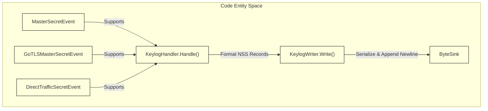
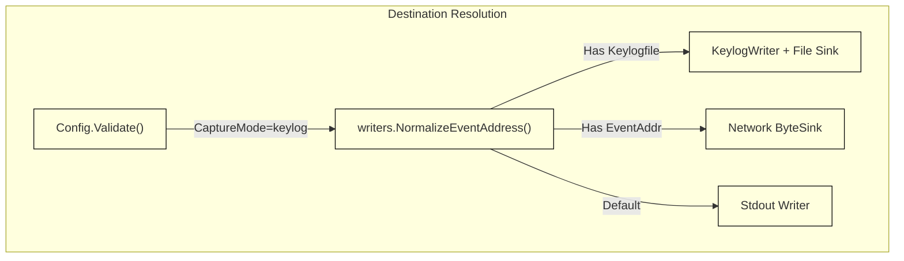

# Keylog Mode

<details>
<summary>Relevant source files</summary>

The following files were used as context for generating this wiki page:

- [internal/output/writers/keylog_writer.go](https://github.com/gojue/ecapture/blob/8c9caada/internal/output/writers/keylog_writer.go)
- [internal/probe/base/handlers/keylog_handler.go](https://github.com/gojue/ecapture/blob/8c9caada/internal/probe/base/handlers/keylog_handler.go)
- [internal/probe/base/handlers/keylog_handler_test.go](https://github.com/gojue/ecapture/blob/8c9caada/internal/probe/base/handlers/keylog_handler_test.go)
- [internal/probe/gnutls/config.go](https://github.com/gojue/ecapture/blob/8c9caada/internal/probe/gnutls/config.go)
- [internal/probe/gnutls/config_test.go](https://github.com/gojue/ecapture/blob/8c9caada/internal/probe/gnutls/config_test.go)
- [internal/probe/gnutls/event.go](https://github.com/gojue/ecapture/blob/8c9caada/internal/probe/gnutls/event.go)
- [internal/probe/gnutls/event_masterkey.go](https://github.com/gojue/ecapture/blob/8c9caada/internal/probe/gnutls/event_masterkey.go)
- [internal/probe/gnutls/event_packet.go](https://github.com/gojue/ecapture/blob/8c9caada/internal/probe/gnutls/event_packet.go)

</details>


## Purpose and Scope
Keylog Mode in `ecapture` is designed to intercept TLS master secrets and ephemeral traffic secrets from user-space libraries (`tls` for OpenSSL/BoringSSL, `gotls` for Go native crypto/tls, and `gnutls` for GnuTLS) without decrypting or capturing packet payloads directly within the eBPF kernel space. Instead, eCapture serializes these cryptographic secrets into the standard **NSS Key Log Format**, outputting them to stdout, a file, or a network sink. 

This mode is ideal for scenarios where packet capture (`pcapng`) overhead must be minimized or where network packets are captured independently via standard network diagnostic tools (such as `tcpdump` or cloud packet mirrors) and later decrypted in analysis tools like Wireshark by combining the packet trace with the exported key log file.

Sources: [internal/probe/base/handlers/keylog_handler.go:81-98](https://github.com/gojue/ecapture/blob/8c9caada/internal/probe/base/handlers/keylog_handler.go#L81-L98), [internal/probe/gnutls/config.go:154-173](https://github.com/gojue/ecapture/blob/8c9caada/internal/probe/gnutls/config.go#L154-L173)

---

## 1. Verified Keylog Commands
To run eCapture in Keylog Mode, use the `-m keylog` (or `--mode keylog`) flag across the core TLS probes.

### OpenSSL / BoringSSL (`tls`)
```bash
ecapture tls -m keylog --keylogfile=/tmp/openssl_keylog.txt
```

### Go Native TLS (`gotls`)
```bash
ecapture gotls -m keylog --keylogfile=/tmp/gotls_keylog.txt --pid=1234
```

### GnuTLS (`gnutls`)
```bash
ecapture gnutls -m keylog --keylogfile=/tmp/gnutls_keylog.txt
```

Sources: [internal/probe/base/handlers/keylog_handler.go:81-120](https://github.com/gojue/ecapture/blob/8c9caada/internal/probe/base/handlers/keylog_handler.go#L81-L120), [internal/probe/gnutls/config.go:154-173](https://github.com/gojue/ecapture/blob/8c9caada/internal/probe/gnutls/config.go#L154-L173)

---

## 2. NSS Key Log Format & Implementation
The core component responsible for formatting and emitting cryptographic secrets is `KeylogHandler` [internal/probe/base/handlers/keylog_handler.go:81](https://github.com/gojue/ecapture/blob/8c9caada/internal/probe/base/handlers/keylog_handler.go#L81), supported by `KeylogWriter` [internal/output/writers/keylog_writer.go:27](https://github.com/gojue/ecapture/blob/8c9caada/internal/output/writers/keylog_writer.go#L27). 

### Supported Secret Types
Depending on the TLS version and library implementation, eCapture handles multiple secret structures:
1. **TLS 1.2 and Earlier (`CLIENT_RANDOM`)**: Emits the 32-byte client random combined with the 48-byte master secret.
2. **TLS 1.3 (`TRAFFIC_SECRET` / Handshake Secrets)**: Emits individual traffic secrets such as `CLIENT_HANDSHAKE_TRAFFIC_SECRET`, `SERVER_HANDSHAKE_TRAFFIC_SECRET`, `CLIENT_TRAFFIC_SECRET_0`, `SERVER_TRAFFIC_SECRET_0`, and `EXPORTER_SECRET`.
3. **GoTLS Label-Based Format**: Utilizes Go's internal secret labels (`CLIENT_HANDSHAKE_TRAFFIC_SECRET`, `SERVER_HANDSHAKE_TRAFFIC_SECRET`, etc.) paired with the client random [internal/probe/base/handlers/keylog_handler.go:54-61](https://github.com/gojue/ecapture/blob/8c9caada/internal/probe/base/handlers/keylog_handler.go#L54-L61).


*Figure 1: Keylog event ingestion and formatting pipeline mapping events to `KeylogHandler` and `KeylogWriter`.*

Sources: [internal/probe/base/handlers/keylog_handler.go:37-120](https://github.com/gojue/ecapture/blob/8c9caada/internal/probe/base/handlers/keylog_handler.go#L37-L120), [internal/output/writers/keylog_writer.go:27-72](https://github.com/gojue/ecapture/blob/8c9caada/internal/output/writers/keylog_writer.go#L27-L72)

---

## 3. Destination Rules and `--keylogfile` Compatibility
Keylog mode writes records line-by-line, ensuring each entry is terminated by a newline (`\n`). 

### Destination Options
- **Default (Stdout)**: If neither `--eventaddr` nor `--keylogfile` is specified, keylog entries stream directly to standard output.
- **File Output (`--keylogfile`)**: Directs keylog output to a specific file path. `--keylogfile` acts as a compatibility alias for normalizing the event destination sink [internal/probe/gnutls/config.go:166-173](https://github.com/gojue/ecapture/blob/8c9caada/internal/probe/gnutls/config.go#L166-L173).
- **Network Sinks (`--eventaddr`)**: Supports TCP or WebSocket remote collectors by normalizing the address format [internal/probe/gnutls/config.go:168](https://github.com/gojue/ecapture/blob/8c9caada/internal/probe/gnutls/config.go#L168).


*Figure 2: Configuration validation and destination routing for Keylog Mode.*

Sources: [internal/probe/gnutls/config.go:154-173](https://github.com/gojue/ecapture/blob/8c9caada/internal/probe/gnutls/config.go#L154-L173), [internal/output/writers/keylog_writer.go:27-50](https://github.com/gojue/ecapture/blob/8c9caada/internal/output/writers/keylog_writer.go#L27-L50)

---

## 4. Independent Packet Capture for Wireshark
Unlike `pcapng` mode (which embeds decryption secrets directly inside the packet capture file), Keylog Mode separates packet acquisition from key logging:
1. **Capture Packets**: Record network traffic independently using tools like `tcpdump`:
   ```bash
   tcpdump -i eth0 -w /tmp/traffic.pcap 'tcp port 443'
   ```
2. **Capture Secrets**: Run eCapture in keylog mode:
   ```bash
   ecapture tls -m keylog --keylogfile=/tmp/keys.log
   ```
3. **Decrypt in Wireshark**: 
   - Open `/tmp/traffic.pcap` in Wireshark.
   - Navigate to **Edit > Preferences > Protocols > TLS**.
   - Set **(Pre)-Master-Secret log filename** to `/tmp/keys.log`.
   - Wireshark will automatically use the logged secrets to decrypt TLS sessions on the fly.

Sources: [internal/probe/base/handlers/keylog_handler.go:81-98](https://github.com/gojue/ecapture/blob/8c9caada/internal/probe/base/handlers/keylog_handler.go#L81-L98)

---

## 5. Sensitive-File Handling and Security Considerations
Because cryptographic keys grant immediate decryption capabilities for recorded or live TLS streams, key log files represent highly sensitive security artifacts:
- **File Permissions**: When using `--keylogfile`, ensure the output file is created with restricted permissions (e.g., `0600`) so that unprivileged local users cannot read master secrets.
- **Storage**: Avoid storing key logs on persistent or world-readable storage volumes; prefer temporary secure directories (`/tmp/`) or streaming over encrypted network sinks via `--eventaddr`.
- **Cleanup**: Purge key log files immediately after analysis sessions conclude.

Sources: [internal/probe/base/handlers/keylog_handler.go:81-131](https://github.com/gojue/ecapture/blob/8c9caada/internal/probe/base/handlers/keylog_handler.go#L81-L131), [internal/output/writers/keylog_writer.go:51-72](https://github.com/gojue/ecapture/blob/8c9caada/internal/output/writers/keylog_writer.go#L51-L72)