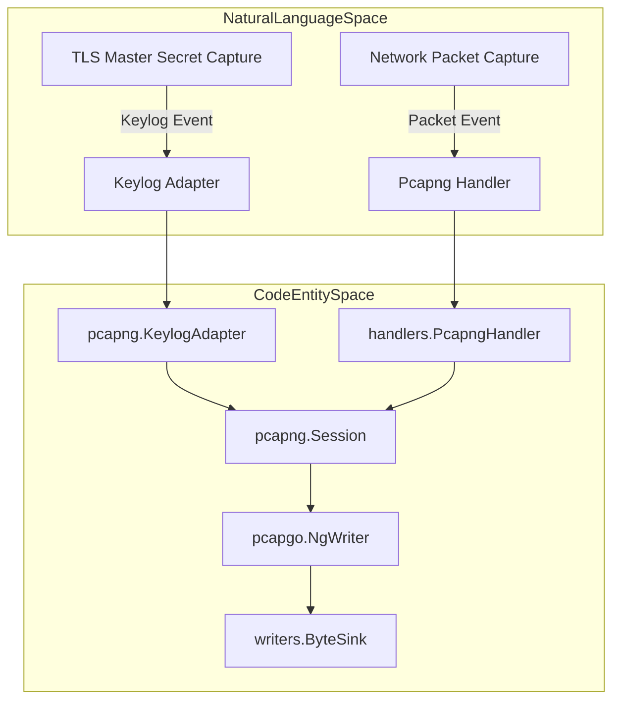
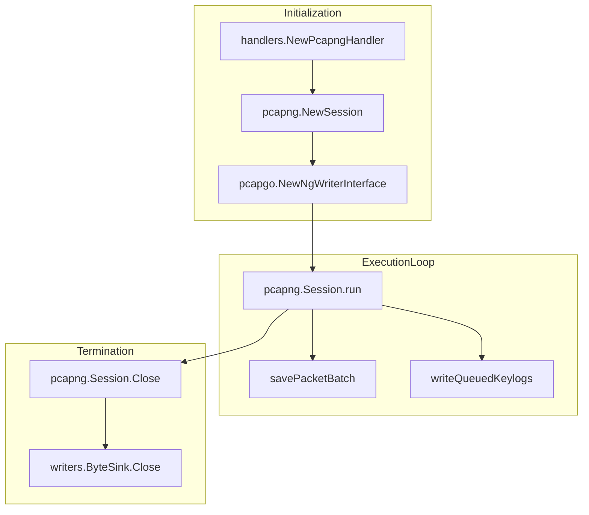

# pcapng Mode

<details>
<summary>Relevant source files</summary>

The following files were used as context for generating this wiki page:

- [internal/output/pcapng/destinations_test.go](https://github.com/gojue/ecapture/blob/8c9caada/internal/output/pcapng/destinations_test.go)
- [internal/output/pcapng/keylog_adapter.go](https://github.com/gojue/ecapture/blob/8c9caada/internal/output/pcapng/keylog_adapter.go)
- [internal/output/pcapng/session.go](https://github.com/gojue/ecapture/blob/8c9caada/internal/output/pcapng/session.go)
- [internal/output/pcapng/session_test.go](https://github.com/gojue/ecapture/blob/8c9caada/internal/output/pcapng/session_test.go)
- [internal/probe/base/handlers/pcapng_handler.go](https://github.com/gojue/ecapture/blob/8c9caada/internal/probe/base/handlers/pcapng_handler.go)
- [internal/probe/base/handlers/pcapng_handler_test.go](https://github.com/gojue/ecapture/blob/8c9caada/internal/probe/base/handlers/pcapng_handler_test.go)

</details>


## Purpose and Scope

This page covers the technical design, configuration, and operational workflow of eCapture's `pcapng` capture mode (`-m pcap` or `-m pcapng`). This mode records network packets via eBPF probes (such as Traffic Control (TC) filters or socket hooks) and simultaneously captures TLS master secrets from core cryptographic libraries (`tls`, `gotls`, `gnutls`). It serializes both data streams into a single `pcapng` artifact containing standard packet blocks and embedded TLS Decryption Secrets Blocks (DSB). This format allows tools like Wireshark to decrypt HTTPS and TLS traffic automatically without requiring a separate keylog file.

Sources: [internal/probe/base/handlers/pcapng_handler.go:88-101](https://github.com/gojue/ecapture/blob/8c9caada/internal/probe/base/handlers/pcapng_handler.go#L88-L101), [internal/output/pcapng/session.go:46-76](https://github.com/gojue/ecapture/blob/8c9caada/internal/output/pcapng/session.go#L46-L76)

---

## Verified Commands for Core TLS Modules

To execute captures using the `pcapng` format, select `-m pcap` or `-m pcapng` alongside the target module (`tls`, `gotls`, or `gnutls`).

### OpenSSL and BoringSSL (`tls`)
```bash
ecapture tls -m pcapng --pcapfile capture.pcapng -i eth0
```

### Go Native TLS (`gotls`)
```bash
ecapture gotls -m pcapng --pcapfile capture.pcapng --pid 12345
```

### GnuTLS (`gnutls`)
```bash
ecapture gnutls -m pcapng --pcapfile capture.pcapng -i eth0
```

Sources: [internal/probe/base/handlers/pcapng_handler.go:188-194](https://github.com/gojue/ecapture/blob/8c9caada/internal/probe/base/handlers/pcapng_handler.go#L188-L194), [internal/output/pcapng/session.go:78-166](https://github.com/gojue/ecapture/blob/8c9caada/internal/output/pcapng/session.go#L78-L166)

---

## Interface Selection and Destination Rules

The `pcapng` session initializes by inspecting system network interfaces using `net.Interfaces()` to build interface description blocks (`NgInterface`) [internal/output/pcapng/session.go:84-133](https://github.com/gojue/ecapture/blob/8c9caada/internal/output/pcapng/session.go#L84-L133). 

- **Interface Selection (`-i` / `--interface`)**: The interface specified by the user is designated as the primary capture interface (`ifaceIdx`). All other active interfaces are automatically added to the `pcapng` header so that packets originating across bridge or loopback devices map correctly [internal/output/pcapng/session.go:112-148](https://github.com/gojue/ecapture/blob/8c9caada/internal/output/pcapng/session.go#L112-L148).
- **Destination Sinks**: Captured data is written to a `ByteSink` abstraction supporting multiple output destinations including local files, TCP streams (`tcp://host:port`), WebSockets (`ws://host:port/`), and in-memory buffers for testing [internal/output/pcapng/destinations_test.go:43-105](https://github.com/gojue/ecapture/blob/8c9caada/internal/output/pcapng/destinations_test.go#L43-L105).

Sources: [internal/output/pcapng/session.go:78-148](https://github.com/gojue/ecapture/blob/8c9caada/internal/output/pcapng/session.go#L78-L148), [internal/output/pcapng/destinations_test.go:43-132](https://github.com/gojue/ecapture/blob/8c9caada/internal/output/pcapng/destinations_test.go#L43-L132)

---

## `--pcapfile` Compatibility and Output Aliases

The flag `--pcapfile` serves as a backward-compatible alias for specifying the output destination path when running in `pcap` or `pcapng` mode. Under the hood, the CLI parses this flag and initializes `PcapngHandler`, which wraps a stateful `pcapng.Session` and allocates the underlying `ByteSink` [internal/probe/base/handlers/pcapng_handler.go:120-137](https://github.com/gojue/ecapture/blob/8c9caada/internal/probe/base/handlers/pcapng_handler.go#L120-L137).

Sources: [internal/probe/base/handlers/pcapng_handler.go:120-137](https://github.com/gojue/ecapture/blob/8c9caada/internal/probe/base/handlers/pcapng_handler.go#L120-L137), [internal/output/pcapng/session.go:168-198](https://github.com/gojue/ecapture/blob/8c9caada/internal/output/pcapng/session.go#L168-L198)

---

## Packet Blocks and the TLS Decryption Secrets Block (DSB) Implementation

The `Session` struct manages concurrent ingestion of network packets (`TcPacket`) and TLS keylog entries [internal/output/pcapng/session.go:47-76](https://github.com/gojue/ecapture/blob/8c9caada/internal/output/pcapng/session.go#L47-L76). Packets are queued without dropping during high-throughput bursts using a non-blocking notification channel (`queueReady`) [internal/output/pcapng/session.go:56-63](https://github.com/gojue/ecapture/blob/8c9caada/internal/output/pcapng/session.go#L56-L63). Keylog entries are transformed into TLS Decryption Secrets Blocks (`DSB_SECRETS_TYPE_TLS`) and written into the encoder stream [internal/output/pcapng/session.go:220-234](https://github.com/gojue/ecapture/blob/8c9caada/internal/output/pcapng/session.go#L220-L234).

### Architecture Flow: Natural Language to Code Entities



Sources: [internal/probe/base/handlers/pcapng_handler.go:139-169](https://github.com/gojue/ecapture/blob/8c9caada/internal/probe/base/handlers/pcapng_handler.go#L139-L169), [internal/output/pcapng/keylog_adapter.go:40-47](https://github.com/gojue/ecapture/blob/8c9caada/internal/output/pcapng/keylog_adapter.go#L40-L47), [internal/output/pcapng/session.go:168-230](https://github.com/gojue/ecapture/blob/8c9caada/internal/output/pcapng/session.go#L168-L230)

---

## Wireshark Inspection and Verification Workflow

When the generated `.pcapng` file is loaded into Wireshark:
1. Wireshark parses the Section Header Block and Interface Description Blocks.
2. It encounters the embedded **Decryption Secrets Block (DSB)** containing NSS keylog lines (`CLIENT_TRAFFIC_SECRET_0`, etc.).
3. When parsing subsequent Enhanced Packet Blocks (`EPB`), Wireshark uses the embedded secrets to decrypt TLS 1.3 and TLS 1.2 handshake and application data records automatically.

### Session Lifecycle and Execution Flow



Sources: [internal/probe/base/handlers/pcapng_handler.go:119-137](https://github.com/gojue/ecapture/blob/8c9caada/internal/probe/base/handlers/pcapng_handler.go#L119-L137), [internal/output/pcapng/session.go:78-166](https://github.com/gojue/ecapture/blob/8c9caada/internal/output/pcapng/session.go#L78-L166), [internal/output/pcapng/session_test.go:59-107](https://github.com/gojue/ecapture/blob/8c9caada/internal/output/pcapng/session_test.go#L59-L107)