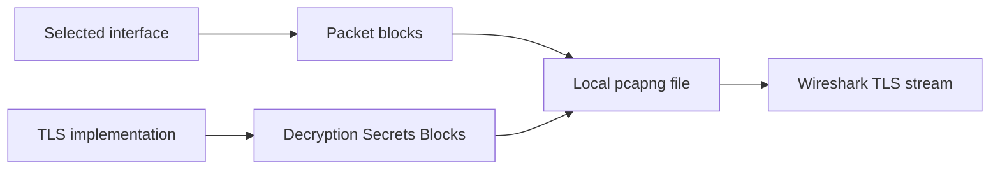

# pcapng Mode

Choose `--model pcapng` (alias `-m pcap`) to record packets and their available TLS secrets in a single Wireshark-readable file. Supply an explicit local `--pcapfile` (`-w`). The probe records encrypted packets and embeds the secrets in Decryption Secrets Blocks (DSBs). Wireshark uses those blocks to reconstruct plaintext.

```bash
sudo ecapture tls --model pcapng --pcapfile openssl.pcapng
sudo ecapture gotls --elfpath ./go-client --model pcapng --pcapfile go.pcapng
sudo ecapture gnutls --model pcapng --pcapfile gnutls.pcapng
```

## Capture the right interface

Without `-i`, eCapture chooses one active Ethernet interface. It first checks IPv4 and IPv6 default routes and prefers the lowest metric. With no usable default route it prefers the largest RX+TX traffic counter, then an up interface. The startup log reports its choice and reason. Use `-i lo` for loopback, or `--ifname NAME` to select a specific interface. A filter such as `'tcp port 443'` selects HTTPS over TCP. Include UDP when recording HTTP/3. [Interface selection](https://github.com/gojue/ecapture/blob/v2.12.0/internal/config/capture_interface.go)

Start capture before the handshake, generate a fresh test request, stop the collector, then open the file. Multiple packets may belong to a single decoded message. Unknown process attribution stays unknown. Where observed, the file preserves PID, process name and a capture-time snapshot of up to 256 bytes of process arguments, including a truncation indicator. [Wireshark process fields](https://github.com/gojue/ecapture/blob/v2.12.0/utils/ecapture.lua)



## Local files and subscribers

In this example `session.pcapng` holds the native capture and `runtime.jsonl` holds the runtime logs.

```bash
sudo ecapture tls --model pcapng --pcapfile session.pcapng --output runtime.jsonl
```

An additional `--keylogfile session.keys` also saves a standalone NSS copy. A terminal destination in v2.12.0 prints runtime logs and labeled byte-count summaries. A local JSON Lines destination gets runtime logs only. TCP and WebSocket carry native `PCAPNG` event bytes. A subscriber that joins late receives a new section and future packets/secrets. To verify decryption, start the client before the test handshake and check a known HTTP message as described in [Wireshark decryption workflows](3.6-wireshark-decryption-workflows.md). [Native files and subscribers](https://github.com/gojue/ecapture/blob/v2.12.0/docs/event-forward-api.md)
