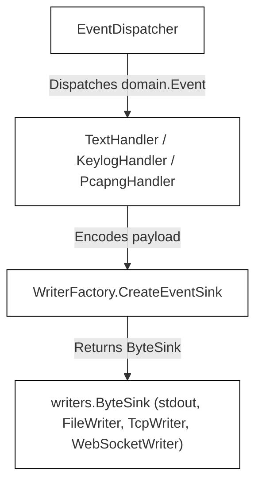
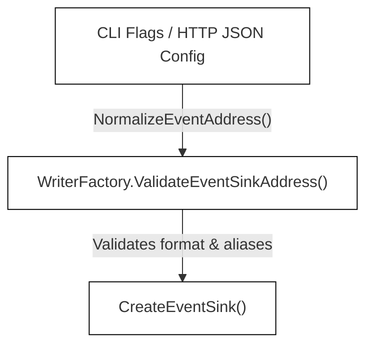

# Event Destinations and Rotation

<details>
<summary>Relevant source files</summary>

The following files were used as context for generating this wiki page:

- [docs/agent/output-pipeline-refactor-taskbook.md](https://github.com/gojue/ecapture/blob/8c9caada/docs/agent/output-pipeline-refactor-taskbook.md)
- [docs/agent/output-pipeline.md](https://github.com/gojue/ecapture/blob/8c9caada/docs/agent/output-pipeline.md)
- [internal/output/writers/factory.go](https://github.com/gojue/ecapture/blob/8c9caada/internal/output/writers/factory.go)
- [internal/output/writers/file_writer.go](https://github.com/gojue/ecapture/blob/8c9caada/internal/output/writers/file_writer.go)
- [internal/output/writers/pipeline_test.go](https://github.com/gojue/ecapture/blob/8c9caada/internal/output/writers/pipeline_test.go)
- [pkg/util/ws/client.go](https://github.com/gojue/ecapture/blob/8c9caada/pkg/util/ws/client.go)
- [pkg/util/ws/client_test.go](https://github.com/gojue/ecapture/blob/8c9caada/pkg/util/ws/client_test.go)
- [test/e2e/fixtures/ecaptureq_assert/main.go](https://github.com/gojue/ecapture/blob/8c9caada/test/e2e/fixtures/ecaptureq_assert/main.go)

</details>


This section explains the architecture, configuration rules, and runtime behaviors of event destinations and rotation for captured events across all three core TLS modules (`tls`, `gotls`, and `gnutls`). It details the uniform `--eventaddr` flag, the `writers.ByteSink` abstraction, supported transport sinks (stdout, file, TCP, and binary WebSocket), mode-specific destination requirements, rotation limits, legacy flag aliases, and strict separation from operational logging (`--logaddr`).

---

## 1. The Uniform Event Destination Flag (`--eventaddr`)

In `ecapture`, captured domain events are decoupled from operational diagnostic logs. The `--eventaddr` flag (backed by `EventCollectorAddr` in the agent configuration) serves as the sole primary destination selector for captured events across OpenSSL, GoTLS, and GnuTLS capture modules [docs/agent/output-pipeline.md:88-91](https://github.com/gojue/ecapture/blob/8c9caada/docs/agent/output-pipeline.md#L88-L91).

The CLI representation mode (`-m text`, `-m keylog`, `-m pcap` or `-m pcapng`) controls the data encoding format, while `--eventaddr` specifies where those encoded bytes are transported [docs/agent/output-pipeline.md:90-91](https://github.com/gojue/ecapture/blob/8c9caada/docs/agent/output-pipeline.md#L90-L91). 


*Figure 1: Event Destination Architecture and Code Entity Mapping*

Sources: [docs/agent/output-pipeline.md:14-18](https://github.com/gojue/ecapture/blob/8c9caada/docs/agent/output-pipeline.md#L14-L18), [docs/agent/output-pipeline.md:88-91](https://github.com/gojue/ecapture/blob/8c9caada/docs/agent/output-pipeline.md#L88-L91), [internal/output/writers/factory.go:77-80](https://github.com/gojue/ecapture/blob/8c9caada/internal/output/writers/factory.go#L77-L80)

---

## 2. Supported Sinks (`ByteSink` Sinks)

All raw event destinations implement the `writers.ByteSink` interface [docs/agent/output-pipeline.md:33-43](https://github.com/gojue/ecapture/blob/8c9caada/docs/agent/output-pipeline.md#L33-L43). The interface abstracts underlying transports so that text, keylog, and pcapng handlers write data uniformly without knowing whether the destination is a console, disk file, network socket, or WebSocket stream [docs/agent/output-pipeline.md:67-73](https://github.com/gojue/ecapture/blob/8c9caada/docs/agent/output-pipeline.md#L67-L73).

```go
type ByteSink interface {
    io.Writer
    Name() string
    Flush() error
    Close() error
}
```
*Source: [docs/agent/output-pipeline.md:36-41](https://github.com/gojue/ecapture/blob/8c9caada/docs/agent/output-pipeline.md#L36-L41)*

The `WriterFactory` constructs four distinct transport types based on the URI scheme or destination name provided to `--eventaddr`:

1. **Stdout (`stdout` or empty for text mode)**: Uses `NewStdoutWriter()` to write directly to standard output [internal/output/writers/factory.go:163-164](https://github.com/gojue/ecapture/blob/8c9caada/internal/output/writers/factory.go#L163-L164).
2. **File (`file://...` or a plain filesystem path)**: Uses `NewFileWriter()` to write to local disk with configurable buffering, truncation, and permission settings (`0600` for sensitive keys/pcapng) [internal/output/writers/factory.go:165-168](https://github.com/gojue/ecapture/blob/8c9caada/internal/output/writers/factory.go#L165-L168), [internal/output/writers/factory.go:129-137](https://github.com/gojue/ecapture/blob/8c9caada/internal/output/writers/factory.go#L129-L137).
3. **TCP (`tcp://host:port`)**: Uses `NewTcpWriter()` to establish an ordered raw byte stream over TCP [internal/output/writers/factory.go:169-170](https://github.com/gojue/ecapture/blob/8c9caada/internal/output/writers/factory.go#L169-L170).
4. **WebSocket (`ws://...` or `wss://...`)**: Uses `NewWebSocketWriter()` to stream binary WebSocket frames [internal/output/writers/factory.go:171-172](https://github.com/gojue/ecapture/blob/8c9caada/internal/output/writers/factory.go#L171-L172), [pkg/util/ws/client.go:23-36](https://github.com/gojue/ecapture/blob/8c9caada/pkg/util/ws/client.go#L23-L36). Receivers reconstruct the ordered artifact by concatenating frame payloads in arrival order [docs/agent/output-pipeline.md:44-48](https://github.com/gojue/ecapture/blob/8c9caada/docs/agent/output-pipeline.md#L44-L48).

Sources: [docs/agent/output-pipeline.md:33-48](https://github.com/gojue/ecapture/blob/8c9caada/docs/agent/output-pipeline.md#L33-L48), [internal/output/writers/factory.go:120-176](https://github.com/gojue/ecapture/blob/8c9caada/internal/output/writers/factory.go#L120-L176)

---

## 3. Mode-Specific Destination and Rotation Rules

Destination requirements and rotation capabilities vary strictly by capture mode:

| Mode | Default Destination | Explicit Destination Required? | Rotation Supported? | Sensitive Permissions / Truncation |
| :--- | :--- | :--- | :--- | :--- |
| **text** | `stdout` (when `--eventaddr` is empty) | No | Yes (file-backed only) | Standard permissions, append/truncate per config |
| **keylog** | None | **Yes** | Yes (file-backed only) | `0600` permissions, truncated at start [docs/agent/output-pipeline.md:81-82](https://github.com/gojue/ecapture/blob/8c9caada/docs/agent/output-pipeline.md#L81-L82) |
| **pcapng** | None | **Yes** | **No** (rejected during validation) [internal/output/writers/factory.go:105-107](https://github.com/gojue/ecapture/blob/8c9caada/internal/output/writers/factory.go#L105-L107) | `0600` permissions, truncated at start [docs/agent/output-pipeline.md:81-82](https://github.com/gojue/ecapture/blob/8c9caada/docs/agent/output-pipeline.md#L81-L82) |

### Validation & Rotation Limits
* **Network & Pcapng Sinks**: Rotation (`--max-size`, `--max-interval`) is restricted exclusively to file-backed text or keylog streams [docs/agent/output-pipeline.md:79-83](https://github.com/gojue/ecapture/blob/8c9caada/docs/agent/output-pipeline.md#L79-L83). Configuring rotation on a pcapng stream or a network sink (`tcp://`, `ws://`) fails validation during `WriterFactory.ValidateEventSinkAddress()` [internal/output/writers/factory.go:105-116](https://github.com/gojue/ecapture/blob/8c9caada/internal/output/writers/factory.go#L105-L116).
* **Stream Integrity**: Network sinks operate on a strict error policy. A failed connection terminates the stream; intermediate reconnection during an active pcapng artifact is not supported [docs/agent/output-pipeline.md:47-48](https://github.com/gojue/ecapture/blob/8c9caada/docs/agent/output-pipeline.md#L47-L48).

Sources: [docs/agent/output-pipeline.md:79-87](https://github.com/gojue/ecapture/blob/8c9caada/docs/agent/output-pipeline.md#L79-L87), [internal/output/writers/factory.go:92-116](https://github.com/gojue/ecapture/blob/8c9caada/internal/output/writers/factory.go#L92-L116)

---

## 4. Legacy Output Aliases and Normalization

To maintain backward compatibility with legacy command-line interfaces, `ecapture` provides alias flags that map directly to the uniform event destination system [docs/agent/output-pipeline.md:94-98](https://github.com/gojue/ecapture/blob/8c9caada/docs/agent/output-pipeline.md#L94-L98).


*Figure 2: Normalization and Validation Workflow*

### Aliasing Rules
* `--keylogfile`: Acts as the legacy primary-file alias when operating in keylog mode (`-m keylog`) [docs/agent/output-pipeline.md:94-95](https://github.com/gojue/ecapture/blob/8c9caada/docs/agent/output-pipeline.md#L94-L95). When running in `pcapng` mode, `--keylogfile` functions as a separate, optional secondary keylog artifact while `--eventaddr` (or `--pcapfile`) targets the primary pcapng stream [docs/agent/output-pipeline.md:98](https://github.com/gojue/ecapture/blob/8c9caada/docs/agent/output-pipeline.md#L98).
* `--pcapfile`: Acts as the legacy primary-file alias when operating in pcapng mode (`-m pcap` or `-m pcapng`) [docs/agent/output-pipeline.md:96-97](https://github.com/gojue/ecapture/blob/8c9caada/docs/agent/output-pipeline.md#L96-L97).
* **Conflict Detection**: Explicitly setting both `--eventaddr` and its corresponding legacy primary flag (`--keylogfile` in keylog mode, or `--pcapfile` in pcapng mode) to differing values returns a validation error [docs/agent/output-pipeline.md:99-100](https://github.com/gojue/ecapture/blob/8c9caada/docs/agent/output-pipeline.md#L99-L100), [internal/output/writers/factory.go:60-65](https://github.com/gojue/ecapture/blob/8c9caada/internal/output/writers/factory.go#L60-L65). Calling `NormalizeEventAddress()` repeatedly is idempotent [docs/agent/output-pipeline.md:103](https://github.com/gojue/ecapture/blob/8c9caada/docs/agent/output-pipeline.md#L103), [internal/output/writers/factory.go:48-66](https://github.com/gojue/ecapture/blob/8c9caada/internal/output/writers/factory.go#L48-L66).

Sources: [docs/agent/output-pipeline.md:88-104](https://github.com/gojue/ecapture/blob/8c9caada/docs/agent/output-pipeline.md#L88-L104), [internal/output/writers/factory.go:48-66](https://github.com/gojue/ecapture/blob/8c9caada/internal/output/writers/factory.go#L48-L66)

---

## 5. Separation from Operational Logging (`--logaddr`)

A core architectural invariant in `ecapture` is the absolute separation between operational diagnostics and captured payload data [docs/agent/output-pipeline.md:27-29](https://github.com/gojue/ecapture/blob/8c9caada/docs/agent/output-pipeline.md#L27-L29).

* **Semantic Channels**: 
  - Operational logs (`OperationalLogRecord`) carry status updates, startup warnings, and debugging metrics [docs/agent/output-pipeline.md:10-13](https://github.com/gojue/ecapture/blob/8c9caada/docs/agent/output-pipeline.md#L10-L13). They output by default to `stderr` and optionally fan out to `--logaddr` or eCaptureQ `PROCESS_LOG` [docs/agent/output-pipeline.md:10-13](https://github.com/gojue/ecapture/blob/8c9caada/docs/agent/output-pipeline.md#L10-L13).
  - Captured events (`domain.Event`) carry plaintext payloads, TLS session keys, or network packet blocks [docs/agent/output-pipeline.md:14-18](https://github.com/gojue/ecapture/blob/8c9caada/docs/agent/output-pipeline.md#L14-L18). They route exclusively through event handlers to `--eventaddr` [docs/agent/output-pipeline.md:14-18](https://github.com/gojue/ecapture/blob/8c9caada/docs/agent/output-pipeline.md#L14-L18).
* **Security & Privacy**: Captured plaintext payloads and cryptographic TLS secrets **must never** enter `--logaddr` or eCaptureQ `PROCESS_LOG` [docs/agent/output-pipeline.md:27-29](https://github.com/gojue/ecapture/blob/8c9caada/docs/agent/output-pipeline.md#L27-L29).
* **Channel Collision Prevention**: Binary pcapng streams written to `stdout` cannot share stdout with operational logging. Configuring both operational logging and binary pcapng output to use `stdout` simultaneously is rejected during pre-flight validation via `ValidateChannelSeparation()` [docs/agent/output-pipeline.md:84-87](https://github.com/gojue/ecapture/blob/8c9caada/docs/agent/output-pipeline.md#L84-L87), [internal/output/writers/factory.go:70-75](https://github.com/gojue/ecapture/blob/8c9caada/internal/output/writers/factory.go#L70-L75).

Sources: [docs/agent/output-pipeline.md:7-30](https://github.com/gojue/ecapture/blob/8c9caada/docs/agent/output-pipeline.md#L7-L30), [docs/agent/output-pipeline.md:84-87](https://github.com/gojue/ecapture/blob/8c9caada/docs/agent/output-pipeline.md#L84-L87), [internal/output/writers/factory.go:68-75](https://github.com/gojue/ecapture/blob/8c9caada/internal/output/writers/factory.go#L68-L75)