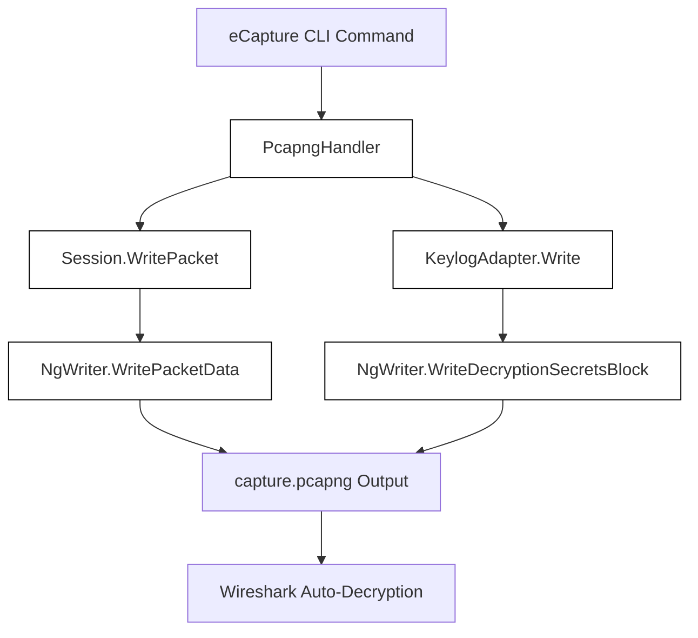
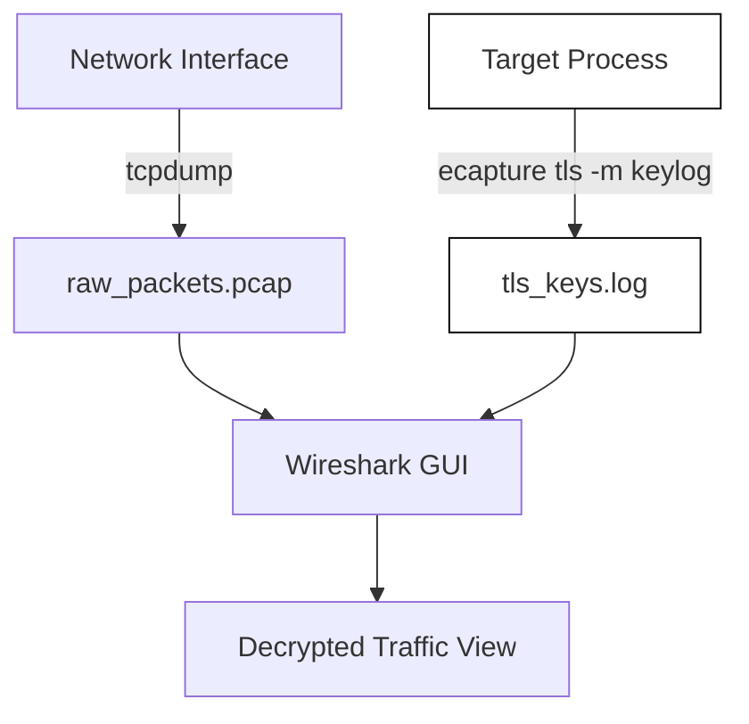
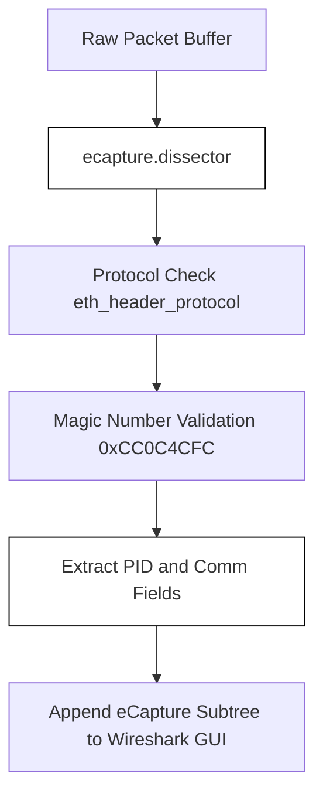

# Wireshark Decryption Workflows

<details>
<summary>Relevant source files</summary>

The following files were used as context for generating this wiki page:

- [CONTRIBUTING.md](https://github.com/gojue/ecapture/blob/8c9caada/CONTRIBUTING.md)
- [images/ecapture-pid.png](https://github.com/gojue/ecapture/blob/8c9caada/images/ecapture-pid.png)
- [images/ecapture-wireshark-lua-plugin.png](https://github.com/gojue/ecapture/blob/8c9caada/images/ecapture-wireshark-lua-plugin.png)
- [internal/output/pcapng/destinations_test.go](https://github.com/gojue/ecapture/blob/8c9caada/internal/output/pcapng/destinations_test.go)
- [internal/output/pcapng/keylog_adapter.go](https://github.com/gojue/ecapture/blob/8c9caada/internal/output/pcapng/keylog_adapter.go)
- [internal/output/pcapng/session.go](https://github.com/gojue/ecapture/blob/8c9caada/internal/output/pcapng/session.go)
- [internal/output/pcapng/session_test.go](https://github.com/gojue/ecapture/blob/8c9caada/internal/output/pcapng/session_test.go)
- [internal/probe/base/handlers/pcapng_handler.go](https://github.com/gojue/ecapture/blob/8c9caada/internal/probe/base/handlers/pcapng_handler.go)
- [utils/ecapture.lua](https://github.com/gojue/ecapture/blob/8c9caada/utils/ecapture.lua)

</details>


This page details how to inspect captured TLS traffic using Wireshark through eCapture. It contrasts the two primary Wireshark-compatible analysis workflows supported by eCapture: opening a self-contained `pcapng` capture file with embedded Decryption Secrets Blocks (DSBs) versus combining a standard network packet capture (`pcap`/`pcapng`) with an independent keylog file. It also highlights when utilizing text mode directly in the terminal remains the simpler diagnostic choice.

---

## 1. Embedded Secrets Workflow (`pcapng` Mode)

When eCapture runs in `pcapng` mode (`-m pcapng`), it captures both raw network packets via Traffic Control (TC) probes or socket filters and runtime TLS master secrets via uprobes. It interleaves these events into a single, synchronized stream [internal/output/pcapng/session.go:46-76](https://github.com/gojue/ecapture/blob/8c9caada/internal/output/pcapng/session.go#L46-L76). 

The underlying session encoder writes TLS secrets into the stream using Wireshark's standard Decryption Secrets Block (DSB) format before or alongside the chronological packet blocks [internal/output/pcapng/session.go:220-234](https://github.com/gojue/ecapture/blob/8c9caada/internal/output/pcapng/session.go#L220-L234).

### Verifiable Steps

1. **Start eCapture in `pcapng` mode**:
   ```bash
   ecapture tls -m pcapng --libssl /lib/x86_64-linux-gnu/libssl.so.3 -w capture.pcapng
   ```
2. **Generate target TLS traffic** (e.g., using `curl` or a test client against an HTTPS endpoint).
3. **Stop eCapture** (Ctrl+C) to flush buffers and finalize the `pcapng` file [internal/probe/base/handlers/pcapng_handler.go:171-189](https://github.com/gojue/ecapture/blob/8c9caada/internal/probe/base/handlers/pcapng_handler.go#L171-L189).
4. **Open the capture in Wireshark**:
   ```bash
   wireshark capture.pcapng
   ```
5. **Verify decryption**: Wireshark automatically reads the embedded DSB packets, extracts the session keys, and populates the *Transport Layer Security* protocol tree with decrypted application data without requiring external keylog configurations.


*Diagram 1: Embedded Secrets Data Flow from eCapture Handler to Wireshark.*

Sources: [internal/output/pcapng/session.go:46-234](https://github.com/gojue/ecapture/blob/8c9caada/internal/output/pcapng/session.go#L46-L234), [internal/probe/base/handlers/pcapng_handler.go:88-189](https://github.com/gojue/ecapture/blob/8c9caada/internal/probe/base/handlers/pcapng_handler.go#L88-L189), [internal/output/pcapng/keylog_adapter.go:20-47](https://github.com/gojue/ecapture/blob/8c9caada/internal/output/pcapng/keylog_adapter.go#L20-L47)

---

## 2. Separate Capture and Keylog Workflow

Alternatively, you can record network packets and TLS master secrets independently. This is useful when network monitoring infrastructure (such as `tcpdump` or dedicated hardware taps) is already deployed, or when you want to feed secrets into an existing packet trace.

### Verifiable Steps

1. **Capture packets using `tcpdump`**:
   ```bash
   tcpdump -i any -w raw_packets.pcap port 443
   ```
2. **Capture TLS keys using eCapture in keylog mode**:
   ```bash
   ecapture tls -m keylog --keylogfile tls_keys.log
   ```
3. **Configure Wireshark**:
   - Open Wireshark and load `raw_packets.pcap`.
   - Navigate to **Edit > Preferences > Protocols > TLS**.
   - In the **(Pre)-Master-Secret log filename** field, browse and select `tls_keys.log`.
   - Click **OK** to decrypt the trace.


*Diagram 2: Independent Capture and Keylog Integration Pipeline.*

Sources: [internal/output/pcapng/destinations_test.go:43-132](https://github.com/gojue/ecapture/blob/8c9caada/internal/output/pcapng/destinations_test.go#L43-L132)

---

## 3. When Text Mode is Simpler

While Wireshark provides deep packet inspection and protocol analysis, `text` mode (`-m text`) is often preferable for quick debugging, container troubleshooting, or automated log ingestion.

* **No Post-Processing Required**: Plaintext HTTP requests, SQL queries, or custom payloads are printed directly to `stdout` or forwarded via `--eventaddr`, eliminating the need to open a GUI or configure decryption keys [internal/probe/base/handlers/pcapng_handler.go:1-55](https://github.com/gojue/ecapture/blob/8c9caada/internal/probe/base/handlers/pcapng_handler.go#L1-L55).
* **Immediate Feedback**: Useful for verifying that uprobes successfully attach to target functions without setting up network capture interfaces.
* **Low Overhead**: Avoids capturing unrelated TCP background noise, framing headers, or stateful packet queues.

Sources: [internal/probe/base/handlers/pcapng_handler.go:32-55](https://github.com/gojue/ecapture/blob/8c9caada/internal/probe/base/handlers/pcapng_handler.go#L32-L55)

---

## 4. Wireshark Lua Dissector Integration

eCapture includes a custom Wireshark Lua post-dissector plugin (`ecapture.lua`) that injects process metadata (such as PID and command name) into captured packet trailers [utils/ecapture.lua:1-65](https://github.com/gojue/ecapture/blob/8c9caada/utils/ecapture.lua#L1-L65).

### Plugin Features
* **Magic Number Validation**: Identifies eCapture-enhanced frames via the magic constant `0xCC0C4CFC` [utils/ecapture.lua:11-51](https://github.com/gojue/ecapture/blob/8c9caada/utils/ecapture.lua#L11-L51).
* **Process Enrichment**: Extends the packet details tree to display originating process IDs and command names (`Comm`) [utils/ecapture.lua:16-58](https://github.com/gojue/ecapture/blob/8c9caada/utils/ecapture.lua#L16-L58).

To install the plugin for Wireshark:
1. Copy `utils/ecapture.lua` to your personal Wireshark plugins directory (e.g., `~/.local/lib/wireshark/plugins/` on Linux).
2. Restart Wireshark or press `Ctrl+Shift+R` to reload Lua plugins.


*Diagram 3: Lua Dissector Execution Flow in Wireshark.*

Sources: [utils/ecapture.lua:9-65](https://github.com/gojue/ecapture/blob/8c9caada/utils/ecapture.lua#L9-L65)