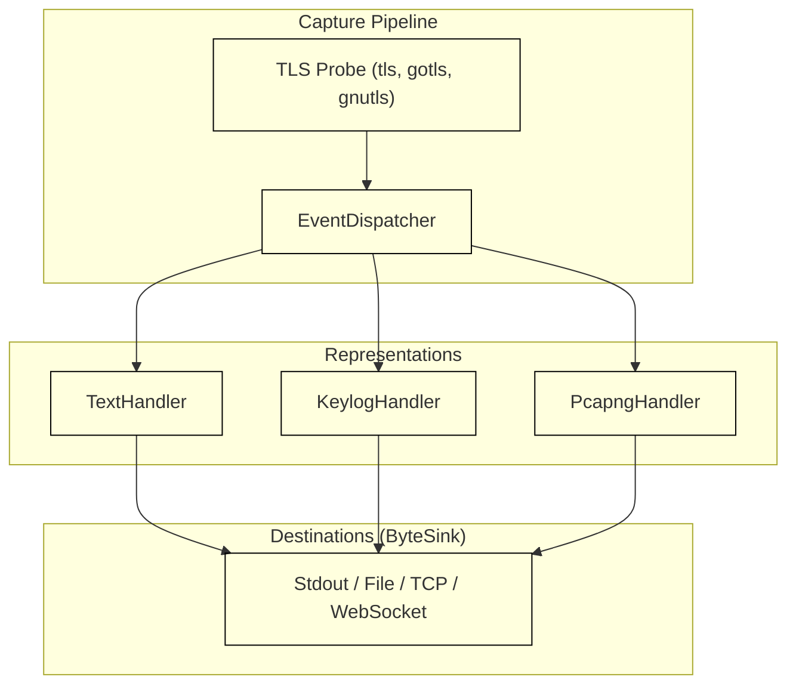
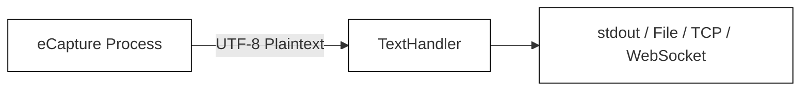
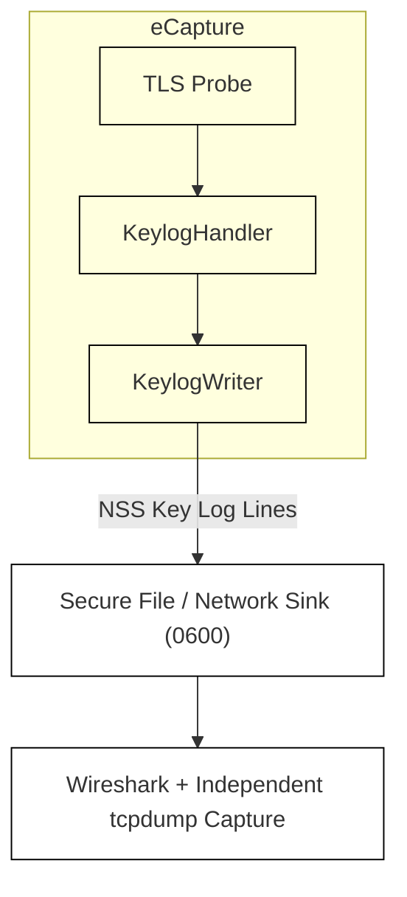
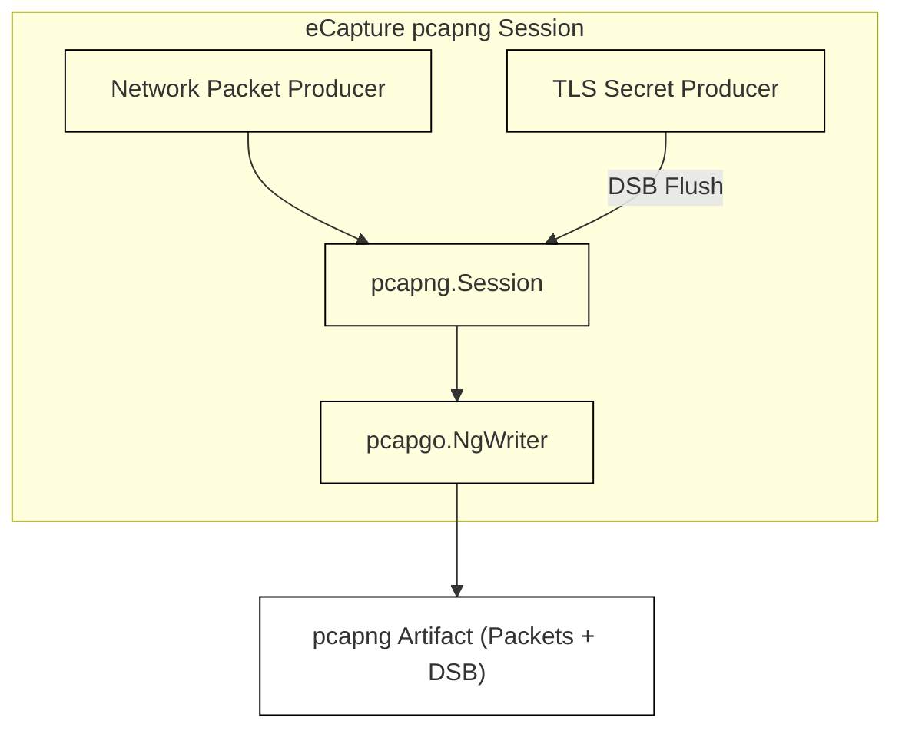

# Capture Modes

Relevant source files

The following files were used as context for generating this wiki page:

- [cli/cmd/output_flags.go](https://github.com/gojue/ecapture/blob/8c9caada/cli/cmd/output_flags.go)
- [cli/cmd/output_pipeline_test.go](https://github.com/gojue/ecapture/blob/8c9caada/cli/cmd/output_pipeline_test.go)
- [docs/agent/output-pipeline-refactor-taskbook.md](https://github.com/gojue/ecapture/blob/8c9caada/docs/agent/output-pipeline-refactor-taskbook.md)
- [docs/agent/output-pipeline.md](https://github.com/gojue/ecapture/blob/8c9caada/docs/agent/output-pipeline.md)
- [internal/output/writers/factory.go](https://github.com/gojue/ecapture/blob/8c9caada/internal/output/writers/factory.go)
- [internal/output/writers/pipeline_test.go](https://github.com/gojue/ecapture/blob/8c9caada/internal/output/writers/pipeline_test.go)
- [internal/probe/base/handlers/text_handler.go](https://github.com/gojue/ecapture/blob/8c9caada/internal/probe/base/handlers/text_handler.go)
- [internal/probe/base/handlers/text_handler_test.go](https://github.com/gojue/ecapture/blob/8c9caada/internal/probe/base/handlers/text_handler_test.go)
- [test/e2e/fixtures/ecaptureq_assert/main.go](https://github.com/gojue/ecapture/blob/8c9caada/test/e2e/fixtures/ecaptureq_assert/main.go)

This page serves as a high-level user guide to the three core capture modes—`text`, `keylog`, and `pcapng`—supported by eCapture's core TLS modules (`tls`, `gotls`, and `gnutls`) [docs/agent/output-pipeline.md:1-103](https://github.com/gojue/ecapture/blob/8c9caada/docs/agent/output-pipeline.md#L1-L103). eCapture decouples representation policies (what format the data is stored in) from transport routing (where the output is sent), utilizing raw byte sinks (`ByteSink`) such as standard output, files, TCP streams, or binary WebSockets [docs/agent/output-pipeline.md:20-48](https://github.com/gojue/ecapture/blob/8c9caada/docs/agent/output-pipeline.md#L20-L48).

For deep technical dives into individual modes, destination management, or wire format workflows, refer to the following child pages:
- [Choosing Text, Keylog, or pcapng](3.1-choosing-text-keylog-or-pcapng.md)
- [Text Mode](3.2-text-mode.md)
- [Keylog Mode](3.3-keylog-mode.md)
- [pcapng Mode](3.4-pcapng-mode.md)
- [Event Destinations and Rotation](3.5-event-destinations-and-rotation.md)
- [Wireshark Decryption Workflows](3.6-wireshark-decryption-workflows.md)

---

## Overview of Capture Modes

eCapture processes captured TLS traffic through explicit handler representations, allowing operators to choose the exact artifact format required for inspection [docs/agent/output-pipeline.md:14-18](https://github.com/gojue/ecapture/blob/8c9caada/docs/agent/output-pipeline.md#L14-L18).

*Figure 1: Event Dispatch and Representation Routing Architecture [docs/agent/output-pipeline.md:14-18](https://github.com/gojue/ecapture/blob/8c9caada/docs/agent/output-pipeline.md#L14-L18) [internal/output/writers/factory.go:77-176](https://github.com/gojue/ecapture/blob/8c9caada/internal/output/writers/factory.go#L77-L176)*

Sources: [docs/agent/output-pipeline.md:7-25](https://github.com/gojue/ecapture/blob/8c9caada/docs/agent/output-pipeline.md#L7-L25), [internal/output/writers/factory.go:77-176](https://github.com/gojue/ecapture/blob/8c9caada/internal/output/writers/factory.go#L77-L176)

---

## 3.1 Choosing Text, Keylog, or pcapng

Selecting the correct mode depends on whether you require immediate plaintext analysis, live packet inspection with Wireshark, or cryptographic key logging [docs/agent/output-pipeline.md:66-73](https://github.com/gojue/ecapture/blob/8c9caada/docs/agent/output-pipeline.md#L66-L73).

| Mode | Representation | Primary Destination Requirement | Typical Use Case |
| :--- | :--- | :--- | :--- |
| **`text`** | UTF-8 Plaintext (Decrypted Read/Write payloads) | Defaults to `stdout`; supports files and networks [docs/agent/output-pipeline.md:93-94](https://github.com/gojue/ecapture/blob/8c9caada/docs/agent/output-pipeline.md#L93-L94) | Immediate terminal inspection, lightweight debugging, script parsing [docs/agent/output-pipeline.md:70](https://github.com/gojue/ecapture/blob/8c9caada/docs/agent/output-pipeline.md#L70) |
| **`keylog`** | NSS Key Log lines (`CLIENT_RANDOM ...`) | Requires explicit destination (`--eventaddr` or `--keylogfile`) [docs/agent/output-pipeline.md:94-95](https://github.com/gojue/ecapture/blob/8c9caada/docs/agent/output-pipeline.md#L94-L95) | Decrypting an independent packet capture (`tcpdump`) in Wireshark [docs/agent/output-pipeline.md:71](https://github.com/gojue/ecapture/blob/8c9caada/docs/agent/output-pipeline.md#L71) |
| **`pcapng`** | Packet blocks + embedded TLS Decryption Secrets Block (DSB) | Requires explicit destination (`--eventaddr` or `--pcapfile`) [docs/agent/output-pipeline.md:96-97](https://github.com/gojue/ecapture/blob/8c9caada/docs/agent/output-pipeline.md#L96-L97) | Single-file packet analysis where packets and decryption secrets are bundled together [docs/agent/output-pipeline.md:72](https://github.com/gojue/ecapture/blob/8c9caada/docs/agent/output-pipeline.md#L72) |

For detailed trade-offs and decision criteria, see [Choosing Text, Keylog, or pcapng](3.1-choosing-text-keylog-or-pcapng.md).

Sources: [docs/agent/output-pipeline.md:66-73](https://github.com/gojue/ecapture/blob/8c9caada/docs/agent/output-pipeline.md#L66-L73), [internal/output/writers/factory.go:90-116](https://github.com/gojue/ecapture/blob/8c9caada/internal/output/writers/factory.go#L90-L116)

---

## 3.2 Text Mode

Text mode captures decrypted application layer data (such as HTTP/1.x, HTTP/2, or custom TLS protocols) directly from function entry/exit hooks [internal/probe/base/handlers/text_handler.go:26-41](https://github.com/gojue/ecapture/blob/8c9caada/internal/probe/base/handlers/text_handler.go#L26-L41). By default, text events stream to standard output (`stdout`) [docs/agent/output-pipeline.md:93](https://github.com/gojue/ecapture/blob/8c9caada/docs/agent/output-pipeline.md#L93), but can be redirected via `--eventaddr` [docs/agent/output-pipeline.md:88-91](https://github.com/gojue/ecapture/blob/8c9caada/docs/agent/output-pipeline.md#L88-L91).

*Figure 2: Text Mode Data Flow [internal/probe/base/handlers/text_handler.go:26-111](https://github.com/gojue/ecapture/blob/8c9caada/internal/probe/base/handlers/text_handler.go#L26-L111) [docs/agent/output-pipeline.md:70](https://github.com/gojue/ecapture/blob/8c9caada/docs/agent/output-pipeline.md#L70)*

For syntax, verified commands for `tls`, `gotls`, and `gnutls`, and verification flows, see [Text Mode](3.2-text-mode.md).

Sources: [docs/agent/output-pipeline.md:68-70](https://github.com/gojue/ecapture/blob/8c9caada/docs/agent/output-pipeline.md#L68-L70), [internal/probe/base/handlers/text_handler.go:26-111](https://github.com/gojue/ecapture/blob/8c9caada/internal/probe/base/handlers/text_handler.go#L26-L111)

---

## 3.3 Keylog Mode

Keylog mode extracts negotiated TLS session master secrets in NSS Key Log format [docs/agent/output-pipeline.md:71](https://github.com/gojue/ecapture/blob/8c9caada/docs/agent/output-pipeline.md#L71). It requires an explicit destination—either via `--eventaddr` or the legacy alias `--keylogfile` [docs/agent/output-pipeline.md:94-95](https://github.com/gojue/ecapture/blob/8c9caada/docs/agent/output-pipeline.md#L94-L95). 

*Figure 3: Keylog Mode and Independent Packet Decryption Workflow [docs/agent/output-pipeline.md:71-82](https://github.com/gojue/ecapture/blob/8c9caada/docs/agent/output-pipeline.md#L71-L82)*

For permissions handling, key logging specifications, and Wireshark instructions, see [Keylog Mode](3.3-keylog-mode.md).

Sources: [docs/agent/output-pipeline.md:71](https://github.com/gojue/ecapture/blob/8c9caada/docs/agent/output-pipeline.md#L71), [docs/agent/output-pipeline.md:79-82](https://github.com/gojue/ecapture/blob/8c9caada/docs/agent/output-pipeline.md#L79-L82), [internal/output/writers/pipeline_test.go:77-104](https://github.com/gojue/ecapture/blob/8c9caada/internal/output/writers/pipeline_test.go#L77-L104)

---

## 3.4 pcapng Mode

pcapng mode captures network packets alongside an embedded **TLS Decryption Secrets Block (DSB)** [docs/agent/output-pipeline.md:72](https://github.com/gojue/ecapture/blob/8c9caada/docs/agent/output-pipeline.md#L72). This produces a self-contained capture artifact where Wireshark can automatically decrypt TLS streams without requiring a separate key log file [docs/agent/output-pipeline.md:72](https://github.com/gojue/ecapture/blob/8c9caada/docs/agent/output-pipeline.md#L72).

*Figure 4: pcapng Session Architecture and Decryption Secrets Block Integration [docs/agent/output-pipeline.md:72](https://github.com/gojue/ecapture/blob/8c9caada/docs/agent/output-pipeline.md#L72)*

For interface selection rules, file truncation policies, and validation commands, see [pcapng Mode](3.4-pcapng-mode.md).

Sources: [docs/agent/output-pipeline.md:72](https://github.com/gojue/ecapture/blob/8c9caada/docs/agent/output-pipeline.md#L72), [docs/agent/output-pipeline-refactor-taskbook.md:82-93](https://github.com/gojue/ecapture/blob/8c9caada/docs/agent/output-pipeline-refactor-taskbook.md#L82-L93)

---

## 3.5 Event Destinations and Rotation

eCapture strictly separates captured event destinations (`--eventaddr`) from operational logs (`--logaddr`) [docs/agent/output-pipeline.md:27-30](https://github.com/gojue/ecapture/blob/8c9caada/docs/agent/output-pipeline.md#L27-L30). Captured payloads and cryptographic secrets are never written to operational logs or error channels [docs/agent/output-pipeline.md:27-30](https://github.com/gojue/ecapture/blob/8c9caada/docs/agent/output-pipeline.md#L27-L30).

- **Supported Sinks**: `stdout`, local files (`file://` or plain paths), ordered TCP connections (`tcp://host:port`), and binary WebSocket streams (`ws://`, `wss://`) [docs/agent/output-pipeline.md:44-48](https://github.com/gojue/ecapture/blob/8c9caada/docs/agent/output-pipeline.md#L44-L48), [internal/output/writers/factory.go:120-176](https://github.com/gojue/ecapture/blob/8c9caada/internal/output/writers/factory.go#L120-L176).
- **Rotation Limits**: File-backed text and keylog streams support rotation (`--rotatesize`, `--rotateinterval`), whereas network sinks and `pcapng` streams reject byte-stream rotation policies [docs/agent/output-pipeline.md:79-81](https://github.com/gojue/ecapture/blob/8c9caada/docs/agent/output-pipeline.md#L79-L81), [internal/output/writers/pipeline_test.go:148-149](https://github.com/gojue/ecapture/blob/8c9caada/internal/output/writers/pipeline_test.go#L148-L149).

For full syntax options, legacy flag aliases (`--keylogfile`, `--pcapfile`), and channel separation checks, see [Event Destinations and Rotation](3.5-event-destinations-and-rotation.md).

Sources: [docs/agent/output-pipeline.md:27-104](https://github.com/gojue/ecapture/blob/8c9caada/docs/agent/output-pipeline.md#L27-L104), [internal/output/writers/factory.go:90-176](https://github.com/gojue/ecapture/blob/8c9caada/internal/output/writers/factory.go#L90-L176)

---

## 3.6 Wireshark Decryption Workflows

Analyzing encrypted traffic via Wireshark can be achieved through two distinct approaches depending on the selected capture mode:

1. **Self-Contained pcapng Workflow**: Open the `.pcapng` file generated by eCapture directly in Wireshark. Because the file contains embedded Decryption Secrets Blocks (DSB), Wireshark automatically decrypts TLS traffic without additional configuration.
2. **Keylog and Packet Capture Workflow**: Run eCapture in `keylog` mode to export an NSS key log file while simultaneously collecting packets via standard utilities like `tcpdump`. In Wireshark, combine the resulting packet capture with the key log file via **Preferences > Protocols > TLS > (Pre)-Master-Secret log filename**.

For step-by-step verification procedures and troubleshooting guidance, see [Wireshark Decryption Workflows](3.6-wireshark-decryption-workflows.md).

Sources: [docs/agent/output-pipeline.md:70-72](https://github.com/gojue/ecapture/blob/8c9caada/docs/agent/output-pipeline.md#L70-L72), [docs/agent/output-pipeline-refactor-taskbook.md:82-93](https://github.com/gojue/ecapture/blob/8c9caada/docs/agent/output-pipeline-refactor-taskbook.md#L82-L93)