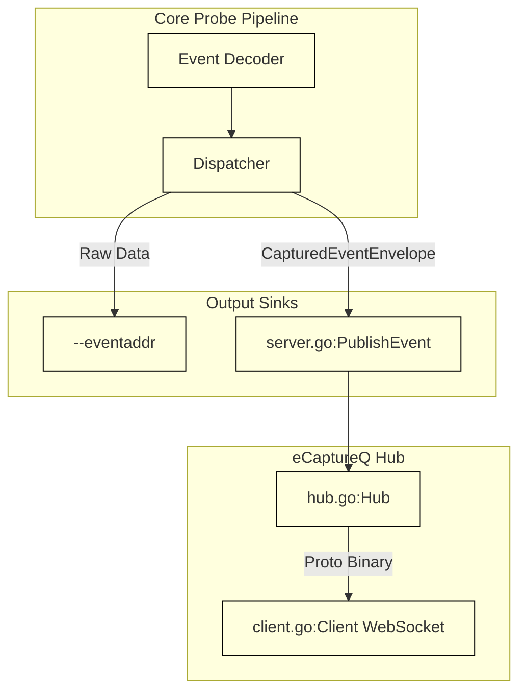
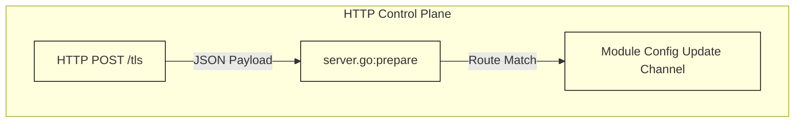

# Integration and Deployment

<details>
<summary>Relevant source files</summary>

The following files were used as context for generating this wiki page:

- [cli/http/logger.go](https://github.com/gojue/ecapture/blob/8c9caada/cli/http/logger.go)
- [cli/http/resp.go](https://github.com/gojue/ecapture/blob/8c9caada/cli/http/resp.go)
- [docs/event-forward-api.md](https://github.com/gojue/ecapture/blob/8c9caada/docs/event-forward-api.md)
- [docs/performance-benchmarks.md](https://github.com/gojue/ecapture/blob/8c9caada/docs/performance-benchmarks.md)
- [docs/remote-config-update-api-zh_Hans.md](https://github.com/gojue/ecapture/blob/8c9caada/docs/remote-config-update-api-zh_Hans.md)
- [docs/remote-config-update-api.md](https://github.com/gojue/ecapture/blob/8c9caada/docs/remote-config-update-api.md)
- [internal/probe/openssl/event_benchmark_test.go](https://github.com/gojue/ecapture/blob/8c9caada/internal/probe/openssl/event_benchmark_test.go)
- [pkg/ecaptureq/client.go](https://github.com/gojue/ecapture/blob/8c9caada/pkg/ecaptureq/client.go)
- [pkg/ecaptureq/hub.go](https://github.com/gojue/ecapture/blob/8c9caada/pkg/ecaptureq/hub.go)
- [pkg/ecaptureq/server.go](https://github.com/gojue/ecapture/blob/8c9caada/pkg/ecaptureq/server.go)
- [protobuf/gen/v1/ecaptureq.pb.go](https://github.com/gojue/ecapture/blob/8c9caada/protobuf/gen/v1/ecaptureq.pb.go)
- [protobuf/proto/v1/ecaptureq.proto](https://github.com/gojue/ecapture/blob/8c9caada/protobuf/proto/v1/ecaptureq.proto)
- [test/benchmark/tls/fixtures/c/openssl_client.c](https://github.com/gojue/ecapture/blob/8c9caada/test/benchmark/tls/fixtures/c/openssl_client.c)
- [test/benchmark/tls/fixtures/server/main.go](https://github.com/gojue/ecapture/blob/8c9caada/test/benchmark/tls/fixtures/server/main.go)
- [test/benchmark/tls/run_benchmark.sh](https://github.com/gojue/ecapture/blob/8c9caada/test/benchmark/tls/run_benchmark.sh)

</details>


## Purpose and Scope
This document provides production guidance for deploying and integrating eCapture's core TLS capture modules (`tls`, `gotls`, and `gnutls`). It details event forwarding mechanisms using `--eventaddr` and additive `eCaptureQ` streaming, runtime dynamic configuration via HTTP, sensitive artifact management, and performance evaluation strategies using built-in benchmarking tools.

Sources: [docs/event-forward-api.md:1-20](https://github.com/gojue/ecapture/blob/8c9caada/docs/event-forward-api.md#L1-L20), [docs/performance-benchmarks.md:1-12](https://github.com/gojue/ecapture/blob/8c9caada/docs/performance-benchmarks.md#L1-L12)

---

## 1. Event Forwarding: `--eventaddr` and `eCaptureQ`

eCapture separates operational logging (`--logaddr`), raw captured event streams (`--eventaddr`), and structured real-time publishing (`--ecaptureq`).

### Raw Event Forwarding with `--eventaddr`
The `--eventaddr` flag specifies the destination for the primary captured-event representation selected by capture modes (text, NSS Key Log, or pcapng). 
- **Supported targets**: Standard output, local file paths, TCP sockets (`tcp://host:port`), or WebSocket connections (`ws://host:port/path`).
- **Behavior**: TCP destinations receive an ordered raw byte stream. WebSocket sinks send ordered binary frames that downstream receivers concatenate into a single artifact.

Sources: [docs/event-forward-api.md:34-45](https://github.com/gojue/ecapture/blob/8c9caada/docs/event-forward-api.md#L34-L45)

### Additive Structured Streaming via `eCaptureQ`
The `--ecaptureq` flag starts a WebSocket server that streams structured runtime logs and captured business events as Protobuf-encoded `LogEntry` messages [docs/event-forward-api.md:46-60](https://github.com/gojue/ecapture/blob/8c9caada/docs/event-forward-api.md#L46-L60). 

`eCaptureQ` operates additively alongside `--eventaddr`: `--eventaddr` writes the raw format (e.g., pcapng or text), while `eCaptureQ` publishes typed domain events through `pkg/ecaptureq/server.go` [docs/event-forward-api.md:61-71](https://github.com/gojue/ecapture/blob/8c9caada/docs/event-forward-api.md#L61-L71).


*Figure 1: Event forwarding data flow bridging event decoding to the `eCaptureQ` publishing hub (`pkg/ecaptureq/server.go` and `pkg/ecaptureq/hub.go`).*

Sources: [docs/event-forward-api.md:1-71](https://github.com/gojue/ecapture/blob/8c9caada/docs/event-forward-api.md#L1-L71), [pkg/ecaptureq/server.go:144-184](https://github.com/gojue/ecapture/blob/8c9caada/pkg/ecaptureq/server.go#L144-L184), [pkg/ecaptureq/hub.go:40-64](https://github.com/gojue/ecapture/blob/8c9caada/pkg/ecaptureq/hub.go#L40-L64)

---

## 2. Runtime Dynamic Configuration via HTTP

eCapture supports updating runtime configuration parameters without restarting the process by exposing an HTTP control server [docs/remote-config-update-api.md:1-21](https://github.com/gojue/ecapture/blob/8c9caada/docs/remote-config-update-api.md#L1-L21).

### Enabling and Endpoints
- **Enablement**: Pass the `--listen` flag (e.g., `--listen 127.0.0.1:28256`) [docs/remote-config-update-api.md:6-7](https://github.com/gojue/ecapture/blob/8c9caada/docs/remote-config-update-api.md#L6-L7).
- **Endpoints**: All configuration routes are HTTP `POST` requests accepting JSON payloads matching internal configuration structs [docs/remote-config-update-api.md:9-28](https://github.com/gojue/ecapture/blob/8c9caada/docs/remote-config-update-api.md#L9-L28).
  - `/tls`, `/openssl`, `/boringssl` — OpenSSL / BoringSSL capture module
  - `/gotls` — Go native TLS capture module
  - `/gnutls` — GnuTLS capture module


*Figure 2: HTTP control request routing to module configuration channels.*

### Response Codes
Responses return a unified JSON status structure defined in `cli/http/resp.go` [docs/remote-config-update-api.md:100-119](https://github.com/gojue/ecapture/blob/8c9caada/docs/remote-config-update-api.md#L100-L119):

| Code Constant | Value | Description |
| --- | ---: | --- |
| `RespOK` | `0` | Configuration successfully accepted and applied |
| `RespErrorInvaildRequest` | `1` | Invalid HTTP request format |
| `RespErrorInternalServer` | `2` | Internal server error |
| `RespErrorNotFound` | `3` | Module resource not found |
| `RespConfigDecodeFailed` | `4` | JSON configuration decoding failed |
| `RespConfigCheckFailed` | `5` | Configuration semantic validation failed |
| `RespSendToChanFailed` | `6` | Internal channel buffer full (retry required) |

Sources: [docs/remote-config-update-api.md:1-132](https://github.com/gojue/ecapture/blob/8c9caada/docs/remote-config-update-api.md#L1-L132), [cli/http/resp.go:1-35](https://github.com/gojue/ecapture/blob/8c9caada/cli/http/resp.go#L1-L35)

---

## 3. Sensitive Artifact Management and Security

Captured plaintext, NSS key log files, and pcapng files containing embedded TLS Decryption Secrets Blocks carry highly sensitive security data.

- **Storage Permissions**: Benchmark and capture artifact directories must be restricted using strict file permissions (`0700`) to prevent unauthorized local access [docs/performance-benchmarks.md:93-117](https://github.com/gojue/ecapture/blob/8c9caada/docs/performance-benchmarks.md#L93-L117).
- **Redaction and Cleanup**: Captured plaintext logs must be reviewed, redacted, and securely purged after analysis. Never commit captured traffic artifacts to version control repositories [docs/performance-benchmarks.md:115-116](https://github.com/gojue/ecapture/blob/8c9caada/docs/performance-benchmarks.md#L115-L116).

Sources: [docs/performance-benchmarks.md:93-117](https://github.com/gojue/ecapture/blob/8c9caada/docs/performance-benchmarks.md#L93-L117)

---

## 4. Performance Evaluation and Benchmarking

eCapture provides two validation layers for assessing performance overhead and event loss: userspace microbenchmarks and end-to-end kernel benchmarks [docs/performance-benchmarks.md:1-12](https://github.com/gojue/ecapture/blob/8c9caada/docs/performance-benchmarks.md#L1-L12).

### Userspace Microbenchmarks
Userspace microbenchmarks measure the OpenSSL userspace decode and text-output pipeline efficiency without loading eBPF bytecode [docs/performance-benchmarks.md:5-6](https://github.com/gojue/ecapture/blob/8c9caada/docs/performance-benchmarks.md#L5-L6). Run them using Go test benches:

```bash
go test -run '^$' -bench '^BenchmarkTLSDataEvent' -benchmem \
  ./internal/probe/openssl
```

Functions such as `BenchmarkTLSDataEventDecode` [internal/probe/openssl/event_benchmark_test.go:29-45](https://github.com/gojue/ecapture/blob/8c9caada/internal/probe/openssl/event_benchmark_test.go#L29-L45) validate payload throughput and memory allocations per event decode iteration.

Sources: [docs/performance-benchmarks.md:13-31](https://github.com/gojue/ecapture/blob/8c9caada/docs/performance-benchmarks.md#L13-L31), [internal/probe/openssl/event_benchmark_test.go:29-45](https://github.com/gojue/ecapture/blob/8c9caada/internal/probe/openssl/event_benchmark_test.go#L29-L45)

### End-to-End Kernel Benchmarking
The end-to-end benchmark harness (`test/benchmark/tls/run_benchmark.sh`) evaluates real uprobe attachment, perf-buffer ring pressure, decoder dispatch, and file-writer throughput under load [docs/performance-benchmarks.md:7-11](https://github.com/gojue/ecapture/blob/8c9caada/docs/performance-benchmarks.md#L7-L11).

Key tunable parameters include:
- `BENCH_MAP_PAGES`: Configures the per-CPU perf reader page count passed to `--mapsize` [docs/performance-benchmarks.md:65-74](https://github.com/gojue/ecapture/blob/8c9caada/docs/performance-benchmarks.md#L65-L74). Note that this is a page count, not a byte count (e.g., 8192 pages on 4 KiB page systems equates to 32 MiB per CPU).
- `BENCH_FAIL_ON_LOSS`: Set to `1` to enforce a zero-loss regression gate checking for missing request/response markers or nonzero `perf_lost_samples` [docs/performance-benchmarks.md:67-111](https://github.com/gojue/ecapture/blob/8c9caada/docs/performance-benchmarks.md#L67-L111).

Sources: [docs/performance-benchmarks.md:32-137](https://github.com/gojue/ecapture/blob/8c9caada/docs/performance-benchmarks.md#L32-L137), [test/benchmark/tls/run_benchmark.sh:1-124](https://github.com/gojue/ecapture/blob/8c9caada/test/benchmark/tls/run_benchmark.sh#L1-L124)