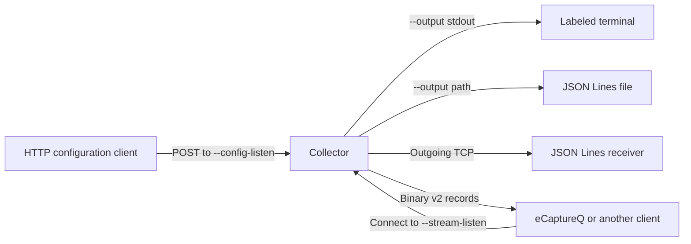

# Integration and Deployment

## Migrate a receiver to v2.12

A collector can write to multiple destinations at once. Specify `--output` once per destination, including `stdout` when an operator also needs a terminal copy. Capture data and operational logs share the v2 `LogEntry` schema. Their `log_type` distinguishes `EVENT` from `PROCESS_LOG`.

| Before v2.12 | Current configuration |
| --- | --- |
| `--logaddr` / `-l` and `--eventaddr` | Repeat `--output` for each terminal, file or outgoing TCP destination. Files and TCP use newline-delimited ProtoJSON. |
| `--ecaptureq` or outgoing WebSocket | Use `--stream-listen ws://127.0.0.1:28256/` and have clients subscribe. Upgrade v1 receivers to the v2 schema. Outgoing TCP remains available for push-based receivers. |
| `--listen` | Use `--config-listen HOST:PORT` for the HTTP configuration service. |
| `--eventroratesize` / `--eventroratetime` | Remove the rotation flags from service definitions. v2.12 has no CLI equivalent. |

For example, this configuration keeps a local console and JSON Lines copy of decoded text and opens a subscription endpoint. Both listeners are disabled until explicitly configured. The WS and HTTP services have no built-in TLS or application authentication. Bind them to loopback or an access-controlled network.

```sh
sudo ecapture tls --model text --text-source pcapng \
  --output stdout --output capture.jsonl \
  --stream-listen ws://127.0.0.1:28256/ --config-listen 127.0.0.1:28258
```



A TCP receiver accepts the collector's connection and buffers complete lines before decoding. WebSocket clients connect to the collector, negotiate `ecapture.v2` and decode one binary `LogEntry` per message. A new subscription receives a heartbeat, a `collector_info` snapshot, recent operational logs and live events. Use the snapshot to identify the host, build, module, mode and selected outputs. There is no event replay. [Protocol reference](https://github.com/gojue/ecapture/blob/v2.12.0/protobuf/PROTOCOLS.md) · [Go receiver](https://github.com/gojue/ecapture/blob/v2.12.0/examples/ecaptureq_client/README.md)

## Native artifacts and reconnection

In keylog mode pass a local `--keylogfile`. In pcapng mode pass a local `--pcapfile`. Keep these paths separate from each JSON output file, which contains only operational logs in those modes. TCP and WebSocket receivers can reconstruct the native artifact. Decode the matching event and append its `keylog.data` or `pcapng.data` bytes in delivery order. A message boundary can fall inside a line or a pcapng block.

Reload drains and closes the old generation's network connections. TCP output reconnects and WebSocket clients must resubscribe. Start a fresh receiver file per connection. A late pcapng subscriber gets fresh section and interface headers and only subsequent packets and secrets. For WebSocket check successful drain, normal close (1000) and local framing/flush before finalizing the file. TCP EOF carries no completion status. Keep the file partial until an external signal confirms completion. [Output and subscription API](https://github.com/gojue/ecapture/blob/v2.12.0/docs/event-forward-api.md)

## Change capture settings at runtime

Send `POST` requests with a JSON body to the endpoint for the active probe. Routes are `/tls`, `/openssl` and `/boringssl` for OpenSSL/BoringSSL, `/gotls` for Go TLS, and `/gnutls` for Linux GnuTLS. The body replaces the capture configuration. Resend filters, paths and mode settings you need to retain. The following replacement keeps a local GoTLS workload on the loopback interface.

```json
{"elf_path":"/opt/demo/go-client","capture_mode":"text","text_source":"pcapng","ifname":"lo"}
```

The collector rejects output routes, listener addresses and legacy routing fields in a core-module update, including an explicit `null`. Restart the process to change those settings. Reusing a native path appends the new generation locally. Use a new path for a separate capture.

| HTTP result | Interpretation |
| --- | --- |
| 200, code 0 | The replacement probe started. |
| 400, code 4 | The body failed to decode, used a forbidden routing field or selected an unavailable configuration factory. |
| 400, code 5 | Validation or the generation switch failed. Validation preserves the running probe. If startup fails after the switch began, check whether rollback restored it. |
| 503, code 6 | The update queue is full. Retry after backoff. |

[HTTP configuration and module-specific field names](https://github.com/gojue/ecapture/blob/v2.12.0/docs/remote-config-update-api.md)

## Measure the deployment

The Linux OpenSSL benchmark compares a local workload with and without capture. Text mode uses loopback TC packets and TLS secrets, extracts `TEXT` from v2 JSON Lines, and counts unique request and response markers separately. Compare missing markers, kernel lost samples and latency, since they measure different effects. The userspace microbenchmark `go test -run '^$' -bench '^BenchmarkTLSDataEvent' -benchmem ./internal/probe/openssl` measures decode and formatting costs. Restrict access to the result directory because plaintext, TLS secrets and process arguments can be present. [Benchmark method and options](https://github.com/gojue/ecapture/blob/v2.12.0/docs/performance-benchmarks.md)
