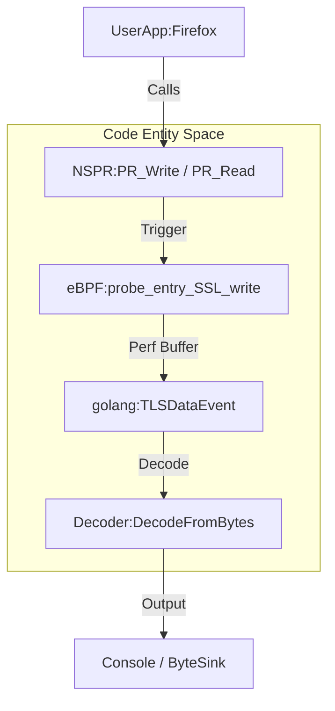
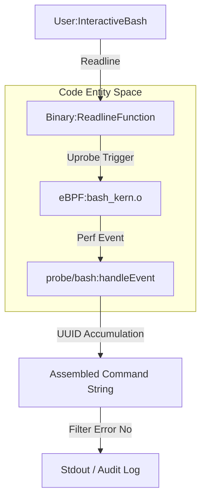
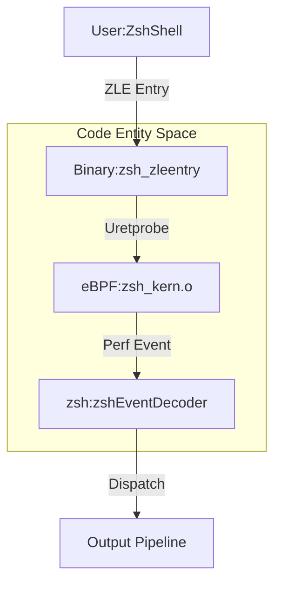
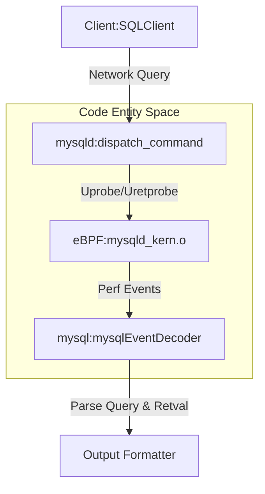
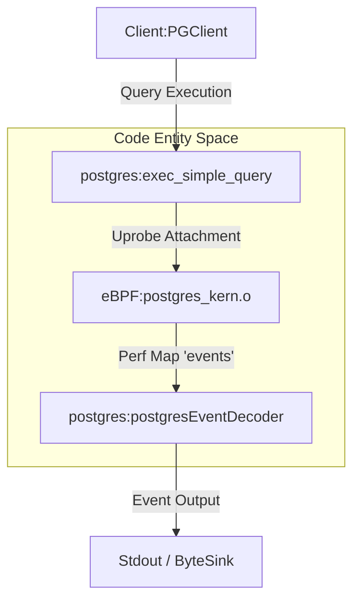

# Other Modules

Relevant source files

The following files were used as context for generating this wiki page:

- [cli/cmd/bash.go](https://github.com/gojue/ecapture/blob/8c9caada/cli/cmd/bash.go)
- [cli/cmd/common_config_test.go](https://github.com/gojue/ecapture/blob/8c9caada/cli/cmd/common_config_test.go)
- [cli/cmd/mysqld.go](https://github.com/gojue/ecapture/blob/8c9caada/cli/cmd/mysqld.go)
- [cli/cmd/postgres.go](https://github.com/gojue/ecapture/blob/8c9caada/cli/cmd/postgres.go)
- [cli/cmd/zsh.go](https://github.com/gojue/ecapture/blob/8c9caada/cli/cmd/zsh.go)
- [internal/probe/bash/bash_probe.go](https://github.com/gojue/ecapture/blob/8c9caada/internal/probe/bash/bash_probe.go)
- [internal/probe/mysql/mysql_probe.go](https://github.com/gojue/ecapture/blob/8c9caada/internal/probe/mysql/mysql_probe.go)
- [internal/probe/mysql/mysql_test.go](https://github.com/gojue/ecapture/blob/8c9caada/internal/probe/mysql/mysql_test.go)
- [internal/probe/nspr/event.go](https://github.com/gojue/ecapture/blob/8c9caada/internal/probe/nspr/event.go)
- [internal/probe/nspr/nspr_probe.go](https://github.com/gojue/ecapture/blob/8c9caada/internal/probe/nspr/nspr_probe.go)
- [internal/probe/nspr/nspr_probe_test.go](https://github.com/gojue/ecapture/blob/8c9caada/internal/probe/nspr/nspr_probe_test.go)
- [internal/probe/postgres/postgres_probe.go](https://github.com/gojue/ecapture/blob/8c9caada/internal/probe/postgres/postgres_probe.go)
- [internal/probe/zsh/zsh_probe.go](https://github.com/gojue/ecapture/blob/8c9caada/internal/probe/zsh/zsh_probe.go)

## Purpose and Scope

While eCapture's core capabilities focus on TLS interception across OpenSSL, BoringSSL, Go native TLS, and GnuTLS, the platform also provides specialized eBPF probes for non-TLS workloads. These non-core modules extend eCapture's auditing and observability features to shell command execution (Bash and Zsh), alternative cryptographic libraries (NSS/NSPR), and database query monitoring (MySQL/MariaDB and PostgreSQL). 

This page serves as the complete reference for all non-core probe coverage, detailing their supported target binaries and libraries, configuration flags, internal implementation, and event data flows.

Sources: [cli/cmd/bash.go:27-40](https://github.com/gojue/ecapture/blob/8c9caada/cli/cmd/bash.go#L27-L40), [cli/cmd/zsh.go:30-42](https://github.com/gojue/ecapture/blob/8c9caada/cli/cmd/zsh.go#L30-L42), [cli/cmd/mysqld.go:30-46](https://github.com/gojue/ecapture/blob/8c9caada/cli/cmd/mysqld.go#L30-L46), [cli/cmd/postgres.go:30-42](https://github.com/gojue/ecapture/blob/8c9caada/cli/cmd/postgres.go#L30-L42), [internal/probe/nspr/nspr_probe.go:37-82](https://github.com/gojue/ecapture/blob/8c9caada/internal/probe/nspr/nspr_probe.go#L37-L82)

---

## Non-Core Probe Overview

The following table summarizes the non-core probes available in eCapture, their target applications, CLI command entry points, and primary eBPF attachment targets.

| Module Name | CLI Command | Supported Targets | Key Hook Functions / Events | Primary Source Files |
| :--- | :--- | :--- | :--- | :--- |
| **NSS/NSPR** | `nspr` (internal factory) | Firefox, Thunderbird, `libnspr4.so`, `libnss3.so` | `PR_Write`, `PR_Read`, SSL master secrets | [`internal/probe/nspr/nspr_probe.go:37-82`()] |
| **Bash** | `bash` | `/bin/bash`, Readline library | Readline entry, return, and exit/exec | [`cli/cmd/bash.go:27-40`(), `internal/probe/bash/bash_probe.go:38-81`()] |
| **Zsh** | `zsh` | `/bin/zsh`, ZLE entry | `zsh_zleentry` uretprobe | [`cli/cmd/zsh.go:30-42`(), `internal/probe/zsh/zsh_probe.go:37-79`()] |
| **MySQL** | `mysqld` | MySQL 5.6, 5.7, 8.0, MariaDB 10.5+ | `dispatch_command` query execution | [`cli/cmd/mysqld.go:30-46`(), `internal/probe/mysql/mysql_probe.go:37-85`()] |
| **PostgreSQL** | `postgres` | PostgreSQL 10+ | `exec_simple_query` query execution | [`cli/cmd/postgres.go:30-42`(), `internal/probe/postgres/postgres_probe.go:37-65`()] |

Sources: [cli/cmd/bash.go:27-40](https://github.com/gojue/ecapture/blob/8c9caada/cli/cmd/bash.go#L27-L40), [cli/cmd/zsh.go:30-42](https://github.com/gojue/ecapture/blob/8c9caada/cli/cmd/zsh.go#L30-L42), [cli/cmd/mysqld.go:30-46](https://github.com/gojue/ecapture/blob/8c9caada/cli/cmd/mysqld.go#L30-L46), [cli/cmd/postgres.go:30-42](https://github.com/gojue/ecapture/blob/8c9caada/cli/cmd/postgres.go#L30-L42), [internal/probe/nspr/nspr_probe.go:37-82](https://github.com/gojue/ecapture/blob/8c9caada/internal/probe/nspr/nspr_probe.go#L37-L82)

---

## 1. NSS/NSPR Probe

The NSS/NSPR probe captures TLS traffic and cryptographic keys from applications built on Mozilla's Network Security Services (NSS) and Netscape Portable Runtime (NSPR), such as Mozilla Firefox and Thunderbird.

### Supported Targets and Configuration
The probe targets `libnspr4.so` for socket I/O operations and `libnss3.so` for session key derivation. Configuration is managed via `nspr.Config`, specifying paths to the NSS and NSPR shared libraries.

### Implementation and Data Flow
The probe establishes `uprobe` and `uretprobe` attachments on `PR_Write` and `PR_Read` within the NSPR library, alongside hooks for master secret extraction [`internal/probe/nspr/nspr_probe.go:193-224`()]. Captured payloads are structured into `TLSDataEvent` buffers matching the C struct layout defined in eBPF bytecode [`internal/probe/nspr/event.go:41-77`()].

Sources: [internal/probe/nspr/nspr_probe.go:37-224](https://github.com/gojue/ecapture/blob/8c9caada/internal/probe/nspr/nspr_probe.go#L37-L224), [internal/probe/nspr/event.go:41-77](https://github.com/gojue/ecapture/blob/8c9caada/internal/probe/nspr/event.go#L41-L77)

---

## 2. Bash Auditing Probe

The Bash probe provides security auditing by intercepting interactive command lines entered into Bash shells.

### Supported Targets and Configuration
The CLI command `bash` initializes `bash.Probe`, automatically resolving the environment's active shell binary or accepting explicit paths via `--bash` and `--readlineso` flags [`cli/cmd/bash.go:27-40`()].

### Implementation and Data Flow
The probe hooks into Bash's Readline integration. Multi-line commands and command execution statuses are tracked and assembled in user space using unique event UUIDs [`internal/probe/bash/bash_probe.go:173-212`()].

Sources: [cli/cmd/bash.go:27-40](https://github.com/gojue/ecapture/blob/8c9caada/cli/cmd/bash.go#L27-L40), [internal/probe/bash/bash_probe.go:38-212](https://github.com/gojue/ecapture/blob/8c9caada/internal/probe/bash/bash_probe.go#L38-L212)

---

## 3. Zsh Auditing Probe

Similar to the Bash module, the Zsh probe monitors interactive command executions within Zsh environments.

### Supported Targets and Configuration
Initialized via the `zsh` command, `zsh.Probe` accepts the `--zsh` flag to locate the target Zsh binary [`cli/cmd/zsh.go:30-42`()].

### Implementation and Data Flow
The probe attaches a `uretprobe` to Zsh's ZLE entry function (`zsh_zleentry`) configured in `setupManager` [`internal/probe/zsh/zsh_probe.go:180-214`()]. Intercepted key inputs and executed commands are parsed via `zshEventDecoder` and forwarded to the output pipeline.

Sources: [cli/cmd/zsh.go:30-42](https://github.com/gojue/ecapture/blob/8c9caada/cli/cmd/zsh.go#L30-L42), [internal/probe/zsh/zsh_probe.go:37-214](https://github.com/gojue/ecapture/blob/8c9caada/internal/probe/zsh/zsh_probe.go#L37-L214)

---

## 4. MySQL / MariaDB Query Probe

The MySQL probe monitors SQL queries executed against MySQL and MariaDB database servers without requiring query logging configurations.

### Supported Targets and Configuration
Supported targets include MySQL 5.6, 5.7, 8.0, and MariaDB 10.5+ [`cli/cmd/mysqld.go:30-46`()]. Configuration accepts the mysqld binary path via `-m` / `--mysqld`, function name overrides via `-f` / `--funcname`, and binary offsets via `--offset` [`cli/cmd/mysqld.go:39-46`()].

### Implementation and Data Flow
The probe attaches uprobes and uretprobes to query dispatch functions (such as `dispatch_command`) [`internal/probe/mysql/mysql_probe.go:189-235`()]. Query strings, connection PIDs, and execution return values (`DispatchCommandReturn`) are captured and decoded [`internal/probe/mysql/mysql_test.go:46-66`()].

Sources: [cli/cmd/mysqld.go:30-46](https://github.com/gojue/ecapture/blob/8c9caada/cli/cmd/mysqld.go#L30-L46), [internal/probe/mysql/mysql_probe.go:37-235](https://github.com/gojue/ecapture/blob/8c9caada/internal/probe/mysql/mysql_probe.go#L37-L235), [internal/probe/mysql/mysql_test.go:46-66](https://github.com/gojue/ecapture/blob/8c9caada/internal/probe/mysql/mysql_test.go#L46-L66)

---

## 5. PostgreSQL Query Probe

The PostgreSQL probe captures SQL queries executed by PostgreSQL database server processes.

### Supported Targets and Configuration
Targets PostgreSQL server binaries version 10 and above [`cli/cmd/postgres.go:30-42`()]. Configured via `postgres.Config`, accepting binary paths (`--postgres`) and target hook functions (`--funcname`) [`cli/cmd/postgres.go:36-41`()].

### Implementation and Data Flow
The probe attaches uprobes to query execution functions (e.g., `exec_simple_query`) [`internal/probe/postgres/postgres_probe.go:141-150`()]. Constant editors handle kernel version constraints and PID/UID filtering [`internal/probe/postgres/postgres_probe.go:188-216`()]. Captured queries flow through `postgresEventDecoder` to the global output sink.

Sources: [cli/cmd/postgres.go:30-42](https://github.com/gojue/ecapture/blob/8c9caada/cli/cmd/postgres.go#L30-L42), [internal/probe/postgres/postgres_probe.go:37-168](https://github.com/gojue/ecapture/blob/8c9caada/internal/probe/postgres/postgres_probe.go#L37-L168), [internal/probe/postgres/postgres_probe.go:188-216](https://github.com/gojue/ecapture/blob/8c9caada/internal/probe/postgres/postgres_probe.go#L188-L216)