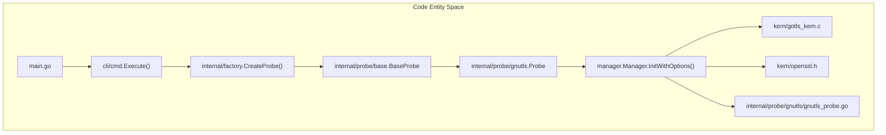

# TLS Capture Architecture

<details>
<summary>Relevant source files</summary>

The following files were used as context for generating this wiki page:

- [AGENTS.md](https://github.com/gojue/ecapture/blob/8c9caada/AGENTS.md)
- [docs/agent/architecture.md](https://github.com/gojue/ecapture/blob/8c9caada/docs/agent/architecture.md)
- [docs/agent/build-test.md](https://github.com/gojue/ecapture/blob/8c9caada/docs/agent/build-test.md)
- [docs/agent/probe-development.md](https://github.com/gojue/ecapture/blob/8c9caada/docs/agent/probe-development.md)
- [internal/probe/gnutls/gnutls_probe.go](https://github.com/gojue/ecapture/blob/8c9caada/internal/probe/gnutls/gnutls_probe.go)
- [internal/probe/gotls/event.go](https://github.com/gojue/ecapture/blob/8c9caada/internal/probe/gotls/event.go)
- [internal/probe/gotls/event_test.go](https://github.com/gojue/ecapture/blob/8c9caada/internal/probe/gotls/event_test.go)
- [kern/go_argument.h](https://github.com/gojue/ecapture/blob/8c9caada/kern/go_argument.h)
- [kern/gotls_kern.c](https://github.com/gojue/ecapture/blob/8c9caada/kern/gotls_kern.c)
- [kern/include/openssl_masterkey_common.h](https://github.com/gojue/ecapture/blob/8c9caada/kern/include/openssl_masterkey_common.h)
- [kern/include/tls_constants.h](https://github.com/gojue/ecapture/blob/8c9caada/kern/include/tls_constants.h)
- [kern/openssl.h](https://github.com/gojue/ecapture/blob/8c9caada/kern/openssl.h)
- [kern/openssl_masterkey.h](https://github.com/gojue/ecapture/blob/8c9caada/kern/openssl_masterkey.h)
- [kern/openssl_masterkey_3.0.h](https://github.com/gojue/ecapture/blob/8c9caada/kern/openssl_masterkey_3.0.h)
- [kern/openssl_masterkey_3.2.h](https://github.com/gojue/ecapture/blob/8c9caada/kern/openssl_masterkey_3.2.h)
- [kern/openssl_untag.h](https://github.com/gojue/ecapture/blob/8c9caada/kern/openssl_untag.h)
- [kern/zsh_kern.c](https://github.com/gojue/ecapture/blob/8c9caada/kern/zsh_kern.c)
- [test/kern/openssl_tagged_pointer_test.go](https://github.com/gojue/ecapture/blob/8c9caada/test/kern/openssl_tagged_pointer_test.go)

</details>


## Purpose and Scope

This document details the internal architecture of eCapture's core TLS capture subsystem (`tls`, `gotls`, and `gnutls`). It explains how eBPF programs are attached to user-space libraries and runtimes, how libraries and symbols are resolved across different versions of OpenSSL, BoringSSL, Go, and GnuTLS, the binary ABI contract between kernel C structs and user-space Go decoders, and the execution flows governing text, keylog, and pcapng capture modes.

Sources: [AGENTS.md:74-94](https://github.com/gojue/ecapture/blob/8c9caada/AGENTS.md#L74-L94), [docs/agent/architecture.md:37-49](https://github.com/gojue/ecapture/blob/8c9caada/docs/agent/architecture.md#L37-L49)

---

## eBPF Attachments and Probe Lifecycle

The TLS capture engine relies on `github.com/gojue/ebpfmanager` to manage the lifecycle of eBPF programs loaded into the kernel. Probes leverage `uprobe` and `uretprobe` attachments to intercept function entry and exit points in target shared libraries or compiled binaries. For `pcapng` and packet filtering modes, traffic control (`TC`) egress/ingress hooks are also attached.


*Figure 1: Initialization Flow from CLI Entry to eBPF Manager Setup.*

Sources: [AGENTS.md:74-94](https://github.com/gojue/ecapture/blob/8c9caada/AGENTS.md#L74-L94), [internal/probe/gnutls/gnutls_probe.go:57-117](https://github.com/gojue/ecapture/blob/8c9caada/internal/probe/gnutls/gnutls_probe.go#L57-L117)

The core probe lifecycle follows a strict initialization and attachment sequence:
1. **Configuration Validation**: The probe configuration is validated idempotently [docs/agent/architecture.md:99-102](https://github.com/gojue/ecapture/blob/8c9caada/docs/agent/architecture.md#L99-L102).
2. **Bytecode Selection**: `BaseProbe.SelectBytecode` selects the appropriate CO-RE or non-CO-RE object file based on kernel BTF availability [docs/agent/probe-development.md:105-109](https://github.com/gojue/ecapture/blob/8c9caada/docs/agent/probe-development.md#L105-L109).
3. **Manager Initialization**: `manager.Manager` initializes maps and programs using embedded binary assets [internal/probe/gnutls/gnutls_probe.go:95-100](https://github.com/gojue/ecapture/blob/8c9caada/internal/probe/gnutls/gnutls_probe.go#L95-L100).
4. **Attachment**: `bpfManager.Start()` attaches uprobes to target symbols (e.g., `SSL_write`, `SSL_read`, `gocryptotls_*`, `gnutls_record_send`) [internal/probe/gnutls/gnutls_probe.go:101-103](https://github.com/gojue/ecapture/blob/8c9caada/internal/probe/gnutls/gnutls_probe.go#L101-L103), [internal/probe/gnutls/gnutls_probe.go:210-212](https://github.com/gojue/ecapture/blob/8c9caada/internal/probe/gnutls/gnutls_probe.go#L210-L212).
5. **Event Loop**: Perf or ring-buffer event readers stream binary structures from kernel maps to user-space handlers [AGENTS.md:76-88](https://github.com/gojue/ecapture/blob/8c9caada/AGENTS.md#L76-L88), [internal/probe/gnutls/gnutls_probe.go:108-114](https://github.com/gojue/ecapture/blob/8c9caada/internal/probe/gnutls/gnutls_probe.go#L108-L114).

Sources: [AGENTS.md:74-94](https://github.com/gojue/ecapture/blob/8c9caada/AGENTS.md#L74-L94), [docs/agent/architecture.md:125-144](https://github.com/gojue/ecapture/blob/8c9caada/docs/agent/architecture.md#L125-L144), [internal/probe/gnutls/gnutls_probe.go:57-117](https://github.com/gojue/ecapture/blob/8c9caada/internal/probe/gnutls/gnutls_probe.go#L57-L117)

---

## Library and Symbol Resolution

Each TLS module targets different runtime environments with distinct symbol and data structure layouts:

### OpenSSL and BoringSSL (`tls`)
- Intercepts OpenSSL/BoringSSL APIs including `SSL_read`, `SSL_write`, `SSL_set_fd`, and master key generation functions (`SSL_write_key`) [docs/agent/architecture.md:41](https://github.com/gojue/ecapture/blob/8c9caada/docs/agent/architecture.md#L41).
- Handles version-specific struct offsets for OpenSSL 1.1.x, 3.0.x, and 3.2+ by using conditional header definitions [kern/openssl_masterkey.h:19-25](https://github.com/gojue/ecapture/blob/8c9caada/kern/openssl_masterkey.h#L19-L25), [kern/openssl_masterkey_3.0.h:22-25](https://github.com/gojue/ecapture/blob/8c9caada/kern/openssl_masterkey_3.0.h#L22-L25), [kern/openssl_masterkey_3.2.h:26-29](https://github.com/gojue/ecapture/blob/8c9caada/kern/openssl_masterkey_3.2.h#L26-L29).
- Uses untagged user pointers (`openssl_untag_user_pointer`) to handle armored or pointer-authenticated addresses on modern architectures [kern/openssl_masterkey.h:35-40](https://github.com/gojue/ecapture/blob/8c9caada/kern/openssl_masterkey.h#L35-L40).

### Go Native TLS (`gotls`)
- Targets Go binaries by hooking internal `crypto/tls` functions (`conn.Read`, `conn.Write`) or standard library TCP/netFD bindings [docs/agent/architecture.md:42](https://github.com/gojue/ecapture/blob/8c9caada/docs/agent/architecture.md#L42).
- Resolves Go's calling conventions dynamically, supporting both stack-based ABIs (Go < 1.17) and register-based ABIs (Go >= 1.17) via helper macros in `kern/go_argument.h` [kern/go_argument.h:18-128](https://github.com/gojue/ecapture/blob/8c9caada/kern/go_argument.h#L18-L128).
- Extracts file descriptors and IP tuples (`src_ip`, `dst_ip`, ports) directly from Go's internal `net.netFD` and `net.TCPAddr` runtime structures [kern/gotls_kern.c:110-187](https://github.com/gojue/ecapture/blob/8c9caada/kern/gotls_kern.c#L110-L187).

### GnuTLS (`gnutls`)
- Hooks GnuTLS record layer functions such as `gnutls_record_send` and `gnutls_record_recv` [internal/probe/gnutls/gnutls_probe.go:210-212](https://github.com/gojue/ecapture/blob/8c9caada/internal/probe/gnutls/gnutls_probe.go#L210-L212).

Sources: [docs/agent/architecture.md:39-49](https://github.com/gojue/ecapture/blob/8c9caada/docs/agent/architecture.md#L39-L49), [kern/go_argument.h:18-128](https://github.com/gojue/ecapture/blob/8c9caada/kern/go_argument.h#L18-L128), [kern/openssl_masterkey.h:19-40](https://github.com/gojue/ecapture/blob/8c9caada/kern/openssl_masterkey.h#L19-L40), [kern/openssl_masterkey_3.0.h:22-25](https://github.com/gojue/ecapture/blob/8c9caada/kern/openssl_masterkey_3.0.h#L22-L25), [kern/openssl_masterkey_3.2.h:26-29](https://github.com/gojue/ecapture/blob/8c9caada/kern/openssl_masterkey_3.2.h#L26-L29)

---

## C/Go Event ABI and Binary Serialization

Data exchanged between kernel eBPF programs and user-space Go code constitutes a strict binary ABI. Any alteration to field widths, sign, or padding breaks decoding.

```mermaid
graph TD
    subgraph "Kernel Space"
        A["kern/got_kern.c: struct go_tls_event"] -->|bpf_perf_event_output| B["BPF_MAP_TYPE_PERF_EVENT_ARRAY"]
    end
    subgraph "User Space"
        B -->|Raw Byte Stream| C["internal/probe/gotls/event.go: GoTLSDataEvent.DecodeFromBytes()"]
        C -->|binary.Read()| D["Decoded GoTLSDataEvent Struct"]
        D -->|Dispatcher Fan-out| E["Text / Keylog / Pcapng Handlers"]
    end
```
*Figure 2: Binary Event ABI Pipeline from Kernel C Struct to User-Space Go Decoders.*

Sources: [AGENTS.md:98-115](https://github.com/gojue/ecapture/blob/8c9caada/AGENTS.md#L98-L115), [kern/gotls_kern.c:33-50](https://github.com/gojue/ecapture/blob/8c9caada/kern/gotls_kern.c#L33-L50), [internal/probe/gotls/event.go:34-145](https://github.com/gojue/ecapture/blob/8c9caada/internal/probe/gotls/event.go#L34-L145)

### Example: GoTLS Event ABI Mapping
The kernel structure `struct go_tls_event` [kern/gotls_kern.c:33-50](https://github.com/gojue/ecapture/blob/8c9caada/kern/gotls_kern.c#L33-L50) is mapped directly into `GoTLSDataEvent` [internal/probe/gotls/event.go:34-74](https://github.com/gojue/ecapture/blob/8c9caada/internal/probe/gotls/event.go#L34-L74) in Go. Fields are deserialized sequentially using `binary.Read` with explicit little-endian byte ordering [internal/probe/gotls/event.go:77-127](https://github.com/gojue/ecapture/blob/8c9caada/internal/probe/gotls/event.go#L77-L127):

| C Field Name | C Type | Go Field Name | Go Type | Offset / Size |
| --- | --- | --- | --- | --- |
| `ts_ns` | `u64` | `Timestamp` | `uint64` | 0 / 8 bytes [kern/gotls_kern.c:34](https://github.com/gojue/ecapture/blob/8c9caada/kern/gotls_kern.c#L34), [internal/probe/gotls/event.go:38](https://github.com/gojue/ecapture/blob/8c9caada/internal/probe/gotls/event.go#L38) |
| `pid` | `u32` | `Pid` | `uint32` | 8 / 4 bytes [kern/gotls_kern.c:35](https://github.com/gojue/ecapture/blob/8c9caada/kern/gotls_kern.c#L35), [internal/probe/gotls/event.go:39](https://github.com/gojue/ecapture/blob/8c9caada/internal/probe/gotls/event.go#L39) |
| `tid` | `u32` | `Tid` | `uint32` | 12 / 4 bytes [kern/gotls_kern.c:36](https://github.com/gojue/ecapture/blob/8c9caada/kern/gotls_kern.c#L36), [internal/probe/gotls/event.go:40](https://github.com/gojue/ecapture/blob/8c9caada/internal/probe/gotls/event.go#L40) |
| `data_len` | `s32` | `DataLen` | `int32` | 16 / 4 bytes [kern/gotls_kern.c:37](https://github.com/gojue/ecapture/blob/8c9caada/kern/gotls_kern.c#L37), [internal/probe/gotls/event.go:41](https://github.com/gojue/ecapture/blob/8c9caada/internal/probe/gotls/event.go#L41) |
| `event_type` | `u8` | `EventType` | `uint8` | 20 / 1 byte [kern/gotls_kern.c:38](https://github.com/gojue/ecapture/blob/8c9caada/kern/gotls_kern.c#L38), [internal/probe/gotls/event.go:42](https://github.com/gojue/ecapture/blob/8c9caada/internal/probe/gotls/event.go#L42) |
| `pad` | `u8[3]` | `pad` | `[3]byte` | 21 / 3 bytes [kern/gotls_kern.c:39](https://github.com/gojue/ecapture/blob/8c9caada/kern/gotls_kern.c#L39), [internal/probe/gotls/event.go:43](https://github.com/gojue/ecapture/blob/8c9caada/internal/probe/gotls/event.go#L43) |
| `fd` | `u32` | `Fd` | `uint32` | 24 / 4 bytes [kern/gotls_kern.c:40](https://github.com/gojue/ecapture/blob/8c9caada/kern/gotls_kern.c#L40), [internal/probe/gotls/event.go:44](https://github.com/gojue/ecapture/blob/8c9caada/internal/probe/gotls/event.go#L44) |
| `src_ip` | `u8[16]` | `SrcIP` | `[16]byte` | 28 / 16 bytes [kern/gotls_kern.c:41](https://github.com/gojue/ecapture/blob/8c9caada/kern/gotls_kern.c#L41), [internal/probe/gotls/event.go:45](https://github.com/gojue/ecapture/blob/8c9caada/internal/probe/gotls/event.go#L45) |
| `data` | `char[]` | `Data` | `[]byte` | 84 / Variable [kern/gotls_kern.c:49](https://github.com/gojue/ecapture/blob/8c9caada/kern/gotls_kern.c#L49), [internal/probe/gotls/event.go:53](https://github.com/gojue/ecapture/blob/8c9caada/internal/probe/gotls/event.go#L53) |

Sources: [AGENTS.md:98-115](https://github.com/gojue/ecapture/blob/8c9caada/AGENTS.md#L98-L115), [kern/gotls_kern.c:33-50](https://github.com/gojue/ecapture/blob/8c9caada/kern/gotls_kern.c#L33-L50), [internal/probe/gotls/event.go:34-145](https://github.com/gojue/ecapture/blob/8c9caada/internal/probe/gotls/event.go#L34-L145)

---

## Shared and Module-Specific Execution Flows

All three core TLS modules (`tls`, `gotls`, and `gnutls`) share a common execution pipeline after events reach user space:
1. **Readers & Decoders**: Perf buffer readers invoke `DecodeFromBytes` on incoming raw byte slices, validating lengths and bounds against malicious or malformed inputs [internal/probe/gotls/event.go:77-145](https://github.com/gojue/ecapture/blob/8c9caada/internal/probe/gotls/event.go#L77-L145).
2. **Synchronous Dispatcher**: Decoded events are passed to `events.Dispatcher`, which fans out synchronously and unordered to all registered output handlers [docs/agent/architecture.md:20-24](https://github.com/gojue/ecapture/blob/8c9caada/docs/agent/architecture.md#L20-L24), [docs/agent/probe-development.md:125-128](https://github.com/gojue/ecapture/blob/8c9caada/docs/agent/probe-development.md#L125-L128).
3. **Capture Mode Handlers**:
   - **Text Mode**: Formats plaintext buffers (`kSSLRead`/`kSSLWrite`, or Go read/write) and prints them to stdout or forwards them via `--eventaddr` [kern/openssl.h:23-39](https://github.com/gojue/ecapture/blob/8c9caada/kern/openssl.h#L23-L39), [kern/gotls_kern.c:25-26](https://github.com/gojue/ecapture/blob/8c9caada/kern/gotls_kern.c#L25-L26).
   - **Keylog Mode**: Captures TLS master secrets and client random values, formatting them into NSS Key Log lines [kern/openssl_masterkey.h:35-105](https://github.com/gojue/ecapture/blob/8c9caada/kern/openssl_masterkey.h#L35-L105).
   - **Pcapng Mode**: Captures packet blocks via TC hooks and embeds TLS Decryption Secrets Blocks (DSB) into the output stream [internal/probe/gnutls/gnutls_probe.go:180-186](https://github.com/gojue/ecapture/blob/8c9caada/internal/probe/gnutls/gnutls_probe.go#L180-L186), [docs/agent/architecture.md:73-74](https://github.com/gojue/ecapture/blob/8c9caada/docs/agent/architecture.md#L73-L74).

Sources: [AGENTS.md:74-94](https://github.com/gojue/ecapture/blob/8c9caada/AGENTS.md#L74-L94), [docs/agent/architecture.md:20-24](https://github.com/gojue/ecapture/blob/8c9caada/docs/agent/architecture.md#L20-L24), [docs/agent/probe-development.md:125-128](https://github.com/gojue/ecapture/blob/8c9caada/docs/agent/probe-development.md#L125-L128), [kern/openssl.h:23-39](https://github.com/gojue/ecapture/blob/8c9caada/kern/openssl.h#L23-L39), [kern/openssl_masterkey.h:35-105](https://github.com/gojue/ecapture/blob/8c9caada/kern/openssl_masterkey.h#L35-L105), [internal/probe/gnutls/gnutls_probe.go:180-186](https://github.com/gojue/ecapture/blob/8c9caada/internal/probe/gnutls/gnutls_probe.go#L180-L186)