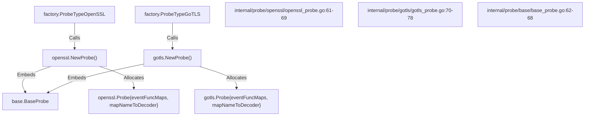
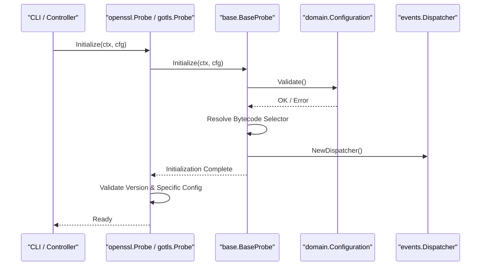
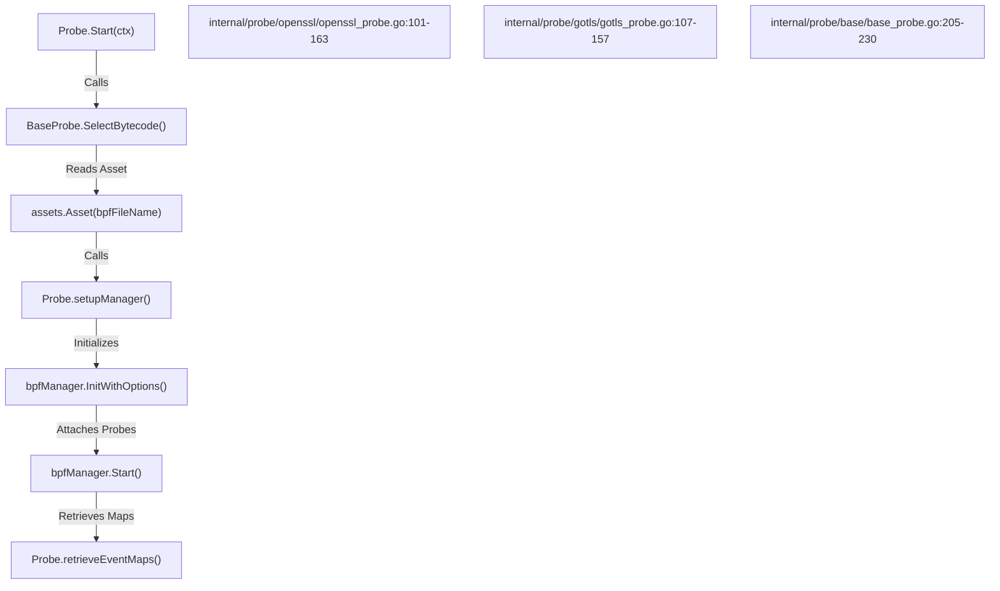
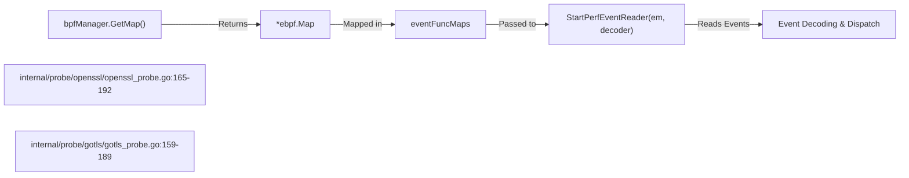
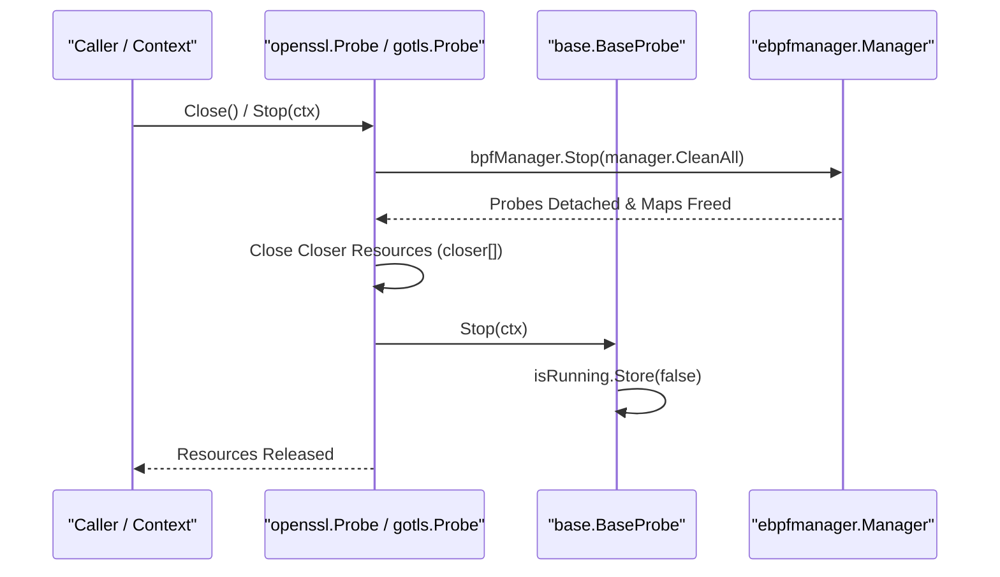

# Probe Framework and Lifecycle

Relevant source files

The following files were used as context for generating this wiki page:

- [internal/config/base_config.go](https://github.com/gojue/ecapture/blob/8c9caada/internal/config/base_config.go)
- [internal/domain/configuration.go](https://github.com/gojue/ecapture/blob/8c9caada/internal/domain/configuration.go)
- [internal/probe/base/base_probe.go](https://github.com/gojue/ecapture/blob/8c9caada/internal/probe/base/base_probe.go)
- [internal/probe/gotls/config_iface.go](https://github.com/gojue/ecapture/blob/8c9caada/internal/probe/gotls/config_iface.go)
- [internal/probe/gotls/config_iface_test.go](https://github.com/gojue/ecapture/blob/8c9caada/internal/probe/gotls/config_iface_test.go)
- [internal/probe/gotls/gotls_probe.go](https://github.com/gojue/ecapture/blob/8c9caada/internal/probe/gotls/gotls_probe.go)
- [internal/probe/openssl/config_iface.go](https://github.com/gojue/ecapture/blob/8c9caada/internal/probe/openssl/config_iface.go)
- [internal/probe/openssl/config_iface_test.go](https://github.com/gojue/ecapture/blob/8c9caada/internal/probe/openssl/config_iface_test.go)
- [internal/probe/openssl/config_linux.go](https://github.com/gojue/ecapture/blob/8c9caada/internal/probe/openssl/config_linux.go)
- [internal/probe/openssl/openssl_probe.go](https://github.com/gojue/ecapture/blob/8c9caada/internal/probe/openssl/openssl_probe.go)

## Purpose and Scope
This document details the architectural framework and lifecycle management for core TLS probes (`openssl` and `gotls`) within eCapture. It covers probe factory registration, embedding and delegation via `BaseProbe`, configuration validation, eBPF bytecode resolution, manager attachment, event reader tracking, and graceful shutdown workflows.

Sources:
- [internal/probe/openssl/openssl_probe.go:44-69](https://github.com/gojue/ecapture/blob/8c9caada/internal/probe/openssl/openssl_probe.go#L44-L69)
- [internal/probe/gotls/gotls_probe.go:52-78](https://github.com/gojue/ecapture/blob/8c9caada/internal/probe/gotls/gotls_probe.go#L52-L78)
- [internal/probe/base/base_probe.go:46-68](https://github.com/gojue/ecapture/blob/8c9caada/internal/probe/base/base_probe.go#L46-L68)

---

## Factory Registration and Instantiation
Concrete probes register with the application factory and expose constructor functions that initialize probe instances with appropriate metadata and internal dispatch structures.

The OpenSSL and GoTLS probes embed `base.BaseProbe` and set up internal maps for routing eBPF events to their respective decoders.

Sources:
- [internal/probe/openssl/openssl_probe.go:61-69](https://github.com/gojue/ecapture/blob/8c9caada/internal/probe/openssl/openssl_probe.go#L61-L69)
- [internal/probe/gotls/gotls_probe.go:70-78](https://github.com/gojue/ecapture/blob/8c9caada/internal/probe/gotls/gotls_probe.go#L70-L78)
- [internal/probe/base/base_probe.go:62-68](https://github.com/gojue/ecapture/blob/8c9caada/internal/probe/base/base_probe.go#L62-L68)

---

## BaseProbe Lifecycle and Initialization
The lifecycle of any core TLS probe begins with `Initialize(ctx, cfg)`, implemented across concrete probes by delegating shared validation and dispatcher setup to `base.BaseProbe.Initialize()`.

During initialization, configuration validation occurs, operational loggers are configured, bytecode selection modes are resolved, and an event dispatcher is instantiated with appropriate text or publisher handlers.

Sources:
- [internal/probe/openssl/openssl_probe.go:71-99](https://github.com/gojue/ecapture/blob/8c9caada/internal/probe/openssl/openssl_probe.go#L71-L99)
- [internal/probe/gotls/gotls_probe.go:80-104](https://github.com/gojue/ecapture/blob/8c9caada/internal/probe/gotls/gotls_probe.go#L80-L104)
- [internal/probe/base/base_probe.go:70-164](https://github.com/gojue/ecapture/blob/8c9caada/internal/probe/base/base_probe.go#L70-L164)
- [internal/config/base_config.go:135-158](https://github.com/gojue/ecapture/blob/8c9caada/internal/config/base_config.go#L135-L158)

---

## eBPF Attachment and Manager Setup
Once initialized, the probe's `Start(ctx)` method drives the loading of eBPF bytecode assets, initialization of the `ebpfmanager.Manager`, attachment of kprobes/uprobes, and retrieval of event maps.

The bytecode asset is selected dynamically based on BTF and build-time mode configurations, read from embedded assets, and loaded into the kernel via `ebpfmanager`.

Sources:
- [internal/probe/openssl/openssl_probe.go:101-163](https://github.com/gojue/ecapture/blob/8c9caada/internal/probe/openssl/openssl_probe.go#L101-L163)
- [internal/probe/gotls/gotls_probe.go:107-157](https://github.com/gojue/ecapture/blob/8c9caada/internal/probe/gotls/gotls_probe.go#L107-L157)
- [internal/probe/base/base_probe.go:205-230](https://github.com/gojue/ecapture/blob/8c9caada/internal/probe/base/base_probe.go#L205-L230)

---

## Reader Tracking and Event Decoding
After the eBPF manager successfully attaches probes and starts, event maps are retrieved from the manager instance and paired with corresponding decoders. `StartPerfEventReader` spawns background read loops to pull events from perf or ring buffers.

Sources:
- [internal/probe/openssl/openssl_probe.go:165-192](https://github.com/gojue/ecapture/blob/8c9caada/internal/probe/openssl/openssl_probe.go#L165-L192)
- [internal/probe/gotls/gotls_probe.go:159-189](https://github.com/gojue/ecapture/blob/8c9caada/internal/probe/gotls/gotls_probe.go#L159-L189)

---

## Concurrency, Shutdown, and Resource Cleanup
Probe teardown is managed by `Stop(ctx)` and `Close()`. The `BaseProbe` manages running state atomically, while concrete probes ensure that the eBPF manager is stopped with `manager.CleanAll` to detach probes and unload maps, and file handles or readers are closed.

Sources:
- [internal/probe/openssl/openssl_probe.go:194-209](https://github.com/gojue/ecapture/blob/8c9caada/internal/probe/openssl/openssl_probe.go#L194-L209)
- [internal/probe/gotls/gotls_probe.go:196-215](https://github.com/gojue/ecapture/blob/8c9caada/internal/probe/gotls/gotls_probe.go#L196-L215)
- [internal/probe/base/base_probe.go:194-204](https://github.com/gojue/ecapture/blob/8c9caada/internal/probe/base/base_probe.go#L194-L204)