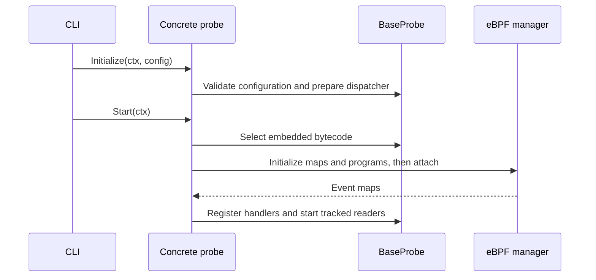

# Probe Framework and Lifecycle

## Registration and startup

The CLI imports each module's probe package. Its `register.go` initializer registers a factory constructor. `runProbe` validates the selected module configuration, calls `factory.CreateProbe`, and invokes `Initialize` and `Start`. Configuration validation must be idempotent because initialization may validate it again.

`BaseProbe` owns shared dispatch, readers and the optional perf-reorder window. Concrete probes own their manager, attachments, map-to-decoder mappings and mode-specific handlers. The CLI owns the configured outputs and listeners and supplies them to the active probe. [Architecture and ownership](https://github.com/gojue/ecapture/blob/v2.12.0/docs/agent/architecture.md) · [BaseProbe](https://github.com/gojue/ecapture/blob/v2.12.0/internal/probe/base/base_probe.go)

## Readers and ordering

Each active map needs both a matching decoder and a running reader. `StartPerfEventReader` and `StartRingbufReader` track their read loops independently. With perf reordering enabled, a supported decoder/event pair supplies the original monotonic timestamp. Readers can then sort within a bounded lag window. Multiple readers may still invoke a shared handler concurrently. Preserve synchronization in encoders and writers.

## Reload, failure and close

An HTTP reload constructs a fresh configuration of the same probe type. After validation, the CLI stops the old generation before starting the next one. A failed start triggers an attempt to restore the previous configuration. TCP and WS connections end at a generation boundary while process-level destination settings persist. The client may see a gap between generations. [HTTP update contract](https://github.com/gojue/ecapture/blob/v2.12.0/docs/remote-config-update-api.md)

If the live decryption stream terminates unexpectedly, the first terminal error wakes the CLI through `BaseProbe.Fail`, even on idle input. Cleanup stays with the CLI. The concrete probe detaches its manager and releases module-owned resources. `BaseProbe.Close` unblocks the readers, waits for their goroutines (including pending reorder work), and only then closes the dispatcher and its handlers. This ordering allows accepted packets and secrets to drain during normal shutdown. A terminal write or drain failure is returned to the caller. [Reader shutdown](https://github.com/gojue/ecapture/blob/v2.12.0/internal/probe/base/base_probe.go) · [Decoder failure and drain](https://github.com/gojue/ecapture/blob/v2.12.0/docs/agent/output-pipeline.md)
