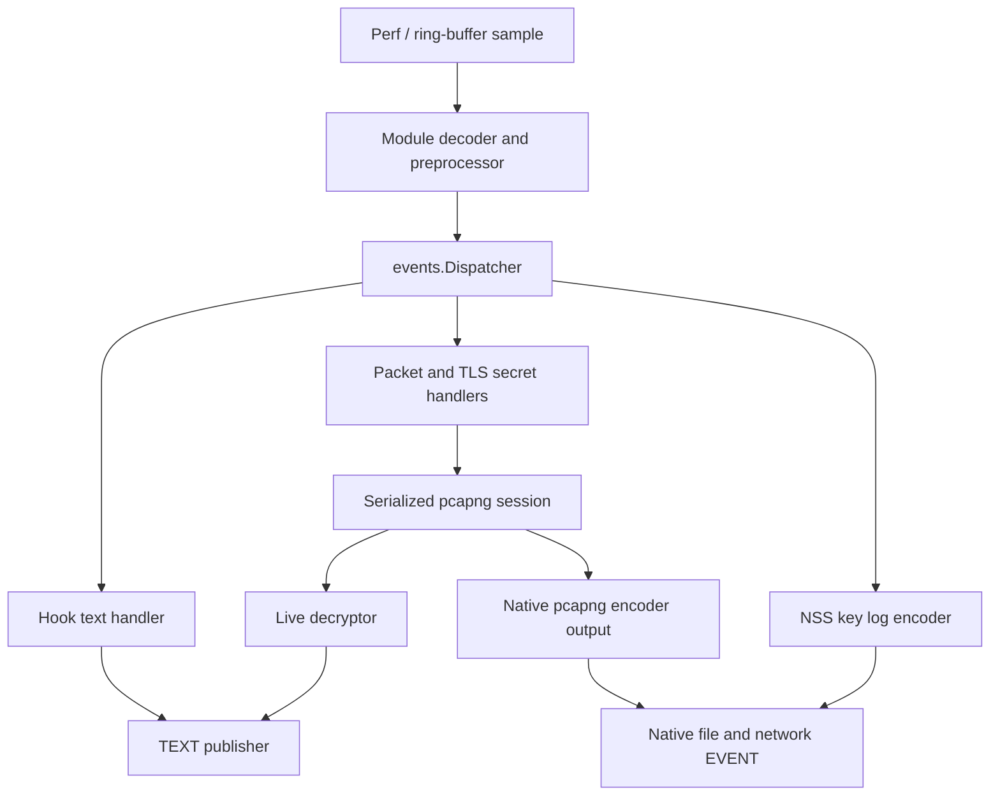

# Event and Output Pipeline

## Dispatch from the kernel

A perf or ring-buffer reader passes a sample to its registered `EventDecoder.Decode`. The decoder may implement `EventPreprocessor` to consume private records, such as OpenSSL connection bookkeeping. For public domain events, `events.Dispatcher` validates the event and synchronously calls each handler whose `Supports` method accepts it. Handler order is unspecified. Multiple readers may dispatch concurrently. The standalone `pkg/event_processor` is outside this production path. [Dispatcher](https://github.com/gojue/ecapture/blob/v2.12.0/internal/events/dispatcher.go) · [Reader and handler contracts](https://github.com/gojue/ecapture/blob/v2.12.0/docs/agent/probe-development.md)

## Encoding and ownership

In the default text path, a low-latency pcapng session feeds packets and Decryption Secrets Blocks into the SDK through a pipe. The SDK matches secrets, reassembles flows and calls back with decoded messages. The callback publishes `TEXT` even when a local copy of the pcapng stream is saved. Explicit hook text formats the underlying read/write event directly.

The keylog handler deduplicates secrets and writes normalized NSS lines. A pcapng session copies packet/key material before queueing it and serializes encoder writes. A keylog adapter can flush pending DSBs into the session. On close, the handler drains pending secrets and packets, flushes the encoder and closes its owned sink. The adapter borrows the session. It must leave final close to the owner. [Output architecture](https://github.com/gojue/ecapture/blob/v2.12.0/docs/agent/output-pipeline.md) · [Keylog handler](https://github.com/gojue/ecapture/blob/v2.12.0/internal/probe/base/handlers/keylog_handler.go)

## Where v2 records go

`writers.ByteSink` provides `Write`, `Name`, `Flush` and `Close` for byte-oriented destinations. The CLI owns publishers for the life of the process. Probe generations borrow them. The WS subscription server implements typed operational-log and captured-event interfaces and lives in `internal/output/stream`. Receiver code can import the public `github.com/gojue/ecapture/v2/protobuf/gen/v2` types.

| Destination | Data representation |
| --- | --- |
| Terminal | In v2.12.0 each line carries a label. Text mode displays the formatted payload, keylog displays NSS lines, and pcapng displays an `encoded_bytes` count for each published chunk. |
| File via `--output` | One ProtoJSON record per line. Captured events are included in text mode. In keylog/pcapng mode the JSON file contains operational logs only. |
| TCP via `--output` | One ProtoJSON record per line, including native events for keylog/pcapng. |
| WebSocket via `--stream-listen` | One binary v2 `LogEntry` per message. Clients negotiate the `ecapture.v2` subprotocol. |
| Native local file | `--keylogfile` and `--pcapfile` hold the actual NSS/pcapng bytes. |

For a `LOG_TYPE_EVENT`, read `event_payload.capture_format`. The values `CAPTURE_FORMAT_TEXT`, `CAPTURE_FORMAT_KEYLOG` and `CAPTURE_FORMAT_PCAPNG` select the `text`, `keylog` and `pcapng` members, respectively. Preserve available process arguments, truncation status, network tuple and TLS observations when forwarding `TEXT`. For native events append the decoded bytes in order for that connection. The packet writer may split a block across records. On reload, the collector drains and ends that generation's network connections. See [receiver completion and reconnection](../4-advanced-usage/4.2-integration-and-deployment.md). [Protocol reference](https://github.com/gojue/ecapture/blob/v2.12.0/protobuf/PROTOCOLS.md)
