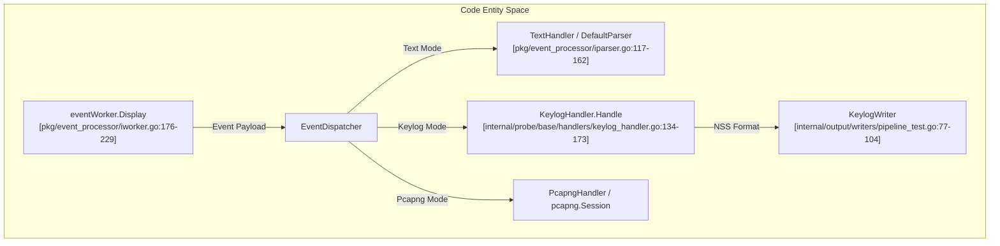
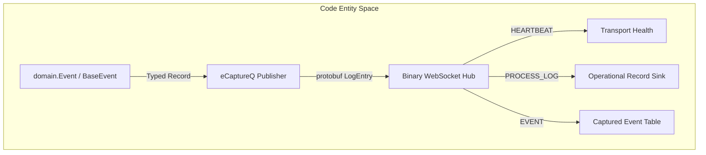

# Event and Output Pipeline

<details>
<summary>Relevant source files</summary>

The following files were used as context for generating this wiki page:

- [docs/agent/output-pipeline-refactor-taskbook.md](https://github.com/gojue/ecapture/blob/8c9caada/docs/agent/output-pipeline-refactor-taskbook.md)
- [docs/agent/output-pipeline.md](https://github.com/gojue/ecapture/blob/8c9caada/docs/agent/output-pipeline.md)
- [internal/output/writers/factory.go](https://github.com/gojue/ecapture/blob/8c9caada/internal/output/writers/factory.go)
- [internal/output/writers/pipeline_test.go](https://github.com/gojue/ecapture/blob/8c9caada/internal/output/writers/pipeline_test.go)
- [internal/probe/base/handlers/keylog_handler.go](https://github.com/gojue/ecapture/blob/8c9caada/internal/probe/base/handlers/keylog_handler.go)
- [internal/probe/base/handlers/keylog_handler_test.go](https://github.com/gojue/ecapture/blob/8c9caada/internal/probe/base/handlers/keylog_handler_test.go)
- [internal/probe/gnutls/config.go](https://github.com/gojue/ecapture/blob/8c9caada/internal/probe/gnutls/config.go)
- [internal/probe/gnutls/config_test.go](https://github.com/gojue/ecapture/blob/8c9caada/internal/probe/gnutls/config_test.go)
- [internal/probe/gnutls/event.go](https://github.com/gojue/ecapture/blob/8c9caada/internal/probe/gnutls/event.go)
- [internal/probe/gnutls/event_masterkey.go](https://github.com/gojue/ecapture/blob/8c9caada/internal/probe/gnutls/event_masterkey.go)
- [internal/probe/gnutls/event_packet.go](https://github.com/gojue/ecapture/blob/8c9caada/internal/probe/gnutls/event_packet.go)
- [pkg/event_processor/base_event.go](https://github.com/gojue/ecapture/blob/8c9caada/pkg/event_processor/base_event.go)
- [pkg/event_processor/http_request.go](https://github.com/gojue/ecapture/blob/8c9caada/pkg/event_processor/http_request.go)
- [pkg/event_processor/http_response.go](https://github.com/gojue/ecapture/blob/8c9caada/pkg/event_processor/http_response.go)
- [pkg/event_processor/iparser.go](https://github.com/gojue/ecapture/blob/8c9caada/pkg/event_processor/iparser.go)
- [pkg/event_processor/iworker.go](https://github.com/gojue/ecapture/blob/8c9caada/pkg/event_processor/iworker.go)
- [pkg/event_processor/processor.go](https://github.com/gojue/ecapture/blob/8c9caada/pkg/event_processor/processor.go)
- [pkg/event_processor/processor_test.go](https://github.com/gojue/ecapture/blob/8c9caada/pkg/event_processor/processor_test.go)
- [test/e2e/fixtures/ecaptureq_assert/main.go](https://github.com/gojue/ecapture/blob/8c9caada/test/e2e/fixtures/ecaptureq_assert/main.go)

</details>


## Purpose and Scope

This page provides a deep architectural and implementation-level trace of the core TLS event and output pipeline in eCapture. It covers the complete lifecycle of captured OpenSSL/BoringSSL, GoTLS, and GnuTLS events—starting from kernel-space eBPF ring buffer extraction, through user-space decoding (`BaseEvent.Decode`) [pkg/event_processor/base_event.go:89-120](https://github.com/gojue/ecapture/blob/8c9caada/pkg/event_processor/base_event.go#L89-L120), asynchronous dispatch via `EventProcessor` [pkg/event_processor/processor.go:70-93](https://github.com/gojue/ecapture/blob/8c9caada/pkg/event_processor/processor.go#L70-L93), worker aggregation in `eventWorker` [pkg/event_processor/iworker.go:69-88](https://github.com/gojue/ecapture/blob/8c9caada/pkg/event_processor/iworker.go#L69-L88), handler processing (Text, Keylog, and Pcapng), raw transport routing via `ByteSink` [docs/agent/output-pipeline.md:33-42](https://github.com/gojue/ecapture/blob/8c9caada/docs/agent/output-pipeline.md#L33-L42), and additive publication to typed `eCaptureQ` channels [docs/agent/output-pipeline.md:57-59](https://github.com/gojue/ecapture/blob/8c9caada/docs/agent/output-pipeline.md#L57-L59).

---

## 1. Event Decoding and Asynchronous Dispatch

When eBPF probes capture TLS plaintext or master secrets, raw byte buffers are pushed from kernel space to user space via Perf/Ring buffers. The event processor pipeline transforms these raw byte arrays into structured domain events and routes them to appropriate worker routines.

```mermaid
graph TD
    subgraph subcode["Code Entity Space"]
    BPF["Ring/Perf Buffer"] -->|Raw Bytes| BE["BaseEvent.Decode\n[pkg/event_processor/base_event.go:89-120]"]
    BE -->|IEventStruct| EP["EventProcessor.Serve\n[pkg/event_processor/processor.go:70-93]"]
    EP -->|"dispatch()"| GW["EventProcessor.getWorkerByUUID\n[pkg/event_processor/processor.go:191-202]"]
    GW -->|Found/New| EW["NewEventWorker\n[pkg/event_processor/iworker.go:90-99]"]
    EW -->|incoming chan| EW_RUN["eventWorker.Write\n[pkg/event_processor/iworker.go:155-163]"]
    EW_RUN -->|Buffer Payload| PARSE["eventWorker.parserEvents\n[pkg/event_processor/iworker.go:249-252]"]
    end
```



### Key Components & Data Structures
- **`BaseEvent`**: Implements the base decoding logic for raw ring buffer payloads, extracting fields such as `DataType`, `Timestamp`, `Pid`, `Tid`, `DataLen`, `Comm`, `Fd`, and `Version` [pkg/event_processor/base_event.go:76-87](https://github.com/gojue/ecapture/blob/8c9caada/pkg/event_processor/base_event.go#L76-L87) via binary little-endian reading [pkg/event_processor/base_event.go:89-120](https://github.com/gojue/ecapture/blob/8c9caada/pkg/event_processor/base_event.go#L89-L120).
- **`EventProcessor`**: Manages incoming events, worker routing queues (`workerQueue`), and cleanup tasks (`destroyConn`) [pkg/event_processor/processor.go:27-53](https://github.com/gojue/ecapture/blob/8c9caada/pkg/event_processor/processor.go#L27-L53). The `Serve()` loop continuously reads from `incoming`, dispatches events, and manages shutdown draining via `drain()` [pkg/event_processor/processor.go:70-115](https://github.com/gojue/ecapture/blob/8c9caada/pkg/event_processor/processor.go#L70-L115).
- **`eventWorker`**: Each unique connection or stream (identified by UUID) is assigned an `eventWorker` goroutine [pkg/event_processor/iworker.go:69-99](https://github.com/gojue/ecapture/blob/8c9caada/pkg/event_processor/iworker.go#L69-L99). It aggregates payloads up to truncation limits or idle timeouts and applies format parsers like HTTP request/response detectors [pkg/event_processor/iparser.go:85-115](https://github.com/gojue/ecapture/blob/8c9caada/pkg/event_processor/iparser.go#L85-L115).

Sources: [pkg/event_processor/base_event.go:76-120](https://github.com/gojue/ecapture/blob/8c9caada/pkg/event_processor/base_event.go#L76-L120), [pkg/event_processor/processor.go:27-115](https://github.com/gojue/ecapture/blob/8c9caada/pkg/event_processor/processor.go#L27-L115), [pkg/event_processor/iworker.go:69-99](https://github.com/gojue/ecapture/blob/8c9caada/pkg/event_processor/iworker.go#L69-L99), [pkg/event_processor/iparser.go:85-115](https://github.com/gojue/ecapture/blob/8c9caada/pkg/event_processor/iparser.go#L85-L115)

---

## 2. Representation Handlers and Routing

Once events are processed by workers, they are classified and routed to representation handlers depending on the active capture mode (Text, Keylog, or Pcapng).



### Handler Mechanics
- **Text Handler & Parsers**: Formats raw payload buffers into readable UTF-8 strings or hexadecimal dumps (`BaseEvent.String()` / `StringHex()`) [pkg/event_processor/base_event.go:134-167](https://github.com/gojue/ecapture/blob/8c9caada/pkg/event_processor/base_event.go#L134-L167) and inspects higher-layer protocols using registered parsers (`HTTPRequest`, `HTTPResponse`) [pkg/event_processor/http_request.go:28-45](https://github.com/gojue/ecapture/blob/8c9caada/pkg/event_processor/http_request.go#L28-L45), [pkg/event_processor/http_response.go:28-37](https://github.com/gojue/ecapture/blob/8c9caada/pkg/event_processor/http_response.go#L28-L37).
- **`KeylogHandler`**: Intercepts TLS master secrets, client randoms, and traffic secrets (`MasterSecretEvent`, `GoTLSMasterSecretEvent`, `DirectTrafficSecretEvent`) [internal/probe/base/handlers/keylog_handler.go:37-79](https://github.com/gojue/ecapture/blob/8c9caada/internal/probe/base/handlers/keylog_handler.go#L37-L79). It deduplicates keys using a seen-keys cache and formats records in the standard NSS Key Log Format [internal/probe/base/handlers/keylog_handler.go:84-106](https://github.com/gojue/ecapture/blob/8c9caada/internal/probe/base/handlers/keylog_handler.go#L84-L106).
- **Pcapng Session & Handler**: Manages packet blocks alongside embedded Decryption Secrets Blocks (DSB) within a synchronized session pipeline [docs/agent/output-pipeline.md:33-55](https://github.com/gojue/ecapture/blob/8c9caada/docs/agent/output-pipeline.md#L33-L55).

Sources: [pkg/event_processor/base_event.go:134-167](https://github.com/gojue/ecapture/blob/8c9caada/pkg/event_processor/base_event.go#L134-L167), [pkg/event_processor/iparser.go:117-162](https://github.com/gojue/ecapture/blob/8c9caada/pkg/event_processor/iparser.go#L117-L162), [pkg/event_processor/http_request.go:28-45](https://github.com/gojue/ecapture/blob/8c9caada/pkg/event_processor/http_request.go#L28-L45), [pkg/event_processor/http_response.go:28-37](https://github.com/gojue/ecapture/blob/8c9caada/pkg/event_processor/http_response.go#L28-L37), [internal/probe/base/handlers/keylog_handler.go:37-106](https://github.com/gojue/ecapture/blob/8c9caada/internal/probe/base/handlers/keylog_handler.go#L37-L106), [docs/agent/output-pipeline.md:33-55](https://github.com/gojue/ecapture/blob/8c9caada/docs/agent/output-pipeline.md#L33-L55)

---

## 3. ByteSink Destinations and Transport Routing

Raw transports are decoupled from format representation using the `ByteSink` interface [docs/agent/output-pipeline.md:33-42](https://github.com/gojue/ecapture/blob/8c9caada/docs/agent/output-pipeline.md#L33-L42). This allows text, keylog, and pcapng encoders to write seamlessly to various underlying targets via a unified factory [docs/agent/output-pipeline.md:95-114](https://github.com/gojue/ecapture/blob/8c9caada/docs/agent/output-pipeline.md#L95-L114).

### `ByteSink` Contract
```go
type ByteSink interface {
    io.Writer
    Name() string
    Flush() error
    Close() error
}
```
*Source: [docs/agent/output-pipeline.md:33-42](https://github.com/gojue/ecapture/blob/8c9caada/docs/agent/output-pipeline.md#L33-L42)*

### Supported Transport Destinations
- **Stdout / File**: Direct stream or file-backed storage (supporting file URIs and optional log rotation for text/keylog streams) [docs/agent/output-pipeline.md:79-83](https://github.com/gojue/ecapture/blob/8c9caada/docs/agent/output-pipeline.md#L79-L83).
- **TCP Sinks**: Ordered raw byte stream over network sockets (`tcp://host:port`) [docs/agent/output-pipeline.md:44-48](https://github.com/gojue/ecapture/blob/8c9caada/docs/agent/output-pipeline.md#L44-L48).
- **WebSocket Sinks**: Ordered binary-frame WebSocket streams (`ws://` or `wss://`), where receivers concatenate frame payloads in arrival order [docs/agent/output-pipeline.md:44-48](https://github.com/gojue/ecapture/blob/8c9caada/docs/agent/output-pipeline.md#L44-L48).

Sources: [docs/agent/output-pipeline.md:33-55](https://github.com/gojue/ecapture/blob/8c9caada/docs/agent/output-pipeline.md#L33-L55), [internal/output/writers/pipeline_test.go:31-104](https://github.com/gojue/ecapture/blob/8c9caada/internal/output/writers/pipeline_test.go#L31-L104)

---

## 4. Additive eCaptureQ Publication

In addition to writing raw byte streams to primary `ByteSink` destinations, eCaptureQ operates as an additive, typed event publisher [docs/agent/output-pipeline.md:57-65](https://github.com/gojue/ecapture/blob/8c9caada/docs/agent/output-pipeline.md#L57-L65).



### Separation of Concerns
- **Isolation**: Captured payloads and sensitive TLS secrets are strictly partitioned from operational logs and never enter `--logaddr` or `PROCESS_LOG` channels [docs/agent/output-pipeline.md:27-30](https://github.com/gojue/ecapture/blob/8c9caada/docs/agent/output-pipeline.md#L27-L30).
- **Protocol**: eCaptureQ messages are serialized as binary protobuf `LogEntry` structures containing metadata, timestamps, process information, and network tuples without reverse-parsing raw sink bytes [docs/agent/output-pipeline.md:105-118](https://github.com/gojue/ecapture/blob/8c9caada/docs/agent/output-pipeline.md#L105-L118).

Sources: [docs/agent/output-pipeline.md:27-30](https://github.com/gojue/ecapture/blob/8c9caada/docs/agent/output-pipeline.md#L27-L30), [docs/agent/output-pipeline.md:105-118](https://github.com/gojue/ecapture/blob/8c9caada/docs/agent/output-pipeline.md#L105-L118)