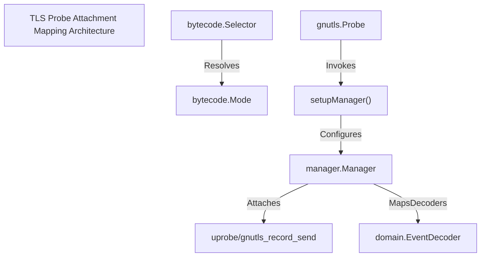
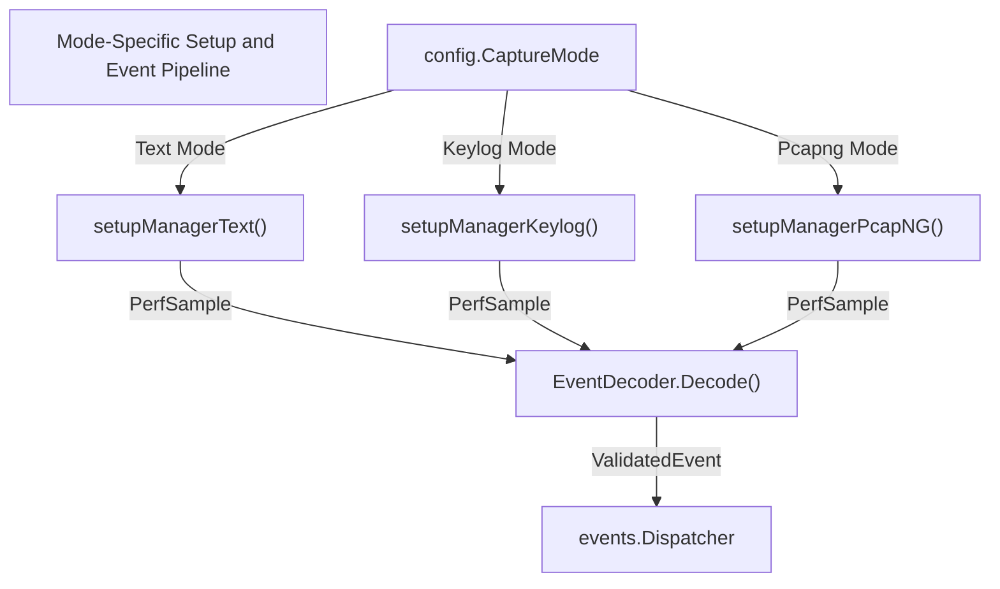

# Extending a TLS Probe

Relevant source files

The following files were used as context for generating this wiki page:

- [AGENTS.md](https://github.com/gojue/ecapture/blob/8c9caada/AGENTS.md)
- [docs/agent/architecture.md](https://github.com/gojue/ecapture/blob/8c9caada/docs/agent/architecture.md)
- [docs/agent/build-test.md](https://github.com/gojue/ecapture/blob/8c9caada/docs/agent/build-test.md)
- [docs/agent/probe-development.md](https://github.com/gojue/ecapture/blob/8c9caada/docs/agent/probe-development.md)
- [internal/probe/bytecode/selector.go](https://github.com/gojue/ecapture/blob/8c9caada/internal/probe/bytecode/selector.go)
- [internal/probe/gnutls/gnutls_probe.go](https://github.com/gojue/ecapture/blob/8c9caada/internal/probe/gnutls/gnutls_probe.go)
- [internal/probe/gotls/config_symbol.go](https://github.com/gojue/ecapture/blob/8c9caada/internal/probe/gotls/config_symbol.go)
- [internal/probe/gotls/config_symbol_test.go](https://github.com/gojue/ecapture/blob/8c9caada/internal/probe/gotls/config_symbol_test.go)

## Purpose and Scope
Extending core TLS probes (`tls`, `gotls`, or `gnutls`) requires preserving fundamental system contracts, including attachment mappings, event binary ABIs, version support matrices, CO-RE and non-CO-RE bytecode asset resolution, and mode-specific execution behavior [AGENTS.md:98-132](https://github.com/gojue/ecapture/blob/8c9caada/AGENTS.md#L98-L132). When adding new hook points, fields, or target libraries, developers must coordinate changes across C eBPF programs, Go manager initialization, symbol/version resolvers, and decoding pipelines [docs/agent/probe-development.md:13-67](https://github.com/gojue/ecapture/blob/8c9caada/docs/agent/probe-development.md#L13-L67).

Sources: [AGENTS.md:98-132](https://github.com/gojue/ecapture/blob/8c9caada/AGENTS.md#L98-L132), [docs/agent/probe-development.md:13-67](https://github.com/gojue/ecapture/blob/8c9caada/docs/agent/probe-development.md#L13-L67)

---

## Attachment Mappings and Target Resolution
Each TLS probe establishes an atomic relationship between C eBPF section markers (`SEC("...")`), target functions or symbols (`AttachToFuncName`), library or binary paths (`BinaryPath`), and Go manager configurations [docs/agent/probe-development.md:50-67](https://github.com/gojue/ecapture/blob/8c9caada/docs/agent/probe-development.md#L50-L67). When extending a probe with new hooks:
1. Define the uprobe or uretprobe section in C source files matching the target library's internal function signatures.
2. Register the corresponding `manager.Probe` entry specifying `Section`, `EbpfFuncName`, `AttachToFuncName`, and `BinaryPath` [internal/probe/gnutls/gnutls_probe.go:210-212](https://github.com/gojue/ecapture/blob/8c9caada/internal/probe/gnutls/gnutls_probe.go#L210-L212).
3. For dynamic Go binary targets (`gotls`), ensure symbol tables, section offsets, and instruction return positions are accurately computed using ELF and Go symbol parsers [internal/probe/gotls/config_symbol.go:24-90](https://github.com/gojue/ecapture/blob/8c9caada/internal/probe/gotls/config_symbol.go#L24-L90).

Sources: [docs/agent/probe-development.md:50-67](https://github.com/gojue/ecapture/blob/8c9caada/docs/agent/probe-development.md#L50-L67), [internal/probe/gnutls/gnutls_probe.go:39-117](https://github.com/gojue/ecapture/blob/8c9caada/internal/probe/gnutls/gnutls_probe.go#L39-L117), [internal/probe/gnutls/gnutls_probe.go:169-202](https://github.com/gojue/ecapture/blob/8c9caada/internal/probe/gnutls/gnutls_probe.go#L169-L202), [internal/probe/gotls/config_symbol.go:24-90](https://github.com/gojue/ecapture/blob/8c9caada/internal/probe/gotls/config_symbol.go#L24-L90)

---

## Event ABI and Binary Contracts
Data crossing the kernel-user boundary via eBPF perf or ring buffers relies on a strict binary ABI [docs/agent/probe-development.md:71-88](https://github.com/gojue/ecapture/blob/8c9caada/docs/agent/probe-development.md#L71-L88). Extending an event structure requires simultaneous updates to both C struct definitions and Go `DecodeFromBytes` implementations [docs/agent/probe-development.md:73-88](https://github.com/gojue/ecapture/blob/8c9caada/docs/agent/probe-development.md#L73-L88).
- **Field Layout:** Preserve exact field order, fixed widths, signedness, explicit padding, and array dimensions [AGENTS.md:110-115](https://github.com/gojue/ecapture/blob/8c9caada/AGENTS.md#L110-L115).
- **Validation:** Implement idempotent, non-destructive validation logic in `Event.Validate()` [docs/agent/probe-development.md:83-84](https://github.com/gojue/ecapture/blob/8c9caada/docs/agent/probe-development.md#L83-L84).
- **Padding Tolerance:** Account for trailing perf-sample alignment padding by validating minimum struct sizes plus payload discriminators rather than relying on exact byte lengths [docs/agent/probe-development.md:78-80](https://github.com/gojue/ecapture/blob/8c9caada/docs/agent/probe-development.md#L78-L80).

Sources: [AGENTS.md:110-115](https://github.com/gojue/ecapture/blob/8c9caada/AGENTS.md#L110-L115), [docs/agent/probe-development.md:71-88](https://github.com/gojue/ecapture/blob/8c9caada/docs/agent/probe-development.md#L71-L88)

---

## Version Support and Dynamic Offsets
Core TLS probes handle varying library versions through dynamic offset resolution and version validation gates:
- **GoTLS:** Parses `.gopclntab` or `.data.rel.ro.gopclntab` ELF sections, checks magic headers for different Go runtime versions (e.g., Go 1.18+ relative function offsets), and resolves virtual addresses [internal/probe/gotls/config_symbol.go:92-208](https://github.com/gojue/ecapture/blob/8c9caada/internal/probe/gotls/config_symbol.go#L92-L208).
- **GnuTLS:** Validates supported version bounds during configuration initialization before constructing probe attachments [internal/probe/gnutls/gnutls_probe.go:57-78](https://github.com/gojue/ecapture/blob/8c9caada/internal/probe/gnutls/gnutls_probe.go#L57-L78).

Sources: [internal/probe/gnutls/gnutls_probe.go:57-78](https://github.com/gojue/ecapture/blob/8c9caada/internal/probe/gnutls/gnutls_probe.go#L57-L78), [internal/probe/gotls/config_symbol.go:92-208](https://github.com/gojue/ecapture/blob/8c9caada/internal/probe/gotls/config_symbol.go#L92-L208)

---

## CO-RE and Non-CO-RE Asset Integration
eCapture manages compilation variants through `bytecode.Selector`, which evaluates requested BTF modes against available embedded assets at runtime [internal/probe/bytecode/selector.go:78-226](https://github.com/gojue/ecapture/blob/8c9caada/internal/probe/bytecode/selector.go#L78-L226).
- **Mode Resolution:** The selector checks user parameters (`BTFModeCore`, `BTFModeNonCore`, or `BTFModeAutoDetect`) against kernel capabilities and asset catalogues [internal/probe/bytecode/selector.go:133-193](https://github.com/gojue/ecapture/blob/8c9caada/internal/probe/bytecode/selector.go#L133-L193).
- **Asset Suffixes:** Concrete base names are mapped to `_core.o` or `_noncore.o` suffixes [internal/probe/bytecode/selector.go:229-239](https://github.com/gojue/ecapture/blob/8c9caada/internal/probe/bytecode/selector.go#L229-L239). When extending a probe with new bytecode sources, ensure both CO-RE and non-CO-RE compilation pipelines generate the expected artifacts without introducing hard fallbacks after resolution [internal/probe/bytecode/selector.go:202-226](https://github.com/gojue/ecapture/blob/8c9caada/internal/probe/bytecode/selector.go#L202-L226).

Sources: [docs/agent/architecture.md:20-25](https://github.com/gojue/ecapture/blob/8c9caada/docs/agent/architecture.md#L20-L25), [internal/probe/bytecode/selector.go:78-239](https://github.com/gojue/ecapture/blob/8c9caada/internal/probe/bytecode/selector.go#L78-L239), [internal/probe/gnutls/gnutls_probe.go:169-202](https://github.com/gojue/ecapture/blob/8c9caada/internal/probe/gnutls/gnutls_probe.go#L169-L202)

---

## Mode-Specific Behavior and Handlers
TLS probes adapt their manager setup depending on the selected capture representation (`text`, `keylog`, or `pcapng`) [internal/probe/gnutls/gnutls_probe.go:169-202](https://github.com/gojue/ecapture/blob/8c9caada/internal/probe/gnutls/gnutls_probe.go#L169-L202). 
- **Text Mode:** Attaches uprobes/uretprobes dedicated to plaintext payload interception [internal/probe/gnutls/gnutls_probe.go:204-212](https://github.com/gojue/ecapture/blob/8c9caada/internal/probe/gnutls/gnutls_probe.go#L204-L212).
- **Keylog Mode:** Captures cryptographic master secrets and TLS handshakes for external decryption workflows [internal/probe/gnutls/gnutls_probe.go:178-179](https://github.com/gojue/ecapture/blob/8c9caada/internal/probe/gnutls/gnutls_probe.go#L178-L179).
- **pcapng Mode:** Integrates traffic capture hooks, TC (Traffic Control) ingress/egress programs, and instruction patchers for packet-level serialization with embedded decryption blocks [internal/probe/gnutls/gnutls_probe.go:180-186](https://github.com/gojue/ecapture/blob/8c9caada/internal/probe/gnutls/gnutls_probe.go#L180-L186).

Sources: [internal/probe/gnutls/gnutls_probe.go:169-202](https://github.com/gojue/ecapture/blob/8c9caada/internal/probe/gnutls/gnutls_probe.go#L169-L202)