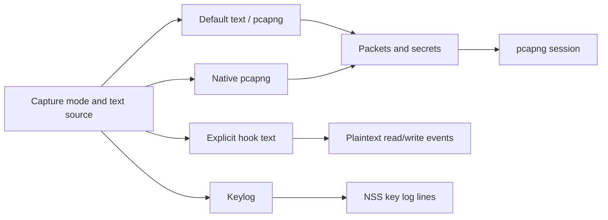

# Extending a TLS Probe

## Keep the attachment map and decoder in sync

A change to an existing TLS probe crosses the boundary between the eBPF object and the Go manager. Check the C section, BPF function and map name against the manager's section, function and map registration. Resolve the target against the actual library or Go executable. A map with a decoder also needs a tracked reader. For fields crossing this boundary, keep exact widths, signedness, byte order, padding and length validation aligned. Exercise short, malformed, maximum-size and valid padded samples. Per-CPU reordering relies on the original monotonic timestamp. [Probe development guide](https://github.com/gojue/ecapture/blob/v2.12.0/docs/agent/probe-development.md)

## Version-specific bytecode

OpenSSL patch versions may share a measured layout. Check the version-to-object mapping in `sslVersionBpfMap` and confirm both CO-RE and non-CO-RE variants can resolve the intended base name. GnuTLS 3.8.10 and 3.8.11 have separate layouts, while 3.8.12 and 3.8.13 map to the 3.8.11 object. GoTLS resolves its functions in the selected executable. A new library layout needs a capture test with that library, in addition to a mapping test. [OpenSSL mappings](https://github.com/gojue/ecapture/blob/v2.12.0/internal/probe/openssl/libs.go) · [GnuTLS mappings](https://github.com/gojue/ecapture/blob/v2.12.0/internal/probe/gnutls/config.go) · [Go symbol resolver](https://github.com/gojue/ecapture/blob/v2.12.0/internal/probe/gotls/config_symbol.go)

## Verify the affected modes

A change to secret extraction affects default text, keylog and native pcapng. Test reconstructed output during a live request, independent decryption with the saved NSS file, and decryption using only the pcapng's embedded DSBs. Test the legacy hook source separately when read/write records change. For GnuTLS, the manager routes both packet-backed text and pcapng mode through the packet capture setup. The former feeds the decoder, the latter produces a native file. [GnuTLS manager](https://github.com/gojue/ecapture/blob/v2.12.0/internal/probe/gnutls/gnutls_probe.go) · [E2E assertions](../6-build-testing-and-release/6.2-tls-test-and-e2e-strategy.md)

When extending v2 TEXT metadata, preserve older field numbers and absence semantics. Regenerate Go types from the schema, then check terminal, JSON Lines and WebSocket output with the same capture. For native modes, verify emitted bytes after encoding and the separate local artifact. [Protocol schema](https://github.com/gojue/ecapture/blob/v2.12.0/protobuf/proto/v2/ecaptureq.proto) · [Protobuf generation](https://github.com/gojue/ecapture/blob/v2.12.0/protobuf/README.md)
