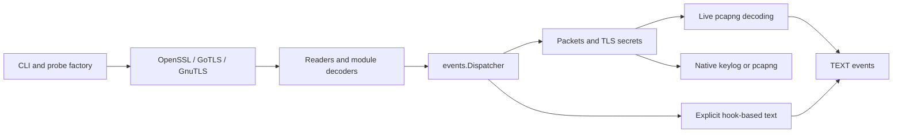

# Architecture and Probe Development

In v2.12.0, `tls`, `gotls` and `gnutls` use module-specific probes to collect packets and TLS secrets for the default text mode. They share the live decoder, event dispatcher and v2 output publishers. A native pcapng capture and a decoded text capture can therefore observe the same traffic while delivering different representations.

- [TLS capture architecture](5.1-tls-capture-architecture.md) traces the module, capture source and C/Go event layout.
- [Probe framework and lifecycle](5.2-probe-framework-and-lifecycle.md) describes startup, tracked readers, shutdown and reload.
- [Event and output pipeline](5.3-event-and-output-pipeline.md) explains dispatch, typed events, native encoders and network formats.
- [Extending a TLS probe](5.4-extending-a-tls-probe.md) covers version mappings, bytecode variants and how to verify each supported representation.
