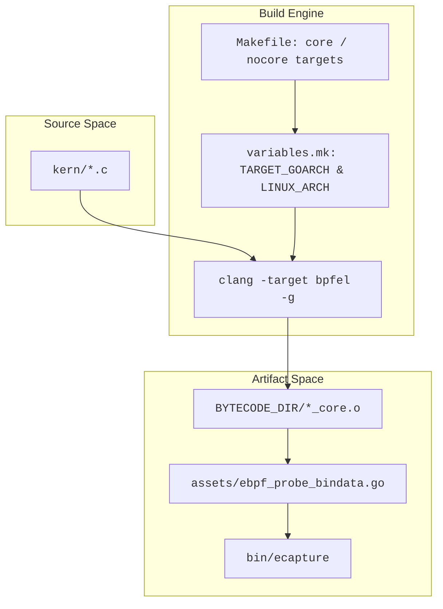
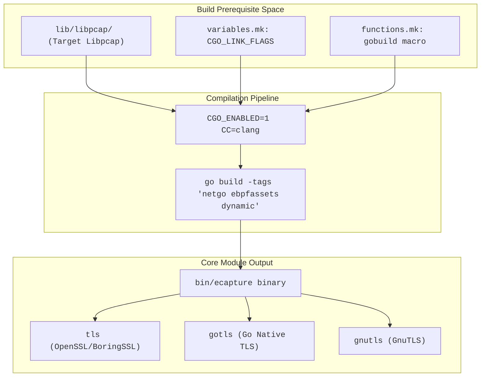

# Build and Bytecode Assets

<details>
<summary>Relevant source files</summary>

The following files were used as context for generating this wiki page:

- [Makefile](https://github.com/gojue/ecapture/blob/8c9caada/Makefile)
- [builder/Dockerfile](https://github.com/gojue/ecapture/blob/8c9caada/builder/Dockerfile)
- [builder/Makefile.release](https://github.com/gojue/ecapture/blob/8c9caada/builder/Makefile.release)
- [builder/init_env.sh](https://github.com/gojue/ecapture/blob/8c9caada/builder/init_env.sh)
- [docs/compilation.md](https://github.com/gojue/ecapture/blob/8c9caada/docs/compilation.md)
- [functions.mk](https://github.com/gojue/ecapture/blob/8c9caada/functions.mk)
- [go.mod](https://github.com/gojue/ecapture/blob/8c9caada/go.mod)
- [go.sum](https://github.com/gojue/ecapture/blob/8c9caada/go.sum)
- [variables.mk](https://github.com/gojue/ecapture/blob/8c9caada/variables.mk)

</details>


## Purpose and Scope

This page details the build system, architecture variants, CO-RE (Compile Once – Run Everywhere) versus non-CO-RE bytecode generation strategies, and toolchain prerequisites required to compile `ecapture` and its core modules (`tls` for OpenSSL/BoringSSL, `gotls` for Go native TLS, and `gnutls` for GnuTLS). It explains how eBPF C programs are compiled into architecture-specific object files and embedded into the Go binary.

Sources: [Makefile:4-16](https://github.com/gojue/ecapture/blob/8c9caada/Makefile#L4-L16), [variables.mk:1-120](https://github.com/gojue/ecapture/blob/8c9caada/variables.mk#L1-L120), [docs/compilation.md:1-36](https://github.com/gojue/ecapture/blob/8c9caada/docs/compilation.md#L1-L36)

---

## 1. Supported Build Environments and Prerequisites

Building `ecapture` requires a modern Linux development environment (Ubuntu 20.04 or later is officially supported via helper scripts) with specific toolchain versions [docs/compilation.md:28-44](https://github.com/gojue/ecapture/blob/8c9caada/docs/compilation.md#L28-L44).

### Required Toolchain Versions
* **Golang**: Version `1.26.0` or newer (`go.mod:3` [], `functions.mk:25-34` []).
* **Clang/LLVM**: Version `9.0` or newer (Clang `14` or `18` recommended for advanced architectures) [docs/compilation.md:34-36](https://github.com/gojue/ecapture/blob/8c9caada/docs/compilation.md#L34-L36).
* **Libraries & Headers**: `libelf-dev`, `pkgconf`, `linux-tools-common`, `linux-tools-generic`, and target kernel header files [docs/compilation.md:52-55](https://github.com/gojue/ecapture/blob/8c9caada/docs/compilation.md#L52-L55).

Environment initialization can be automated via the provided bootstrap script:
```shell
/bin/bash -c "$(curl -fsSL https://raw.githubusercontent.com/gojue/ecapture/master/builder/init_env.sh)"
```
This script detects the host OS release [builder/init_env.sh:10-40](https://github.com/gojue/ecapture/blob/8c9caada/builder/init_env.sh#L10-L40), installs required system packages [builder/init_env.sh:73-75](https://github.com/gojue/ecapture/blob/8c9caada/builder/init_env.sh#L73-L75), configures symlinks for `clang`, `llc`, and `llvm-strip` [builder/init_env.sh:76-80](https://github.com/gojue/ecapture/blob/8c9caada/builder/init_env.sh#L76-L80), and sets up the Go toolchain [builder/init_env.sh:95-98](https://github.com/gojue/ecapture/blob/8c9caada/builder/init_env.sh#L95-L98).

Sources: [builder/init_env.sh:1-108](https://github.com/gojue/ecapture/blob/8c9caada/builder/init_env.sh#L1-L108), [functions.mk:13-36](https://github.com/gojue/ecapture/blob/8c9caada/functions.mk#L13-L36), [docs/compilation.md:24-57](https://github.com/gojue/ecapture/blob/8c9caada/docs/compilation.md#L24-L57)

---

## 2. Architecture Variants and Toolchain Mapping

The build system (`variables.mk`) normalizes target architectures into specific target triples, architecture build directories, and C compilation flags [variables.mk:72-120](https://github.com/gojue/ecapture/blob/8c9caada/variables.mk#L72-L120).

| Target Architecture (`TARGET_GOARCH`) | Linux Kernel Arch (`LINUX_ARCH`) | BPF Target Triple (`BPF_TARGET_TRIPLE`) | Minimum Kernel Version |
| :--- | :--- | :--- | :--- |
| `amd64` | `x86` | `x86_64` | Linux 4.18+ [docs/compilation.md:28](https://github.com/gojue/ecapture/blob/8c9caada/docs/compilation.md#L28) |
| `arm64` | `arm64` | `aarch64` | Linux 5.5+ [docs/compilation.md:28](https://github.com/gojue/ecapture/blob/8c9caada/docs/compilation.md#L28) |
| `loong64` | `loongarch` | `loongarch64-linux-gnu` | Linux 6.6+ [docs/compilation.md:28](https://github.com/gojue/ecapture/blob/8c9caada/docs/compilation.md#L28) |

### Cross-Compilation and Loong64 Support
Cross-compilation is driven by setting the `CROSS_ARCH` environment variable (e.g., `CROSS_ARCH=arm64 make`) [docs/compilation.md:107-112](https://github.com/gojue/ecapture/blob/8c9caada/docs/compilation.md#L107-L112). For `loong64`, strict requirements apply: it must be built on Ubuntu 24.04 `x86_64` using LLVM 18 (`CLANG_NUM=18`) and requires `LOONG64_VMLINUX` and kernel headers [variables.mk:91-117](https://github.com/gojue/ecapture/blob/8c9caada/variables.mk#L91-L117), [docs/compilation.md:114-131](https://github.com/gojue/ecapture/blob/8c9caada/docs/compilation.md#L114-L131).

Sources: [variables.mk:72-120](https://github.com/gojue/ecapture/blob/8c9caada/variables.mk#L72-L120), [docs/compilation.md:79-131](https://github.com/gojue/ecapture/blob/8c9caada/docs/compilation.md#L79-L131)

---

## 3. CO-RE and Non-CO-RE Bytecode Asset Generation

eBPF bytecode is compiled from C source files under `kern/` into architecture-specific object files (`_core.o` or non-CO-RE equivalents) and subsequently packed into Go source files via asset generation [Makefile:174-190](https://github.com/gojue/ecapture/blob/8c9caada/Makefile#L174-L190).

### Build Targets
* `make all` (or `make build`): Compiles both CO-RE and non-CO-RE bytecode assets and builds the `ecapture` binary [Makefile:4-6](https://github.com/gojue/ecapture/blob/8c9caada/Makefile#L4-L6).
* `make core`: Builds eCapture with **CO-RE (Compile Once – Run Everywhere) assets only** [Makefile:9-11](https://github.com/gojue/ecapture/blob/8c9caada/Makefile#L9-L11).
* `make nocore`: Builds eCapture with **non-CO-RE assets only**, bypassing BTF dependencies for older kernels [Makefile:13-15](https://github.com/gojue/ecapture/blob/8c9caada/Makefile#L13-L15), [docs/compilation.md:69-77](https://github.com/gojue/ecapture/blob/8c9caada/docs/compilation.md#L69-L77).

### Compilation Flow
The `Makefile` targets each source file in `kern/` matching `KERN_OBJECTS`, invoking `clang` with appropriate target flags (`-target bpfel`), debug symbols (`-g`), and dependency generation [Makefile:174-185](https://github.com/gojue/ecapture/blob/8c9caada/Makefile#L174-L185).


Sources: [Makefile:1-190](https://github.com/gojue/ecapture/blob/8c9caada/Makefile#L1-L190), [variables.mk:140-176](https://github.com/gojue/ecapture/blob/8c9caada/variables.mk#L140-L176)

---

## 4. Build Prerequisites for TLS, GoTLS, and GnuTLS

The core TLS probes (`tls`, `gotls`, `gnutls`) depend on statically linked `libpcap` and CGO configurations defined in `functions.mk` [functions.mk:47-57](https://github.com/gojue/ecapture/blob/8c9caada/functions.mk#L47-L57).

### CGO and Linker Configuration
The `gobuild` macro defines the precise environment variables and build flags passed to the Go compiler [functions.mk:47-57](https://github.com/gojue/ecapture/blob/8c9caada/functions.mk#L47-L57):
* `CGO_ENABLED=1` [functions.mk:49](https://github.com/gojue/ecapture/blob/8c9caada/functions.mk#L49) ensures packet capture features (`pcapng` mode) can link against the bundled `libpcap` archive located at `LIBPCAP_BUILD_DIR` [functions.mk:50-51](https://github.com/gojue/ecapture/blob/8c9caada/functions.mk#L50-L51).
* Build tags include `netgo`, `ebpfassets`, `dynamic`, and module-specific tags like `ecap_android` [variables.mk:152-176](https://github.com/gojue/ecapture/blob/8c9caada/variables.mk#L152-L176), [functions.mk:54](https://github.com/gojue/ecapture/blob/8c9caada/functions.mk#L54).
* Ldflags strip binary symbols (`-w -s`) and inject the git version and bytecode configuration [functions.mk:54](https://github.com/gojue/ecapture/blob/8c9caada/functions.mk#L54).


Sources: [functions.mk:47-57](https://github.com/gojue/ecapture/blob/8c9caada/functions.mk#L47-L57), [variables.mk:52-124](https://github.com/gojue/ecapture/blob/8c9caada/variables.mk#L52-L124)