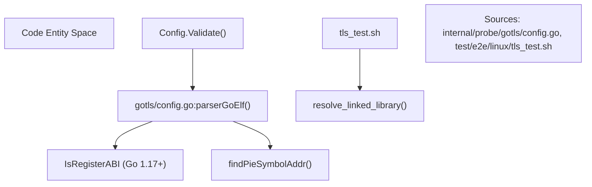
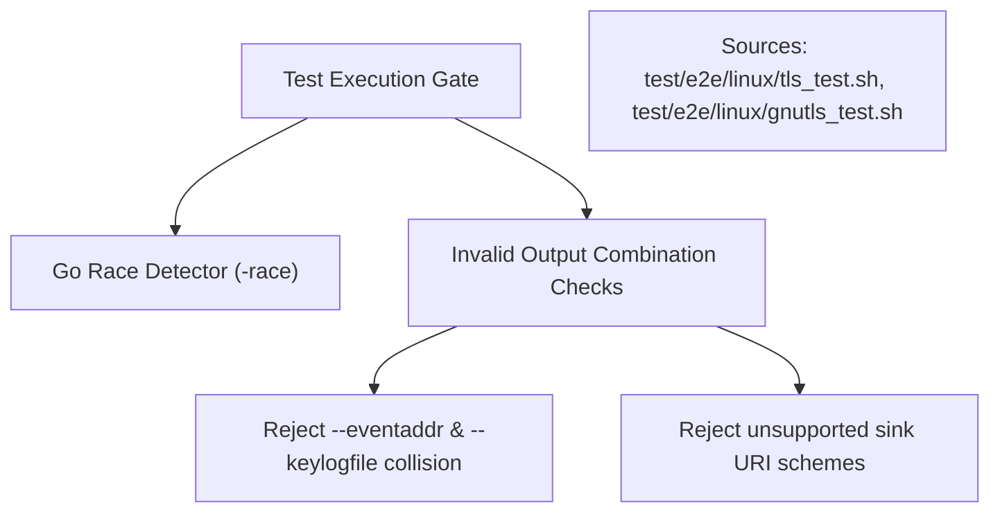
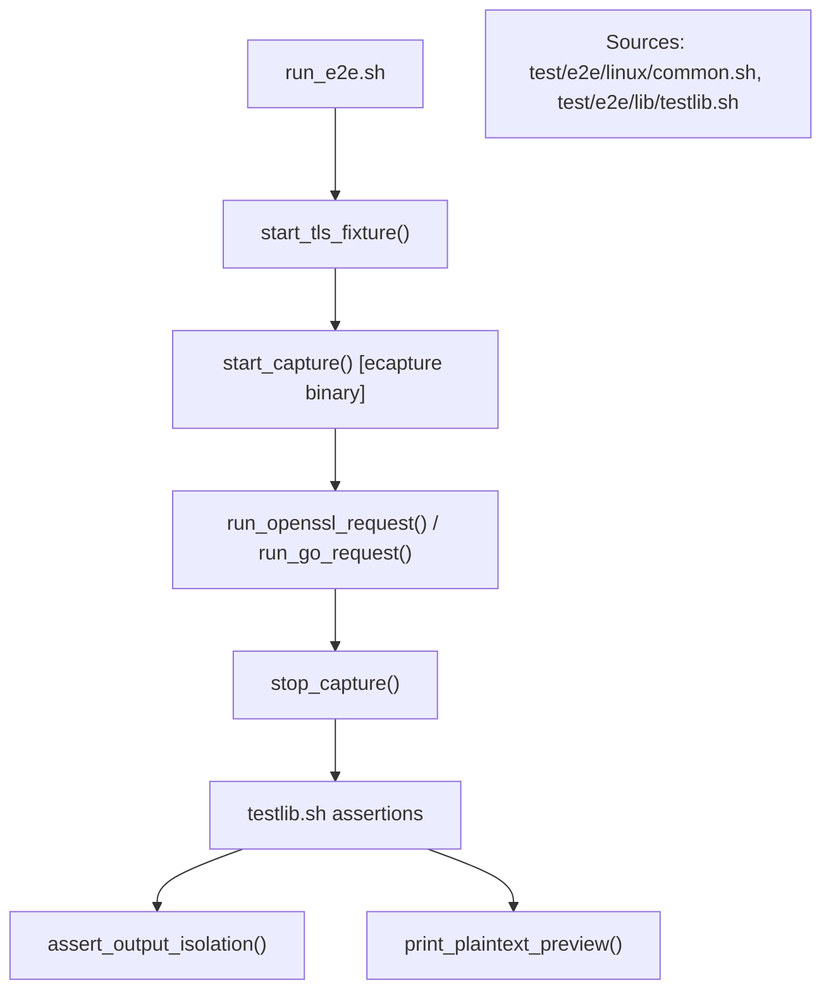
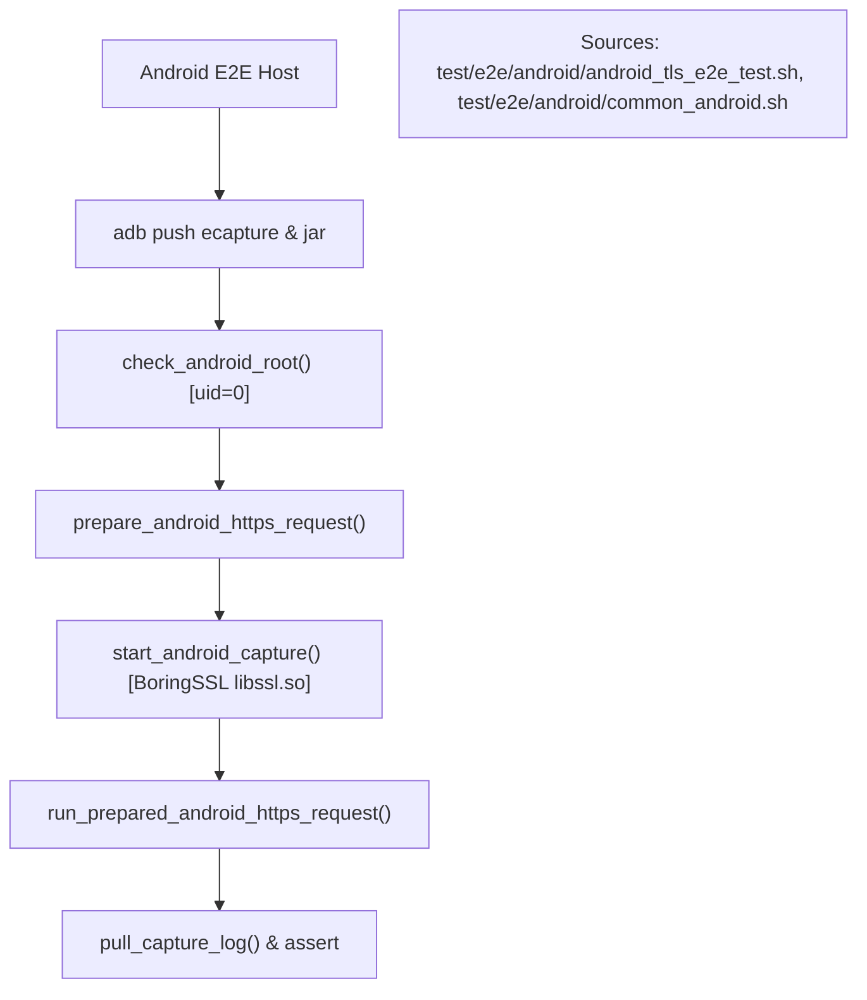

# TLS Test and E2E Strategy

Relevant source files

The following files were used as context for generating this wiki page:

- [internal/probe/gotls/config.go](https://github.com/gojue/ecapture/blob/8c9caada/internal/probe/gotls/config.go)
- [test/e2e/README.md](https://github.com/gojue/ecapture/blob/8c9caada/test/e2e/README.md)
- [test/e2e/android/android_tls_e2e_test.sh](https://github.com/gojue/ecapture/blob/8c9caada/test/e2e/android/android_tls_e2e_test.sh)
- [test/e2e/android/common_android.sh](https://github.com/gojue/ecapture/blob/8c9caada/test/e2e/android/common_android.sh)
- [test/e2e/android/setup_android_env.sh](https://github.com/gojue/ecapture/blob/8c9caada/test/e2e/android/setup_android_env.sh)
- [test/e2e/common.sh](https://github.com/gojue/ecapture/blob/8c9caada/test/e2e/common.sh)
- [test/e2e/fixtures/pcapng_check/main.go](https://github.com/gojue/ecapture/blob/8c9caada/test/e2e/fixtures/pcapng_check/main.go)
- [test/e2e/gnutls_e2e_test.sh](https://github.com/gojue/ecapture/blob/8c9caada/test/e2e/gnutls_e2e_test.sh)
- [test/e2e/go_https_client.go](https://github.com/gojue/ecapture/blob/8c9caada/test/e2e/go_https_client.go)
- [test/e2e/gotls_e2e_test.sh](https://github.com/gojue/ecapture/blob/8c9caada/test/e2e/gotls_e2e_test.sh)
- [test/e2e/lib/testlib.sh](https://github.com/gojue/ecapture/blob/8c9caada/test/e2e/lib/testlib.sh)
- [test/e2e/linux/common.sh](https://github.com/gojue/ecapture/blob/8c9caada/test/e2e/linux/common.sh)
- [test/e2e/linux/gnutls_test.sh](https://github.com/gojue/ecapture/blob/8c9caada/test/e2e/linux/gnutls_test.sh)
- [test/e2e/linux/gotls_test.sh](https://github.com/gojue/ecapture/blob/8c9caada/test/e2e/linux/gotls_test.sh)
- [test/e2e/linux/tls_test.sh](https://github.com/gojue/ecapture/blob/8c9caada/test/e2e/linux/tls_test.sh)
- [test/e2e/tls_e2e_test.sh](https://github.com/gojue/ecapture/blob/8c9caada/test/e2e/tls_e2e_test.sh)

## Purpose and Scope
This page details the testing and End-to-End (E2E) verification strategy for eCapture's core TLS modules (`tls` for OpenSSL/BoringSSL, `gotls` for Go native TLS, and `gnutls` for GnuTLS). It covers targeted unit test patterns, byte-level ABI checks, race condition detection, production-tag gates, and strict Linux/Android E2E execution harnesses that validate text, keylog, and pcapng output modes.

Sources: [test/e2e/README.md:1-76](https://github.com/gojue/ecapture/blob/8c9caada/test/e2e/README.md#L1-L76), [test/e2e/linux/common.sh:1-76](https://github.com/gojue/ecapture/blob/8c9caada/test/e2e/linux/common.sh#L1-L76)

---

## 6.2.1 Targeted Unit Tests and Byte-Level ABI Checks
Core TLS probes rely on precise binary structure inspection and ABI compatibility. Unit tests and configuration validators verify binary properties prior to eBPF program attachment:
- **Go Binary ABI Inspection**: The `gotls` module parses ELF symbols, detects Go runtime versions, and configures register-based ABI flags for Go 1.17+ binaries ([internal/probe/gotls/config.go:141-190](https://github.com/gojue/ecapture/blob/8c9caada/internal/probe/gotls/config.go#L141-L190)). It resolves Position-Independent Executable (PIE) symbol offsets ([internal/probe/gotls/config.go:216-228](https://github.com/gojue/ecapture/blob/8c9caada/internal/probe/gotls/config.go#L216-L228)).
- **Library Linkage and Resolution**: OpenSSL and GnuTLS probes resolve linked shared objects (`libssl.so`, `libgnutls.so`) to ensure target function symbols (`SSL_read`, `gnutls_record_recv`) reside at expected offsets [test/e2e/linux/tls_test.sh:13-19](https://github.com/gojue/ecapture/blob/8c9caada/test/e2e/linux/tls_test.sh#L13-L19), [test/e2e/linux/gnutls_test.sh:13-26](https://github.com/gojue/ecapture/blob/8c9caada/test/e2e/linux/gnutls_test.sh#L13-L26).

Sources: [internal/probe/gotls/config.go:114-228](https://github.com/gojue/ecapture/blob/8c9caada/internal/probe/gotls/config.go#L114-L228), [test/e2e/linux/tls_test.sh:13-19](https://github.com/gojue/ecapture/blob/8c9caada/test/e2e/linux/tls_test.sh#L13-L19)

---

## 6.2.2 Race Conditions and Production-Tag Gates
To guarantee safety in concurrent user-space control loops and eBPF event ring buffers, the test suite enforces rigorous build and runtime checks:
- **Race Detector Integration**: Go tests and components are executed under the Go race detector (`-race`) to catch concurrent map reads/writes in event dispatchers and output sinks.
- **Output Isolation and Conflict Gates**: Test cases validate that eCapture strictly separates operational logging (`--logaddr`) from captured events (`--eventaddr` or stdout), rejecting conflicting parameters such as simultaneous stdout usage or invalid sink URI schemes [test/e2e/linux/tls_test.sh:59-79](https://github.com/gojue/ecapture/blob/8c9caada/test/e2e/linux/tls_test.sh#L59-L79).

Sources: [test/e2e/linux/tls_test.sh:59-79](https://github.com/gojue/ecapture/blob/8c9caada/test/e2e/linux/tls_test.sh#L59-L79), [test/e2e/linux/gnutls_test.sh:36-56](https://github.com/gojue/ecapture/blob/8c9caada/test/e2e/linux/gnutls_test.sh#L36-L56)

---

## 6.2.3 Linux E2E Harness and Test Matrix
Maintained Linux E2E tests run on GitHub Actions Ubuntu 22.04+ environments with root privileges and kernel version 4.18+ (or 5.5+ for ARM64) [test/e2e/linux/common.sh:30-63](https://github.com/gojue/ecapture/blob/8c9caada/test/e2e/linux/common.sh#L30-L63).
- **Harness Structure**: The runner spawns a local isolated TLS fixture (`test_server`) over loopback, executes native clients (`openssl_client`, `go_https_client`, `gnutls_client`), and runs eCapture in the background capturing specific modes (`text`, `keylog`, `pcapng`) [test/e2e/linux/tls_test.sh:81-158](https://github.com/gojue/ecapture/blob/8c9caada/test/e2e/linux/tls_test.sh#L81-L158), [test/e2e/linux/gotls_test.sh:53-129](https://github.com/gojue/ecapture/blob/8c9caada/test/e2e/linux/gotls_test.sh#L53-L129), [test/e2e/linux/gnutls_test.sh:58-134](https://github.com/gojue/ecapture/blob/8c9caada/test/e2e/linux/gnutls_test.sh#L58-L134).
- **Assertion Library**: Shared validation utilities in `testlib.sh` verify file non-emptiness, absence of capture errors, token containment, and strict output isolation ([test/e2e/lib/testlib.sh:54-107](https://github.com/gojue/ecapture/blob/8c9caada/test/e2e/lib/testlib.sh#L54-L107)).

Sources: [test/e2e/linux/common.sh:30-207](https://github.com/gojue/ecapture/blob/8c9caada/test/e2e/linux/common.sh#L30-L207), [test/e2e/lib/testlib.sh:1-211](https://github.com/gojue/ecapture/blob/8c9caada/test/e2e/lib/testlib.sh#L1-L211), [test/e2e/linux/tls_test.sh:81-158](https://github.com/gojue/ecapture/blob/8c9caada/test/e2e/linux/tls_test.sh#L81-L158)

---

## 6.2.4 Android E2E Harness and Conscrypt Validation
Android E2E testing targets API 33+ (Android 13 through 16) on rooted devices or emulators utilizing platform Conscrypt/BoringSSL ([test/e2e/android/common_android.sh:72-155](https://github.com/gojue/ecapture/blob/8c9caada/test/e2e/android/common_android.sh#L72-L155)).
- **Workload Deployment**: Pushes the compiled `ecapture` binary and an `app_process` Java client (`AndroidHttpsClient`) executing HTTPS requests via `adb` [test/e2e/android/android_tls_e2e_test.sh:19-46](https://github.com/gojue/ecapture/blob/8c9caada/test/e2e/android/android_tls_e2e_test.sh#L19-L46).
- **Gated Execution**: Utilizes file gates (`prepare_android_https_request`) to synchronize eCapture attachment with the exact PID of the targeted Java process, avoiding perf buffer overflows on busy emulator images [test/e2e/android/android_tls_e2e_test.sh:66-92](https://github.com/gojue/ecapture/blob/8c9caada/test/e2e/android/android_tls_e2e_test.sh#L66-L92).

Sources: [test/e2e/android/android_tls_e2e_test.sh:19-154](https://github.com/gojue/ecapture/blob/8c9caada/test/e2e/android/android_tls_e2e_test.sh#L19-L154), [test/e2e/android/common_android.sh:65-155](https://github.com/gojue/ecapture/blob/8c9caada/test/e2e/android/common_android.sh#L65-L155)

---

## 6.2.5 Output Mode Verification (Text, Keylog, and pcapng)
The E2E test suite validates artifact integrity for all three capture modes:
- **Text Mode**: Asserts that plaintext tokens matching the E2E test run appear in the event stream without leaking into operational logs [test/e2e/linux/tls_test.sh:81-99](https://github.com/gojue/ecapture/blob/8c9caada/test/e2e/linux/tls_test.sh#L81-L99).
- **Keylog Mode**: Captures raw packets via `tshark` concurrently while eCapture writes NSS keylog files. It verifies the presence of TLS 1.2 `CLIENT_RANDOM` and TLS 1.3 traffic secrets, then uses `tshark` with `-o tls.keylog_file` to successfully decrypt the packet capture [test/e2e/linux/tls_test.sh:101-137](https://github.com/gojue/ecapture/blob/8c9caada/test/e2e/linux/tls_test.sh#L101-L137), [test/e2e/lib/testlib.sh:185-205](https://github.com/gojue/ecapture/blob/8c9caada/test/e2e/lib/testlib.sh#L185-L205).
- **pcapng Mode**: Validates generated pcapng artifacts against structural requirements using `pcapng_check`, ensuring the presence of Section Header Blocks (SHB), Interface Description Blocks (IDB), Enhanced Packet Blocks, and TLS Decryption Secrets Blocks (DSB) [test/e2e/README.md:41-47](https://github.com/gojue/ecapture/blob/8c9caada/test/e2e/README.md#L41-L47), [test/e2e/linux/tls_test.sh:139-158](https://github.com/gojue/ecapture/blob/8c9caada/test/e2e/linux/tls_test.sh#L139-L158).

Sources: [test/e2e/README.md:30-58](https://github.com/gojue/ecapture/blob/8c9caada/test/e2e/README.md#L30-L58), [test/e2e/linux/tls_test.sh:81-158](https://github.com/gojue/ecapture/blob/8c9caada/test/e2e/linux/tls_test.sh#L81-L158), [test/e2e/lib/testlib.sh:185-211](https://github.com/gojue/ecapture/blob/8c9caada/test/e2e/lib/testlib.sh#L185-L211)