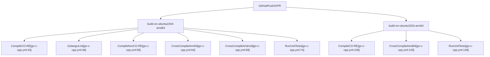
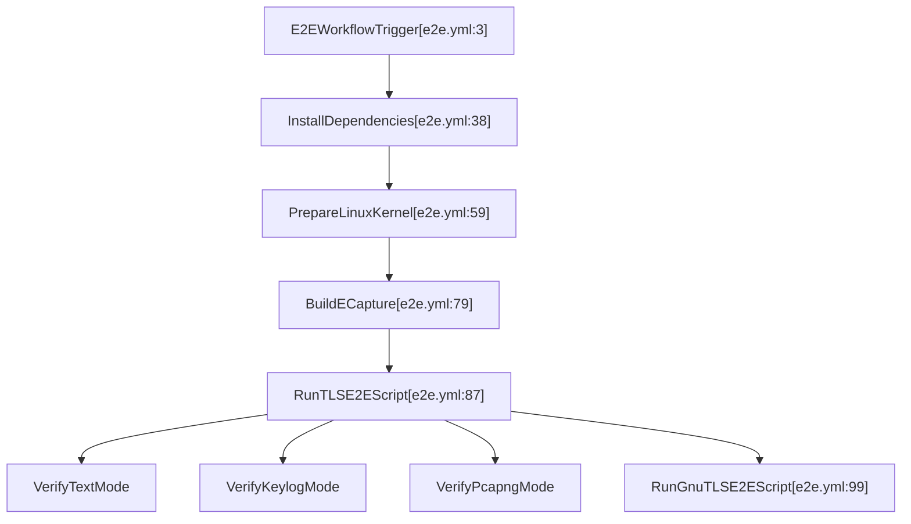

# CI, Packaging, and Release

<details>
<summary>Relevant source files</summary>

The following files were used as context for generating this wiki page:

- [.github/workflows/android_e2e.yml](https://github.com/gojue/ecapture/blob/8c9caada/.github/workflows/android_e2e.yml)
- [.github/workflows/codeql-analysis.yml](https://github.com/gojue/ecapture/blob/8c9caada/.github/workflows/codeql-analysis.yml)
- [.github/workflows/e2e.yml](https://github.com/gojue/ecapture/blob/8c9caada/.github/workflows/e2e.yml)
- [.github/workflows/go-c-cpp.yml](https://github.com/gojue/ecapture/blob/8c9caada/.github/workflows/go-c-cpp.yml)
- [.github/workflows/pr_build_debug.yml](https://github.com/gojue/ecapture/blob/8c9caada/.github/workflows/pr_build_debug.yml)
- [.github/workflows/release.yml](https://github.com/gojue/ecapture/blob/8c9caada/.github/workflows/release.yml)
- [builder/rpmBuild.spec](https://github.com/gojue/ecapture/blob/8c9caada/builder/rpmBuild.spec)

</details>


## Purpose and Scope
This page details the continuous integration (CI) pipelines, automated testing matrices, security analysis workflows, packaging specifications, and release orchestration mechanisms for `ecapture`. The scope is restricted to the core TLS modules (`tls`, `gotls`, and `gnutls`) and their accompanying bytecode assets, cross-compilation targets, and distribution artifacts [.github/workflows/go-c-cpp.yml:1-76](https://github.com/gojue/ecapture/blob/8c9caada/.github/workflows/go-c-cpp.yml#L1-L76), [.github/workflows/e2e.yml:1-122](https://github.com/gojue/ecapture/blob/8c9caada/.github/workflows/e2e.yml#L1-L122).

---

## 1. Continuous Integration (CI) Architecture & Coverage
The CI architecture relies on GitHub Actions workflows divided into compilation matrices, unit test suites, static analysis jobs, and end-to-end (E2E) verification environments across multiple Linux distributions and Android API levels [.github/workflows/go-c-cpp.yml:1-141](https://github.com/gojue/ecapture/blob/8c9caada/.github/workflows/go-c-cpp.yml#L1-L141), [.github/workflows/e2e.yml:1-122](https://github.com/gojue/ecapture/blob/8c9caada/.github/workflows/e2e.yml#L1-L122), [.github/workflows/android_e2e.yml:1-164](https://github.com/gojue/ecapture/blob/8c9caada/.github/workflows/android_e2e.yml#L1-L164).

### Build Matrices and Architecture Support
The core build pipeline (`GO/C/C++ CI`) executes on Ubuntu runner nodes (`ubuntu-22.04` and `ubuntu-24.04`) for both `x86_64` (amd64) and `arm64` architectures [.github/workflows/go-c-cpp.yml:9-140](https://github.com/gojue/ecapture/blob/8c9caada/.github/workflows/go-c-cpp.yml#L9-L140). It compiles both CO-RE (Compile Once – Run Everywhere) and non-CO-RE (bytecode assets embedded via build tags) variants [.github/workflows/go-c-cpp.yml:43-63](https://github.com/gojue/ecapture/blob/8c9caada/.github/workflows/go-c-cpp.yml#L43-L63).


*Figure 1: CI Build Matrix Workflow Mapping.*

Sources: [.github/workflows/go-c-cpp.yml:1-140](https://github.com/gojue/ecapture/blob/8c9caada/.github/workflows/go-c-cpp.yml#L1-L140)

---

## 2. Automated Testing Gates (Unit, Race, and E2E)
Testing is enforced through three distinct gates: Go unit tests with race detection, Linux E2E test suites covering TLS/GoTLS/GnuTLS modes, and Android E2E emulator pipelines [.github/workflows/go-c-cpp.yml:74-75](https://github.com/gojue/ecapture/blob/8c9caada/.github/workflows/go-c-cpp.yml#L74-L75), [.github/workflows/e2e.yml:19-110](https://github.com/gojue/ecapture/blob/8c9caada/.github/workflows/e2e.yml#L19-L110), [.github/workflows/android_e2e.yml:19-155](https://github.com/gojue/ecapture/blob/8c9caada/.github/workflows/android_e2e.yml#L19-L155).

### Unit and Race Verification
Unit tests are executed with the race detector enabled to identify concurrency hazards in probe management, byte sinks, and ring buffer readers:
```bash
go test -v -race ./...
```
*Source: [.github/workflows/go-c-cpp.yml:74-75](https://github.com/gojue/ecapture/blob/8c9caada/.github/workflows/go-c-cpp.yml#L74-L75)*

### End-to-End (E2E) Workload Gates
The E2E workflow (`tls-e2e`) runs on pull requests and pushes to `master`, `v2`, and `v1` branches [.github/workflows/e2e.yml:1-10](https://github.com/gojue/ecapture/blob/8c9caada/.github/workflows/e2e.yml#L1-L10). It installs required development packages (`libssl-dev`, `libgnutls28-dev`, `tshark`) and executes test scripts for `tls`, `gotls`, and `gnutls` across `text`, `keylog`, and `pcapng` modes [.github/workflows/e2e.yml:38-110](https://github.com/gojue/ecapture/blob/8c9caada/.github/workflows/e2e.yml#L38-L110).


*Figure 2: E2E Execution Flow and Verification Gates.*

Sources: [.github/workflows/e2e.yml:1-122](https://github.com/gojue/ecapture/blob/8c9caada/.github/workflows/e2e.yml#L1-L122)

---

## 3. Least-Privilege Workflow Boundaries & Security Scanning
Workflows enforce least-privilege boundary rules by restricting GITHUB_TOKEN permissions explicitly and isolating elevated privileges (such as `sudo` or `setcap`) to specific test execution steps [.github/workflows/codeql-analysis.yml:27-31](https://github.com/gojue/ecapture/blob/8c9caada/.github/workflows/codeql-analysis.yml#L27-L31), [.github/workflows/android_e2e.yml:52-56](https://github.com/gojue/ecapture/blob/8c9caada/.github/workflows/android_e2e.yml#L52-L56)etry.

### CodeQL Static Analysis
The CodeQL workflow analyzes C++ and Go sources on a schedule and on pull requests, uploading security findings and coverage reports to Codecov [.github/workflows/codeql-analysis.yml:14-92](https://github.com/gojue/ecapture/blob/8c9caada/.github/workflows/codeql-analysis.yml#L14-L92).
- **Languages Analyzed**: `cpp`, `go` [.github/workflows/codeql-analysis.yml:35](https://github.com/gojue/ecapture/blob/8c9caada/.github/workflows/codeql-analysis.yml#L35)
- **Build Integration**: Executes `make env` and `make nocore` prior to static verification [.github/workflows/codeql-analysis.yml:85-87](https://github.com/gojue/ecapture/blob/8c9caada/.github/workflows/codeql-analysis.yml#L85-L87)

Sources: [.github/workflows/codeql-analysis.yml:1-92](https://github.com/gojue/ecapture/blob/8c9caada/.github/workflows/codeql-analysis.yml#L1-L92), [.github/workflows/android_e2e.yml:52-56](https://github.com/gojue/ecapture/blob/8c9caada/.github/workflows/android_e2e.yml#L52-L56)

---

## 4. Packaging and Release Pipelines
Releases are triggered automatically upon publishing git tags matching the pattern `v*` [.github/workflows/release.yml:1-5](https://github.com/gojue/ecapture/blob/8c9caada/.github/workflows/release.yml#L1-L5). 

### Release Artifact Generation
The release pipeline (`Release`) builds binaries for Linux (`amd64`, `arm64`, `loong64`) and Android variants, generating compressed tarballs and Debian (`.deb`) packages [.github/workflows/release.yml:16-190](https://github.com/gojue/ecapture/blob/8c9caada/.github/workflows/release.yml#L16-L190). RPM packaging is supported via the RPM spec file configuration [builder/rpmBuild.spec:1-63](https://github.com/gojue/ecapture/blob/8c9caada/builder/rpmBuild.spec#L1-L63).

```yaml
Name:       ecapture
Version:    v1.1.0
Release:    2025%{?dist}
Summary:    Capture SSL/TLS plaintext content without CA certificates using eBPF
License:    Apache-2.0
URL:        https://ecapture.cc
```
*Source: [builder/rpmBuild.spec:1-6](https://github.com/gojue/ecapture/blob/8c9caada/builder/rpmBuild.spec#L1-L6)*

### Debug and PR Artifacts
For pull requests, the `PR Build (Debug)` workflow compiles debug artifacts for Android and Linux across multiple architectures, ensuring pre-merge verification of cross-compilation integrity [.github/workflows/pr_build_debug.yml:1-180](https://github.com/gojue/ecapture/blob/8c9caada/.github/workflows/pr_build_debug.yml#L1-L180).

Sources: [.github/workflows/release.yml:1-190](https://github.com/gojue/ecapture/blob/8c9caada/.github/workflows/release.yml#L1-L190), [.github/workflows/pr_build_debug.yml:1-177](https://github.com/gojue/ecapture/blob/8c9caada/.github/workflows/pr_build_debug.yml#L1-L177), [builder/rpmBuild.spec:1-63](https://github.com/gojue/ecapture/blob/8c9caada/builder/rpmBuild.spec#L1-L63)