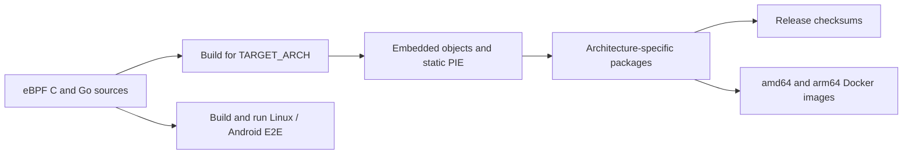

# Build, Testing, and Release

A v2.12.0 release tag builds Linux and Android packages on Linux and checks the resulting artifacts before publication. Separate E2E workflows build the collector and run it on the kernels and workloads in their test matrices.

| Question | Chapter |
| --- | --- |
| Which toolchain, kernel headers and embedded assets does this target need? | [Build and bytecode assets](6.1-build-and-bytecode-assets.md) |
| How can I verify decoded text, NSS secrets and native pcapng independently? | [TLS tests and E2E strategy](6.2-tls-test-and-e2e-strategy.md) |
| Which jobs build the packages, run real-kernel tests and publish container images? | [CI, packaging and release](6.3-ci-packaging-and-release.md) |
