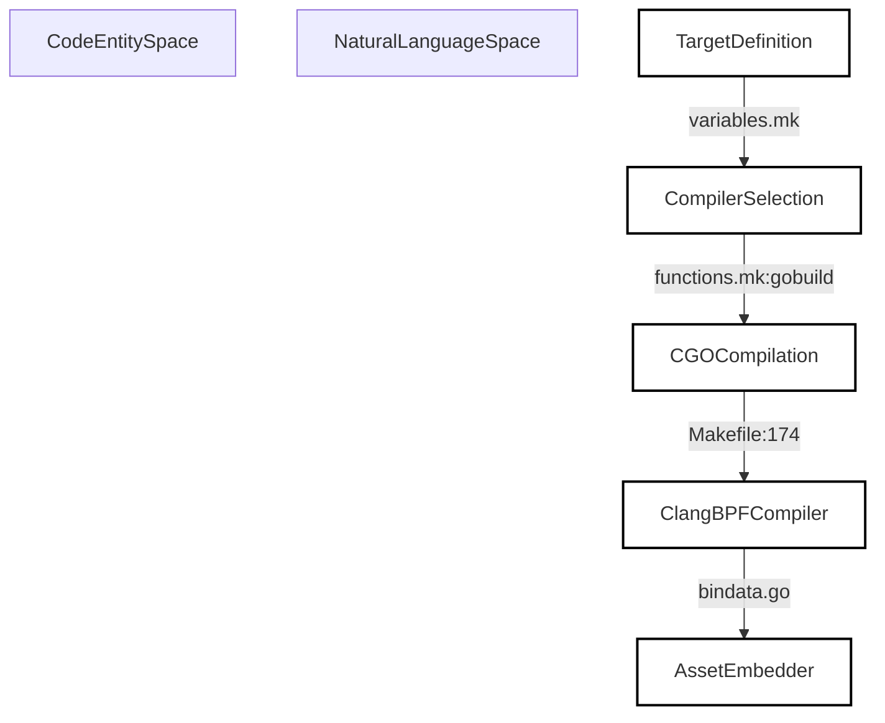
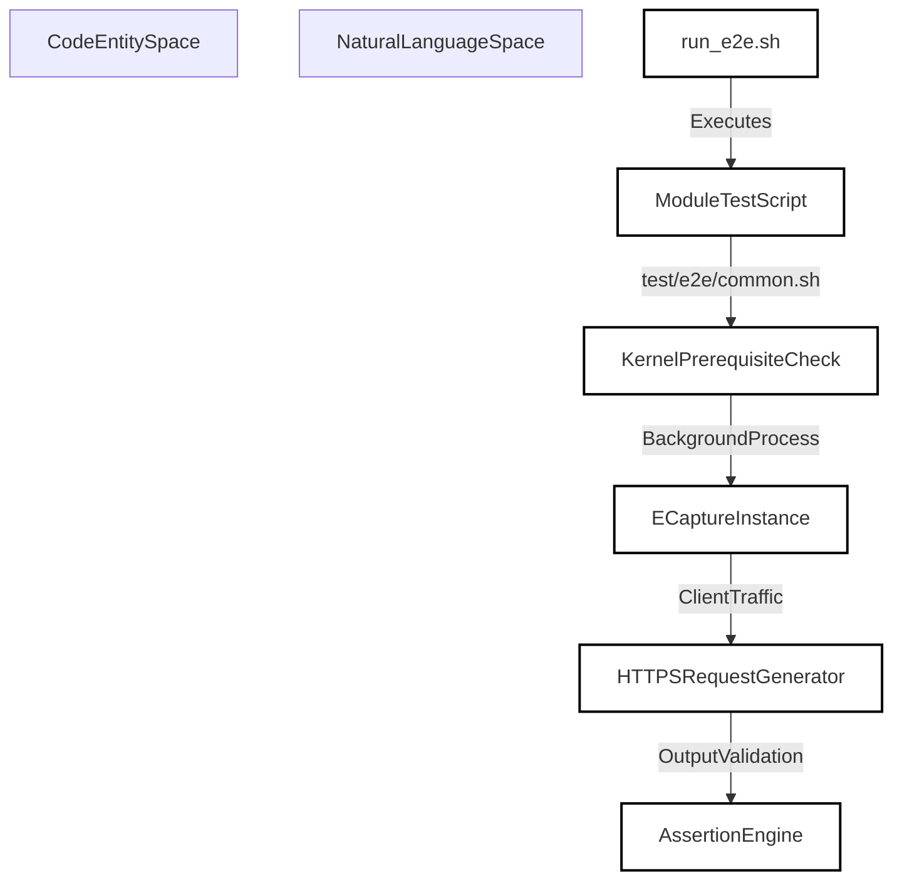

# Build, Testing, and Release

Relevant source files

The following files were used as context for generating this wiki page:

- [Makefile](https://github.com/gojue/ecapture/blob/8c9caada/Makefile)
- [builder/Makefile.release](https://github.com/gojue/ecapture/blob/8c9caada/builder/Makefile.release)
- [docs/compilation.md](https://github.com/gojue/ecapture/blob/8c9caada/docs/compilation.md)
- [docs/e2e-tests.md](https://github.com/gojue/ecapture/blob/8c9caada/docs/e2e-tests.md)
- [functions.mk](https://github.com/gojue/ecapture/blob/8c9caada/functions.mk)
- [test/e2e/run_e2e.sh](https://github.com/gojue/ecapture/blob/8c9caada/test/e2e/run_e2e.sh)
- [variables.mk](https://github.com/gojue/ecapture/blob/8c9caada/variables.mk)

## Purpose and Scope
This parent wiki page serves as the developer-facing entry point for compiling, testing, packaging, and releasing `eCapture`. It covers the build pipelines for the three core TLS modules (`tls`, `gotls`, and `gnutls`), architecture bytecode assets, end-to-end testing strategies for text, keylog, and pcapng modes, and release workflows.

For deep technical dives, refer to the child pages:
- [Build and Bytecode Assets](6.1-build-and-bytecode-assets.md)
- [TLS Test and E2E Strategy](6.2-tls-test-and-e2e-strategy.md)
- [CI, Packaging, and Release](6.3-ci-packaging-and-release.md)

---

## 6.1 Build and Bytecode Assets

Building `eCapture` requires orchestrating C-based eBPF bytecode compilation via `clang` and linking the user-space Go application with a pinned `libpcap` archive [docs/compilation.md:59-60](https://github.com/gojue/ecapture/blob/8c9caada/docs/compilation.md#L59-L60). The build system supports CO-RE (Compile Once – Run Everywhere) and non-CO-RE bytecode assets across multiple architecture targets including `amd64`, `arm64`, and `loong64` [Makefile:174-185, variables.mk:77-120](https://github.com/gojue/ecapture/blob/8c9caada/Makefile:174-185, variables.mk#L77-L120). 

The compilation workflow is managed via the top-level `Makefile` and `functions.mk`, where targets such as `make core`, `make nocore`, and `CROSS_ARCH=<arch> make` govern asset generation [Makefile:10-15, variables.mk:72](https://github.com/gojue/ecapture/blob/8c9caada/Makefile:10-15, variables.mk#L72). CGO is strictly enabled (`CGO_ENABLED=1`) to statically link the `libpcap` library into the final binary [variables.mk:54, functions.mk:49-54].

*Diagram 1: Build and Bytecode Generation Pipeline linking configuration variables to bytecode embedding.*

For details on supported Linux build environments, architecture variants, CO-RE and non-CO-RE generated assets, and build prerequisites, see [Build and Bytecode Assets](6.1-build-and-bytecode-assets.md).

Sources: [Makefile:1-190](https://github.com/gojue/ecapture/blob/8c9caada/Makefile#L1-L190), [variables.mk:1-120](https://github.com/gojue/ecapture/blob/8c9caada/variables.mk#L1-L120), [functions.mk:47-57](https://github.com/gojue/ecapture/blob/8c9caada/functions.mk#L47-L57), [docs/compilation.md:1-131](https://github.com/gojue/ecapture/blob/8c9caada/docs/compilation.md#L1-L131)

---

## 6.2 TLS Test and E2E Strategy

Validating core TLS probes (`tls`, `gotls`, and `gnutls`) requires comprehensive test suites that verify byte-level ABI compatibility, event serialization, and multi-mode output correctness (text, keylog, and pcapng) [docs/e2e-tests.md:15-19](https://github.com/gojue/ecapture/blob/8c9caada/docs/e2e-tests.md#L15-L19). End-to-end tests automate kernel capability checks, helper process execution, and regex-based output assertion [docs/e2e-tests.md:96-124](https://github.com/gojue/ecapture/blob/8c9caada/docs/e2e-tests.md#L96-L124).

The test runner scripts located in `test/e2e/` coordinate prerequisite validation, target program execution (such as `curl`, custom Go HTTPS clients, and system binaries), and teardown [test/e2e/run_e2e.sh:1-31, docs/e2e-tests.md:76-92](https://github.com/gojue/ecapture/blob/8c9caada/test/e2e/run_e2e.sh:1-31, docs/e2e-tests.md#L76-L92).

*Diagram 2: End-to-End Test Execution Flow across TLS probe modules.*

For details on targeted unit tests, byte-level ABI checks, race and production-tag gates, and strict Linux/Android E2E cases, see [TLS Test and E2E Strategy](6.2-tls-test-and-e2e-strategy.md).

Sources: [test/e2e/run_e2e.sh:1-31](https://github.com/gojue/ecapture/blob/8c9caada/test/e2e/run_e2e.sh#L1-L31), [docs/e2e-tests.md:1-229](https://github.com/gojue/ecapture/blob/8c9caada/docs/e2e-tests.md#L1-L229)

---

## 6.3 CI, Packaging, and Release

Release engineering and packaging are handled through automated scripts and Makefiles that construct compressed release tarballs, Debian (`.deb`) packages, and RPM specifications [builder/Makefile.release:10-157](https://github.com/gojue/ecapture/blob/8c9caada/builder/Makefile.release#L10-L157). Least-privilege workflow boundaries and automated release checks ensure that binaries are properly stripped, version-tagged via Git metadata, and accompanied by SHA-256 checksums [builder/Makefile.release:114-130](https://github.com/gojue/ecapture/blob/8c9caada/builder/Makefile.release#L114-L130).

The release target coordinates cross-compiled asset bundling and GitHub release publishing through `builder/Makefile.release` [builder/Makefile.release:10-130](https://github.com/gojue/ecapture/blob/8c9caada/builder/Makefile.release#L10-L130).

For details on core TLS CI coverage, least-privilege workflow boundaries, packaging, and release checks, see [CI, Packaging, and Release](6.3-ci-packaging-and-release.md).

Sources: [builder/Makefile.release:1-158](https://github.com/gojue/ecapture/blob/8c9caada/builder/Makefile.release#L1-L158)

---

## 构建、测试与发布 (Simplified Chinese Version)

### 目的与范围
本页面是面向开发者的父级 Wiki 页面，重点介绍如何编译、测试、打包和发布 `eCapture` 及其三个核心 TLS 模块（`tls`、`gotls` 和 `gnutls`）以及文本、密钥日志和 pcapng 抓取模式。

详细技术细节请参考以下子页面：
- [Build and Bytecode Assets](6.1-build-and-bytecode-assets.md)
- [TLS Test and E2E Strategy](6.2-tls-test-and-e2e-strategy.md)
- [CI, Packaging, and Release](6.3-ci-packaging-and-release.md)

---

## 6.1 构建与字节码资产
`eCapture` 的构建过程需要通过 `clang` 编译 C 语言编写的 eBPF 字节码，并与锁定的 `libpcap` 静态库进行链接 [docs/compilation.md:59-60](https://github.com/gojue/ecapture/blob/8c9caada/docs/compilation.md#L59-L60)。构建系统支持 CO-RE 与非 CO-RE 字节码资产，覆盖 `amd64`、`arm64` 以及 `loong64` 等多种架构目标 [Makefile:174-185, variables.mk:77-120](https://github.com/gojue/ecapture/blob/8c9caada/Makefile:174-185, variables.mk#L77-L120)。

有关支持的 Linux 构建环境、架构变体、CO-RE 资产以及前置依赖的详细信息，请参阅 [Build and Bytecode Assets](6.1-build-and-bytecode-assets.md)。

Sources: [Makefile:1-190](https://github.com/gojue/ecapture/blob/8c9caada/Makefile#L1-L190), [variables.mk:1-120](https://github.com/gojue/ecapture/blob/8c9caada/variables.mk#L1-L120), [functions.mk:47-57](https://github.com/gojue/ecapture/blob/8c9caada/functions.mk#L47-L57), [docs/compilation.md:1-131](https://github.com/gojue/ecapture/blob/8c9caada/docs/compilation.md#L1-L131)

---

## 6.2 TLS 测试与端到端策略
验证核心 TLS 探针需要执行全面的端到端（E2E）测试套件，用以校验字节级 ABI 兼容性、事件序列化以及多模式输出的正确性 [docs/e2e-tests.md:15-19](https://github.com/gojue/ecapture/blob/8c9caada/docs/e2e-tests.md#L15-L19)。测试脚本位于 `test/e2e/` 目录下 [test/e2e/run_e2e.sh:1-31, docs/e2e-tests.md:76-92](https://github.com/gojue/ecapture/blob/8c9caada/test/e2e/run_e2e.sh:1-31, docs/e2e-tests.md#L76-L92)。

有关单元测试、ABI 校验以及严格的 Linux/Android E2E 测试案例的详细信息，请参阅 [TLS Test and E2E Strategy](6.2-tls-test-and-e2e-strategy.md)。

Sources: [test/e2e/run_e2e.sh:1-31](https://github.com/gojue/ecapture/blob/8c9caada/test/e2e/run_e2e.sh#L1-L31), [docs/e2e-tests.md:1-229](https://github.com/gojue/ecapture/blob/8c9caada/docs/e2e-tests.md#L1-L229)

---

## 6.3 CI、打包与发布
发布工程和打包过程由自动化脚本和 Makefile 统一管理，支持生成压缩的发布包、Debian (`.deb`) 软件包以及 RPM 规约文件 [builder/Makefile.release:10-157](https://github.com/gojue/ecapture/blob/8c9caada/builder/Makefile.release#L10-L157)。发布流程通过 Git 元数据进行版本标记，并自动计算 SHA-256 校验和 [builder/Makefile.release:114-130](https://github.com/gojue/ecapture/blob/8c9caada/builder/Makefile.release#L114-L130)。

有关核心 TLS CI 覆盖率、打包规范及发布检查的详细信息，请参阅 [CI, Packaging, and Release](6.3-ci-packaging-and-release.md)。

Sources: [builder/Makefile.release:1-158](https://github.com/gojue/ecapture/blob/8c9caada/builder/Makefile.release#L1-L158)