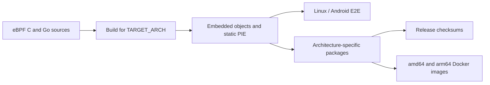

# Build, Testing, and Release

The v2.12.0 release pipeline builds architecture-specific Linux and Android binaries on Linux. To verify a release, check that it embeds the expected eBPF objects, exercises them on a real target kernel, and ships the matching executable in each package.

| Question | Chapter |
| --- | --- |
| Which toolchain, kernel headers and embedded assets does this target need? | [Build and bytecode assets](6.1-build-and-bytecode-assets.md) |
| How can I verify decoded text, NSS secrets and native pcapng independently? | [TLS tests and E2E strategy](6.2-tls-test-and-e2e-strategy.md) |
| Which jobs build the packages, run real-kernel tests and publish container images? | [CI, packaging and release](6.3-ci-packaging-and-release.md) |
