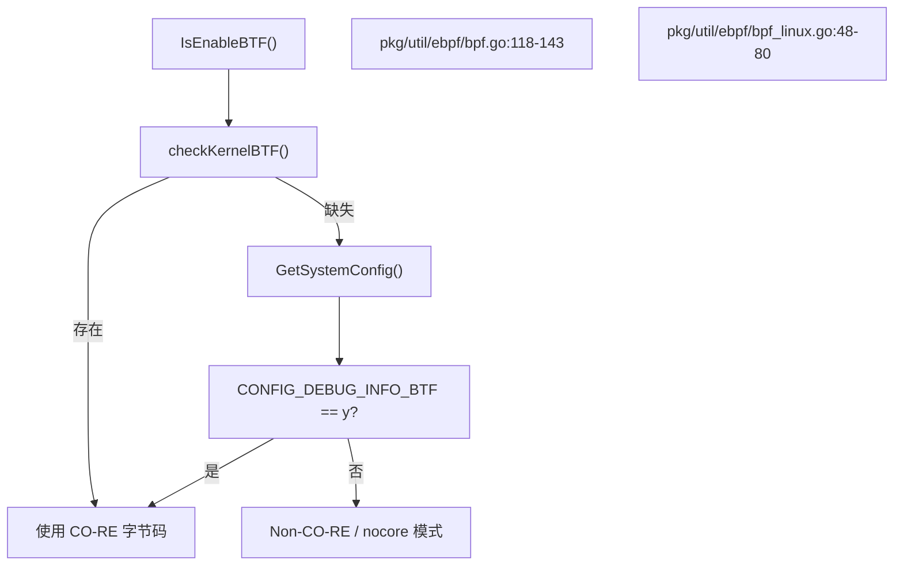
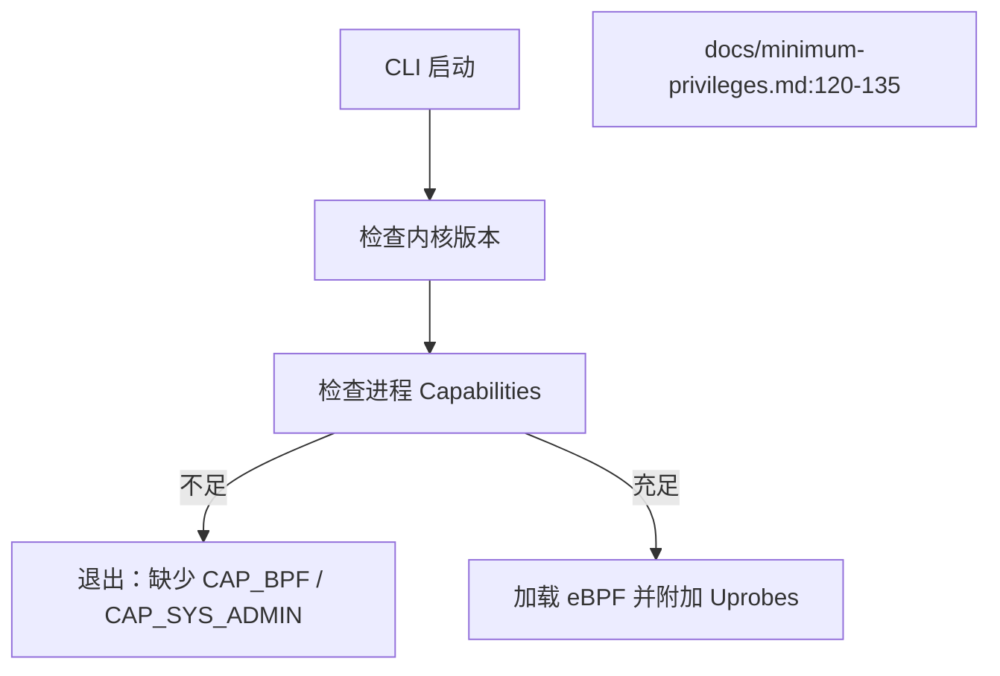

# 环境要求与安装

<details>
<summary>相关源文件</summary>

以下文件被用作生成此维基页面的上下文：

- [.github/ISSUE_TEMPLATE/bug_report.md](https://github.com/gojue/ecapture/blob/8c9caada/.github/ISSUE_TEMPLATE/bug_report.md)
- [SECURITY.md](https://github.com/gojue/ecapture/blob/8c9caada/SECURITY.md)
- [docs/README.md](https://github.com/gojue/ecapture/blob/8c9caada/docs/README.md)
- [docs/compilation.md](https://github.com/gojue/ecapture/blob/8c9caada/docs/compilation.md)
- [docs/defense-detection.md](https://github.com/gojue/ecapture/blob/8c9caada/docs/defense-detection.md)
- [docs/example-outputs.md](https://github.com/gojue/ecapture/blob/8c9caada/docs/example-outputs.md)
- [docs/minimum-privileges.md](https://github.com/gojue/ecapture/blob/8c9caada/docs/minimum-privileges.md)
- [docs/release-verification.md](https://github.com/gojue/ecapture/blob/8c9caada/docs/release-verification.md)
- [pkg/util/ebpf/bpf.go](https://github.com/gojue/ecapture/blob/8c9caada/pkg/util/ebpf/bpf.go)
- [pkg/util/ebpf/bpf_linux.go](https://github.com/gojue/ecapture/blob/8c9caada/pkg/util/ebpf/bpf_linux.go)
- [pkg/util/ebpf/bpf_test.go](https://github.com/gojue/ecapture/blob/8c9caada/pkg/util/ebpf/bpf_test.go)

</details>

---

## 目的与范围
本页面定义了运行 eCapture 所需的主机环境要求、内核配置、权限要求（root 或 Linux capabilities）以及安装步骤。它详细说明了三个核心 TLS 捕获模块（用于 OpenSSL/BoringSSL 的 `tls`、用于 Go 原生 TLS 的 `gotls` 以及用于 GnuTLS 的 `gnutls`）的运行时依赖项，并解释了 `pcapng` 捕获模式特有的接口先决条件。

Sources: [docs/compilation.md:26-37](https://github.com/gojue/ecapture/blob/8c9caada/docs/compilation.md#L26-L37), [docs/minimum-privileges.md:5-34](https://github.com/gojue/ecapture/blob/8c9caada/docs/minimum-privileges.md#L5-L34)

---

## 支持的平台与架构
eCapture 依赖于 eBPF uprobes、tracepoints 和流量控制 (TC) 钩子，这对内核版本和架构提出了严格限制。

| 架构 | 最低 Linux 内核版本 | Android 支持 | 备注 |
|---|---|---|---|
| `x86_64` | 内核 4.18+ | 支持 | 完整支持 CO-RE 和 non-CO-RE |
| `aarch64` (`arm64`) | 内核 5.5+ | 支持 | 通常需要 Android 12+ |
| `LoongArch64` (`loong64`) | 内核 6.6+ | 不支持 | 需要 LLVM 18+ 及特定 sysroots |

Sources: [docs/compilation.md:28-30](https://github.com/gojue/ecapture/blob/8c9caada/docs/compilation.md#L28-L30), [docs/minimum-privileges.md:124-126](https://github.com/gojue/ecapture/blob/8c9caada/docs/minimum-privileges.md#L124-L126)

---

## 内核与 BTF 要求
eCapture 以两种字节码模式运行：使用 BPF 类型格式 (BTF) 的 CO-RE（一次编译，到处运行）模式，以及 non-CO-RE（使用本地内核头文件的回退编译）模式。

### BTF 检测逻辑
启动时，eCapture 通过检查 `/sys/kernel/btf/vmlinux` 或通过 `checkKernelBTF()` [pkg/util/ebpf/bpf.go:89-98](https://github.com/gojue/ecapture/blob/8c9caada/pkg/util/ebpf/bpf.go#L89-L98) 扫描回退目录中的内核 ELF 镜像来确认内核 BTF 是否启用。如果 BTF 缺失，它会回退到检查内核配置文件（`/proc/config.gz`，`/boot/config-*`）中的 `CONFIG_DEBUG_INFO_BTF` [pkg/util/ebpf/bpf_linux.go:28-31](https://github.com/gojue/ecapture/blob/8c9caada/pkg/util/ebpf/bpf_linux.go#L28-L31)。


Sources: [pkg/util/ebpf/bpf.go:89-143](https://github.com/gojue/ecapture/blob/8c9caada/pkg/util/ebpf/bpf.go#L89-L143), [pkg/util/ebpf/bpf_linux.go:48-80](https://github.com/gojue/ecapture/blob/8c9caada/pkg/util/ebpf/bpf_linux.go#L48-L80)

### 强制性内核配置
无论是否支持 BTF，目标内核必须启用以下选项，并由 `IsEnableBPF()` [pkg/util/ebpf/bpf.go:146-170](https://github.com/gojue/ecapture/blob/8c9caada/pkg/util/ebpf/bpf.go#L146-L170) 进行验证：
* `CONFIG_BPF`
* `CONFIG_UPROBES`
* `CONFIG_ARCH_SUPPORTS_UPROBES`

Sources: [pkg/util/ebpf/bpf.go:30-44](https://github.com/gojue/ecapture/blob/8c9caada/pkg/util/ebpf/bpf.go#L30-L44), [pkg/util/ebpf/bpf.go:146-170](https://github.com/gojue/ecapture/blob/8c9caada/pkg/util/ebpf/bpf.go#L146-L170)

---

## 权限、Root 与 Capabilities
加载 eBPF 程序、将 uprobes 附加到共享库以及绑定 TC 分类器都需要提升权限。

### Linux Capabilities 细分
从 Linux 5.8 开始，eBPF 权限已从 `CAP_SYS_ADMIN` 中分离。所需权限因内核版本和操作模式而异：

| eCapture 模式 | 内核 >= 5.8 所需 Capabilities | 内核 < 5.8 所需 Capabilities |
|---|---|---|
| `text` | `CAP_BPF` + `CAP_PERFMON` + `CAP_SYS_PTRACE` | `CAP_SYS_ADMIN` |
| `keylog` | `CAP_BPF` + `CAP_PERFMON` + `CAP_SYS_PTRACE` | `CAP_SYS_ADMIN` |
| `pcapng` | `CAP_BPF` + `CAP_PERFMON` + `CAP_NET_ADMIN` + `CAP_SYS_PTRACE` | `CAP_SYS_ADMIN` + `CAP_NET_ADMIN` |

Sources: [docs/minimum-privileges.md:5-34](https://github.com/gojue/ecapture/blob/8c9caada/docs/minimum-privileges.md#L5-L34)

### 通过 `setcap` 分配权限
要在没有完整 `root` 或 `sudo` 权限的情况下运行 eCapture，请为二进制文件分配扩展属性：

```bash
# 针对内核 >= 5.8 的 pcapng 模式
sudo setcap 'cap_bpf,cap_perfmon,cap_net_admin,cap_sys_ptrace=eip' /usr/local/bin/ecapture

# 验证权限
getcap /usr/local/bin/ecapture
```

Sources: [docs/minimum-privileges.md:45-73](https://github.com/gojue/ecapture/blob/8c9caada/docs/minimum-privileges.md#L45-L73)


Sources: [docs/minimum-privileges.md:120-135](https://github.com/gojue/ecapture/blob/8c9caada/docs/minimum-privileges.md#L120-L135)

---

## pcapng 接口先决条件
在 `pcapng` 模式（`-m pcap` 或 `-m pcapng`）下运行时，eCapture 通过指定网络接口（`-i <interface>`）上的流量控制 (TC) eBPF 钩子拦截网络数据包，并将解密后的负载密钥注入到“解密密钥块 (DSB)”中。

* **先决条件**：
  * `CAP_NET_ADMIN` 权限（或以 root 身份运行）。
  * 有效且处于活动状态的网络接口名称（例如 `eth0`、`ens160`、`wlan0`）。
  * 在 Docker 内部运行时，必须使用 `--net=host` 才能访问并向主机网络接口附加 TC 过滤器。

Sources: [docs/minimum-privileges.md:13-34](https://github.com/gojue/ecapture/blob/8c9caada/docs/minimum-privileges.md#L13-L34), [docs/minimum-privileges.md:113-118](https://github.com/gojue/ecapture/blob/8c9caada/docs/minimum-privileges.md#L113-L118)

---

## 模块特定先决条件
三个核心 TLS 捕获模块针对不同的底层运行时和共享库实现：

1. **`tls` (OpenSSL 和 BoringSSL)**：
   * 针对动态库：`libssl.so`（OpenSSL 1.0.x, 1.1.x, 3.0+）或 BoringSSL（Android / Chrome / 自定义二进制文件）。
   * 需要对 `SSL_do_handshake`、`SSL_read` 和 `SSL_write` 等函数进行符号解析。
2. **`gotls` (Go 原生 TLS)**：
   * 针对使用 `crypto/tls` 编译的 Go 二进制文件。
   * 需要 DWARF 符号表或函数表偏移量来定位内部 Go TLS 结构（例如 `crypto/tls.(*Conn).read` / `write`）。
3. **`gnutls` (GnuTLS)**：
   * 针对链接到 `libgnutls.so` 的应用程序。
   * 需要兼容的 GnuTLS 握手和记录层状态函数的版本绑定。

Sources: [docs/compilation.md:132-154](https://github.com/gojue/ecapture/blob/8c9caada/docs/compilation.md#L132-L154)

---

## 安装与源码编译
eCapture 使用 Go 和 Clang/LLVM 构建。

### 构建工具链要求
* **Golang**: 1.26.0 或更高版本
* **Clang / LLVM**: 9.0 或更高版本（LoongArch64 需要 LLVM 18）
* **CMake**: 3.18.4 或更高版本
* **Libelf**: `libelf-dev`

### 编译命令
```bash
git clone --recurse-submodules https://github.com/gojue/ecapture.git
cd ecapture
make
bin/ecapture
```

Sources: [docs/compilation.md:33-67](https://github.com/gojue/ecapture/blob/8c9caada/docs/compilation.md#L33-L67)