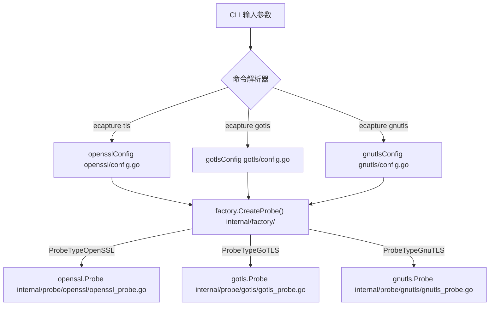
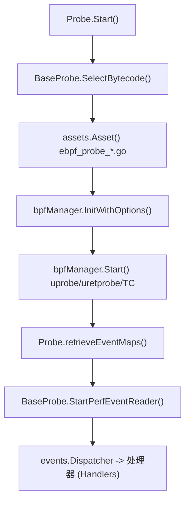

# 选择 TLS 探针

相关源码文件

以下文件被用作生成此维基页面的上下文：

- [AGENTS.md](https://github.com/gojue/ecapture/blob/8c9caada/AGENTS.md)
- [cli/cmd/gnutls.go](https://github.com/gojue/ecapture/blob/8c9caada/cli/cmd/gnutls.go)
- [cli/cmd/gotls.go](https://github.com/gojue/ecapture/blob/8c9caada/cli/cmd/gotls.go)
- [cli/cmd/nss.go](https://github.com/gojue/ecapture/blob/8c9caada/cli/cmd/nss.go)
- [cli/cmd/root.go](https://github.com/gojue/ecapture/blob/8c9caada/cli/cmd/root.go)
- [cli/cmd/tls.go](https://github.com/gojue/ecapture/blob/8c9caada/cli/cmd/tls.go)
- [docs/agent/architecture.md](https://github.com/gojue/ecapture/blob/8c9caada/docs/agent/architecture.md)
- [docs/agent/build-test.md](https://github.com/gojue/ecapture/blob/8c9caada/docs/agent/build-test.md)
- [docs/agent/probe-development.md](https://github.com/gojue/ecapture/blob/8c9caada/docs/agent/probe-development.md)
- [internal/probe/gnutls/gnutls_probe.go](https://github.com/gojue/ecapture/blob/8c9caada/internal/probe/gnutls/gnutls_probe.go)
- [internal/probe/gotls/gotls_probe.go](https://github.com/gojue/ecapture/blob/8c9caada/internal/probe/gotls/gotls_probe.go)
- [internal/probe/openssl/openssl_probe.go](https://github.com/gojue/ecapture/blob/8c9caada/internal/probe/openssl/openssl_probe.go)

## 目的与范围

本页提供了一个技术对比和决策框架，用于选择合适的 eCapture TLS 探针（`tls`、`gotls` 或 `gnutls`）。选择正确的探针取决于目标应用程序底层的密码学库或语言运行时、操作系统平台（Linux 与 Android），以及期望的输出表示形式（`text`、`keylog` 或 `pcap`/`pcapng`）。

Sources: [cli/cmd/tls.go:29-48](https://github.com/gojue/ecapture/blob/8c9caada/cli/cmd/tls.go#L29-L48), [cli/cmd/gotls.go:28-43](https://github.com/gojue/ecapture/blob/8c9caada/cli/cmd/gotls.go#L28-L43), [cli/cmd/gnutls.go:33-49](https://github.com/gojue/ecapture/blob/8c9caada/cli/cmd/gnutls.go#L33-L49)

---

## 核心 TLS 探针决策矩阵

下表将应用程序运行时和二进制特征映射到正确的 eCapture CLI 子命令、内部探针工厂类型以及字节码目标。

| 目标应用栈 | 目标库 / 二进制文件 | 支持的版本 | 支持的平台 | CLI 命令 | 工厂探针类型 | 主要 eBPF 源码 |
| :--- | :--- | :--- | :--- | :--- | :--- | :--- |
| **OpenSSL / BoringSSL** | `libssl.so`, 静态二进制文件, Android Conscrypt (`libssl.so`) | OpenSSL 1.0.x, 1.1.x, 3.x+; BoringSSL | Linux (`x86_64`, `aarch64`, `loongarch64`), Android (`x86_64`, `aarch64`) | `ecapture tls` | `factory.ProbeTypeOpenSSL` | `kern/openssl*_kern.c`, `kern/boringssl*_kern.c` |
| **Go Native TLS** | Go 编译的 ELF 二进制文件 (`crypto/tls`) | Go 1.17 – Go 1.26+ (v1/v2 ABI 探测) | Linux (`x86_64`, `aarch64`, `loongarch64`), Android (`x86_64`, `aarch64`) | `ecapture gotls` | `factory.ProbeTypeGoTLS` | `kern/gotls_kern.c` |
| **GnuTLS** | `libgnutls.so` | GnuTLS 3.6.x, 3.7.x, 3.8.x | Linux (`x86_64`, `aarch64`, `loongarch64`), Android Termux (`aarch64`) | `ecapture gnutls` | `factory.ProbeTypeGnuTLS` | `kern/gnutls_*_kern.c` |

Sources: [cli/cmd/tls.go:29-61](https://github.com/gojue/ecapture/blob/8c9caada/cli/cmd/tls.go#L29-L61), [cli/cmd/gotls.go:28-55](https://github.com/gojue/ecapture/blob/8c9caada/cli/cmd/gotls.go#L28-L55), [cli/cmd/gnutls.go:33-60](https://github.com/gojue/ecapture/blob/8c9caada/cli/cmd/gnutls.go#L33-L60), [docs/agent/architecture.md:37-49](https://github.com/gojue/ecapture/blob/8c9caada/docs/agent/architecture.md#L37-L49)

---

## 探针选择架构

下图将自然语言的选择标准桥接到 CLI 解析器、工厂注册表和探针初始化包中的具体代码实体。

Sources: [cli/cmd/tls.go:26-48](https://github.com/gojue/ecapture/blob/8c9caada/cli/cmd/tls.go#L26-L48), [cli/cmd/gotls.go:26-43](https://github.com/gojue/ecapture/blob/8c9caada/cli/cmd/gotls.go#L26-L43), [cli/cmd/gnutls.go:29-49](https://github.com/gojue/ecapture/blob/8c9caada/cli/cmd/gnutls.go#L29-L49), [internal/probe/openssl/openssl_probe.go:44-69](https://github.com/gojue/ecapture/blob/8c9caada/internal/probe/openssl/openssl_probe.go#L44-L69), [internal/probe/gotls/gotls_probe.go:52-78](https://github.com/gojue/ecapture/blob/8c9caada/internal/probe/gotls/gotls_probe.go#L52-L78), [internal/probe/gnutls/gnutls_probe.go:39-55](https://github.com/gojue/ecapture/blob/8c9caada/internal/probe/gnutls/gnutls_probe.go#L39-L55)

---

## 初始化与数据流

一旦调用探针命令，eCapture 会验证配置，通过 `BaseProbe` 选择匹配的字节码资产，并将 eBPF map 绑定到事件解码器。

Sources: [internal/probe/openssl/openssl_probe.go:102-163](https://github.com/gojue/ecapture/blob/8c9caada/internal/probe/openssl/openssl_probe.go#L102-L163), [internal/probe/gotls/gotls_probe.go:107-157](https://github.com/gojue/ecapture/blob/8c9caada/internal/probe/gotls/gotls_probe.go#L107-L157), [internal/probe/gnutls/gnutls_probe.go:80-117](https://github.com/gojue/ecapture/blob/8c9caada/internal/probe/gnutls/gnutls_probe.go#L80-L117), [docs/agent/architecture.md:7-26](https://github.com/gojue/ecapture/blob/8c9caada/docs/agent/architecture.md#L7-L26)

---

## 探针详细概况

### 1. OpenSSL 与 BoringSSL 探针 (`tls`)
* **使用场景**：动态或静态链接到 OpenSSL（如 Nginx、cURL、Python、Node.js、PHP）或 Google BoringSSL（Android 系统应用、Chrome）的应用程序。
* **关键标志位**：使用 `--libssl` 指定自定义库路径 [cli/cmd/tls.go:51](https://github.com/gojue/ecapture/blob/8c9caada/cli/cmd/tls.go#L51)；使用 `--ssl_version` 针对特定的 ABI 偏移量 [cli/cmd/tls.go:57](https://github.com/gojue/ecapture/blob/8c9caada/cli/cmd/tls.go#L57)；使用 `-m text|keylog|pcap` 选择输出模式 [cli/cmd/tls.go:53](https://github.com/gojue/ecapture/blob/8c9caada/cli/cmd/tls.go#L53)。
* **实现细节**：将 uprobe 挂载到 SSL 写入/读取的入口/出口函数（例如 `SSL_write`, `SSL_read`），或 BoringSSL 内部的主密钥日志记录函数。

Sources: [cli/cmd/tls.go:29-61](https://github.com/gojue/ecapture/blob/8c9caada/cli/cmd/tls.go#L29-L61), [internal/probe/openssl/openssl_probe.go:44-69](https://github.com/gojue/ecapture/blob/8c9caada/internal/probe/openssl/openssl_probe.go#L44-L69)

### 2. GoTLS 捕获探针 (`gotls`)
* **使用场景**：使用 Go 标准库 `crypto/tls` 包编译的 Go 二进制文件。不依赖于 OpenSSL。
* **关键标志位**：使用 `--elfpath` (`-e`) 指向目标 Go 二进制文件，以便进行符号和寄存器 ABI 探测 [cli/cmd/gotls.go:46](https://github.com/gojue/ecapture/blob/8c9caada/cli/cmd/gotls.go#L46)；使用 `--perf-reorder` 进行高吞吐量排序 [cli/cmd/gotls.go:47](https://github.com/gojue/ecapture/blob/8c9caada/cli/cmd/gotls.go#L47)。
* **实现细节**：解析 Go 内部函数符号，如 `crypto/tls.(*Conn).Read`、`crypto/tls.(*Conn).writeRecordLocked` 和 `crypto/tls.(*Config).writeKeyLog` [internal/probe/gotls/gotls_probe.go:47-50](https://github.com/gojue/ecapture/blob/8c9caada/internal/probe/gotls/gotls_probe.go#L47-L50)。

Sources: [cli/cmd/gotls.go:28-55](https://github.com/gojue/ecapture/blob/8c9caada/cli/cmd/gotls.go#L28-L55), [internal/probe/gotls/gotls_probe.go:46-68](https://github.com/gojue/ecapture/blob/8c9caada/internal/probe/gotls/gotls_probe.go#L46-L68)

### 3. GnuTLS 捕获探针 (`gnutls`)
* **使用场景**：针对 GnuTLS 库编译的应用程序（在企业级 Linux 发行版和 Android 的 Termux 中很常见）。
* **关键标志位**：使用 `--gnutls` 指定 `libgnutls.so` 路径 [cli/cmd/gnutls.go:52](https://github.com/gojue/ecapture/blob/8c9caada/cli/cmd/gnutls.go#L52)；使用 `--ssl_version` 进行 GnuTLS 版本映射 [cli/cmd/gnutls.go:57](https://github.com/gojue/ecapture/blob/8c9caada/cli/cmd/gnutls.go#L57)。
* **实现细节**：将 uprobe 挂载到 `libgnutls.so` 中的 `gnutls_record_send` 和 `gnutls_record_recv` 函数 [internal/probe/gnutls/gnutls_probe.go:211-212](https://github.com/gojue/ecapture/blob/8c9caada/internal/probe/gnutls/gnutls_probe.go#L211-L212)。

Sources: [cli/cmd/gnutls.go:33-60](https://github.com/gojue/ecapture/blob/8c9caada/cli/cmd/gnutls.go#L33-L60), [internal/probe/gnutls/gnutls_probe.go:39-55](https://github.com/gojue/ecapture/blob/8c9caada/internal/probe/gnutls/gnutls_probe.go#L39-L55)