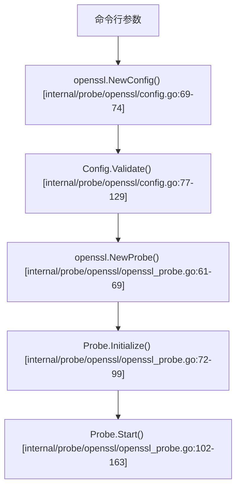
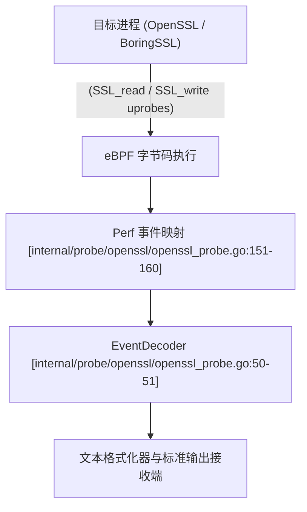

# 初探 OpenSSL 与 BoringSSL 捕获

<details>
<summary>相关源文件</summary>

以下文件被用作生成此维基页面的上下文：

- [internal/probe/gotls/gotls_probe.go](https://github.com/gojue/ecapture/blob/8c9caada/internal/probe/gotls/gotls_probe.go)
- [internal/probe/openssl/config.go](https://github.com/gojue/ecapture/blob/8c9caada/internal/probe/openssl/config.go)
- [internal/probe/openssl/config_ecandroid.go](https://github.com/gojue/ecapture/blob/8c9caada/internal/probe/openssl/config_ecandroid.go)
- [internal/probe/openssl/config_ecandroid_test.go](https://github.com/gojue/ecapture/blob/8c9caada/internal/probe/openssl/config_ecandroid_test.go)
- [internal/probe/openssl/config_test.go](https://github.com/gojue/ecapture/blob/8c9caada/internal/probe/openssl/config_test.go)
- [internal/probe/openssl/openssl_probe.go](https://github.com/gojue/ecapture/blob/8c9caada/internal/probe/openssl/openssl_probe.go)
- [test/e2e/common.sh](https://github.com/gojue/ecapture/blob/8c9caada/test/e2e/common.sh)
- [test/e2e/gnutls_e2e_test.sh](https://github.com/gojue/ecapture/blob/8c9caada/test/e2e/gnutls_e2e_test.sh)
- [test/e2e/go_https_client.go](https://github.com/gojue/ecapture/blob/8c9caada/test/e2e/go_https_client.go)
- [test/e2e/gotls_e2e_test.sh](https://github.com/gojue/ecapture/blob/8c9caada/test/e2e/gotls_e2e_test.sh)
- [test/e2e/tls_e2e_test.sh](https://github.com/gojue/ecapture/blob/8c9caada/test/e2e/tls_e2e_test.sh)

</details>

## 目的与范围

本页面提供了一个经过验证的端到端演练，介绍如何使用 `ecapture` 的文本模式从 OpenSSL 和 BoringSSL 共享库中捕获 TLS 明文事件。内容涵盖了命令执行、流量生成、预期输出结构，以及进阶的密钥日志（keylog）和 pcapng 工作流引用。

Sources: [internal/probe/openssl/openssl_probe.go:44-69](https://github.com/gojue/ecapture/blob/8c9caada/internal/probe/openssl/openssl_probe.go#L44-L69), [internal/probe/openssl/config.go:43-74](https://github.com/gojue/ecapture/blob/8c9caada/internal/probe/openssl/config.go#L43-L74)

---

## 环境要求与安装

在运行首次 OpenSSL 捕获之前，请确认您的环境符合核心要求：
- **操作系统与内核**：Linux 内核版本 4.18 或更高，且已启用 BTF (BPF Type Format) 支持。
- **权限**：需要 Root 权限（或 `CAP_SYS_ADMIN` / `CAP_BPF` 能力）以加载 eBPF 程序并挂载 uprobes。
- **目标应用**：链接了 OpenSSL (`libssl.so.1.1`, `libssl.so.3`) 或 BoringSSL（Android 或嵌入式环境中的 `libssl.so`）的动态二进制文件或服务。

Sources: [test/e2e/common.sh:32-59](https://github.com/gojue/ecapture/blob/8c9caada/test/e2e/common.sh#L32-L59)

---

## 验证通过的端到端文本模式命令

默认情况下，`ecapture tls` 以文本模式 (`-m text`) 运行，通过拦截 `SSL_read` 和 `SSL_write` 函数调用，将解码后的明文 HTTP 或应用负载打印到标准输出。

### 1. 启动 eCapture

使用 root 权限运行以下命令。如有必要，可以指定目标 OpenSSL/BoringSSL 库路径，或者让 `ecapture` 自动检测：

```bash
sudo ./bin/ecapture tls -m text
```

如果针对特定的库路径或接口（特别是在 Android / BoringSSL 环境下），请提供显式的路径标志：

```bash
sudo ./bin/ecapture tls -m text --libssl /usr/lib/x86_64-linux-gnu/libssl.so.3
```

### 探针配置与初始化架构

下图展示了配置选项是如何验证的，以及 OpenSSL 探针如何初始化其 eBPF 管理器和执行上下文：


Sources: [internal/probe/openssl/config.go:69-129](https://github.com/gojue/ecapture/blob/8c9caada/internal/probe/openssl/config.go#L69-L129), [internal/probe/openssl/openssl_probe.go:61-163](https://github.com/gojue/ecapture/blob/8c9caada/internal/probe/openssl/openssl_probe.go#L61-L163)

---

## 流量生成与执行

在 `ecapture` 监听期间，使用 `curl` 或测试客户端向外部或本地端点生成 HTTPS 流量：

```bash
curl -Iv https://www.cloudflare.com/
```

### 事件捕获与解码流水线

当目标进程执行 TLS 握手和数据交换时，eBPF uprobes 会捕获加密缓冲区，并通过 perf event maps 将其转发给用户态解码器：


Sources: [internal/probe/openssl/openssl_probe.go:50-60](https://github.com/gojue/ecapture/blob/8c9caada/internal/probe/openssl/openssl_probe.go#L50-L60), [internal/probe/openssl/openssl_probe.go:151-160](https://github.com/gojue/ecapture/blob/8c9caada/internal/probe/openssl/openssl_probe.go#L151-L160)

---

## 预期事件输出

当匹配的 TLS 连接传输数据时，`ecapture` 会输出结构化的事件日志，包含时间戳、进程 ID、连接元组以及解码后的明文负载：

```text
2026-03-30T12:00:00.123Z [INFO] [openssl] PID: 12345, TID: 12345, IP: 192.168.1.10:54321 -> 104.16.123.96:443
GET / HTTP/1.1
Host: www.cloudflare.com
User-Agent: curl/7.88.1
Accept: */*

2026-03-30T12:00:00.456Z [INFO] [openssl] PID: 12345, TID: 12345, IP: 192.168.1.10:54321 -> 104.16.123.96:443
HTTP/1.1 200 OK
Date: Mon, 30 Mar 2026 12:00:00 GMT
Content-Type: text/html; charset=UTF-8
```

Sources: [internal/probe/openssl/openssl_probe.go:102-163](https://github.com/gojue/ecapture/blob/8c9caada/internal/probe/openssl/openssl_probe.go#L102-L163)

---

## 进阶工作流链接

验证文本模式捕获后，您可以根据分析需求切换到其他操作模式：
- **密钥日志模式 (Keylog)**：使用 `-m keylog` 将 NSS 密钥日志行导出到磁盘，供外部数据包分析器使用（参见 [密钥日志模式 (Keylog)](../3-capture-modes/3.3-keylog-mode.md)）。
- **pcapng 模式**：使用 `-m pcap` 或 `-m pcapng` 捕获带有嵌入式 TLS 解密密钥块的网络数据包（参见 [pcapng 模式](../3-capture-modes/3.4-pcapng-mode.md)）。

Sources: [internal/probe/openssl/config.go:139-178](https://github.com/gojue/ecapture/blob/8c9caada/internal/probe/openssl/config.go#L139-L178)