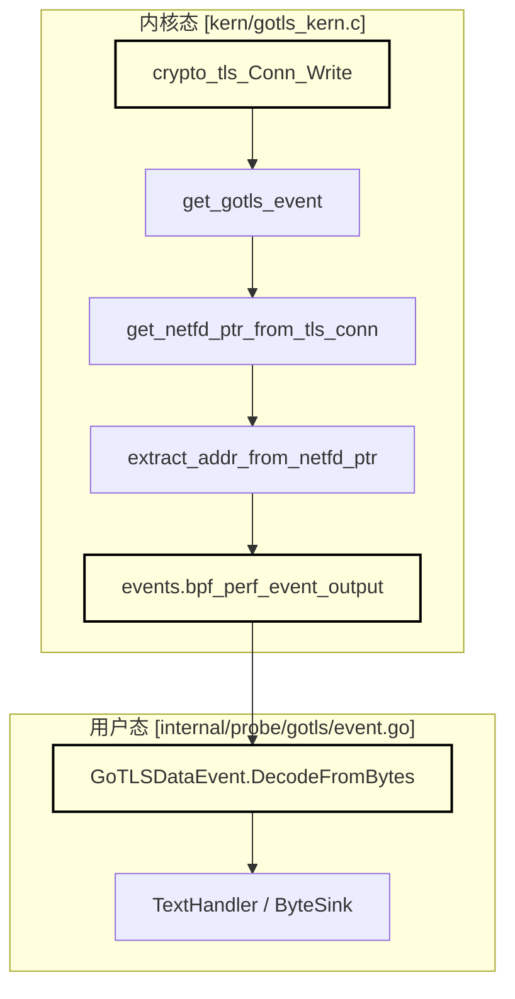
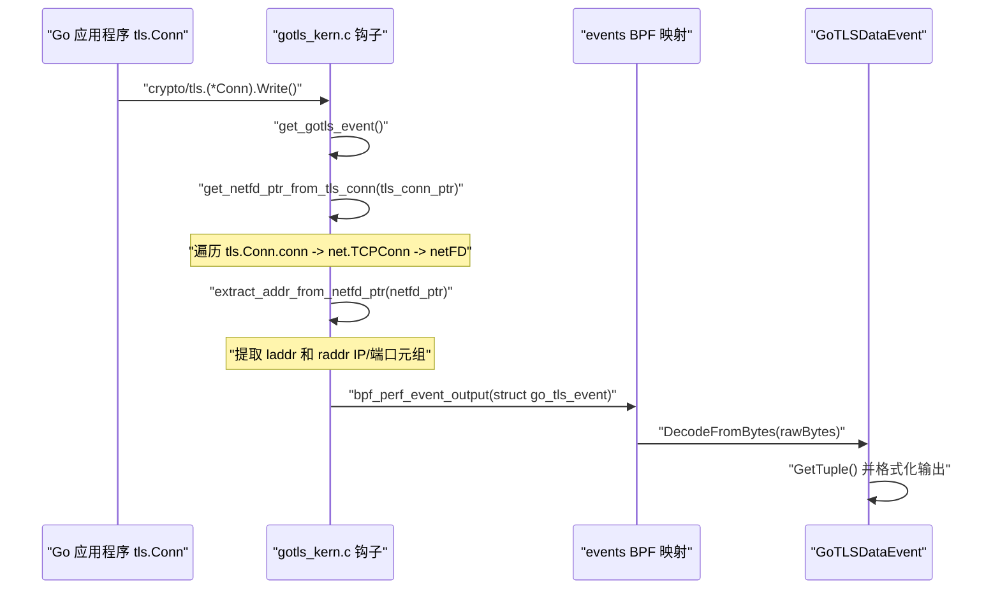

# 初探 GoTLS 捕获

<details>
<summary>相关源码文件</summary>

以下文件被用作生成此维基页面的上下文：

- [internal/probe/gotls/event.go](https://github.com/gojue/ecapture/blob/8c9caada/internal/probe/gotls/event.go)
- [internal/probe/gotls/event_test.go](https://github.com/gojue/ecapture/blob/8c9caada/internal/probe/gotls/event_test.go)
- [kern/go_argument.h](https://github.com/gojue/ecapture/blob/8c9caada/kern/go_argument.h)
- [kern/gotls_kern.c](https://github.com/gojue/ecapture/blob/8c9caada/kern/gotls_kern.c)
- [kern/include/openssl_masterkey_common.h](https://github.com/gojue/ecapture/blob/8c9caada/kern/include/openssl_masterkey_common.h)
- [kern/include/tls_constants.h](https://github.com/gojue/ecapture/blob/8c9caada/kern/include/tls_constants.h)
- [test/e2e/README.md](https://github.com/gojue/ecapture/blob/8c9caada/test/e2e/README.md)
- [test/e2e/fixtures/pcapng_check/main.go](https://github.com/gojue/ecapture/blob/8c9caada/test/e2e/fixtures/pcapng_check/main.go)
- [test/e2e/lib/testlib.sh](https://github.com/gojue/ecapture/blob/8c9caada/test/e2e/lib/testlib.sh)
- [test/e2e/linux/common.sh](https://github.com/gojue/ecapture/blob/8c9caada/test/e2e/linux/common.sh)
- [test/e2e/linux/gnutls_test.sh](https://github.com/gojue/ecapture/blob/8c9caada/test/e2e/linux/gnutls_test.sh)
- [test/e2e/linux/gotls_test.sh](https://github.com/gojue/ecapture/blob/8c9caada/test/e2e/linux/gotls_test.sh)
- [test/e2e/linux/tls_test.sh](https://github.com/gojue/ecapture/blob/8c9caada/test/e2e/linux/tls_test.sh)

</details>

## 目的与范围

本页面提供了一个经过验证的端到端指南，介绍如何使用 eCapture 的 `gotls` 模块以文本模式捕获 Go 原生二进制程序的 TLS 流量。与依赖动态共享库（`libssl.so` 或 `libgnutls.so`）的 OpenSSL 或 GnuTLS 不同，Go 应用程序静态链接其自身的 TLS 栈（`crypto/tls`），并使用自定义的调用约定和内部数据结构。

本指南涵盖了目标二进制文件选择、必要的命令行参数（`--elfpath`、`-m text`、`--eventaddr`、`--logaddr`）、预期的事件负载结构，以及向密钥日志（keylog）和 pcapng 工作流的转换 [test/e2e/linux/gotls_test.sh:53-129](https://github.com/gojue/ecapture/blob/8c9caada/test/e2e/linux/gotls_test.sh#L53-L129)。

Sources: [test/e2e/linux/gotls_test.sh:53-129](https://github.com/gojue/ecapture/blob/8c9caada/test/e2e/linux/gotls_test.sh#L53-L129)

---

## 目标二进制文件准备与环境要求

在调用 `gotls` 探针之前，请确保您的目标 Go 应用程序满足以下标准：
1. **ELF 二进制路径**：eCapture 需要通过 `--elfpath` 或目标进程 ID（`--pid`）访问 Go 二进制的 ELF 文件，以解析 `crypto/tls.(*Conn).Read` 和 `crypto/tls.(*Conn).Write` 的符号表和函数偏移量。
2. **符号表**：缺少 Go 符号表（`go.itab` 或函数名）的已剥离（stripped）二进制文件可能需要恢复符号，或指向未剥离的编译产物。
3. **内核与权限**：需要 Linux 内核 4.18+ (x86_64) 或 5.5+ (ARM64) 且支持 BTF，并以 root 权限（`sudo`）运行 [test/e2e/linux/common.sh:30-47](https://github.com/gojue/ecapture/blob/8c9caada/test/e2e/linux/common.sh#L30-L47)。

Sources: [test/e2e/linux/common.sh:30-47](https://github.com/gojue/ecapture/blob/8c9caada/test/e2e/linux/common.sh#L30-L47), [test/e2e/linux/gotls_test.sh:53-70](https://github.com/gojue/ecapture/blob/8c9caada/test/e2e/linux/gotls_test.sh#L53-L70)

---

## 经验证的端到端 GoTLS 文本模式命令

要以文本模式捕获 Go HTTPS 客户端或服务器的明文事件，请执行以下经过验证的命令 [test/e2e/linux/gotls_test.sh:57-70](https://github.com/gojue/ecapture/blob/8c9caada/test/e2e/linux/gotls_test.sh#L57-L70)：

```bash
sudo ./bin/ecapture gotls \
    --elfpath /path/to/go_https_client \
    --model text \
    --eventaddr ./gotls_events.log \
    --logaddr ./gotls_operational.log
```

### 参数参考
- `gotls`：选择 Go 原生 TLS 捕获模块。
- `--elfpath`：指定包含 `crypto/tls` 符号的已编译 Go 可执行文件的路径 [test/e2e/linux/gotls_test.sh:57](https://github.com/gojue/ecapture/blob/8c9caada/test/e2e/linux/gotls_test.sh#L57)。
- `-m text`（或 `--model text`）：选择文本表示形式，将解码后的明文记录流式传输到指定的输出 [test/e2e/linux/gotls_test.sh:57](https://github.com/gojue/ecapture/blob/8c9caada/test/e2e/linux/gotls_test.sh#L57)。
- `--eventaddr`：将捕获的明文数据事件路由到文件、标准输出或网络接收端 [test/e2e/linux/gotls_test.sh:57](https://github.com/gojue/ecapture/blob/8c9caada/test/e2e/linux/gotls_test.sh#L57)。
- `--logaddr`：将操作生命周期日志（初始化、挂载状态、错误）与事件负载分开输出，确保输出隔离 [test/e2e/linux/gotls_test.sh:57](https://github.com/gojue/ecapture/blob/8c9caada/test/e2e/linux/gotls_test.sh#L57)。

Sources: [test/e2e/linux/gotls_test.sh:57-70](https://github.com/gojue/ecapture/blob/8c9caada/test/e2e/linux/gotls_test.sh#L57-L70)

---

## 预期事件结构与输出

当 Go 应用程序执行 TLS 读取或写入时，eBPF 内核探针会捕获原始缓冲区，从 `net.netFD` 结构中解析底层的网络文件描述符（`fd`）、源/目的 IP 地址及端口，并将 `go_tls_event` 结构推送到用户态 [kern/gotls_kern.c:33-50](https://github.com/gojue/ecapture/blob/8c9caada/kern/gotls_kern.c#L33-L50)，[kern/gotls_kern.c:110-187](https://github.com/gojue/ecapture/blob/8c9caada/kern/gotls_kern.c#L110-L187)。

### 输出记录示例
```json
{
  "timestamp": 1711900000000000000,
  "pid": 1234,
  "tid": 1235,
  "dataLen": 79,
  "eventType": 0,
  "fd": 7,
  "srcIP": "127.0.0.1",
  "srcPort": 54321,
  "dstIP": "127.0.0.1",
  "dstPort": 8443,
  "ipVersion": 4,
  "comm": "go_https_client",
  "data": "GET /e2e HTTP/1.1\r\nHost: 127.0.0.1:8443\r\nUser-Agent: Go-http-client/1.1\r\n\r\n",
  "tuple": "127.0.0.1:54321-127.0.0.1:8443"
}
```

Sources: [kern/gotls_kern.c:33-50](https://github.com/gojue/ecapture/blob/8c9caada/kern/gotls_kern.c#L33-L50), [internal/probe/gotls/event.go:54-74](https://github.com/gojue/ecapture/blob/8c9caada/internal/probe/gotls/event.go#L54-L74)

---

## 架构与数据流

下图展示了 GoTLS 拦截如何连接内核态 eBPF 探针与用户态解码组件：

标题："GoTLS 内核到用户态数据流"

Sources: [kern/gotls_kern.c:33-187](https://github.com/gojue/ecapture/blob/8c9caada/kern/gotls_kern.c#L33-L187), [internal/probe/gotls/event.go:77-153](https://github.com/gojue/ecapture/blob/8c9caada/internal/probe/gotls/event.go#L77-L153)

---

## 执行控制流

以下序列详细说明了内核探针如何检查 Go 内部的 `tls.Conn` 对象布局，以提取连接元组和明文负载：

标题："GoTLS 连接与地址提取序列"

Sources: [kern/gotls_kern.c:110-187](https://github.com/gojue/ecapture/blob/8c9caada/kern/gotls_kern.c#L110-L187), [internal/probe/gotls/event.go:77-153](https://github.com/gojue/ecapture/blob/8c9caada/internal/probe/gotls/event.go#L77-L153)

---

## 转换到密钥日志与 pcapng 工作流

一旦验证了文本模式捕获，您可以使用 `-m` 参数切换展示模型，而无需更改目标配置：

1. **密钥日志模式 (`-m keylog`)**：提取 TLS 主密钥（master secrets）或流量密钥，并以 NSS Key Log 格式写入。这允许使用独立的抓包工具（`tcpdump` 或 `tshark`）进行离线流量解密 [test/e2e/linux/gotls_test.sh:72-108](https://github.com/gojue/ecapture/blob/8c9caada/test/e2e/linux/gotls_test.sh#L72-L108)。
2. **pcapng 模式 (`-m pcapng`)**：自动将指定接口（`--ifname lo`）上的数据包捕获与捕获的 TLS 密钥相结合，并将其嵌入到带有 TLS 解密密钥块 (DSB) 的 `pcapng` 文件中 [test/e2e/linux/gotls_test.sh:110-129](https://github.com/gojue/ecapture/blob/8c9caada/test/e2e/linux/gotls_test.sh#L110-L129)。

Sources: [test/e2e/linux/gotls_test.sh:72-129](https://github.com/gojue/ecapture/blob/8c9caada/test/e2e/linux/gotls_test.sh#L72-L129), [test/e2e/README.md:30-38](https://github.com/gojue/ecapture/blob/8c9caada/test/e2e/README.md#L30-L38)