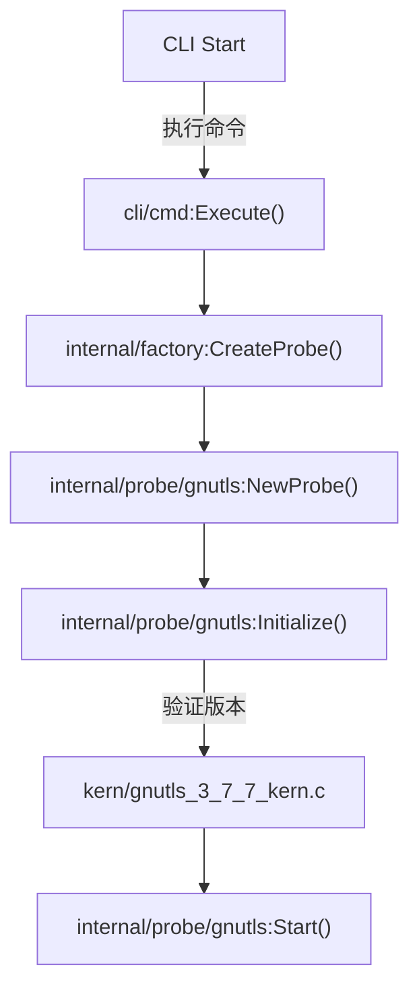
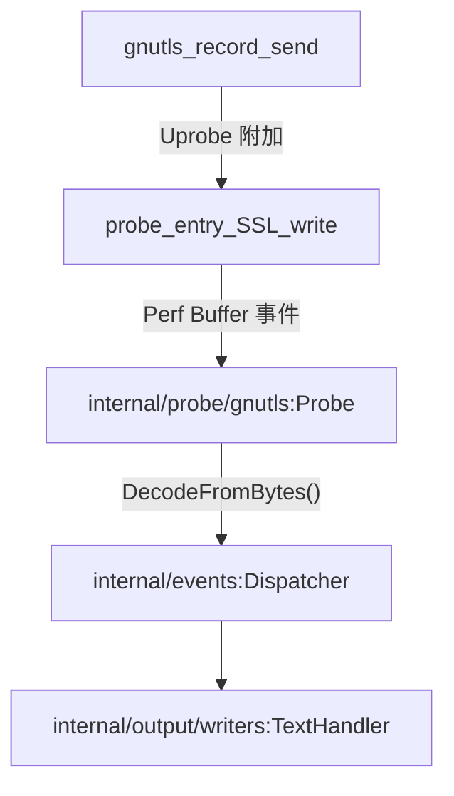

# 初探 GnuTLS 捕获

<details>
<summary>相关源文件</summary>

以下文件被用作生成此维基页面的上下文：

- [AGENTS.md](https://github.com/gojue/ecapture/blob/8c9caada/AGENTS.md)
- [docs/agent/architecture.md](https://github.com/gojue/ecapture/blob/8c9caada/docs/agent/architecture.md)
- [docs/agent/build-test.md](https://github.com/gojue/ecapture/blob/8c9caada/docs/agent/build-test.md)
- [docs/agent/probe-development.md](https://github.com/gojue/ecapture/blob/8c9caada/docs/agent/probe-development.md)
- [internal/probe/gnutls/gnutls_probe.go](https://github.com/gojue/ecapture/blob/8c9caada/internal/probe/gnutls/gnutls_probe.go)
- [internal/probe/gnutls/gnutls_probe_test.go](https://github.com/gojue/ecapture/blob/8c9caada/internal/probe/gnutls/gnutls_probe_test.go)
- [kern/gnutls_3_6_12_kern.c](https://github.com/gojue/ecapture/blob/8c9caada/kern/gnutls_3_6_12_kern.c)
- [kern/gnutls_3_7_0_kern.c](https://github.com/gojue/ecapture/blob/8c9caada/kern/gnutls_3_7_0_kern.c)
- [kern/gnutls_3_7_3_kern.c](https://github.com/gojue/ecapture/blob/8c9caada/kern/gnutls_3_7_3_kern.c)
- [kern/gnutls_3_7_7_kern.c](https://github.com/gojue/ecapture/blob/8c9caada/kern/gnutls_3_7_7_kern.c)
- [kern/gnutls_3_8_4_kern.c](https://github.com/gojue/ecapture/blob/8c9caada/kern/gnutls_3_8_4_kern.c)
- [kern/gnutls_3_8_7_kern.c](https://github.com/gojue/ecapture/blob/8c9caada/kern/gnutls_3_8_7_kern.c)
- [utils/gnutls_offset.c](https://github.com/gojue/ecapture/blob/8c9caada/utils/gnutls_offset.c)

</details>

## 目的与范围

本页提供了一个经过验证的端到端教程，介绍如何使用 `ecapture` 的 `gnutls` 模块，从动态链接到 GnuTLS 的应用程序中捕获 TLS 明文事件。内容涵盖了目标库发现、版本兼容性验证、文本模式命令执行、预期的明文输出，以及到密钥日志 (keylog) 和 pcapng 工作流的交叉引用。

Sources: [docs/agent/architecture.md](https://github.com/gojue/ecapture/blob/8c9caada/docs/agent/architecture.md), [internal/probe/gnutls/gnutls_probe.go](https://github.com/gojue/ecapture/blob/8c9caada/internal/probe/gnutls/gnutls_probe.go)

---

## 前置条件与目标发现

在运行 GnuTLS 捕获之前，必须在 Linux 系统上定位目标共享库（例如 `libgnutls.so`）并验证其版本。GnuTLS 依赖于编译到 eBPF 字节码对象中的硬编码结构偏移映射，这些映射对应于特定的次要版本和补丁版本（如 `3.6.12`、`3.7.3`、`3.7.7`、`3.8.4` 和 `3.8.7`）。

1. **定位库文件**：使用 `ldconfig` 或包管理器查找 `libgnutls.so` 的绝对路径：
   ```sh
   ldconfig -p | grep gnutls
   ```
   典型路径包括 `/usr/lib/x86_64-linux-gnu/libgnutls.so.30` 或 `/usr/lib64/libgnutls.so`。

2. **验证版本兼容性**：使用 `pkg-config` 或库查询检查您的 GnuTLS 版本：
   ```sh
   pkg-config --modversion gnutls
   ```
   确保该版本与 `kern/` 中支持的字节码定义之一相匹配。

Sources: [docs/agent/build-test.md](https://github.com/gojue/ecapture/blob/8c9caada/docs/agent/build-test.md), [internal/probe/gnutls/gnutls_probe.go](https://github.com/gojue/ecapture/blob/8c9caada/internal/probe/gnutls/gnutls_probe.go)

---

## 验证过的端到端文本模式命令

文本模式 (`-m text`) 将 uprobe 附加到 GnuTLS 记录层函数（`gnutls_record_send` 和 `gnutls_record_recv`），拦截缓冲区，并将解码后的明文事件直接输出到标准输出。

### 命令执行

以 root 权限运行 `ecapture`，指定目标 GnuTLS 库路径、检测到的版本以及文本捕获模式：

```sh
sudo ./bin/ecapture gnutls --libgnutls /usr/lib/x86_64-linux-gnu/libgnutls.so.30 --gversion 3.7.7 -m text
```

### 预期事件输出

当目标应用程序（如 `gnutls-cli` 或自定义客户端）执行 TLS 握手并交换数据时，`ecapture` 会将结构化事件记录打印到 stdout：

```text
2/4 [I] time="202X-XX-XXTTT:HH:MM:SSZ" level=info msg="GnuTLS probe started successfully"
2/4 [I] event type: 3, PID: 12345, TID: 12345, UID: 0, Comm: gnutls-cli
2/4 [I] Plaintext Read/Write (Length: 51):
GET / HTTP/1.1
Host: example.com
User-Agent: GnuTLS
```

Sources: [internal/probe/gnutls/gnutls_probe.go](https://github.com/gojue/ecapture/blob/8c9caada/internal/probe/gnutls/gnutls_probe.go)

---

## 转向密钥日志 (Keylog) 与 pcapng 工作流

一旦您验证了明文捕获，就可以根据您的分析需求切换输出表现形式：

* **密钥日志模式 (Keylog Mode) (`-m keylog`)**：提取 NSS 密钥日志格式的 TLS 会话密钥和主密钥，允许 `wireshark` 或 `tcpdump` 等独立的数据包捕获工具解密记录的流量。
* **pcapng 模式 (`-m pcap` 或 `-m pcapng`)**：通过流量控制 (TC) 钩子捕获网络数据包，同时将 TLS 解密密钥块直接嵌入到生成的 `pcapng` 文件中，以便在 Wireshark 中实现开箱即用的解密。

Sources: [docs/agent/architecture.md](https://github.com/gojue/ecapture/blob/8c9caada/docs/agent/architecture.md), [internal/probe/gnutls/gnutls_probe.go](https://github.com/gojue/ecapture/blob/8c9caada/internal/probe/gnutls/gnutls_probe.go)

---

## 实现与数据流架构

以下图表将自然语言操作空间与 `internal/probe/gnutls` 包及 C 内核资产中的具体代码实体联系起来。

### 初始化流程


Sources: [internal/probe/gnutls/gnutls_probe.go](https://github.com/gojue/ecapture/blob/8c9caada/internal/probe/gnutls/gnutls_probe.go), [docs/agent/architecture.md](https://github.com/gojue/ecapture/blob/8c9caada/docs/agent/architecture.md)

### 数据路径与事件解码


Sources: [internal/probe/gnutls/gnutls_probe.go](https://github.com/gojue/ecapture/blob/8c9caada/internal/probe/gnutls/gnutls_probe.go), [docs/agent/architecture.md](https://github.com/gojue/ecapture/blob/8c9caada/docs/agent/architecture.md)