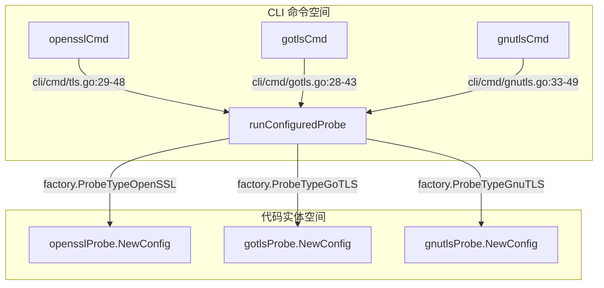
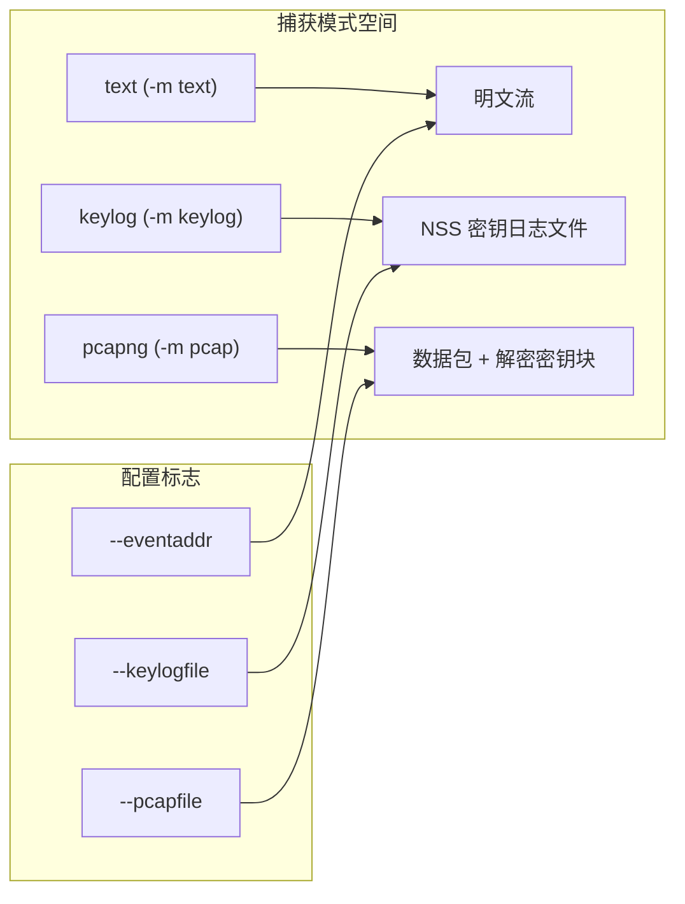

# 快速入门

相关源文件

以下文件被用作生成此维基页面的上下文：

- [CHANGELOG.md](https://github.com/gojue/ecapture/blob/8c9caada/CHANGELOG.md)
- [README-zh_Hans.md](https://github.com/gojue/ecapture/blob/8c9caada/README-zh_Hans.md)
- [README.md](https://github.com/gojue/ecapture/blob/8c9caada/README.md)
- [cli/cmd/gnutls.go](https://github.com/gojue/ecapture/blob/8c9caada/cli/cmd/gnutls.go)
- [cli/cmd/gotls.go](https://github.com/gojue/ecapture/blob/8c9caada/cli/cmd/gotls.go)
- [cli/cmd/nss.go](https://github.com/gojue/ecapture/blob/8c9caada/cli/cmd/nss.go)
- [cli/cmd/root.go](https://github.com/gojue/ecapture/blob/8c9caada/cli/cmd/root.go)
- [cli/cmd/tls.go](https://github.com/gojue/ecapture/blob/8c9caada/cli/cmd/tls.go)
- [main.go](https://github.com/gojue/ecapture/blob/8c9caada/main.go)

## 目的与范围
eCapture (旁观者) 是一款基于 eBPF 的工具，旨在捕获 SSL/TLS 明文通信、进行命令行审计并监控数据库查询，无需中间人 (MITM) 代理或安装自定义 CA 证书 [README.md:5-8](https://github.com/gojue/ecapture/blob/8c9caada/README.md#L5-L8), [README.md:59-67](https://github.com/gojue/ecapture/blob/8c9caada/README.md#L59-L67)。本入口将引导用户完成系统环境准备，选择合适的 TLS 捕获模块（`tls`、`gotls` 或 `gnutls`），并执行您的首次明文、密钥日志 (keylog) 或 pcapng 捕获工作流。

Sources: [README.md:5-8](https://github.com/gojue/ecapture/blob/8c9caada/README.md#L5-L8), [README.md:59-67](https://github.com/gojue/ecapture/blob/8c9caada/README.md#L59-L67)

---

### 标题：核心 TLS 命令路由至探针工厂

Sources: [cli/cmd/tls.go:29-48](https://github.com/gojue/ecapture/blob/8c9caada/cli/cmd/tls.go#L29-L48), [cli/cmd/gotls.go:28-43](https://github.com/gojue/ecapture/blob/8c9caada/cli/cmd/gotls.go#L28-L43), [cli/cmd/gnutls.go:33-49](https://github.com/gojue/ecapture/blob/8c9caada/cli/cmd/gnutls.go#L33-L49)

---

## 1.1 环境要求与安装
eCapture 支持 x86_64 (内核 4.18+)、aarch64 (内核 5.5+) 和 LoongArch64 (内核 6.6+) 架构的 Linux 系统，以及 x86_64 和 aarch64 架构的 Android 系统 [README.md:34-38](https://github.com/gojue/ecapture/blob/8c9caada/README.md#L34-L38)。运行需要 root 权限或特定的 Linux capabilities 以加载 eBPF 程序并挂载 uprobes/TC 分类器 [README.md:34-38](https://github.com/gojue/ecapture/blob/8c9caada/README.md#L34-L38)。有关内核 BTF 要求、权限配置和环境搭建的完整详情，请参阅 [环境要求与安装](1.1-requirements-and-installation.md)。

Sources: [README.md:34-38](https://github.com/gojue/ecapture/blob/8c9caada/README.md#L34-L38), [README.md:70-98](https://github.com/gojue/ecapture/blob/8c9caada/README.md#L70-L98)

---

## 1.2 选择 TLS 探针
根据您的目标应用技术栈，eCapture 提供了三个核心 TLS 捕获模块：
- **`tls`**: 针对 OpenSSL、LibreSSL 和 BoringSSL 共享库或静态链接的二进制文件 [README.md:131](https://github.com/gojue/ecapture/blob/8c9caada/README.md#L131), [cli/cmd/tls.go:29-32](https://github.com/gojue/ecapture/blob/8c9caada/cli/cmd/tls.go#L29-L32)。
- **`gotls`**: 针对使用 Go 原生 `crypto/tls` 包构建的 Go 二进制文件 [README.md:127](https://github.com/gojue/ecapture/blob/8c9caada/README.md#L127), [cli/cmd/gotls.go:28-32](https://github.com/gojue/ecapture/blob/8c9caada/cli/cmd/gotls.go#L28-L32)。
- **`gnutls`**: 针对链接到 GnuTLS 密码库的应用程序 [README.md:126](https://github.com/gojue/ecapture/blob/8c9caada/README.md#L126), [cli/cmd/gnutls.go:33-36](https://github.com/gojue/ecapture/blob/8c9caada/cli/cmd/gnutls.go#L33-L36)。

有关目标、库路径和输出能力的全面决策矩阵，请参阅 [选择 TLS 探针](1.2-choosing-a-tls-probe.md)。

Sources: [README.md:126-131](https://github.com/gojue/ecapture/blob/8c9caada/README.md#L126-L131), [cli/cmd/tls.go:29-32](https://github.com/gojue/ecapture/blob/8c9caada/cli/cmd/tls.go#L29-L32), [cli/cmd/gotls.go:28-32](https://github.com/gojue/ecapture/blob/8c9caada/cli/cmd/gotls.go#L28-L32), [cli/cmd/gnutls.go:33-36](https://github.com/gojue/ecapture/blob/8c9caada/cli/cmd/gnutls.go#L33-L36)

---

### 标题：输出流水线模式选择

Sources: [cli/cmd/tls.go:53-55](https://github.com/gojue/ecapture/blob/8c9caada/cli/cmd/tls.go#L53-L55), [cli/cmd/gotls.go:49-51](https://github.com/gojue/ecapture/blob/8c9caada/cli/cmd/gotls.go#L49-L51), [cli/cmd/gnutls.go:53-55](https://github.com/gojue/ecapture/blob/8c9caada/cli/cmd/gnutls.go#L53-L55)

---

## 1.3 初探 OpenSSL 与 BoringSSL 捕获
`tls` 命令会自动发现系统 OpenSSL 库，或通过 `--libssl` 接收显式路径 [README.md:136-139](https://github.com/gojue/ecapture/blob/8c9caada/README.md#L136-L139), [cli/cmd/tls.go:51](https://github.com/gojue/ecapture/blob/8c9caada/cli/cmd/tls.go#L51)。在文本模式下运行会直接在控制台打印解密后的 HTTPS 请求和响应 [README.md:106-116](https://github.com/gojue/ecapture/blob/8c9caada/README.md#L106-L116)。有关经过验证的端到端命令示例、流量生成器以及向密钥日志和 pcapng 工作流的转换，请参阅 [初探 OpenSSL 与 BoringSSL 捕获](1.3-first-openssl-and-boringssl-capture.md)。

Sources: [README.md:100-116](https://github.com/gojue/ecapture/blob/8c9caada/README.md#L100-L116), [cli/cmd/tls.go:29-51](https://github.com/gojue/ecapture/blob/8c9caada/cli/cmd/tls.go#L29-L51)

---

## 1.4 初探 GoTLS 捕获
`gotls` 命令通过 `--elfpath` 指定编译后的二进制路径来针对 Go 程序 [cli/cmd/gotls.go:46](https://github.com/gojue/ecapture/blob/8c9caada/cli/cmd/gotls.go#L46)。它通过 Hook Go 内部的 TLS 连接函数来提取明文流量 [README.md:127](https://github.com/gojue/ecapture/blob/8c9caada/README.md#L127)。有关经过验证的文本模式命令、必需标志、预期事件和高级输出绑定，请参阅 [初探 GoTLS 捕获](1.4-first-gotls-capture.md)。

Sources: [README.md:127](https://github.com/gojue/ecapture/blob/8c9caada/README.md#L127), [cli/cmd/gotls.go:28-46](https://github.com/gojue/ecapture/blob/8c9caada/cli/cmd/gotls.go#L28-L46)

---

## 1.5 初探 GnuTLS 捕获
`gnutls` 命令捕获与 GnuTLS 链接的应用程序的明文 [README.md:126](https://github.com/gojue/ecapture/blob/8c9caada/README.md#L126), [cli/cmd/gnutls.go:33-36](https://github.com/gojue/ecapture/blob/8c9caada/cli/cmd/gnutls.go#L33-L36)。它支持在 Linux 和 Termux/Android 环境下使用显式库路径 (`--gnutls`) 和版本指定符 (`--ssl_version`) [cli/cmd/gnutls.go:52-57](https://github.com/gojue/ecapture/blob/8c9caada/cli/cmd/gnutls.go#L52-L57)。有关完整说明、版本检查和输出示例，请参阅 [初探 GnuTLS 捕获](1.5-first-gnutls-capture.md)。

Sources: [README.md:126](https://github.com/gojue/ecapture/blob/8c9caada/README.md#L126), [cli/cmd/gnutls.go:33-57](https://github.com/gojue/ecapture/blob/8c9caada/cli/cmd/gnutls.go#L33-L57)